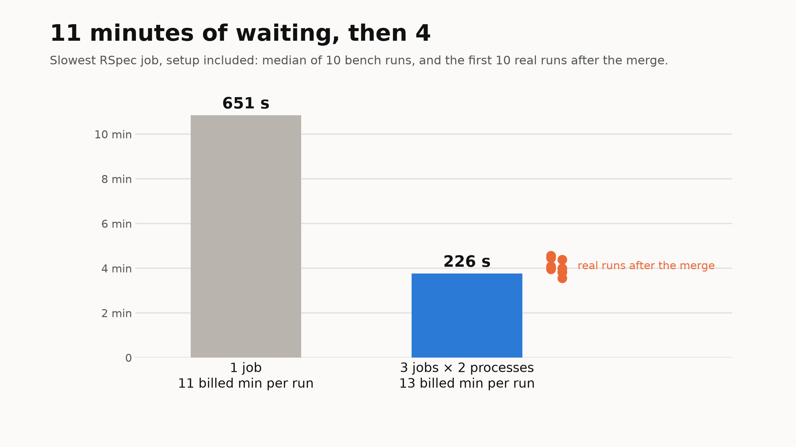
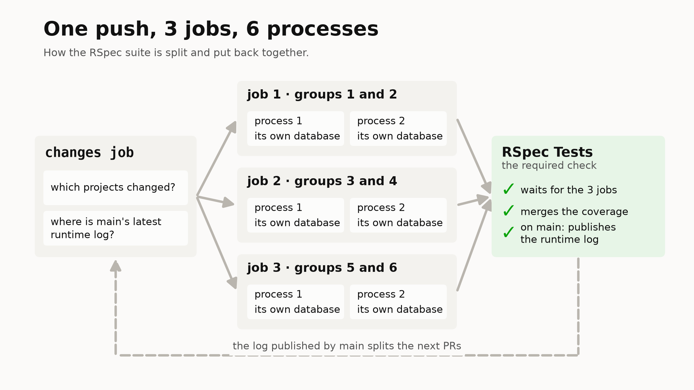
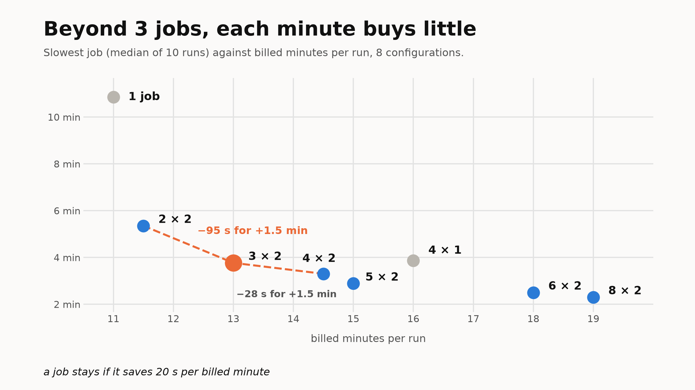
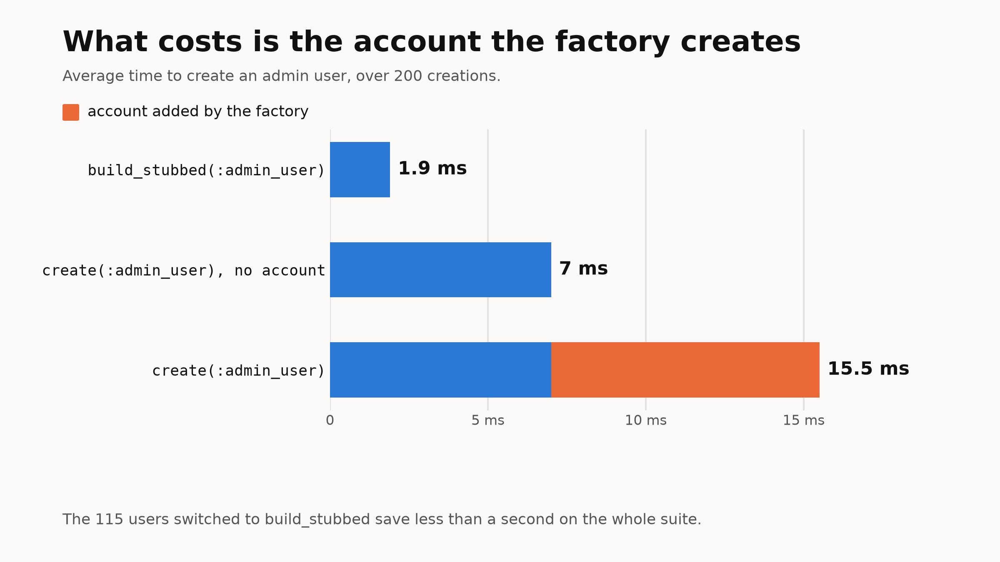

In [Running only the changed project's tests](/en/blog/running-only-the-changed-project-s-tests-without-losing-required-checks), we stopped running RSpec on PRs that don't touch the API. But three quarters of PRs do touch it, and for them RSpec still ran in a single job: 11 minutes of waiting.

We did two things: split the suite across several runners (merged), and write specs that cost less (in progress).



## One suite, 3 jobs, 6 processes

We use [`parallel_tests`](https://github.com/grosser/parallel_tests). It cuts the suite into 6 groups of files. Each job of the matrix takes 2, one per runner vCPU, and each process gets its own test database.



```yaml
strategy:
  matrix:
    groups: ["1,2", "3,4", "5,6"]
steps:
  - name: Prepare database
    run: |
      bin/rails db:schema:load
      psql "$POSTGRES_URL" -c "CREATE DATABASE app_test2 TEMPLATE app_test"

  - name: Run RSpec
    run: |
      bundle exec parallel_rspec -n 6 --only-group ${{ matrix.groups }} \
        --group-by ${{ inputs.runtime-log-run && 'runtime' || 'filesize' }} spec
```

The second database is cloned from the first (`TEMPLATE`), so the schema is loaded only once. `database.yml` appends `TEST_ENV_NUMBER` to the database name, and each process gets its own.

## The same split in all 3 jobs

For the groups to take about the same time, `parallel_tests` needs each file's duration. Every green run on `main` publishes that log, and PRs split their suite with it. Without a log, the split goes by file size.

But if two jobs don't read the same log, they don't split the same way: some files run nowhere, and CI stays green.


So the `changes` job, which already runs before the tests, looks up the log once and passes the run id to the 3 jobs:

```yaml
- name: Find main's RSpec runtime log
  id: runtime-log
  run: |
    echo "run=$(gh api "repos/$GITHUB_REPOSITORY/actions/artifacts?name=rspec-runtime-log&per_page=100" \
      -q '[.artifacts[] | select(.workflow_run.head_branch == "main" and (.expired | not))] | max_by(.created_at) | .workflow_run.id // empty')" >> "$GITHUB_OUTPUT"
```

## How many jobs?

GitHub bills each job rounded up to the minute, and each job pays its setup (about 50 s here). We measured 8 configurations, 10 runs each, and kept a simple rule: one more job must save at least 20 s per extra billed minute.



Two takeaways. 4 jobs of one process cost more than 3 jobs of 2, and finish later: the second vCPU sits idle. And beyond 3 jobs, rounding to the minute comes down to a few seconds: a real 5 × 2 run was billed 18 minutes instead of the expected 15.

Over the first 10 runs after the merge, the slowest job finished between 213 and 274 s. Two flaky tests that already existed on `main` became more frequent with one database per process (lower ids): they're fixed.

## Slimming down the specs

Parallelizing cuts the wait, not the work. For that, the specs have to do less. One PR set five conventions:

- an expensive setup shared by a single `:aggregate_failures` example;
- only create the records under test;
- factories without cascades of records;
- `build_stubbed` when the spec never reads the database;
- remove examples that prove nothing more than their neighbour.


## Too big to review

The PR touched 641 files. We had agents audit it, in passes, until nothing was left:


Human review still found tests that were green for the wrong reason: a `build_stubbed` user has no roles, so an access denial always passed. And one measurement showed that `build_stubbed` wasn't the real gain:



So we closed the PR, and we're taking it another way: one PR per rule, reviewed in a few minutes. A rule that can be checked automatically becomes a RuboCop rule; the others go into the agents' knowledge, in plain sentences. And test users are created as in production. Nothing is merged on that side yet.

The 3 × 2 split won't have to change: on the slimmed-down suite, the same bench also picked 3 × 2.

> [!NOTE]
> `ubuntu-latest` runners land on different CPUs (7 models during our measurements), and the same suite can take from 477 to 730 s. Configurations are compared on the same CPU, and versions of the suite on a single machine, one after the other. We also track in PostHog the sum of each spec file's duration, which goes up when we add specs, not when we add jobs (see [Tracking a team's tech OKRs in PostHog](/en/blog/tracking-a-team-s-tech-okrs-in-posthog-straight-from-github-actions)).
