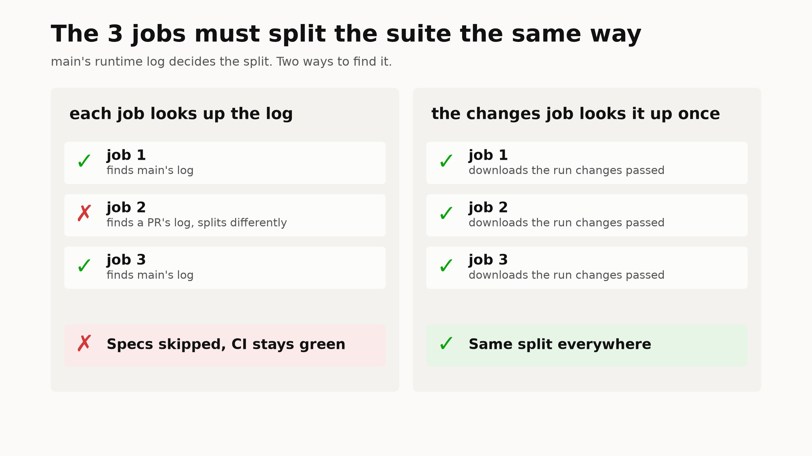
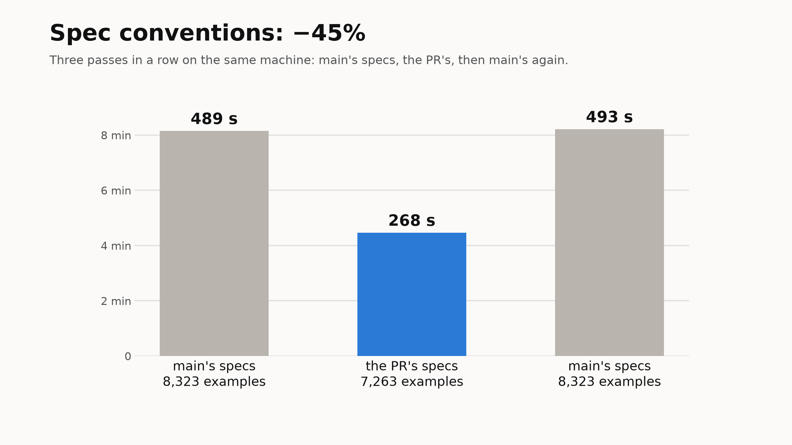
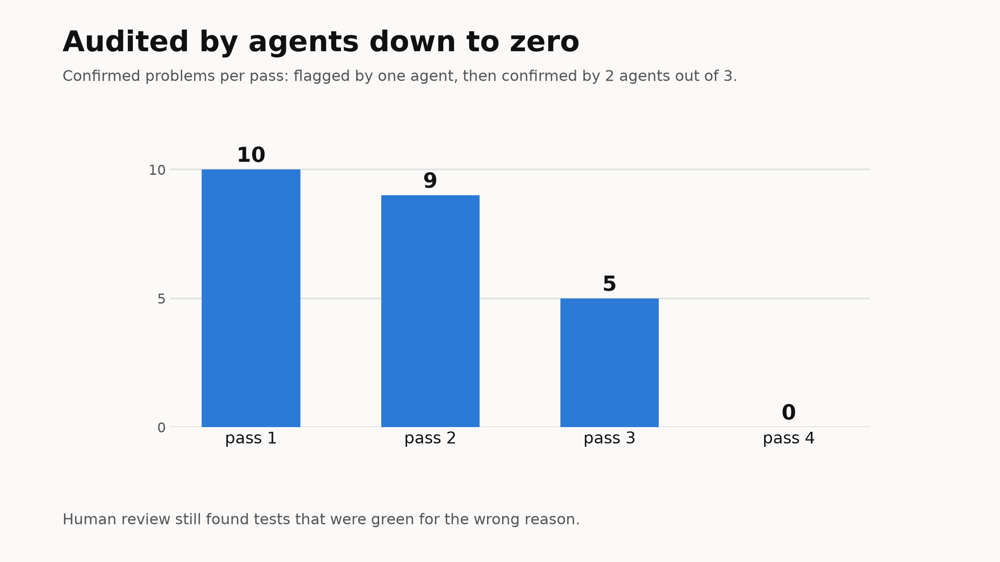

On one of our products, a PR that touched the API waited 10 minutes for RSpec. That's long enough to open something else, and lose track of the PR.

In [Running only the changed project's tests](/en/blog/running-only-the-changed-project-s-tests-without-losing-required-checks), we had already stopped running the tests of the parts of the code a PR doesn't touch. We went on in two steps. First, split the suite across several runners: CI does the same work, but in parallel, so we wait less. Then, slim down the specs themselves, so there's less work, period.


## Parallelizing: 3 jobs, 6 processes

We use [`parallel_tests`](https://github.com/grosser/parallel_tests). It cuts the suite into 6 groups of files. Each job of the matrix takes 2, one per runner vCPU.


```yaml
strategy:
  matrix:
    groups: ["1,2", "3,4", "5,6"]
steps:
  - name: Prepare database
    run: |
      bin/rails db:schema:load
      # process 2's database, copied from process 1's
      psql "$POSTGRES_URL" -c "CREATE DATABASE app_test2 TEMPLATE app_test"

  - name: Run RSpec
    run: |
      bundle exec parallel_rspec -n 6 --only-group ${{ matrix.groups }} \
        --group-by ${{ inputs.runtime-log-run && 'runtime' || 'filesize' }} spec
```

Each process has its own test database: `database.yml` appends `TEST_ENV_NUMBER` to its name.

## Groups of the same duration

The slowest job sets the wait, so we want the 6 groups to take about as long as each other. Every green run on `main` records each spec file's duration in a log, and `parallel_tests` uses it to build groups of equal duration. Without a log, it splits by file size, which is less accurate.

For the 3 jobs to split the same way, they must read the log of the same `main` run. If one job picks another, some files run nowhere, and CI stays green.



So the `changes` job, which already runs before the tests, picks that run once and passes its id to the 3 jobs:

```yaml
- name: Find main's RSpec runtime log
  id: runtime-log
  run: |
    echo "run=$(gh api "repos/$GITHUB_REPOSITORY/actions/artifacts?name=rspec-runtime-log&per_page=100" \
      -q '[.artifacts[] | select(.workflow_run.head_branch == "main" and (.expired | not))] | max_by(.created_at) | .workflow_run.id // empty')" >> "$GITHUB_OUTPUT"
```

## How many jobs?

GitHub bills each job rounded up to the minute, and each job pays its setup (about 50 s here). We measured 8 configurations, 10 runs each, and kept a simple rule: one more job must save at least 20 s per extra billed minute.


Going from 3 × 2 to 8 × 2 would save 88 s of waiting, for 6 more billed minutes on every run: +46% on the RSpec bill. Beyond 3 jobs, rounding to the minute also comes down to a few seconds: a real 5 × 2 run was billed 18 minutes instead of the expected 15.

And 4 jobs of one process cost more than 3 jobs of 2, and finish later: each runner's second vCPU sits idle.

## Slimming down the specs

Parallelizing cuts the wait, not the work. For that, the specs have to do less. One PR set five conventions:

- an expensive setup shared by a single `:aggregate_failures` example;
- only create the records under test;
- factories without cascades of records;
- `build_stubbed` when the spec never reads the database;
- remove examples that prove nothing more than their neighbour.



## Too big to review

The PR touched 641 files. We had agents audit it, in passes, until nothing was left:



Human review still found tests that were green for the wrong reason: a `build_stubbed` user has no roles, so an access denial always passed. And one measurement showed that `build_stubbed` wasn't the real gain:


So we apply the conventions one rule at a time: one PR per rule, reviewed in a few minutes. A rule that can be checked automatically becomes a RuboCop rule; the others go into the agents' knowledge, in plain sentences. And test users are created as in production.

The 3 × 2 split won't have to change: on the slimmed-down suite, the same bench also picked 3 × 2.

> [!NOTE]
> `ubuntu-latest` runners land on different CPUs (7 models during our measurements), and the same suite can take from 477 to 730 s. Configurations are compared on the same CPU, and versions of the suite on a single machine, one after the other. We also track in PostHog the sum of each spec file's duration, which goes up when we add specs, not when we add jobs (see [Tracking a team's tech OKRs in PostHog](/en/blog/tracking-a-team-s-tech-okrs-in-posthog-straight-from-github-actions)).
