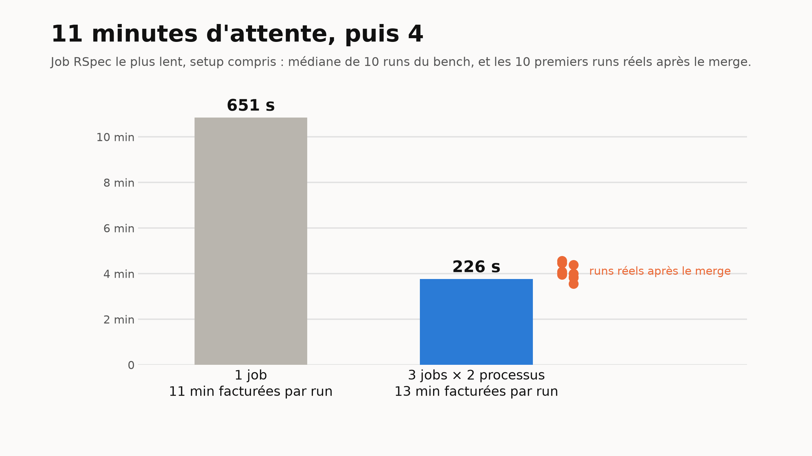
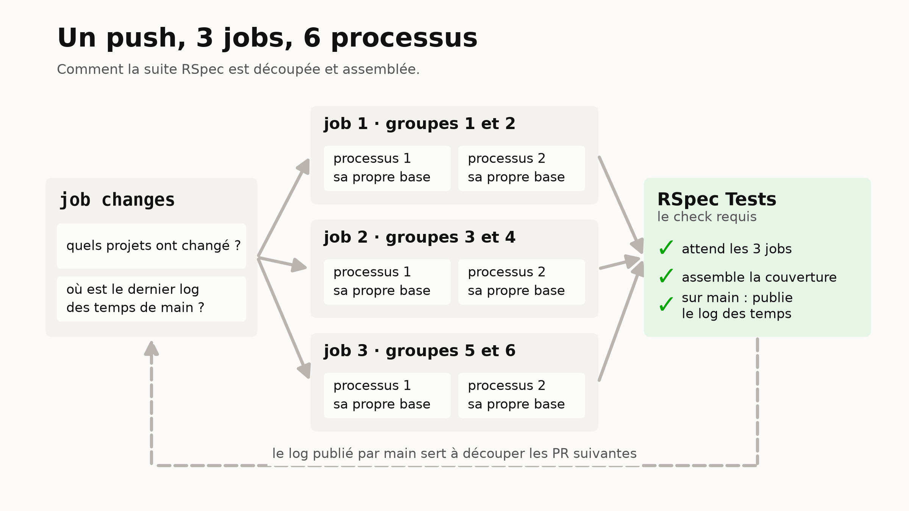
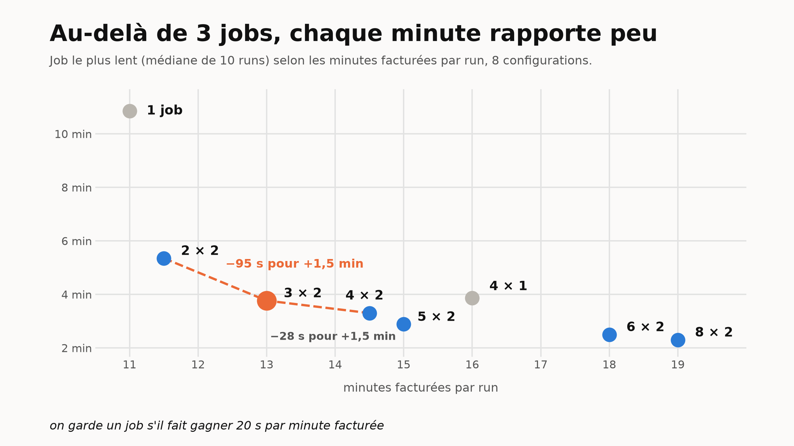
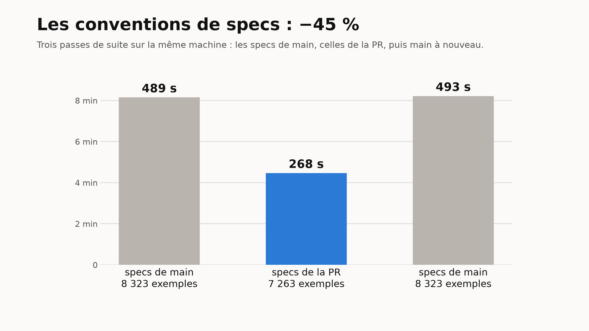
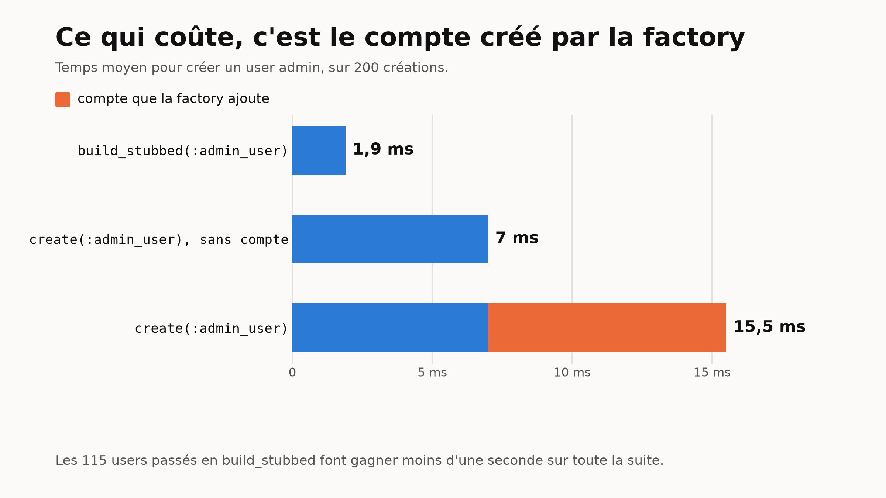

Dans [Ne lancer que les tests du projet modifié](/blog/ne-lancer-que-les-tests-du-projet-modifie-sans-perdre-les-checks-requis), on avait arrêté de lancer RSpec sur les PR qui ne touchent pas l'API. Mais les trois quarts des PR la touchent, et pour elles, RSpec tournait toujours sur un seul job : 11 minutes d'attente.

On a fait deux choses : répartir la suite sur plusieurs runners (mergé), et écrire des specs qui coûtent moins cher (en cours).



## Une suite, 3 jobs, 6 processus

On utilise [`parallel_tests`](https://github.com/grosser/parallel_tests). Il coupe la suite en 6 groupes de fichiers. Chaque job de la matrice en prend 2, un par vCPU du runner, et chaque processus a sa propre base de test.



```yaml
strategy:
  matrix:
    groups: ["1,2", "3,4", "5,6"]
steps:
  - name: Prepare database
    run: |
      bin/rails db:schema:load
      psql "$POSTGRES_URL" -c "CREATE DATABASE app_test2 TEMPLATE app_test"

  - name: Run RSpec
    run: |
      bundle exec parallel_rspec -n 6 --only-group ${{ matrix.groups }} \
        --group-by ${{ inputs.runtime-log-run && 'runtime' || 'filesize' }} spec
```

La deuxième base est clonée depuis la première (`TEMPLATE`) : le schéma n'est chargé qu'une fois. `database.yml` ajoute `TEST_ENV_NUMBER` au nom de la base, et chaque processus prend la sienne.

## Le même découpage dans les 3 jobs

Pour que les groupes durent à peu près autant, `parallel_tests` a besoin du temps de chaque fichier. Chaque run vert de `main` publie ce log, et les PR découpent leur suite avec. Sans log, le découpage se fait par taille de fichier.

Mais si deux jobs ne lisent pas le même log, ils ne découpent pas pareil : des fichiers ne tournent nulle part, et la CI reste verte.


Le job `changes`, qui tourne déjà avant les tests, cherche donc le log une seule fois et passe le numéro du run aux 3 jobs :

```yaml
- name: Find main's RSpec runtime log
  id: runtime-log
  run: |
    echo "run=$(gh api "repos/$GITHUB_REPOSITORY/actions/artifacts?name=rspec-runtime-log&per_page=100" \
      -q '[.artifacts[] | select(.workflow_run.head_branch == "main" and (.expired | not))] | max_by(.created_at) | .workflow_run.id // empty')" >> "$GITHUB_OUTPUT"
```

## Combien de jobs ?

GitHub facture chaque job arrondi à la minute supérieure, et chaque job paie son setup (environ 50 s ici). On a mesuré 8 configurations, 10 runs chacune, et gardé une règle simple : un job de plus doit faire gagner au moins 20 s par minute facturée en plus.



Deux choses à retenir. 4 jobs d'un processus coûtent plus cher que 3 jobs de 2, et finissent plus tard : le deuxième vCPU ne sert à rien. Et au-delà de 3 jobs, l'arrondi à la minute se joue à quelques secondes : un vrai run en 5 × 2 a été facturé 18 minutes au lieu des 15 prévues.

Sur les 10 premiers runs après le merge, le job le plus lent a fini entre 213 et 274 s. Deux tests instables qui existaient déjà sur `main` sont devenus plus fréquents avec une base par processus (des ids plus bas) : ils sont corrigés.

## Alléger les specs

Paralléliser réduit l'attente, pas le travail. Pour ça, il faut des specs qui en font moins. Une PR a posé cinq conventions :

- un setup coûteux partagé par un seul exemple `:aggregate_failures` ;
- ne créer que les enregistrements testés ;
- des factories sans cascades d'enregistrements ;
- `build_stubbed` quand le spec ne lit jamais la base ;
- supprimer les exemples qui ne prouvent rien de plus que leur voisin.



## Trop grosse pour être relue

La PR touchait 641 fichiers. On l'a fait auditer par des agents, en passes, jusqu'à ce qu'il ne reste rien :


La relecture humaine a quand même trouvé des tests verts pour une mauvaise raison : un user `build_stubbed` n'a pas de rôles, donc un refus d'accès passait toujours. Et une mesure a montré que `build_stubbed` n'était pas le vrai gain :



On a donc fermé la PR, et on reprend autrement : une PR par règle, relue en quelques minutes. Une règle vérifiable automatiquement devient une règle RuboCop ; les autres vont dans le knowledge des agents, en phrases simples. Et les users de test sont créés comme en production. Rien n'est encore mergé de ce côté.

Le découpage en 3 × 2 n'aura pas à changer : sur la suite allégée, le même bench donnait aussi 3 × 2.

> [!NOTE]
> Les runners `ubuntu-latest` tombent sur des CPU différents (7 modèles pendant nos mesures), et la même suite peut prendre de 477 à 730 s. Les configurations sont comparées à CPU égal, et les versions de la suite sur une seule machine, l'une après l'autre. On suit aussi dans PostHog la somme des temps de chaque fichier de spec, qui monte quand on ajoute des specs, pas quand on ajoute des jobs (voir [Suivre les OKR tech d'une équipe dans PostHog](/blog/suivre-les-okr-tech-d-une-equipe-dans-posthog-depuis-github-actions)).
