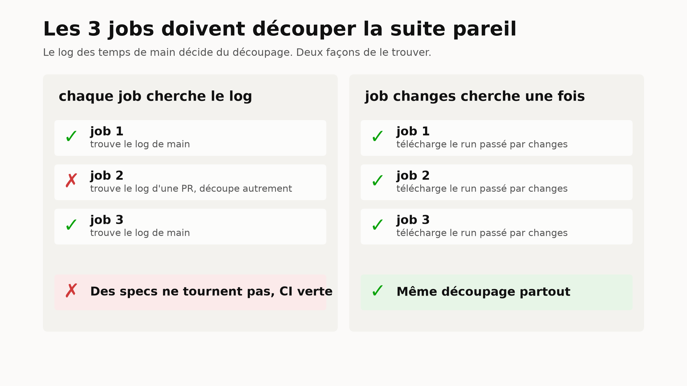

Sur un de nos produits, une PR qui touche l'API attendait RSpec 10 minutes. C'est assez pour ouvrir autre chose, et perdre le fil de sa PR.

Dans [Ne lancer que les tests du projet modifié](/blog/ne-lancer-que-les-tests-du-projet-modifie-sans-perdre-les-checks-requis), on avait déjà arrêté de lancer les tests des parties du code qu'une PR ne touche pas. On a continué en deux étapes. D'abord, répartir la suite sur plusieurs runners : la CI fait le même travail, mais en parallèle, donc on attend moins. Ensuite, alléger les specs elles-mêmes, pour qu'il y ait moins de travail tout court.


## Paralléliser : 3 jobs, 6 processus

On utilise [`parallel_tests`](https://github.com/grosser/parallel_tests). Il coupe la suite en 6 groupes de fichiers. Chaque job de la matrice en prend 2, un par vCPU du runner.


```yaml
strategy:
  matrix:
    groups: ["1,2", "3,4", "5,6"]
steps:
  - name: Prepare database
    run: |
      bin/rails db:schema:load
      # la base du processus 2, copiée depuis celle du processus 1
      psql "$POSTGRES_URL" -c "CREATE DATABASE app_test2 TEMPLATE app_test"

  - name: Run RSpec
    run: |
      bundle exec parallel_rspec -n 6 --only-group ${{ matrix.groups }} \
        --group-by ${{ inputs.runtime-log-run && 'runtime' || 'filesize' }} spec
```

Chaque processus a sa propre base de test : `database.yml` ajoute `TEST_ENV_NUMBER` à son nom.

## Des groupes de même durée

C'est le job le plus lent qui fixe l'attente, donc on veut que les 6 groupes durent à peu près autant. Chaque run vert de `main` enregistre le temps de chaque fichier de spec dans un log, et `parallel_tests` s'en sert pour faire des groupes de durée égale. Sans log, il découpe par taille de fichier, ce qui est moins juste.

Pour que les 3 jobs découpent pareil, ils doivent lire le log du même run de `main`. Si un job en prend un autre, des fichiers ne tournent nulle part, et la CI reste verte.



Le job `changes`, qui tourne déjà avant les tests, choisit donc ce run une seule fois et passe son numéro aux 3 jobs :

```yaml
- name: Find main's RSpec runtime log
  id: runtime-log
  run: |
    echo "run=$(gh api "repos/$GITHUB_REPOSITORY/actions/artifacts?name=rspec-runtime-log&per_page=100" \
      -q '[.artifacts[] | select(.workflow_run.head_branch == "main" and (.expired | not))] | max_by(.created_at) | .workflow_run.id // empty')" >> "$GITHUB_OUTPUT"
```

## Combien de jobs ?

GitHub facture chaque job arrondi à la minute supérieure, et chaque job paie son setup (environ 50 s ici). On a mesuré 8 configurations, 10 runs chacune, et gardé une règle simple : un job de plus doit faire gagner au moins 20 s par minute facturée en plus.


Passer de 3 × 2 à 8 × 2 ferait gagner 88 s d'attente, pour 6 minutes facturées de plus à chaque run : +46 % sur la facture RSpec. Au-delà de 3 jobs, l'arrondi à la minute se joue en plus à quelques secondes : un vrai run en 5 × 2 a été facturé 18 minutes au lieu des 15 prévues.

Et 4 jobs d'un processus coûtent plus cher que 3 jobs de 2, et finissent plus tard : le deuxième vCPU de chaque runner ne sert à rien.

## Alléger les specs

Paralléliser réduit l'attente, pas le travail. Pour ça, il faut des specs qui en font moins. Une PR a posé cinq conventions :

- un setup coûteux partagé par un seul exemple `:aggregate_failures` ;
- ne créer que les enregistrements testés ;
- des factories sans cascades d'enregistrements ;
- `build_stubbed` quand le spec ne lit jamais la base ;
- supprimer les exemples qui ne prouvent rien de plus que leur voisin.


## Trop grosse pour être relue

La PR touchait 641 fichiers. On l'a fait auditer par des agents, en passes, jusqu'à ce qu'il ne reste rien :


La relecture humaine a quand même trouvé des tests verts pour une mauvaise raison : un user `build_stubbed` n'a pas de rôles, donc un refus d'accès passait toujours. Et une mesure a montré que `build_stubbed` n'était pas le vrai gain :


On applique donc les conventions une règle à la fois : une PR par règle, relue en quelques minutes. Une règle vérifiable automatiquement devient une règle RuboCop ; les autres vont dans le knowledge des agents, en phrases simples. Et les users de test sont créés comme en production.

Le découpage en 3 × 2 n'aura pas à changer : sur la suite allégée, le même bench donnait aussi 3 × 2.

> [!NOTE]
> Les runners `ubuntu-latest` tombent sur des CPU différents (7 modèles pendant nos mesures), et la même suite peut prendre de 477 à 730 s. Les configurations sont comparées à CPU égal, et les versions de la suite sur une seule machine, l'une après l'autre. On suit aussi dans PostHog la somme des temps de chaque fichier de spec, qui monte quand on ajoute des specs, pas quand on ajoute des jobs (voir [Suivre les OKR tech d'une équipe dans PostHog](/blog/suivre-les-okr-tech-d-une-equipe-dans-posthog-depuis-github-actions)).
