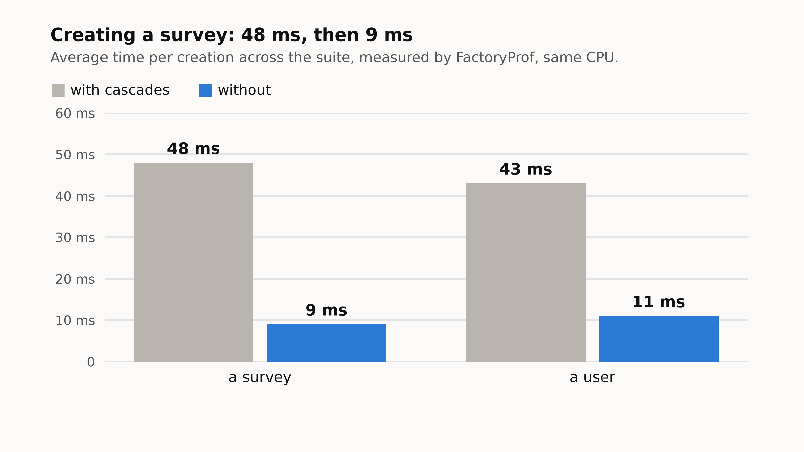

At one of our clients, [parallelizing RSpec](/en/blog/parallelizing-rspec-on-github-actions) took a PR's CI from 10 minutes to less than 5. But the suite still does the same work, just spread over 6 processes. For it to do less, the specs have to do less.

We applied four spec conventions, and found along the way an August regression that cost more than any of them. Each change was measured alone, on a single machine: the original suite, then the suite with the change, one after the other.


## One example per expensive setup

Every `it` replays the `before` and `let` blocks above it. When that setup imports a file, clones a survey or generates data, seven one-line `it`s make seven imports:

```ruby
describe 'after running' do
  before { result }

  it { expect(result.success).to be true }
  it { expect(created_survey).to have_attributes(name: 'Imported Survey', status: 'complete') }
  it { expect(created_survey.owner).to eq(owner) }
  it { expect(blob).to have_received(:purge_later) }
  # … and three more
end
```

We group them into a single example, named after what it proves:

```ruby
it 'creates the survey and purges the upload', :aggregate_failures do
  expect(result.success).to be true
  expect(created_survey).to have_attributes(name: 'Imported Survey', status: 'complete')
  expect(created_survey.owner).to eq(owner)
  expect(blob).to have_received(:purge_later)
end
```

With [`:aggregate_failures`](https://rspec.info/blog/2015/06/rspec-3-3-has-been-released/), the example doesn't stop at the first failing `expect`: it runs them all and reports every failure, as the seven examples did.

Fewer examples means fewer runs of the same setup. The import spec above goes from 72 examples in 26 s to 29 examples in 8 s:


Applied to 28 files, this takes the whole suite from 666 to 558 s (−16%).

## `build_stubbed` when the spec never reads the database

Many specs save an object to the database and never read it back. For example, a validation rejects a pie chart for a multiple-choice question, because its answers don't add up to 100%. The spec only needs the question's type, but it saved the question to the database:

```ruby
# before: the question is saved to the database
subject(:chart) { build(:results_card, card: create(:card_question_multiple), options: { chart_type: 'pie' }) }

# after: the question is built in memory
subject(:chart) { build(:results_card, card: build_stubbed(:card_question_multiple), options: { chart_type: 'pie' }) }

it { is_expected.not_to be_valid }
```

`build_stubbed` builds the object with an id, as if it were saved, but without touching the database:


That's a few milliseconds per object: across the 19 files where we applied it, the gain is around 1% of the suite. [FactoryDoctor](https://test-prof.evilmartians.io/guide/profilers/factory_doctor) put everything the suite saved without ever reading it back at 29.8 s.

## Factories without cascades

Here's what a `create(:survey)` created:

```ruby
factory :survey do
  account                            # an account, with its mailing_account
  association :owner, factory: :user # a user…
end

factory :user do
  transient do
    accounts { [build(:account)] }   # …with another account, and another mailing_account
    account_role_key { 'client_edit' }
  end

  after(:create) do |user, evaluator|
    evaluator.accounts.each do |account|
      account.save!
      role = Role.find_by(key: evaluator.account_role_key) || begin
        Rbac::SyncCatalog.call       # more on this below
        Role.find_by!(key: evaluator.account_role_key)
      end
      user.user_roles.create!(role:, roleable: account)
    end
  end
end
```

So a survey created in a spec also meant two accounts, two `mailing_account`s, an owner and its role, even when the spec only looked at the survey. A factory default is paid for in every spec that uses the factory, and in every factory that associates it: 5,540 `mailing_account`s were created, for 18 read.

The fix: the owner no longer has an account, `mailing_account` becomes a trait you ask for, and child records reuse their parent's survey instead of creating another one.

```ruby
factory :survey do
  account
  owner { association :user, accounts: [] }
end

factory :account do
  trait :with_mailing_account do
    mailing_account
  end
end
```

Creating a survey goes from 48 to 9 ms, and the suite creates more than 4,000 of them:



Over the whole suite, that's 38,134 records created instead of 44,135, and the suite goes from 699 to 574 s (−18%). Yet most of those 48 ms didn't come from the accounts, but from the `Rbac::SyncCatalog.call` line, which copied all the app's roles: that's the next section.

The same default remained on staff users: the factory gave every user an account, even admins, who have none in production (their access comes from their type). That account cost more than everything `build_stubbed` saved:


Staff user factories no longer have an account by default; a spec that needs one passes it.

## An August regression: roles copied again for every example

In August, the app got per-account permissions. At a client, each member now has a role: editor (edits surveys and invites members), analyst (sees the results) or follower (only sees the survey's progress). These roles, and what each one allows, are written in the code, then copied into two database tables, so that a user's permissions can be read with a simple query. That's all `Rbac::SyncCatalog` does: copy this list from the code to the database.

In the tests, the `user` factory gives a role to the user it creates. If the role isn't in the database, it runs the copy (the `after(:create)` above). But every RSpec example runs in a transaction that is rolled back at the end: everything it created disappears, roles included. So the next example starts with no roles, and its first user runs the copy again. Since every survey's owner got a role, almost every example paid for it.

Nobody noticed: the feature was well tested and the CI stayed green, it was just slower. We found it while looking for why creating a survey cost 48 ms.

The fix is one line: copy the roles once, before the whole suite, outside the transactions. They're there for every example, and the factory always finds them.

```ruby
# spec/support/rbac_catalog.rb
RSpec.configure do |config|
  config.before(:suite) { Rbac::SyncCatalog.call }
end
```

On its own, this line takes the suite from 714 to 486 s: the biggest gain in this whole article. Once the roles are copied before the suite, the cascades' own share drops to about twenty seconds.

## Only create the records under test

Some specs created much more data than they checked.

For example, an import consumes credits: 1 credit per block of 1,000 respondents, rounded up. To check that rounding, you have to go past a block, so the spec imported 1,500 respondents and checked that it cost 2 credits. But what we test is the rounding, not the volume. For the duration of the spec, we bring the block down to 2 respondents with `stub_const`: 3 respondents give the same rounding to 2 credits.

```ruby
# before
let(:respondent_count) { 1500 }
let(:questions) { [build_parsed_question(cell_values: Array.new(1500, 'a'))] }

# after: 2 respondents per credit, same rounding, 3 rows instead of 1,500
let(:respondent_count) { 3 }
let(:questions) { [build_parsed_question(cell_values: %w[a a a])] }
before { stub_const('Credits::Recalculate::Quantitative::RESPONDENTS_PER_BUCKET', 2) }
```

Same idea elsewhere: a report created 20 respondents per profile, when 4 are enough to check what it computes. Its spec file goes from 40 to 9 s:


Across the 4 files involved, this saves about 42 s. That's less than the gap between two measurements of the same code (50 to 100 s): on the whole suite you can't see it, you have to measure file by file.

## What's next

We're taking these conventions one by one: one small PR per convention, reviewed in a few minutes.

To make them last, the ones a tool can check become RuboCop rules (RuboCop is the Ruby linter): a spec that breaks them fails the CI. The others are written, in plain sentences, in the instructions our coding agents read before writing a spec.

And the CI split from [the previous article](/en/blog/parallelizing-rspec-on-github-actions) doesn't change: even on the slimmed-down suite, 3 jobs of 2 processes remain the best trade-off between waiting time and billed minutes.

> [!NOTE]
> `ubuntu-latest` runners land on different CPUs, and the same suite can take from 477 to 730 s. So versions of the suite are compared on a single machine, one after the other. We also track in PostHog the sum of each spec file's duration, which goes up when we add specs, not when we add jobs (see [Tracking a team's tech OKRs in PostHog](/en/blog/tracking-a-team-s-tech-okrs-in-posthog-straight-from-github-actions)).
