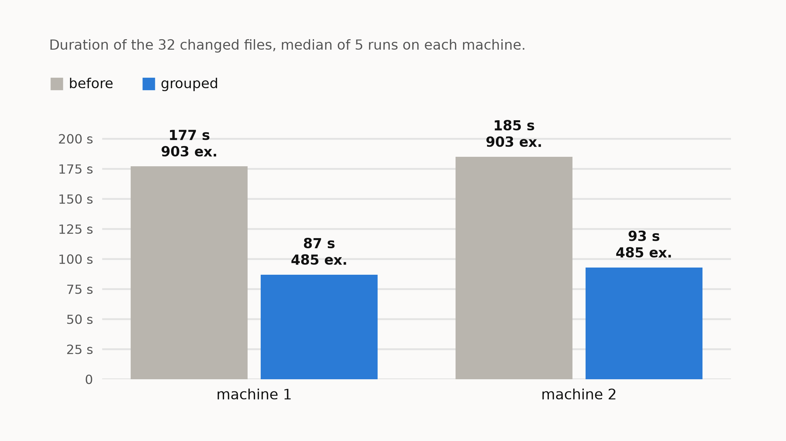
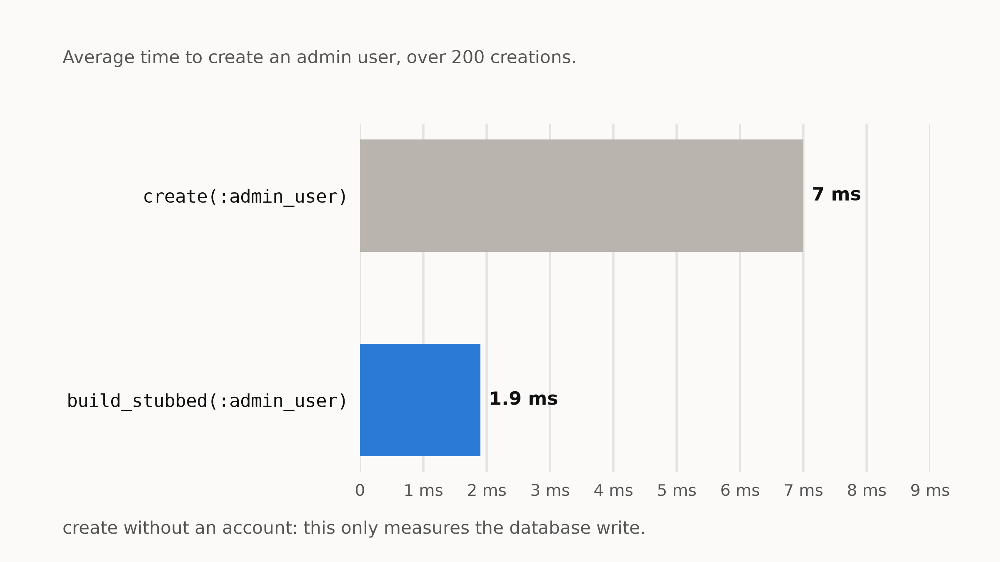

At one of our clients, [parallelizing RSpec](/en/blog/parallelizing-rspec-on-github-actions) took a PR's CI from 10 minutes to less than 5. But parallelizing, like getting bigger machines, only spreads the same work: we wait less, the suite isn't any more efficient. The cause is tests that do much more work than what they check, and that's what we worked on.

And it compounds: a fixed factory speeds up every spec that uses it, today's and the ones we'll write tomorrow, and a spec written with the right conventions is fast from the start.

This client's app runs online surveys: an account creates questionnaires, people answer them, and the app analyzes the answers. We applied four spec conventions, and measured each one alone on today's code, on two machines (the protocol is at the end of the article).


## One example per expensive setup

Every `it` replays the `before` and `let` blocks above it. When that setup imports a file, clones a survey or generates data, seven one-line `it`s make seven imports:

```ruby
describe 'after running' do
  before { result }

  it { expect(result.success).to be true }
  it { expect(created_survey).to have_attributes(name: 'Imported Survey', status: 'complete') }
  it { expect(created_survey.owner).to eq(owner) }
  it { expect(blob).to have_received(:purge_later) }
  # … and three more
end
```

We group them into a single example, named after what it proves:

```ruby
it 'creates the survey and purges the upload', :aggregate_failures do
  expect(result.success).to be true
  expect(created_survey).to have_attributes(name: 'Imported Survey', status: 'complete')
  expect(created_survey.owner).to eq(owner)
  expect(blob).to have_received(:purge_later)
end
```

With [`:aggregate_failures`](https://rspec.info/blog/2015/06/rspec-3-3-has-been-released/), the example doesn't stop at the first failing `expect`: it runs them all and reports every failure, as the seven examples did.

Fewer examples means fewer runs of the same setup. Across the 32 files where we applied it, we go from 903 examples in 3 minutes to 485 examples in 1.5 minutes:



## `build_stubbed` when the spec never reads the database

Many specs save an object to the database and never read it back. For example, a validation rejects a pie chart for a multiple-choice question, because its answers don't add up to 100%. The spec only needs the question's type, but it saved the whole question to the database:

```ruby
# before: the question is saved to the database
subject(:chart) { build(:results_card, card: create(:card_question_multiple), options: { chart_type: 'pie' }) }

# after: the question is built in memory
subject(:chart) { build(:results_card, card: build_stubbed(:card_question_multiple), options: { chart_type: 'pie' }) }

it { is_expected.not_to be_valid }
```

`build_stubbed` builds the object with an id, as if it were saved, but without touching the database:



That's a few milliseconds per object: the 19 files where we applied it go from 12 to 8 s, so 4 s saved.

## Factories without cascades

Here's what a `create(:survey)` created:

```ruby
factory :survey do
  account                            # an account, with its mailing_account
  association :owner, factory: :user # a user…
end

factory :user do
  transient do
    accounts { [build(:account)] }   # …with another account, and another mailing_account
  end
end
```

So a survey created in a spec also meant two accounts, two `mailing_account`s (an account's email sending settings) and an owner (the user who created the survey), even when the spec only looked at the survey. A factory default is paid for in every spec that uses the factory, and in every factory that associates it: 5,540 `mailing_account`s were created, only 18 of them requested directly by a spec.

The fix: the owner no longer has an account, `mailing_account` becomes a trait you ask for, and child records reuse their parent's survey instead of creating another one.

```ruby
factory :survey do
  account
  owner { association :user, accounts: [] }
end

factory :account do
  trait :with_mailing_account do
    mailing_account
  end
end
```

Since almost every spec creates surveys, the gain is measured on the whole suite: about 40 s (from 434 to 395 s on one machine, from 498 to 455 s on the other).

The same default remained on staff users: the factory gave every user an account, even admins, who have none in production (their access comes from their type). That account cost more than everything `build_stubbed` saved:


Staff user factories no longer have an account by default; a spec that needs one passes it.

## Only create the records under test

Some specs created much more data than they checked. It often happens when the code contains a threshold. Take pagination at 20 items per page: to check there really are three pages, a spec creates 45 items. Yet what it tests is how items are split into pages, not how many there are. So for the duration of the spec, we can set the page size to 2 with `stub_const`: 5 items are then enough to get three pages.

```ruby
# before: 45 orders to get 3 pages of 20
before { create_list(:order, 45) }

# after: pages of 2, and 5 orders are enough for 3 pages
before do
  stub_const('Order::PER_PAGE', 2)
  create_list(:order, 5)
end

it { expect(Order.page(3).count).to eq(1) }
```

At our client, we found this pattern twice. First in the import of answers, billed 1 credit per block of 1,000 answers, rounded up: to check that importing 1,500 answers costs 2 credits, the spec really imported 1,500 answers. With the block set to 2 answers for the duration of the test, 3 answers are enough to land on 2 credits again.

Then in a simulation: to test a survey, the app can simulate respondents in each targeted group (adults, minors…) and flag the groups it won't manage to reach. The spec simulated 20 people per group, when 4 are enough to tell whether a group is reached.

With a third file that no longer creates useless respondents, these files go from about a minute to under 20 s:


## What's next

We wrote rules so these conventions stick. They run on every PR.

**A RuboCop rule written for the project.** `RSpec/OneLinerExample` enforces the shape of examples: a one-line `it { expect(...).to ... }`, or a named example tagged `:aggregate_failures` when it checks several things. A CI script runs it only on the lines the PR adds or changes, so nobody has to rewrite every old spec:

```yaml
# .github/workflows/api-lint.yml
- name: Check the style of touched specs
  run: bin/check-spec-style origin/${{ github.base_ref }}
```

A new example written over several lines without `:aggregate_failures` fails the CI with this message:

```
Write the example as a one-liner `it { expect(...).to ... }` — no description, no `do … end`
(tag `:aggregate_failures` when several expectations are needed).
```

**Instructions for the coding agents.** What a linter can't judge is written in plain sentences in `.claude/knowledge/api/spec.md`. A hook adds it to the agent's context as soon as it edits a file under `spec/`, for example:

> Do not mimic legacy specs that violate these rules — the convention wins over existing style.

> [!NOTE]
> **How we measured.** GitHub runners are drawn at random among several CPU models, and the same suite took from 400 to 575 s on them in our measurements: so we never compare two CI runs with each other. Each convention is applied alone to today's code, then a single runner alternately runs the version without and the version with it: five times each on only the files the convention changes (the rest of the suite doesn't change), three times on the whole suite for the factories, which are used everywhere. We keep the median. All of it ran on two runners, which give the same gains within a few seconds.
