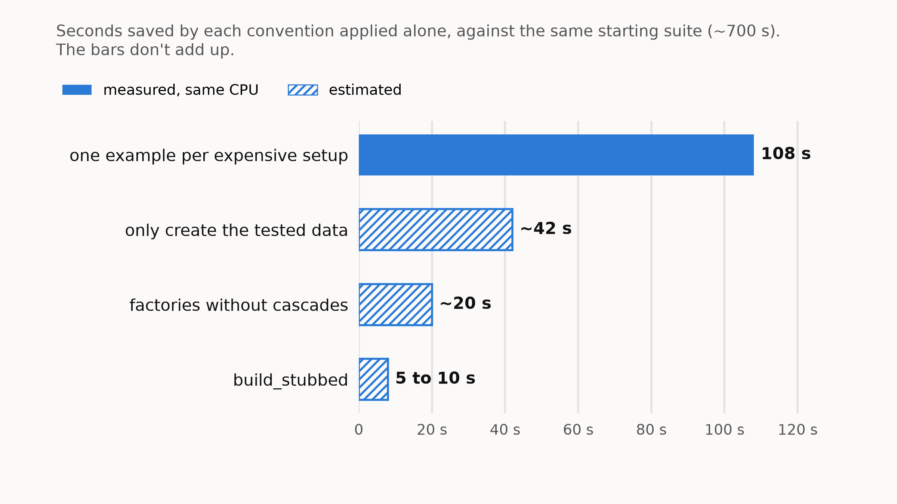
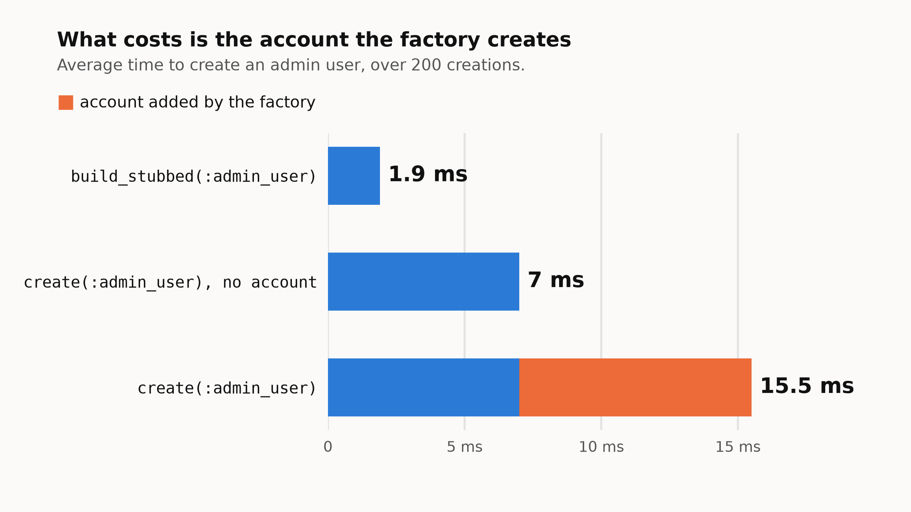
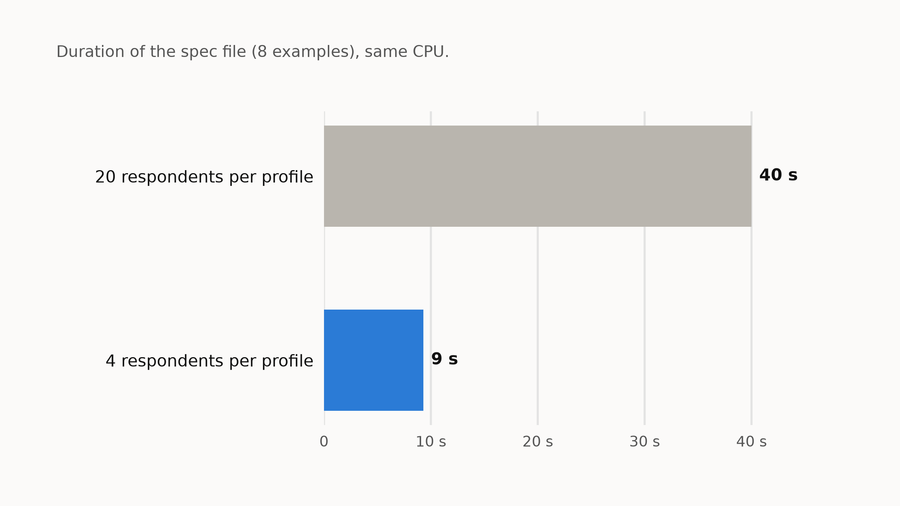

At one of our clients, [parallelizing RSpec](/en/blog/parallelizing-rspec-on-github-actions) took a PR's CI from 10 minutes to less than 5. But parallelizing, like getting bigger machines, only spreads the same work: we wait less, the suite isn't any more efficient. The cause is tests that do much more work than what they check, and that's what we worked on.

And it compounds: a fixed factory speeds up every spec that uses it, today's and the ones we'll write tomorrow, and a spec written with the right conventions is fast from the start.

We applied four spec conventions. Each one was applied alone to the same starting suite, then both versions ran one after the other on the same machine. So the gains don't add up, and three of them are estimates.



## One example per expensive setup

Every `it` replays the `before` and `let` blocks above it. When that setup imports a file, clones a survey or generates data, seven one-line `it`s make seven imports:

```ruby
describe 'after running' do
  before { result }

  it { expect(result.success).to be true }
  it { expect(created_survey).to have_attributes(name: 'Imported Survey', status: 'complete') }
  it { expect(created_survey.owner).to eq(owner) }
  it { expect(blob).to have_received(:purge_later) }
  # … and three more
end
```

We group them into a single example, named after what it proves:

```ruby
it 'creates the survey and purges the upload', :aggregate_failures do
  expect(result.success).to be true
  expect(created_survey).to have_attributes(name: 'Imported Survey', status: 'complete')
  expect(created_survey.owner).to eq(owner)
  expect(blob).to have_received(:purge_later)
end
```

With [`:aggregate_failures`](https://rspec.info/blog/2015/06/rspec-3-3-has-been-released/), the example doesn't stop at the first failing `expect`: it runs them all and reports every failure, as the seven examples did.

Fewer examples means fewer runs of the same setup. The import spec above goes from 72 examples in 26 s to 29 examples in 8 s:


Applied to 28 files, this takes the whole suite from 666 to 558 s (−16%).

## `build_stubbed` when the spec never reads the database

Many specs save an object to the database and never read it back. For example, a validation rejects a pie chart for a multiple-choice question, because its answers don't add up to 100%. The spec only needs the question's type, but it saved the question to the database:

```ruby
# before: the question is saved to the database
subject(:chart) { build(:results_card, card: create(:card_question_multiple), options: { chart_type: 'pie' }) }

# after: the question is built in memory
subject(:chart) { build(:results_card, card: build_stubbed(:card_question_multiple), options: { chart_type: 'pie' }) }

it { is_expected.not_to be_valid }
```

`build_stubbed` builds the object with an id, as if it were saved, but without touching the database:


That's a few milliseconds per object: across the 19 files where we applied it, the gain is estimated at 5 to 10 s, about 1% of the suite, too little to show up in a measurement. [FactoryDoctor](https://test-prof.evilmartians.io/guide/profilers/factory_doctor) put everything the suite saved without ever reading it back at 29.8 s.

## Factories without cascades

Here's what a `create(:survey)` created:

```ruby
factory :survey do
  account                            # an account, with its mailing_account
  association :owner, factory: :user # a user…
end

factory :user do
  transient do
    accounts { [build(:account)] }   # …with another account, and another mailing_account
  end
end
```

So a survey created in a spec also meant two accounts, two `mailing_account`s and an owner, even when the spec only looked at the survey. A factory default is paid for in every spec that uses the factory, and in every factory that associates it: 5,540 `mailing_account`s were created, only 18 of them requested directly by a spec.

The fix: the owner no longer has an account, `mailing_account` becomes a trait you ask for, and child records reuse their parent's survey instead of creating another one.

```ruby
factory :survey do
  account
  owner { association :user, accounts: [] }
end

factory :account do
  trait :with_mailing_account do
    mailing_account
  end
end
```

Over the whole suite, that's 38,134 records created instead of 44,135. The convention's own gain is estimated at about twenty seconds: each record avoided only costs a few milliseconds, but there are 6,000 fewer of them every time the suite runs.

The same default remained on staff users: the factory gave every user an account, even admins, who have none in production (their access comes from their type). That account cost more than everything `build_stubbed` saved:



Staff user factories no longer have an account by default; a spec that needs one passes it.

## Only create the records under test

Some specs created much more data than they checked.

For example, an import consumes credits: 1 credit per block of 1,000 respondents, rounded up. To check that rounding, you have to go past a block, so the spec imported 1,500 respondents and checked that it cost 2 credits. But what we test is the rounding, not the volume. For the duration of the spec, we bring the block down to 2 respondents with `stub_const`: 3 respondents give the same rounding to 2 credits.

```ruby
# before
let(:respondent_count) { 1500 }
let(:questions) { [build_parsed_question(cell_values: Array.new(1500, 'a'))] }

# after: 2 respondents per credit, same rounding, 3 rows instead of 1,500
let(:respondent_count) { 3 }
let(:questions) { [build_parsed_question(cell_values: %w[a a a])] }
before { stub_const('Credits::Recalculate::Quantitative::RESPONDENTS_PER_BUCKET', 2) }
```

Same idea elsewhere: a report created 20 respondents per profile, when 4 are enough to check what it computes. Its spec file goes from 40 to 9 s:



Across the 4 files involved, each file's profile puts the gain at about 42 s, an estimate. That's less than the gap between two measurements of the same code (50 to 100 s): on the whole suite you can't see it, you have to measure file by file.

## What's next

We're taking these conventions one by one: one small PR per convention, reviewed in a few minutes.

The goal is for the next specs to be efficient as soon as they're written. The conventions a tool can check become RuboCop rules (RuboCop is the Ruby linter): a spec that breaks them fails the CI. The others are written, in plain sentences, in the instructions our coding agents read before writing a spec.

> [!NOTE]
> `ubuntu-latest` runners land on different CPUs, and the same suite can take from 477 to 730 s. So versions of the suite are compared on a single machine, one after the other. We also track in PostHog the sum of each spec file's duration, which goes up when we add specs, not when we add jobs (see [Tracking a team's tech OKRs in PostHog](/en/blog/tracking-a-team-s-tech-okrs-in-posthog-straight-from-github-actions)).
