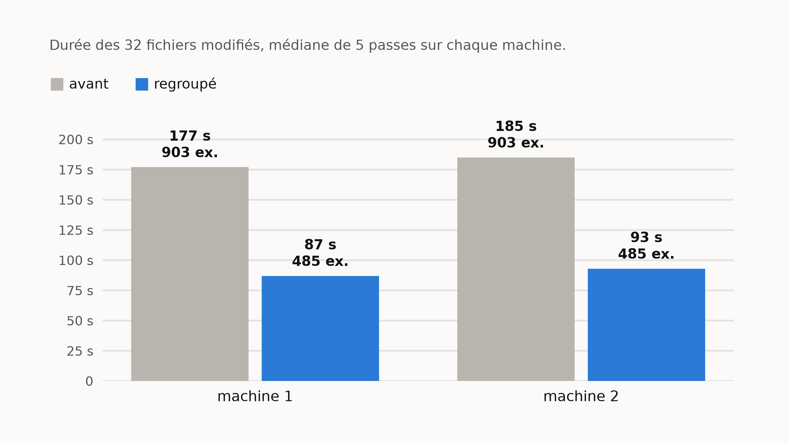
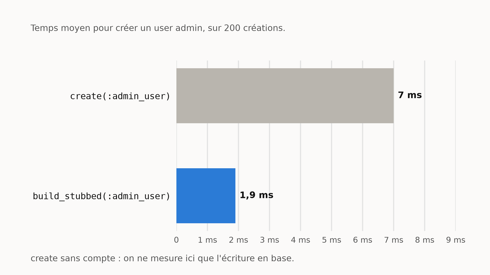
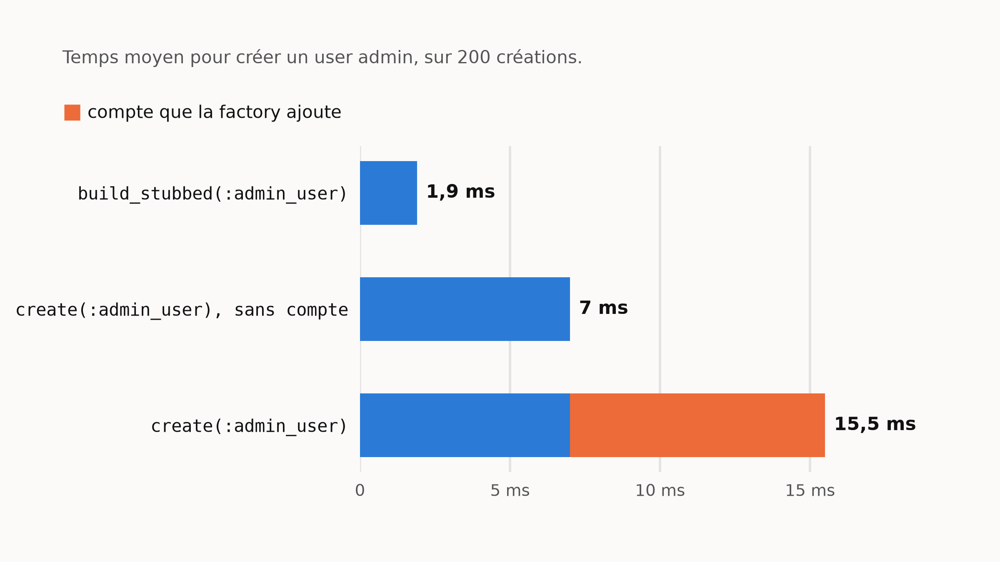

Chez un de nos clients, [paralléliser RSpec](/blog/paralleliser-rspec-sur-github-actions) a fait passer la CI d'une PR de 10 à moins de 5 minutes. Mais paralléliser, comme prendre des machines plus grosses, ne fait que répartir le même travail : on attend moins, la suite n'est pas plus efficace. La cause, ce sont des tests qui font beaucoup plus de travail que ce qu'ils vérifient, et c'est là-dessus qu'on a travaillé.

Et ça se cumule : une factory corrigée accélère tous les specs qui l'utilisent, ceux d'aujourd'hui comme ceux qu'on écrira demain, et un spec écrit avec les bonnes conventions est rapide dès le départ.

L'app de ce client sert à faire des enquêtes en ligne : un compte crée des questionnaires, des gens y répondent, et l'app analyse les réponses. On a appliqué quatre conventions de specs, et mesuré chacune seule sur le code d'aujourd'hui, sur deux machines (le protocole est en fin d'article).


## Un seul exemple par setup coûteux

Chaque `it` rejoue les `before` et les `let` au-dessus de lui. Quand ce setup importe un fichier, clone un questionnaire ou génère des données, sept `it` d'une ligne font sept imports :

```ruby
describe 'after running' do
  before { result }

  it { expect(result.success).to be true }
  it { expect(created_survey).to have_attributes(name: 'Imported Survey', status: 'complete') }
  it { expect(created_survey.owner).to eq(owner) }
  it { expect(blob).to have_received(:purge_later) }
  # … et trois autres
end
```

On les regroupe dans un seul exemple, qui dit ce qu'il prouve :

```ruby
it 'creates the survey and purges the upload', :aggregate_failures do
  expect(result.success).to be true
  expect(created_survey).to have_attributes(name: 'Imported Survey', status: 'complete')
  expect(created_survey.owner).to eq(owner)
  expect(blob).to have_received(:purge_later)
end
```

Avec [`:aggregate_failures`](https://rspec.info/blog/2015/06/rspec-3-3-has-been-released/), l'exemple ne s'arrête pas au premier `expect` qui échoue : il les exécute tous et rapporte chaque échec, comme le faisaient les sept exemples.

Moins d'exemples, c'est moins de fois le même setup. Sur les 32 fichiers où on l'a appliqué, on passe de 903 exemples en 3 minutes à 485 exemples en 1 minute 30 :



## `build_stubbed` quand le spec ne lit jamais la base

Beaucoup de specs enregistrent un objet en base alors qu'ils ne le relisent jamais. Par exemple, une validation refuse un camembert pour une question à choix multiple, parce que les réponses n'y font pas 100 %. Le spec n'a besoin que du type de la question, mais il enregistrait toute la question en base :

```ruby
# avant : la question est enregistrée en base
subject(:chart) { build(:results_card, card: create(:card_question_multiple), options: { chart_type: 'pie' }) }

# après : la question est construite en mémoire
subject(:chart) { build(:results_card, card: build_stubbed(:card_question_multiple), options: { chart_type: 'pie' }) }

it { is_expected.not_to be_valid }
```

`build_stubbed` construit l'objet avec un id, comme s'il était enregistré, mais sans toucher la base :



Ce sont quelques millisecondes par objet : les 19 fichiers où on l'a appliqué passent de 12 à 8 s, soit 4 s de gagnées.

## Des factories sans cascades

Voici ce que créait un `create(:survey)` :

```ruby
factory :survey do
  account                            # un compte, avec son mailing_account
  association :owner, factory: :user # un user…
end

factory :user do
  transient do
    accounts { [build(:account)] }   # …avec un autre compte, et un autre mailing_account
  end
end
```

Un questionnaire créé dans un spec, c'était donc aussi deux comptes, deux `mailing_account` (les réglages d'envoi d'emails d'un compte) et un owner (le user qui a créé le questionnaire), même quand le spec ne regardait que le questionnaire. Un défaut de factory se paie dans chaque spec qui utilise la factory, et dans chaque factory qui l'associe : 5 540 `mailing_account` étaient créés, dont 18 seulement demandés directement par un spec.

La correction : l'owner n'a plus de compte, le `mailing_account` devient un trait qu'on demande, et les enregistrements enfants réutilisent le questionnaire de leur parent au lieu d'en créer un autre.

```ruby
factory :survey do
  account
  owner { association :user, accounts: [] }
end

factory :account do
  trait :with_mailing_account do
    mailing_account
  end
end
```

Comme presque tous les specs créent des questionnaires, le gain se mesure sur toute la suite : environ 40 s (de 434 à 395 s sur une machine, de 498 à 455 s sur l'autre).

Le même défaut restait sur les users staff : la factory donnait un compte à chaque user, même aux admins, qui n'en ont pas en production (leur accès vient de leur type). Ce compte coûtait plus que tout ce que `build_stubbed` faisait gagner :



Les factories des users staff n'ont plus de compte par défaut ; un spec qui en a besoin le passe.

## Ne créer que les enregistrements testés

Certains specs créaient beaucoup plus de données que ce qu'ils vérifiaient. C'est souvent le cas quand le code contient un seuil. Prenons une pagination à 20 éléments par page : pour vérifier qu'il y a bien trois pages, un spec crée 45 éléments. Pourtant, ce qu'il teste, c'est la façon de découper en pages, pas le nombre d'éléments. On peut donc, le temps du spec, passer la taille de page à 2 avec `stub_const` : 5 éléments suffisent alors pour avoir trois pages.

```ruby
# avant : 45 commandes pour obtenir 3 pages de 20
before { create_list(:order, 45) }

# après : des pages de 2, et 5 commandes suffisent pour 3 pages
before do
  stub_const('Order::PER_PAGE', 2)
  create_list(:order, 5)
end

it { expect(Order.page(3).count).to eq(1) }
```

Chez notre client, on a trouvé ce motif deux fois. D'abord dans l'import de réponses, facturé 1 crédit par tranche de 1 000 réponses, arrondi au-dessus : pour vérifier qu'un import de 1 500 réponses coûte bien 2 crédits, le spec importait vraiment 1 500 réponses. En fixant la tranche à 2 réponses le temps du test, 3 réponses suffisent pour retomber sur 2 crédits.

Ensuite dans une simulation : pour tester une enquête, l'app peut simuler des répondants dans chaque groupe visé (les adultes, les mineurs…) et signaler les groupes qu'on n'arrivera pas à atteindre. Le spec simulait 20 personnes par groupe, alors que 4 suffisent pour savoir si un groupe est atteint.

Avec un troisième fichier qui ne crée plus de répondants inutiles, ces fichiers passent d'environ une minute à moins de 20 s :


## Et maintenant

On a écrit des règles pour que ces conventions tiennent. Elles tournent à chaque PR.

**Une règle RuboCop écrite pour le projet.** `RSpec/OneLinerExample` impose la forme des exemples : un `it { expect(...).to ... }` d'une ligne, ou un exemple nommé et marqué `:aggregate_failures` quand il vérifie plusieurs choses. Un script de la CI ne la lance que sur les lignes que la PR ajoute ou modifie, pour ne pas obliger à réécrire tous les anciens specs :

```yaml
# .github/workflows/api-lint.yml
- name: Check the style of touched specs
  run: bin/check-spec-style origin/${{ github.base_ref }}
```

Un nouvel exemple écrit sur plusieurs lignes sans `:aggregate_failures` fait échouer la CI avec ce message :

```
Write the example as a one-liner `it { expect(...).to ... }` — no description, no `do … end`
(tag `:aggregate_failures` when several expectations are needed).
```

**Des instructions pour les agents de code.** Ce qu'un linter ne sait pas juger est écrit en phrases simples dans `.claude/knowledge/api/spec.md`. Un hook l'ajoute automatiquement au contexte de l'agent dès qu'il modifie un fichier sous `spec/`, par exemple :

> Do not mimic legacy specs that violate these rules — the convention wins over existing style.

> [!NOTE]
> **Comment on a mesuré.** Les runners GitHub sont tirés au hasard parmi plusieurs modèles de processeurs, et la même suite y a pris de 400 à 575 s dans nos mesures : on ne compare donc jamais deux runs de CI entre eux. Chaque convention est appliquée seule au code d'aujourd'hui, puis un même runner fait tourner en alternance la version sans et la version avec : cinq fois chacune sur les seuls fichiers que la convention modifie (le reste de la suite ne change pas), trois fois sur la suite complète pour les factories, qui servent partout. On garde la médiane. Le tout a tourné sur deux runners, qui donnent les mêmes gains à quelques secondes près.
