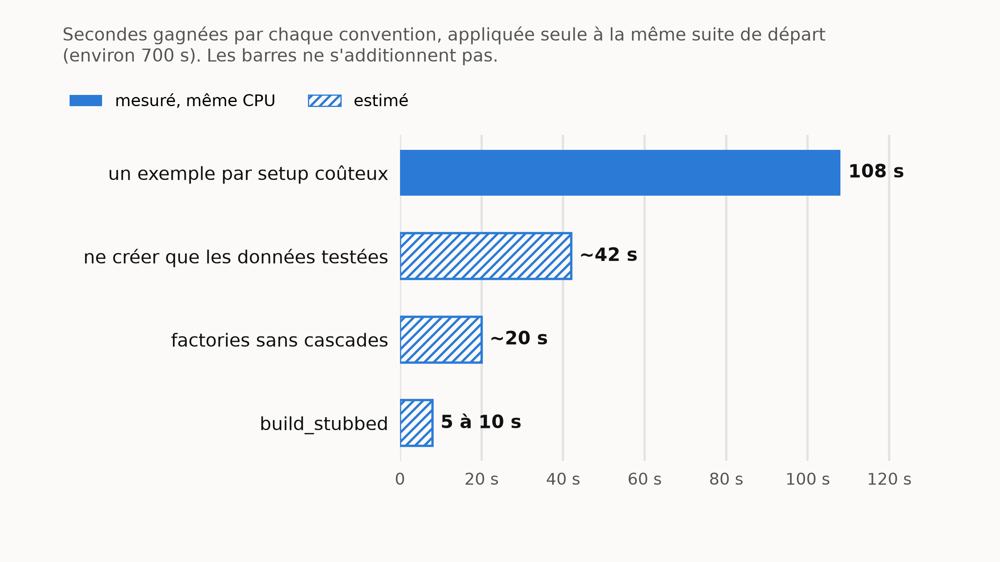

Chez un de nos clients, [paralléliser RSpec](/blog/paralleliser-rspec-sur-github-actions) a fait passer la CI d'une PR de 10 à moins de 5 minutes. Mais paralléliser, comme prendre des machines plus grosses, ne fait que répartir le même travail : on attend moins, la suite n'est pas plus efficace. La cause, ce sont des tests qui font beaucoup plus de travail que ce qu'ils vérifient, et c'est là-dessus qu'on a travaillé.

Et ça se cumule : une factory corrigée accélère tous les specs qui l'utilisent, ceux d'aujourd'hui comme ceux qu'on écrira demain, et un spec écrit avec les bonnes conventions est rapide dès le départ.

On a appliqué quatre conventions de specs. Chacune a été appliquée seule à la même suite de départ, puis les deux versions ont tourné l'une après l'autre sur une même machine. Les gains ne s'additionnent donc pas, et trois d'entre eux sont des estimations.



## Un seul exemple par setup coûteux

Chaque `it` rejoue les `before` et les `let` au-dessus de lui. Quand ce setup importe un fichier, clone un questionnaire ou génère des données, sept `it` d'une ligne font sept imports :

```ruby
describe 'after running' do
  before { result }

  it { expect(result.success).to be true }
  it { expect(created_survey).to have_attributes(name: 'Imported Survey', status: 'complete') }
  it { expect(created_survey.owner).to eq(owner) }
  it { expect(blob).to have_received(:purge_later) }
  # … et trois autres
end
```

On les regroupe dans un seul exemple, qui dit ce qu'il prouve :

```ruby
it 'creates the survey and purges the upload', :aggregate_failures do
  expect(result.success).to be true
  expect(created_survey).to have_attributes(name: 'Imported Survey', status: 'complete')
  expect(created_survey.owner).to eq(owner)
  expect(blob).to have_received(:purge_later)
end
```

Avec [`:aggregate_failures`](https://rspec.info/blog/2015/06/rspec-3-3-has-been-released/), l'exemple ne s'arrête pas au premier `expect` qui échoue : il les exécute tous et rapporte chaque échec, comme le faisaient les sept exemples.

Moins d'exemples, c'est moins de fois le même setup. Le spec de l'import ci-dessus passe de 72 exemples en 26 s à 29 exemples en 8 s :


Appliqué à 28 fichiers, ça fait passer toute la suite de 666 à 558 s (−16 %).

## `build_stubbed` quand le spec ne lit jamais la base

Beaucoup de specs enregistrent un objet en base alors qu'ils ne le relisent jamais. Par exemple, une validation refuse un camembert pour une question à choix multiple, parce que les réponses n'y font pas 100 %. Le spec n'a besoin que du type de la question, mais il l'enregistrait en base :

```ruby
# avant : la question est enregistrée en base
subject(:chart) { build(:results_card, card: create(:card_question_multiple), options: { chart_type: 'pie' }) }

# après : la question est construite en mémoire
subject(:chart) { build(:results_card, card: build_stubbed(:card_question_multiple), options: { chart_type: 'pie' }) }

it { is_expected.not_to be_valid }
```

`build_stubbed` construit l'objet avec un id, comme s'il était enregistré, mais sans toucher la base :


Ce sont quelques millisecondes par objet : sur les 19 fichiers où on l'a appliqué, le gain est estimé à 5 à 10 s, environ 1 % de la suite, trop peu pour ressortir d'une mesure. [FactoryDoctor](https://test-prof.evilmartians.io/guide/profilers/factory_doctor) estimait à 29,8 s tout ce que la suite enregistrait sans jamais le relire.

## Des factories sans cascades

Voici ce que créait un `create(:survey)` :

```ruby
factory :survey do
  account                            # un compte, avec son mailing_account
  association :owner, factory: :user # un user…
end

factory :user do
  transient do
    accounts { [build(:account)] }   # …avec un autre compte, et un autre mailing_account
  end
end
```

Un questionnaire créé dans un spec, c'était donc aussi deux comptes, deux `mailing_account` et un owner, même quand le spec ne regardait que le questionnaire. Un défaut de factory se paie dans chaque spec qui utilise la factory, et dans chaque factory qui l'associe : 5 540 `mailing_account` étaient créés, dont 18 seulement demandés directement par un spec.

La correction : l'owner n'a plus de compte, le `mailing_account` devient un trait qu'on demande, et les enregistrements enfants réutilisent le questionnaire de leur parent au lieu d'en créer un autre.

```ruby
factory :survey do
  account
  owner { association :user, accounts: [] }
end

factory :account do
  trait :with_mailing_account do
    mailing_account
  end
end
```

Sur toute la suite, ça fait 38 134 enregistrements créés au lieu de 44 135. Le gain propre de cette convention est estimé à une vingtaine de secondes : chaque enregistrement évité ne coûte que quelques millisecondes, mais il y en a 6 000 de moins à chaque passage de la suite.

Le même défaut restait sur les users staff : la factory donnait un compte à chaque user, même aux admins, qui n'en ont pas en production (leur accès vient de leur type). Ce compte coûtait plus que tout ce que `build_stubbed` faisait gagner :


Les factories des users staff n'ont plus de compte par défaut ; un spec qui en a besoin le passe.

## Ne créer que les enregistrements testés

Certains specs créaient beaucoup plus de données que ce qu'ils vérifiaient.

Par exemple, un import consomme des crédits : 1 crédit par tranche de 1 000 répondants, arrondi au-dessus. Pour vérifier cet arrondi, il faut dépasser une tranche, donc le spec importait 1 500 répondants et vérifiait que ça coûtait 2 crédits. Mais ce qu'on teste, c'est l'arrondi, pas le volume. Le temps du spec, on ramène la tranche à 2 répondants avec `stub_const` : 3 répondants donnent le même arrondi à 2 crédits.

```ruby
# avant
let(:respondent_count) { 1500 }
let(:questions) { [build_parsed_question(cell_values: Array.new(1500, 'a'))] }

# après : 2 répondants par crédit, même arrondi, 3 lignes au lieu de 1 500
let(:respondent_count) { 3 }
let(:questions) { [build_parsed_question(cell_values: %w[a a a])] }
before { stub_const('Credits::Recalculate::Quantitative::RESPONDENTS_PER_BUCKET', 2) }
```

Même idée ailleurs : un rapport créait 20 répondants par profil, alors que 4 suffisent pour vérifier ce qu'il calcule. Son fichier de spec passe de 40 à 9 s :


Sur les 4 fichiers concernés, le profil de chaque fichier donne un gain d'environ 42 s, une estimation. C'est moins que l'écart entre deux mesures du même code (50 à 100 s) : sur toute la suite, on ne le voit pas, il faut mesurer fichier par fichier.

## Et maintenant

On reprend ces conventions une par une : une petite PR par convention, qu'on relit en quelques minutes.

Le but, c'est que les prochains specs soient efficaces dès qu'on les écrit. Les conventions qu'un outil peut vérifier deviennent des règles de RuboCop, le linter Ruby : un spec qui ne les respecte pas fait échouer la CI. Les autres sont écrites, en phrases simples, dans les instructions que nos agents de code lisent avant d'écrire un spec.

> [!NOTE]
> Les runners `ubuntu-latest` tombent sur des CPU différents, et la même suite peut prendre de 477 à 730 s. Les versions de la suite sont donc comparées sur une seule machine, l'une après l'autre. On suit aussi dans PostHog la somme des temps de chaque fichier de spec, qui monte quand on ajoute des specs, pas quand on ajoute des jobs (voir [Suivre les OKR tech d'une équipe dans PostHog](/blog/suivre-les-okr-tech-d-une-equipe-dans-posthog-depuis-github-actions)).
