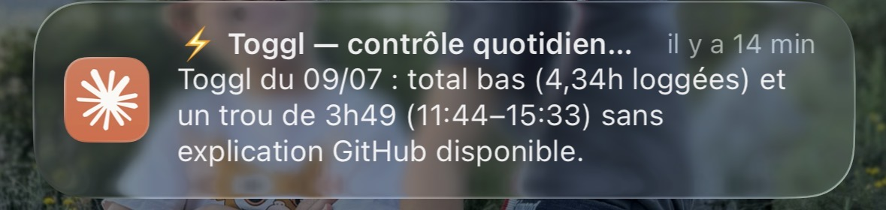
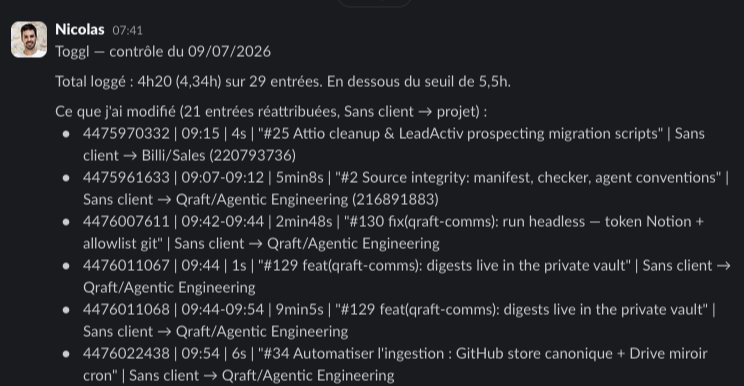

We sell expertise by the hour. For that to work, every hour has to land on the right client and the right topic — billable or not. My tool for this is [Toggl](https://toggl.com/track/), and I'm bad at maintaining it by hand: a forgotten timer running all night, entries never assigned to a client, whole gaps on busy days.

So I built a pipeline that reconstructs my days from what I actually do: my Claude Code sessions, my commits, my calendar.



## 1. What manual tracking misses

A real sample, from a single week:

- a timer started at 6:57pm and stopped… at 8:18am the next day — 13h35 logged for a task that took 21 minutes
- 21 entries with no client, so unbillable as they stand
- a 3h49 gap on a Wednesday, with no trace of what I had done

Nothing dramatic individually. Compounded over a month, it's misattributed revenue, and painful reconciliation when the monthly activity report is due.

## 2. A cloud routine does the analysis

The core of the pipeline is a [scheduled Claude Code routine](https://claude.com/claude-code): an isolated cloud session fired by cron every morning at 7:37, with its environment secrets (Toggl token, GitHub token) and two connectors (Slack, Google Calendar). Its prompt lists the checks to run on yesterday:

```javascript
1. No entries: if yesterday (a workday) has no entries at all, that's the main alert.
2. Gaps: intervals > 1h with no entry between the day's first and last entries.
   Ignore a 45min–1h30 gap between 12pm and 2pm (normal lunch break).
3. Client-less entries: entries with no project_id, or whose project has no client_id.
4. Forgotten timers: entries > 10h, or a timer still running that started yesterday.
5. Missing lunch break: a single entry covering 12pm–2pm and lasting > 3h.
6. Low total: total < 5.5h even though there are entries.
```

To explain each anomaly, it cross-references three sources: GitHub activity (commits, PRs — via the [events API](https://docs.github.com/en/rest/activity/events)), the calendar (a gap covered by an appointment is legitimate, there's nothing to create), and my Mac's local activity — the interesting part, next section. Then it fixes what's safe through the [Toggl API](https://engineering.toggl.com/docs/), turns the rest into suggestions, and sends me a single Slack DM per day: reassigned, created, legitimate gaps, suggestions, still to fix.



## 3. The local context no cloud can see

The bulk of my activity is visible through no API: Claude Code sessions and not-yet-pushed commits live on my Mac. The cloud routine can't come and get them.

Hence the second component: a local sensor, fired by launchd at 7:15, which extracts yesterday's activity windows — every Claude Code session leaves a timestamped trace of every exchange — and drops them into an [R2](https://developers.cloudflare.com/r2/) bucket that the cloud routine reads twenty minutes later.

```python
# activity segments: split on >15 min of inactivity
for ts in stamps:
    if seg_start is None:
        seg_start = prev = ts
        continue
    if ts - prev > SEGMENT_GAP:
        segments.append((seg_start, prev))
        seg_start = ts
    prev = ts
```

The exported JSON is deliberately poor: time windows, a subject for work folders, and a plain label ("personal") for anything private — the content of those sessions never leaves the machine, it only serves to mark a window as non-work.

## 4. Why the sensor has no LLM

The first version of the local component was a full `claude -p` routine, with its own analysis prompt. It lasted three days: one morning, it crashed without telling anyone (the 13h35 timer slipped through); two days later, a false negative — "no activity in this window" when there had been four sessions, because it was searching for Paris times in files timestamped in UTC.

The lesson I take from it: the LLM where there's judgment (assigning an ambiguous entry, deciding a gap is legitimate), deterministic code where it's mechanical (extracting timestamps, converting a timezone, uploading a file). And a failure has to make noise:

```bash
# the sensor's launchd wrapper — no silent failures
if [ $rc -ne 0 ]; then
  curl -s -X POST "https://slack.com/api/chat.postMessage" \
    -H "Authorization: Bearer $SLACK_TOKEN" \
    -d "{\"channel\":\"$DM\",\"text\":\"💻 Toggl local sensor: failed (exit $rc)\"}"
fi
```

## 5. The guardrails

The routine writes to my Toggl without asking each time, so the rules are strict:

- reassign a client-less entry: yes, if the description matches the client mapping; otherwise, a suggestion in the DM
- create an entry in a gap: yes, if the signals converge (session + commits on the window); never beyond the observed windows
- edit existing start/stop times, delete an entry, fill the lunch break, touch a running timer: never
- after every write, read back via GET to check the server really has the data
- personal activity explains gaps, but never creates an entry

## What's still pending

- Secrets are set by hand (Toggl, GitHub, R2 — cloud side and Mac side), and I dragged my feet on it for days.
- Mac off at 7:15: no local data that day. The routine says so in its report, it doesn't guess.
- Ambiguous cases come back to me — by design, and it costs a few minutes of review each morning.
- Too early to quantify how much billable time this recovers per month; I'll follow up once there's hindsight.
