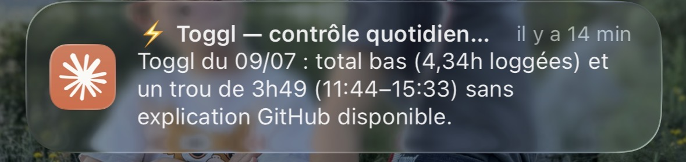
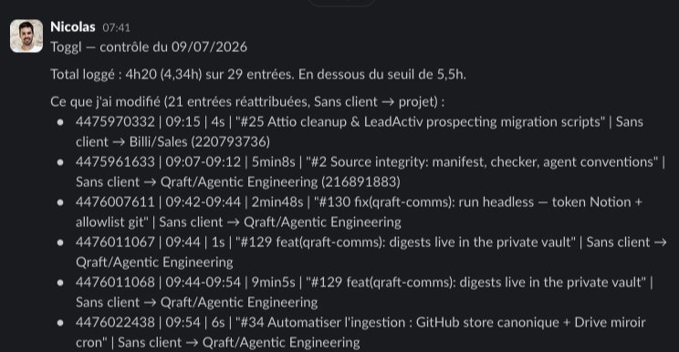

On vend du temps d'expertise. Pour que ça tienne, chaque heure doit finir sur le bon client et le bon sujet — facturable ou non. Mon outil pour ça, c'est [Toggl](https://toggl.com/track/), et je suis mauvais à le tenir à la main : timer oublié qui tourne toute la nuit, entrées jamais attribuées à un client, trous entiers les jours chargés.

Donc j'ai construit un pipeline qui reconstitue mes journées à partir de ce que je fais vraiment : mes sessions Claude Code, mes commits, mon agenda.



## 1. Ce que le suivi manuel rate

Un échantillon réel, sur une seule semaine :

- un timer démarré à 18h57 et arrêté… à 8h18 le lendemain — 13h35 loggées pour une tâche qui a duré 21 minutes
- 21 entrées « sans client », donc infacturables en l'état
- un trou de 3h49 un mercredi, sans aucune trace de ce que j'avais fait

Rien de dramatique à l'unité. Cumulé sur un mois, c'est du chiffre d'affaires mal attribué, et des relectures pénibles au moment du compte rendu d'activité.

## 2. Une routine cloud fait l'analyse

Le cœur du pipeline est une [routine Claude Code planifiée](https://claude.com/claude-code) : une session cloud isolée qui se lance par cron chaque matin à 7h37, avec ses secrets d'environnement (token Toggl, token GitHub) et deux connecteurs (Slack, Google Calendar). Son prompt liste les contrôles à passer sur la journée de la veille :

```javascript
1. Aucune entrée : si la veille (jour ouvré) n'a aucune entrée, c'est l'alerte principale.
2. Trous : intervalles > 1h sans entrée entre la première et la dernière entrée de la journée.
   Ignore un trou de 45 min à 1h30 entre 12h et 14h (pause déjeuner normale).
3. Entrées « sans client » : entrées sans project_id, ou dont le projet n'a pas de client_id.
4. Timers oubliés : entrées > 10h, ou timer encore en cours démarré la veille.
5. Pause déjeuner manquante : une seule entrée couvrant 12h–14h et durant > 3h.
6. Total bas : total < 5,5h alors qu'il y a des entrées.
```

Pour expliquer chaque anomalie, elle croise trois sources : l'activité GitHub (commits, PR — via l'[API events](https://docs.github.com/en/rest/activity/events)), l'agenda (un trou couvert par un rendez-vous est légitime, il n'y a rien à créer), et l'activité locale de mon Mac — la partie intéressante, section suivante. Puis elle corrige ce qui est sûr via l'[API Toggl](https://engineering.toggl.com/docs/), met le reste en proposition, et m'envoie un seul DM Slack par jour : réattribué, créé, trous légitimes, propositions, reste à corriger.



## 3. Le contexte local qu'aucun cloud ne voit

Le plus gros de mon activité n'est visible d'aucune API : les sessions Claude Code et les commits pas encore poussés vivent sur mon Mac. La routine cloud ne peut pas venir les chercher.

D'où le deuxième composant : un capteur local, lancé par launchd à 7h15, qui extrait les fenêtres d'activité de la veille — chaque session Claude Code laisse une trace horodatée de chaque échange — et les dépose dans un bucket [R2](https://developers.cloudflare.com/r2/) que la routine cloud lit vingt minutes plus tard.

```python
# segments d'activité : on coupe à >15 min d'inactivité
for ts in stamps:
    if seg_start is None:
        seg_start = prev = ts
        continue
    if ts - prev > SEGMENT_GAP:
        segments.append((seg_start, prev))
        seg_start = ts
    prev = ts
```

Le JSON exporté est volontairement pauvre : des créneaux, un sujet pour les dossiers de travail, et un simple label (« perso ») pour tout ce qui est privé — le contenu de ces sessions-là ne quitte jamais la machine, il sert juste à marquer un créneau comme non-travail.

## 4. Pourquoi le capteur n'a pas de LLM

La première version du composant local était une routine `claude -p` complète, avec son propre prompt d'analyse. Elle a tenu trois jours : un matin, crash sans prévenir personne (le timer de 13h35 est passé au travers) ; deux jours plus tard, un faux négatif — « aucune activité sur ce créneau » alors qu'il y avait quatre sessions, parce qu'elle cherchait des heures de Paris dans des fichiers horodatés en UTC.

La leçon que j'en retire : le LLM là où il y a du jugement (attribuer une entrée ambiguë, décider qu'un trou est légitime), du code déterministe là où c'est mécanique (extraire des timestamps, convertir un fuseau, uploader un fichier). Et un échec doit faire du bruit :

```bash
# le wrapper launchd du capteur — jamais d'échec silencieux
if [ $rc -ne 0 ]; then
  curl -s -X POST "https://slack.com/api/chat.postMessage" \
    -H "Authorization: Bearer $SLACK_TOKEN" \
    -d "{\"channel\":\"$DM\",\"text\":\"💻 Capteur local Toggl : échec (exit $rc)\"}"
fi
```

## 5. Les garde-fous

La routine écrit dans mon Toggl sans me demander à chaque fois, donc les règles sont strictes :

- réattribuer une entrée « sans client » : oui, si la description matche le mapping client ; sinon, proposition dans le DM
- créer une entrée dans un trou : oui, si les indices convergent (session + commits sur le créneau) ; jamais au-delà des créneaux observés
- modifier des horaires existants, supprimer une entrée, combler la pause déjeuner, toucher un timer en cours : jamais
- après chaque écriture, relecture via GET pour vérifier que le serveur a bien la donnée
- l'activité perso explique des trous, mais ne crée jamais d'entrée

## Ce qui reste

- Les secrets se posent à la main (Toggl, GitHub, R2 — côté cloud et côté Mac), et j'ai traîné plusieurs jours à le faire.
- Mac éteint à 7h15 : pas de données locales ce jour-là. La routine le dit dans son rapport, elle ne devine pas.
- Les cas ambigus me reviennent — c'est voulu, et ça fait quelques minutes de relecture chaque matin.
- Trop tôt pour chiffrer ce que ça récupère en facturable par mois ; je referai un point avec du recul.
