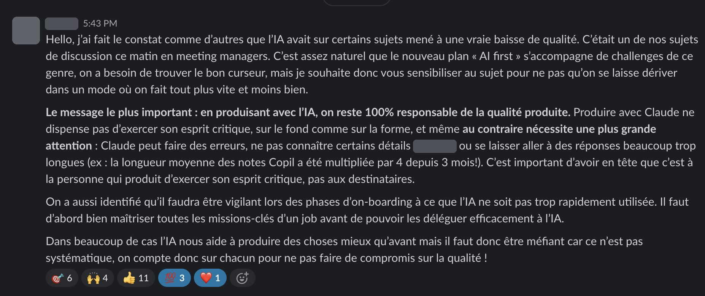
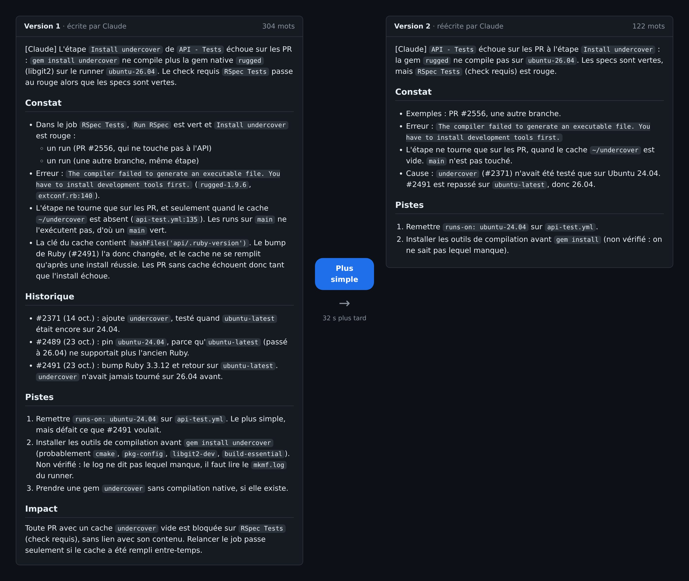

At the end of October, at one of the companies we work with, a member of the leadership team posted this message to the whole company.

The company had just launched an "AI first" plan, and on some topics, quality had dropped, enough for it to come up in the managers' meeting. One figure sums it up: the average length of steering committee notes had been multiplied by 4 in 3 months.

I shared it with the Qraft team the next morning, because I think it concerns all of us, with my own take:

> On my side, there's no way I'm spending more time reading AI-generated things that are 10,000-word slop when the author could have made it simpler / shorter / more relevant. Writing is easy, reading is hard, the work has to be done on the author's side.

## When I code

It's the same with code. A good part of what I ship today is written by Claude Code: the code, but also PR descriptions and issues. It's still my name on it, and I'm the one who answers for it. My job is to read for the direction, challenge, and steer.

An example from the same week. A CI check was blocking PRs, and I asked Claude to open an issue. Its first version was 304 words: the finding, the history of the three PRs that led there, three leads and a paragraph on impact. All of it was correct. I answered "Plus simple" (simpler). The second one is 122 words: what breaks, why, and two leads.

What went away is what the reader didn't need in order to act: the history, the third lead "if it exists", the impact paragraph that repeated the introduction. Claude didn't do that sorting on its own, and it's the same sorting as for the steering committee notes.

For code, I read the structure before the details: routes, resources, names. If the architecture has to change, bugs can wait. And I don't rewrite by hand, I say where to go. In the same session, on how to run only the checks that matter, it went like this: "I'd rather it doesn't run at all than have it run and be ignored". That's where we ended up: the heavy job doesn't run at all when its project hasn't changed ([details in another article](/en/blog/running-only-the-changed-project-s-tests-without-losing-required-checks)).

This article was written with Claude too. I turned down several versions before this one, and it's my name at the top.
