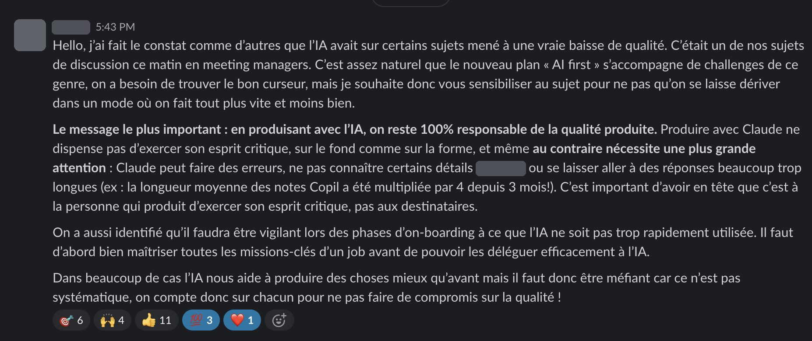
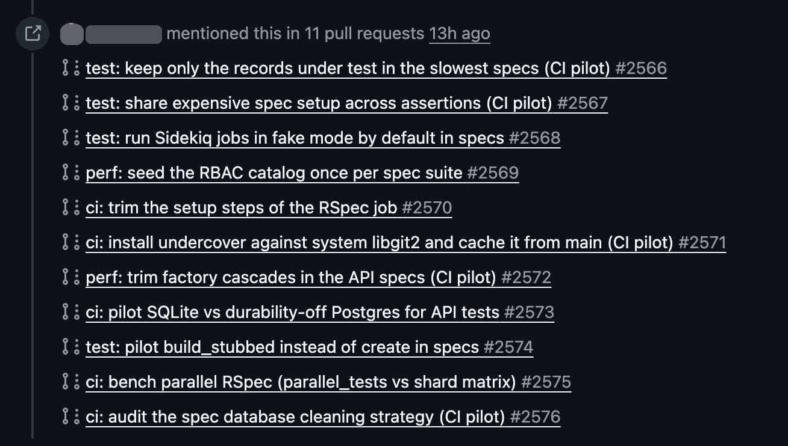
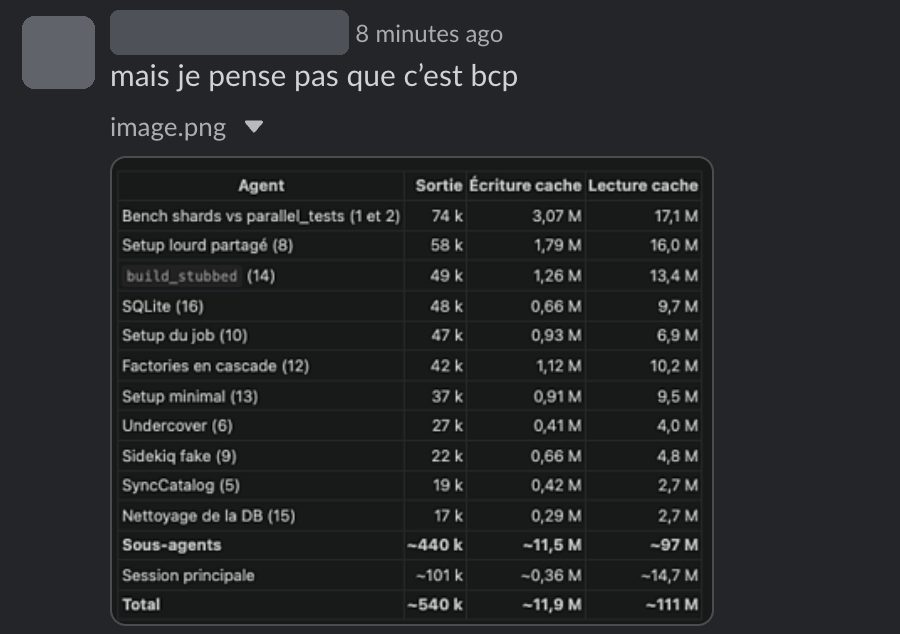
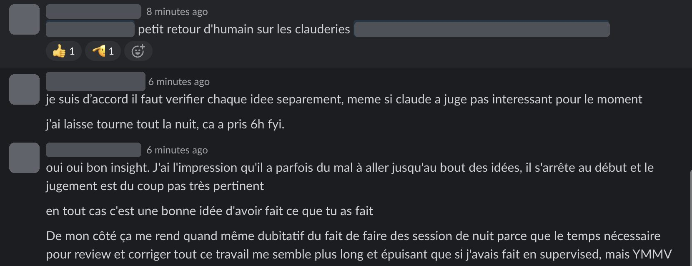

Fin octobre, dans une des boîtes avec qui on travaille, un membre de la direction a posté ce message à toute l'équipe. L'entreprise venait de lancer un plan « AI first », et en réunion de managers, plusieurs avaient constaté que sur certains sujets, la qualité avait baissé.

L'exemple donné est parlant : la longueur moyenne des notes de comité de pilotage a été multipliée par 4 en 3 mois. Et la conclusion est sans ambiguïté : « c'est à la personne qui produit d'exercer son esprit critique, pas aux destinataires ». Je l'ai partagé avec l'équipe Qraft, parce que ça nous concerne tous, moi compris.

Le même jour, je suis tombé sur la même question côté tech, sous une autre forme : pas un texte trop long, mais des décisions prises par un agent.

## Une nuit d'agents sur la CI

Sur le même produit, la suite de tests de l'API (RSpec, 7 650 exemples) était passée de 94 secondes fin mai à environ 12 minutes. Quelqu'un de l'équipe a laissé Claude Code travailler dessus toute la nuit : une PR pilote par idée, et dans chaque PR un bench qui compare la PR à `main` dans le même run. Au matin, il y avait 11 PR et un tableau de 16 idées, avec un verdict pour chacune : ✅, 🟡 ou ❌.

C'était une note de travail, un point de départ, et le travail est solide. Il a montré que le temps de la suite variait jusqu'à 50 % selon le modèle de CPU du runner, et il a trouvé la plus grosse cause du ralentissement : un callback de factory qui resynchronisait le catalogue de permissions à chaque exemple. Une ligne dans `before(:suite)`, et RSpec perd 25 à 35 %.

Restaient les verdicts, et c'est là que la responsabilité revient à l'équipe. Trois pistes sont revenues en 🟡 : éviter les factories en cascade, ne créer que les records sous test, `build_stubbed` au lieu de `create`. « ~1 % », « sous le bruit ». Sur la mesure du jour, c'est juste. Mais ces trois pistes changent la façon d'écrire les tests, et chaque nouveau test en profite : on a décidé de les creuser quand même. Mon impression, c'est que Claude s'arrête parfois au début d'une idée, et la juge sur ce début.

Dans le thread, on est tombés d'accord pour vérifier chaque idée séparément, y compris celles que Claude a écartées. Sur la session de nuit, en revanche, on n'a pas le même avis. De mon côté, relire et corriger ce volume de travail me semble plus long que de superviser au fil de l'eau. De l'autre, les benchs de parallélisation prenaient à eux seuls 5 des 6 heures, du temps machine que personne n'aurait passé à regarder.

La suite : merger les deux gros gains, puis re-mesurer les trois pistes 🟡 par-dessus, une par une.
