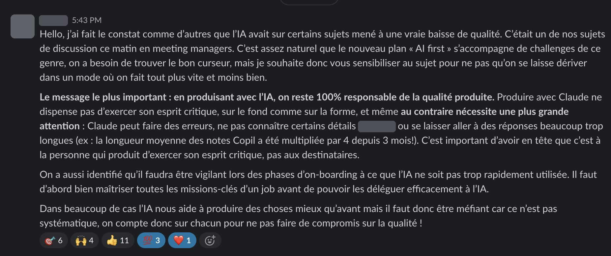
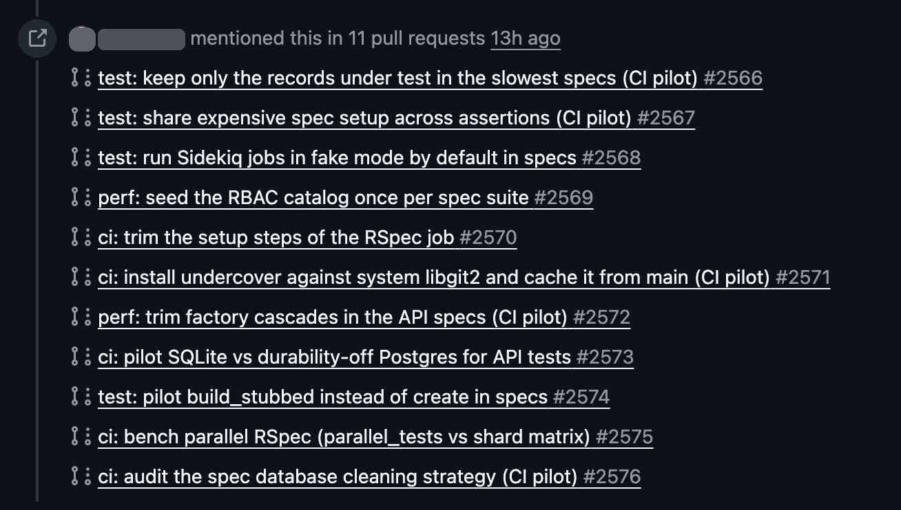
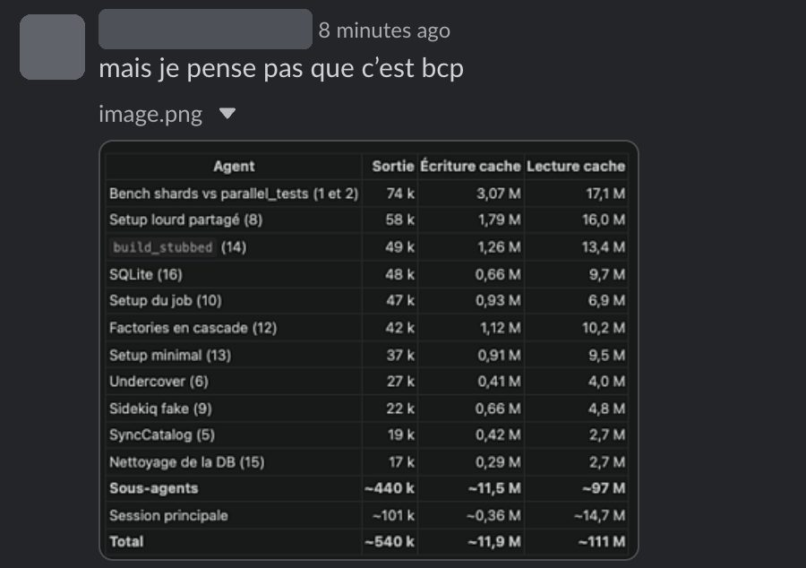
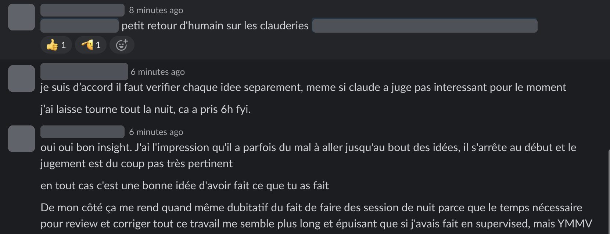

At the end of October, at one of the companies we work with, a member of the leadership team posted this in the internal AI channel. The company had recently launched an "AI first" plan, and it was one of the topics of the managers' meeting that morning: on some topics, AI had led to a real drop in quality.

The figure that sticks is in the middle: the average length of steering committee notes had been multiplied by 4 in 3 months. The sentence right after it says where the work belongs: "it's up to the person who produces to exercise their critical thinking, not the recipients". The message also asks for care during onboarding: you need to master the key tasks of a job before you can delegate them to AI.

I shared it with the Qraft team, with my own take:

> On my side, there's no way I'm spending more time reading AI-generated things that are 10,000-word slop when the author could have made it simpler / shorter / more relevant. Writing is easy, reading is hard, the work has to be done on the author's side.

What changed is the relative cost. Writing ten pages used to cost more than reading them, so the author did the sorting without thinking about it. Now the ten pages are free to produce, and every reader pays to read them. If the author doesn't cut, the cost moves to the readers, once per reader.

## A night of agents on the CI

The same morning, on the tech side of the same product, I ran into a version of this that's less obvious, because what the agent produced wasn't too long: it was very good work, with verdicts on it.

The API test suite (RSpec, 7,650 examples) had gone from 94 seconds at the end of May to about 12 minutes on `main`. A developer on the team opened an issue to bring it back down, and I added a few leads: look at the factories, create only the records under test, use `build_stubbed` instead of `create`, review the database cleaning strategy, try SQLite.

They let Claude Code run overnight on it. One pilot PR per idea, the idea alone, and in each PR a bench workflow that runs control jobs (frozen `main`) and pilot jobs (the PR) in the same run. The first push of each PR is an A/A run, the same code on both sides, to measure the noise. In the morning: 16 ideas in a table with a verdict for each, 11 PRs, about 6 hours, ~540k output tokens and 111M tokens read from cache.

It was a working note for themselves, a starting point, not a deliverable sent to me for review. And the method holds up. It found that the noise came from the runner's CPU model: `ubuntu-latest` lands on four different CPUs, and the same code took 407 s on one and 686 s on another, so every comparison is made control vs pilot on the same CPU. It also found the biggest single cause: a factory callback re-synced the permissions catalog in every example that created a certain object. One line in `before(:suite)`, and RSpec drops by 25 to 35%.

## The verdicts are where I disagree

Three of my leads came back yellow: cascading factories, minimal setup, `build_stubbed`. "~1%", "under the A/A noise", "no mass migration". Measured, that's true today. But they're the ones that change how tests are written, and that compounds: every new test written the right way stays fast. Everything else in the table boils down to more cache, more CPU, more parallelism, and doing once what was done N times (the most interesting of the four). I answered on the issue that these three deserve to be dug into, and that what Claude says needs to be challenged.

My feeling is that Claude often stops at the beginning of an idea, and judges it on that beginning. A 16-row table with ✅ and ❌ looks finished. What's finished is the measurement, not the judgment.

The developer agreed: each idea has to be checked separately, even the ones Claude set aside. The goal was to have something to start from, and the ideas it approved are good leads, but whether they work together hasn't been checked yet. It's the same rule as the message above, applied to code: the verdict is a hypothesis until someone has taken it on.

Where we don't fully agree is the overnight session itself. On my side, the time it takes to review and fix all that work seems longer and more tiring than if I had supervised it as it went. On theirs, the shard benchmarks alone were going to take hours (5 of the 6), machine time nobody would have spent watching. Both are probably true, depending on the topic.

The next step is the one the table can't do: merge the two big wins, then re-measure the three "yellow" leads on top of them, one by one.
