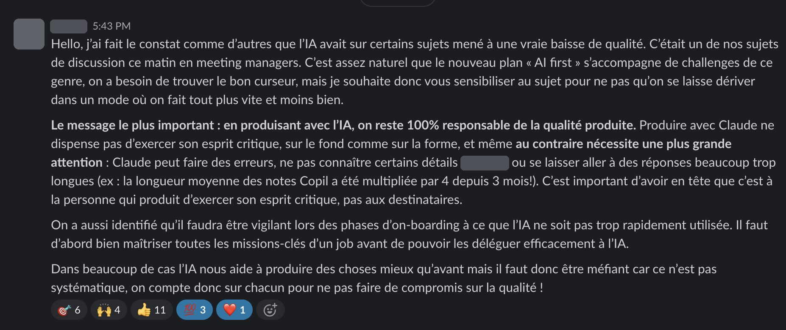
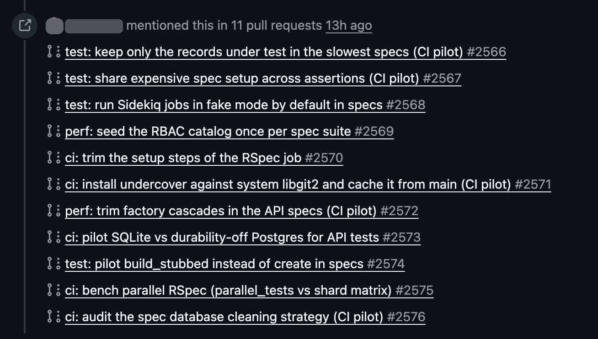
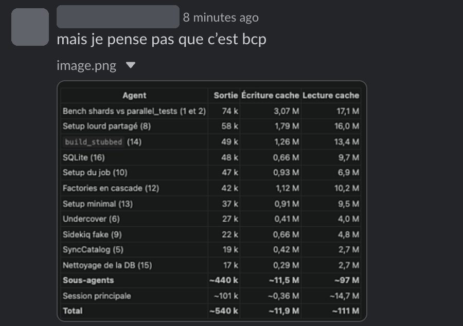
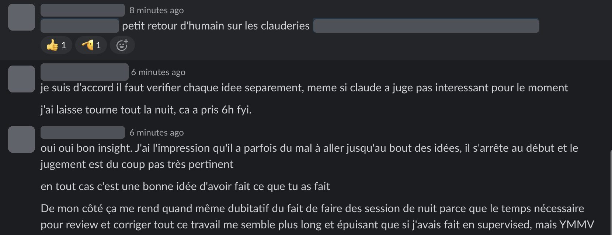

Fin octobre, dans une des boîtes avec qui on travaille, un membre de la direction a posté ce message dans le canal IA interne. L'entreprise venait de lancer un plan « AI first », et c'était un des sujets de la réunion de managers du matin : sur certains sujets, l'IA avait mené à une vraie baisse de qualité.

Le chiffre qui reste est au milieu : la longueur moyenne des notes de comité de pilotage a été multipliée par 4 en 3 mois. La phrase juste après dit où est le travail : « c'est à la personne qui produit d'exercer son esprit critique, pas aux destinataires ». Le message demande aussi de la vigilance pendant l'onboarding : il faut d'abord maîtriser les missions-clés d'un job avant de pouvoir les déléguer à l'IA.

Je l'ai relayé à l'équipe Qraft, avec ce que j'en pense :

> De mon côté, il est hors de question que je passe plus de temps à lire des choses qui ont été générées par l'IA et qui sont du slop à 10 000 mots quand l'auteur aurait pu faire plus simple / plus court / plus pertinent. Il est facile d'écrire, difficile de lire, le travail est à faire du côté de l'auteur.

Ce qui a changé, c'est le coût relatif. Avant, écrire dix pages coûtait plus cher que les lire, donc l'auteur faisait le tri sans y penser. Maintenant, les dix pages ne coûtent rien à produire, et chaque lecteur paie pour les lire. Si l'auteur ne coupe pas, le coût passe chez les lecteurs, une fois par lecteur.

## Une nuit d'agents sur la CI

Le même matin, côté tech du même produit, je suis tombé sur une version moins évidente du problème : ce que l'agent avait produit n'était pas trop long, c'était du très bon travail, avec des verdicts dessus.

La suite de tests de l'API (RSpec, 7 650 exemples) était passée de 94 secondes fin mai à environ 12 minutes sur `main`. Quelqu'un de l'équipe a ouvert une issue pour la faire redescendre, et j'y ai ajouté quelques pistes : regarder les factories, ne créer que les records sous test, `build_stubbed` au lieu de `create`, revoir la stratégie de nettoyage de la base, essayer SQLite.

Claude Code a tourné toute la nuit dessus. Une PR pilote par idée, l'idée seule, et dans chaque PR un workflow de bench qui lance dans le même run des jobs contrôle (`main` figé) et des jobs pilote (la PR). Le premier push de chaque PR est un run A/A, le même code des deux côtés, pour mesurer le bruit. Au matin : 16 idées dans un tableau avec un verdict chacune, 11 PR, environ 6 h, ~540 k tokens de sortie et 111 M de tokens lus en cache.

C'était une note de travail, un point de départ, pas un livrable qu'on m'envoyait à relire. Et la méthode tient. Elle a montré que le bruit venait du modèle de CPU du runner : `ubuntu-latest` tombe sur quatre CPU différents, et le même code a mis 407 s sur l'un, 686 s sur un autre, donc toutes les comparaisons se font contrôle contre pilote sur le même CPU. Elle a aussi trouvé la plus grosse cause : un callback de factory resynchronisait le catalogue de permissions dans chaque exemple qui créait un certain objet. Une ligne dans `before(:suite)`, et RSpec perd 25 à 35 %.

## Les verdicts, c'est là que je ne suis pas d'accord

Trois de mes pistes sont revenues en jaune : les factories en cascade, le setup minimal, `build_stubbed`. « ~1 % », « sous le bruit A/A », « pas de migration massive ». Mesuré, c'est vrai aujourd'hui. Mais ce sont celles qui changent la façon d'écrire les tests, et ça se cumule : chaque nouveau test écrit comme il faut reste rapide. Le reste du tableau se résume à plus de cache, plus de CPU, plus de parallélisation, et faire une fois ce qui était fait N fois (le plus intéressant des quatre). J'ai répondu sur l'issue que ces trois-là méritaient d'être creusées, et qu'il fallait challenger ce que dit Claude.

J'ai l'impression que Claude s'arrête souvent au début d'une idée, et la juge sur ce début. Un tableau de 16 lignes avec des ✅ et des ❌ a l'air fini. Ce qui est fini, c'est la mesure, pas le jugement.

Réponse dans le thread : d'accord, il faut vérifier chaque idée séparément, même celles que Claude a écartées. L'objectif était d'avoir quelque chose pour commencer, et les idées qu'il a retenues sont de bonnes pistes, mais on n'a pas encore vérifié qu'elles marchent ensemble. C'est la même règle que le message du début, appliquée au code : le verdict est une hypothèse tant que personne ne l'a repris à son compte.

Là où on n'est pas complètement d'accord, c'est sur la session de nuit elle-même. De mon côté, le temps qu'il faut pour relire et corriger tout ce travail me semble plus long et plus épuisant que si je l'avais supervisé au fil de l'eau. De l'autre, les benchs de shards allaient prendre des heures à eux seuls (5 sur les 6), du temps machine que personne n'aurait passé à regarder. Les deux sont sans doute vrais, selon le sujet.

La suite, c'est ce que le tableau ne sait pas faire : merger les deux gros gains, puis re-mesurer les trois pistes « jaunes » par-dessus, une par une.
