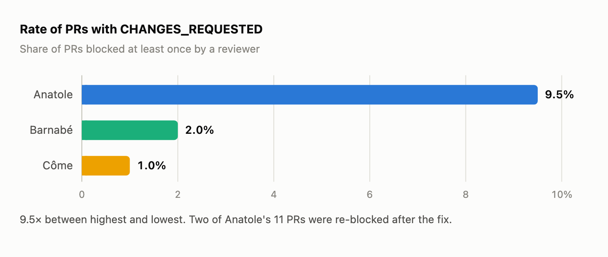
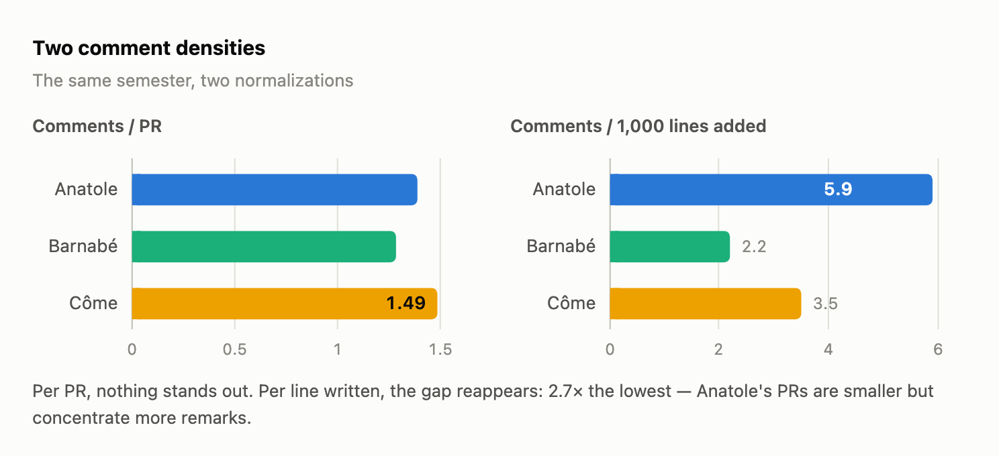
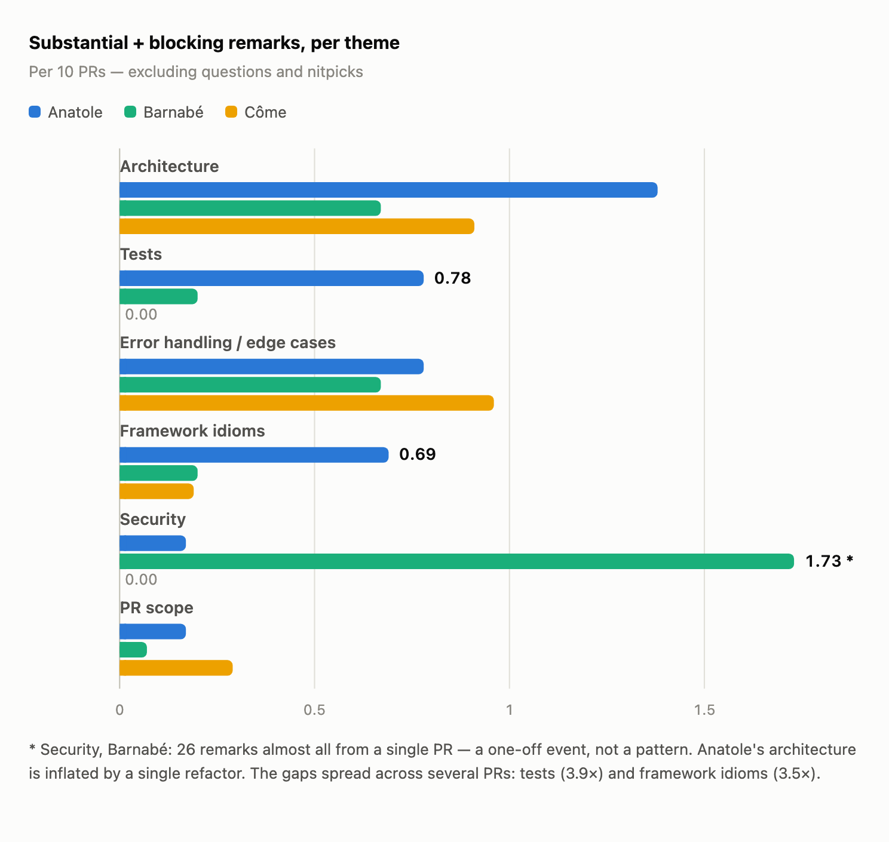

Ahead of the semi-annual review of one of our developers, I wanted to check an impression: his PRs seemed to get pushback in review more often than the others'. I asked Claude Code to classify the semester's 664 human review comments — 474 PRs, three devs compared. Call them Anatole (the dev under review), Barnabé and Côme.

The impression is confirmed, and made precise: the gap is real, concentrated on three themes. On others, Anatole is the best of the three.

## 1. The method

The raw material comes from the GitHub API:

```bash
gh api "repos/$ORG/$REPO/pulls?state=all&base=main" --paginate   # the semester's PRs
gh api "repos/$ORG/$REPO/pulls/$N/reviews" --paginate            # verdicts (APPROVED, CHANGES_REQUESTED…)
gh api "repos/$ORG/$REPO/pulls/$N/comments" --paginate           # inline comments
```

Each comment is classified by theme (architecture, tests, error handling, framework idioms, security, PR scope) and by weight (blocking, substantial, question, nitpick). Bots and self-comments excluded. Two rules:

- everything is normalized per PR, never in absolute terms;
- a gap only counts if it is specific to one dev. A remark that hits all three belongs to the repo or the reviewer, not the dev.

## 2. The main signal: 9.5× on the blocking rate



|  | Anatole | Barnabé | Côme |
| --- | --- | --- | --- |
| PRs opened (merged) | 116 (92) | 150 (124) | 208 (181) |
| Rate of PRs with CHANGES_REQUESTED | **9.5%** | 2.0% | 1.0% |
| Human comments / PR | 1.39 | 1.29 | 1.49 |
| Comments / 1,000 lines added | **5.9** | 2.2 | 3.5 |

Per PR, nothing stands out: 1.39 comments, right in the average. The gap shows up per line written.



Anatole's PRs are smaller, but concentrate more remarks. Two of his PRs were re-blocked after the fix.

## 3. Per theme: where the gap sits



|  | Anatole | Barnabé | Côme |
| --- | --- | --- | --- |
| Architecture | **1.38** (16) | 0.67 (10) | 0.91 (19) |
| Tests | **0.78** (9) | 0.20 (3) | 0.00 (0) |
| Error handling / edge cases | 0.78 (9) | 0.67 (10) | 0.96 (20) |
| Framework idioms | **0.69** (8) | 0.20 (3) | 0.19 (4) |
| Security | 0.17 (2) | 1.73 (26)\* | 0.00 (0) |
| PR scope | 0.17 (2) | 0.07 (1) | 0.29 (6) |
| **Total** | **4.91** (57) | 3.93 (59) | 3.03 (63) |

Two reading corrections: Barnabé's 26 security remarks come from a single PR, and Anatole's architecture is inflated by a single refactor. What remains are the gaps spread across several PRs:

- **Tests (3.9× vs Barnabé, Côme at zero).** The semester's only two blocking "tests" comments are on his PRs: missing coverage, conventions not applied to the rest of the file, tests in the wrong spec file.
- **Framework idioms (3.5×).** Rebuilding what already exists: a model scope rewritten by hand, an existing UI component ignored, an ad hoc task where a standard job was enough.
- **Two patterns absent for Barnabé and Côme.** Propagation — the reviewer has to explicitly ask for a remark to be applied to the whole diff ("A few comments — make sure to apply them to all the tests, I didn't write a comment every time"). And superfluous added code — ~21 occurrences across 116 PRs: useless comments, redundant defensive code, duplication.

## 4. Where Anatole leads

- **PR scope**: 2 remarks over the semester, versus 28 for Côme (dead code, rebase leftovers). The cleanest on the team.
- **Error handling**: 0.78, in the average (0.67–0.96). It's Côme's top category, not his.
- **Security**: 2 isolated remarks, no pattern.
- **Reviewing others**: he catches real, blocking bugs in his peers' PRs.

The comparison also discards the noise: test conventions and the hunt for useless code hit all three devs. That's the reviewer's style and the repo's culture — counted in absolute terms, they would have inflated the case against Anatole.

## 5. Insights, not targets

These numbers prepare a review conversation; they don't set targets. "Get under 3% CHANGES_REQUESTED" would be gameable: bigger PRs, avoiding the demanding reviewer, negotiating remarks in DMs (Goodhart's law).

The behavior to build, proposed by Claude as the synthesis of the patterns: **re-read your own diff before opening the PR** — look for existing code to reuse, delete the superfluous, propagate every remark to the whole diff. I hadn't formulated it myself.

## Limitations

- **A near-single reviewer**: most substantial remarks come from one person. A real but bounded bias — that reviewer also reviews Barnabé and Côme without triggering these remarks.
- **The big-PR effect**: ~60 substantial remarks per dev; a single refactor can inflate a theme. Two cases identified, corrected in §3.
- **LLM classification**: the orders of magnitude are reliable, not the decimals.
- **Not measured**: velocity, topic complexity, autonomy, communication.
