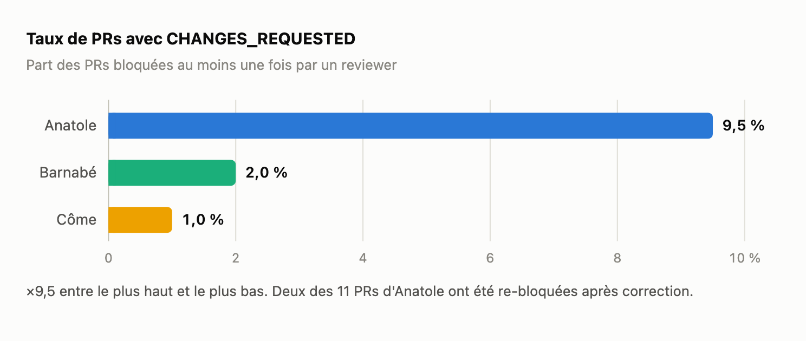
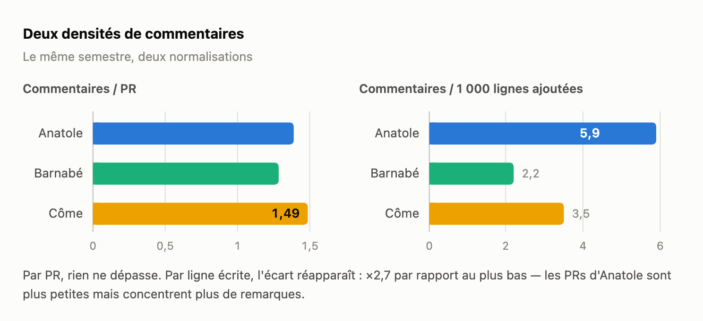
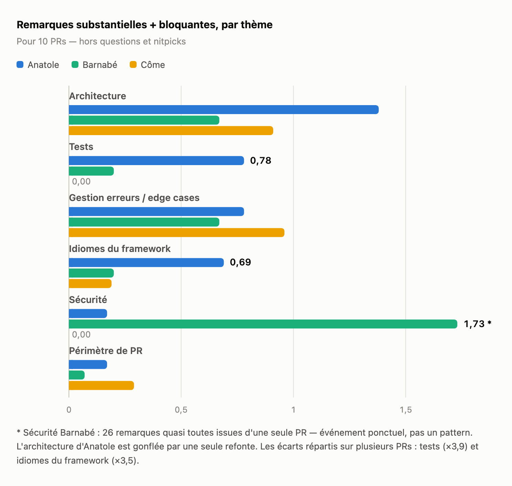

Avant l'entretien semestriel d'un des développeurs de l'équipe, je voulais vérifier une impression : ses PRs semblaient accrocher en review plus souvent que celles des autres. J'ai fait classifier par Claude Code les 664 commentaires de review humains du semestre — 474 PRs, trois devs comparés. Appelons-les Anatole (le dev évalué), Barnabé et Côme.

L'impression est confirmée, et précisée : l'écart est réel, concentré sur trois thèmes. Sur d'autres, Anatole est le meilleur des trois.

## 1. La méthode

La matière première vient de l'API GitHub :

```bash
gh api "repos/$ORG/$REPO/pulls?state=all&base=main" --paginate   # les PRs du semestre
gh api "repos/$ORG/$REPO/pulls/$N/reviews" --paginate            # verdicts (APPROVED, CHANGES_REQUESTED…)
gh api "repos/$ORG/$REPO/pulls/$N/comments" --paginate           # commentaires inline
```

Chaque commentaire est classifié par thème (architecture, tests, gestion d'erreurs, idiomes du framework, sécurité, périmètre de PR) et par poids (bloquant, substantiel, question, nitpick). Bots et auto-commentaires exclus. Deux règles :

- tout est normalisé par PR, jamais en absolu ;
- un écart ne compte que s'il est spécifique à un dev. Une remarque qui touche les trois relève du repo ou du reviewer, pas du dev.

## 2. Le signal principal : ×9,5 sur le taux de blocage



|  | Anatole | Barnabé | Côme |
| --- | --- | --- | --- |
| PRs ouvertes (mergées) | 116 (92) | 150 (124) | 208 (181) |
| Taux de PRs avec CHANGES_REQUESTED | **9,5 %** | 2,0 % | 1,0 % |
| Commentaires humains / PR | 1,39 | 1,29 | 1,49 |
| Commentaires / 1 000 lignes ajoutées | **5,9** | 2,2 | 3,5 |

Par PR, rien ne dépasse : 1,39 commentaire, dans la moyenne. C'est par ligne écrite que l'écart apparaît.



Les PRs d'Anatole sont plus petites, mais concentrent plus de remarques. Deux de ses PRs ont été re-bloquées après correction.

## 3. Par thème : où l'écart se loge



|  | Anatole | Barnabé | Côme |
| --- | --- | --- | --- |
| Architecture | **1,38** (16) | 0,67 (10) | 0,91 (19) |
| Tests | **0,78** (9) | 0,20 (3) | 0,00 (0) |
| Gestion erreurs / edge cases | 0,78 (9) | 0,67 (10) | 0,96 (20) |
| Idiomes du framework | **0,69** (8) | 0,20 (3) | 0,19 (4) |
| Sécurité | 0,17 (2) | 1,73 (26)\* | 0,00 (0) |
| Périmètre PR | 0,17 (2) | 0,07 (1) | 0,29 (6) |
| **Total** | **4,91** (57) | 3,93 (59) | 3,03 (63) |

Deux corrections de lecture : les 26 remarques sécurité de Barnabé viennent d'une seule PR, et l'architecture d'Anatole est gonflée par une seule refonte. Restent les écarts répartis sur plusieurs PRs :

- **Tests (×3,9 vs Barnabé, Côme à zéro).** Les deux seuls bloquants « tests » du semestre sont sur ses PRs : couverture manquante, conventions non appliquées au reste du fichier, tests dans le mauvais fichier de spec.
- **Idiomes du framework (×3,5).** Recréer ce qui existe déjà : un scope de modèle réécrit à la main, un composant UI existant ignoré, une tâche ad hoc là où un job standard suffisait.
- **Deux patterns absents chez Barnabé et Côme.** La propagation — le reviewer doit demander explicitement d'appliquer une remarque à tout le diff (« Quelques commentaires, pense à bien les appliquer pour tous les tests, je n'ai pas écrit un commentaire à chaque fois »). Et le code superflu ajouté — ~21 occurrences sur 116 PRs : commentaires inutiles, code défensif redondant, duplication.

## 4. Où Anatole est devant

- **Périmètre de PR** : 2 remarques sur le semestre, contre 28 pour Côme (code mort, résidus de rebase). Le plus propre de l'équipe.
- **Gestion d'erreurs** : 0,78, dans la moyenne (0,67–0,96). C'est le premier poste de Côme, pas le sien.
- **Sécurité** : 2 remarques isolées, aucun pattern.
- **En review des autres** : il détecte des bugs réels et bloquants chez ses pairs.

La comparaison écarte aussi le bruit : conventions de tests et chasse au code inutile touchent les trois devs. C'est le style du reviewer et la culture du repo — comptées en absolu, elles auraient gonflé le dossier à charge.

## 5. Des insights, pas des objectifs

Ces chiffres préparent un entretien, ils ne fixent pas de cibles. « Passer sous 3 % de CHANGES_REQUESTED » serait gamable : PRs plus grosses, reviewer évité, remarques négociées en DM (loi de Goodhart).

Le comportement à installer, proposé par Claude en synthèse des patterns : **relire son propre diff avant d'ouvrir la PR** — chercher l'existant à réutiliser, supprimer le superflu, propager chaque remarque à tout le diff. Je ne l'avais pas formulé moi-même.

## Limites

- **Reviewer quasi unique** : l'essentiel des remarques substantielles vient d'une seule personne. Biais réel mais borné — elle review aussi Barnabé et Côme sans déclencher ces remarques.
- **Effet grosse PR** : ~60 remarques substantielles par dev ; une seule refonte peut gonfler un thème. Deux cas identifiés, corrigés en §3.
- **Classification LLM** : les ordres de grandeur sont fiables, pas les décimales.
- **Non mesuré** : vélocité, complexité des sujets, autonomie, communication.
