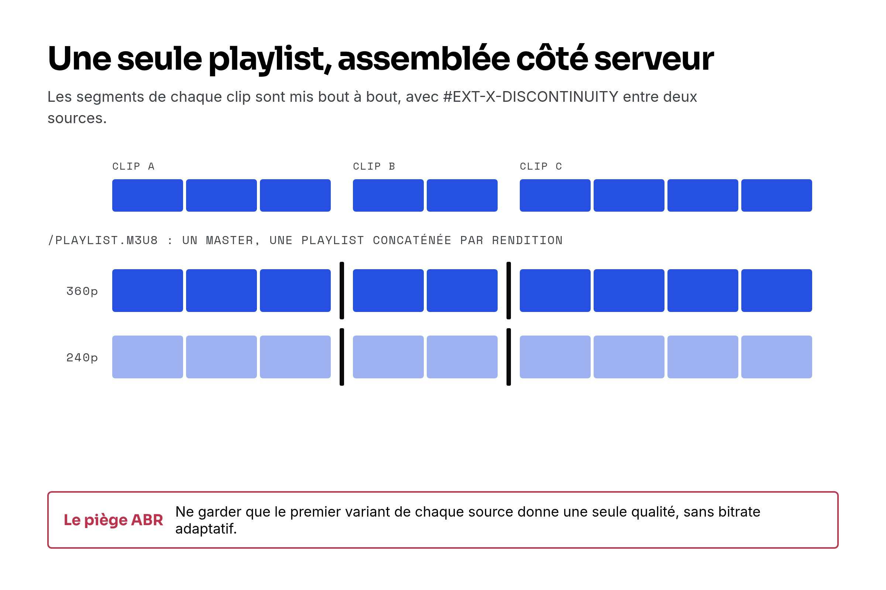
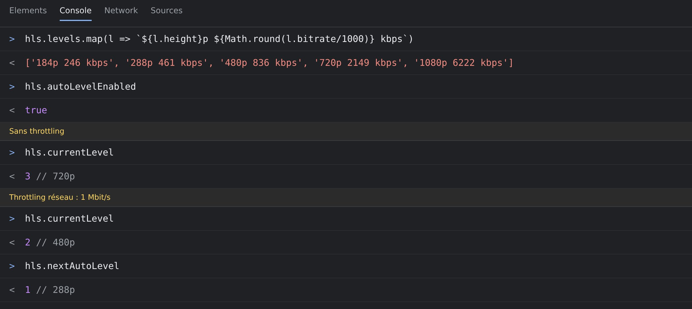

On avait besoin d'un lecteur vidéo unique pour jouer une séquence de courts clips à la suite — comme une playlist, mais composée à la requête depuis des clips stockés séparément sur Bunny Stream. L'approche naïve a échoué. L'approche "production" (double `<video>`) paraissait lourde. Ce qui a vraiment fonctionné, c'est la concaténation côté serveur de playlists HLS, le lecteur ne faisant aucune logique de bascule entre clips.

Repo (public) : [https://github.com/nicolasrouanne/video-chaining](https://github.com/nicolasrouanne/video-chaining)

POC live (CodeSandbox) : [https://codesandbox.io/p/github/nicolasrouanne/video-chaining/main](https://codesandbox.io/p/github/nicolasrouanne/video-chaining/main)

> [!NOTE]


## 1. Première tentative — tableau JS, swap src à la fin

La chose naïve : un élément `<video>`, un tableau d'URLs, basculer vers la suivante quand la précédente se termine.

```javascript
const urls = [videoA, videoB, videoC];
let i = 0;
video.addEventListener("ended", () => {
  video.src = urls[++i];
  video.play();
});
```

Ce qu'on a obtenu :

- Un flash noir à chaque jonction pendant que la nouvelle source se chargeait
- Aucun préchargement du clip suivant
- Une pause de chargement visible toutes les quelques secondes

Définir `src` déclenche un rechargement complet — le navigateur doit découvrir la durée, fetch le premier segment, le décoder, puis démarrer la lecture. Quelques centaines de millisecondes au mieux, plusieurs secondes sur réseau lent. Pas ce qu'on voulait.

## 2. Envisagé — double \<video> avec crossfade

L'approche "production" utilisée par YouTube et Instagram Reels : deux `<video>` empilés, l'un joue pendant que l'autre précharge le suivant. On bascule la visibilité sur `ended`.

On l'a esquissée. Verdict : beaucoup de gestion d'état JS (quel élément est actif, lequel précharge, quand basculer, que faire si le préchargement n'est pas prêt), et la frontière audio entre clips existe toujours au niveau de la source. Faisable mais lourd pour le problème à résoudre.

## 3. Solution qui marche — concaténation de playlist HLS côté serveur

HLS est fait pour ça. Un manifest `.m3u8` peut chaîner des segments de différentes sources avec des marqueurs `#EXT-X-DISCONTINUITY` entre eux. Le lecteur gère les transitions nativement — pas de logique de swap JS, pas de second `<video>`, pas de jonglage manuel du buffer.

La forme :

```text
SOURCES ──┐
          │   fetch + parse        émet un m3u8 avec
          ├──► strip des headers ──► #EXT-X-DISCONTINUITY ──► /playlist.m3u8
          │   segments absolutisés  entre chaque source
SOURCES ──┘
```



Côté serveur, le cœur fait ~30 lignes de Node. Pour chaque URL source, on descend le master playlist jusqu'à un variant, on garde uniquement les lignes `#EXTINF` et les URLs de segments (rendues absolues), on join le tout avec `#EXT-X-DISCONTINUITY` entre les sources :

```javascript
async function segmentsOf(src) {
  const text = await fetch(src).then((r) => r.text());
  return text
    .split("\n")
    .filter((l) => l.startsWith("#EXTINF") || (l && !l.startsWith("#")))
    .map((l) => (l.startsWith("#") ? l : new URL(l, src).href))
    .join("\n");
}

const parts = await Promise.all(sources.map(segmentsOf));
return [
  "#EXTM3U",
  "#EXT-X-VERSION:6",
  "#EXT-X-TARGETDURATION:11",
  "#EXT-X-PLAYLIST-TYPE:VOD",
  parts.join("\n#EXT-X-DISCONTINUITY\n"),
  "#EXT-X-ENDLIST",
].join("\n");
```

→ Serveur complet : [https://github.com/nicolasrouanne/video-chaining/blob/main/server.mjs](https://github.com/nicolasrouanne/video-chaining/blob/main/server.mjs)

Frontend, aucune JS de bascule entre clips :

```html
<video id="v" controls autoplay muted playsinline></video>
<script type="module">
  import Hls from "https://cdn.jsdelivr.net/npm/hls.js@1.5.17/dist/hls.mjs";
  const h = new Hls();
  h.loadSource("/playlist.m3u8");
  h.attachMedia(document.getElementById("v"));
</script>
```

Les segments streament directement depuis le CDN d'origine (Bunny dans notre cas). Le serveur n'émet que le texte du manifest — quelques KB. Pas cher, rapide.

> [!NOTE]
.")

## 4. Le piège subtil — l'ABR sauté silencieusement

Bunny expose chaque vidéo comme un master playlist référençant plusieurs renditions (e.g. 360p + 240p). Notre première implémentation descendait vers le premier variant de chaque source et n'agrégeait que ces segments. Résultat : un media playlist mono-rendition — pas de bitrate adaptatif, pas de bascule de qualité sur réseaux lents.

Le fix : émettre un master playlist qui référence un media playlist concaténé par rendition partagée.

```text
GET /playlist.m3u8?source=A&source=B            → master avec N variants
GET /variant.m3u8?rendition=640x360&source=...  → concat 360p
GET /variant.m3u8?rendition=426x240&source=...  → concat 240p
```

L'endpoint master parcourt le master de chaque source, trouve les résolutions présentes dans toutes les sources (l'intersection), et émet un `#EXT-X-STREAM-INF` par rendition partagée. L'endpoint variant fait ce que l'ancien faisait — concaténer les segments pour une rendition précise.

Vérifié de bout en bout :

```text
[level-controller]: manifest loaded, 2 level(s) found
[level-controller]: Switching to level 1 (360p @1416800) from level -1   ← réseau rapide
```

On throttle le réseau en Slow 3G dans DevTools, on recharge :

```text
[abr] switch candidate:1->0 ... fetchDuration:3.3
[abr] rebuffering expected, optimal quality level 0
[level-controller]: Switching to level 0 (240p @1062600) from level 1   ← ABR redescend en 240p
```

Le lecteur descend en 240p avant tout stall — exactement le comportement souhaité.

On peut inspecter l'état ABR depuis la console navigateur (le POC expose `window.hls`) :

```javascript
hls.levels             // [{ width, height, bitrate }, …]
hls.currentLevel       // -1 = auto, 0/1 = forcé
hls.bandwidthEstimate  // bande passante mesurée en bits/s
```

> [!NOTE]


→ Suivi dans [https://github.com/nicolasrouanne/video-chaining/issues/2](https://github.com/nicolasrouanne/video-chaining/issues/2)

## 5. Ce qui reste

Pour des clips très courts (~3-5s chacun), le surcoût de discontinuité par clip peut dépasser la capacité du lecteur à préfetcher le segment suivant sur des réseaux très lents. Le symptôme : une brève pause de chargement entre clips en Slow 3G. En Slow 4G et plus rapide, rien de visible.

Si l'usage exige une lecture continue à toute épreuve sur mauvais réseaux avec des clips très courts, l'étape suivante réaliste est le pré-rendering serveur avec `ffmpeg -c copy` — générer un MP4 vraiment concaténé par playlist, l'uploader sur Bunny une fois, le lire normalement. Pas de discontinuités, pas de coûts par clip.

→ Suivi dans [https://github.com/nicolasrouanne/video-chaining/issues/1](https://github.com/nicolasrouanne/video-chaining/issues/1)

## En production chez Episto

Le POC est volontairement sans état — les sources passent en query parameters. En production réelle, ça se mappe proprement sur un endpoint Rails :

```text
GET /api/playlists/:id/playlist.m3u8                    → master
GET /api/playlists/:id/variant.m3u8?rendition=640x360   → concat 360p
```

…où les sources viennent de `Playlist.find(id).videos`. Le manifest est immuable par version de playlist, donc du cache HTTP agressif (ou Redis) est l'étape suivante évidente.

## Tous les liens

- Repo : [https://github.com/nicolasrouanne/video-chaining](https://github.com/nicolasrouanne/video-chaining)
- POC live : [https://codesandbox.io/p/github/nicolasrouanne/video-chaining/main](https://codesandbox.io/p/github/nicolasrouanne/video-chaining/main)
- hls.js : [https://github.com/video-dev/hls.js](https://github.com/video-dev/hls.js)
- HLS EXT-X-DISCONTINUITY (Mux) : [https://www.mux.com/articles/hls-ext-tags](https://www.mux.com/articles/hls-ext-tags)
- Docs Bunny Stream : [https://docs.bunny.net/docs/stream-collections](https://docs.bunny.net/docs/stream-collections)
