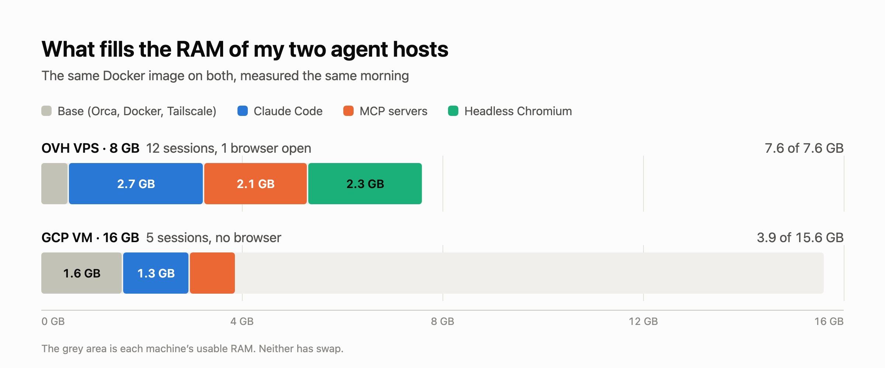

My coding agents run on a VM: one per person, [Orca](https://github.com/stablyai/orca) on it, a Claude Code session per task, driven from the laptop or the phone. Since [the move to an OVH VPS](/en/blog/moving-my-coding-agents-to-an-ovh-vps-with-a-single-boot-script), that VM costs 13.30 € a month instead of about $126 on GCP, with half the RAM. One morning it got slow enough that typing in a terminal lagged, while the GCP host, which I kept, was fine. Both run the same Docker image down to the digest, the same Claude Code version and the same MCP servers: the difference was in the machine, or in what was running on it.

## RAM, not CPU

`free` and the kernel's pressure counters ([PSI](https://docs.kernel.org/accounting/psi.html)) answer it in two commands:

```
$ free -h
               total        used        free      shared  buff/cache   available
Mem:           7.6Gi       7.5Gi       129Mi       147Mi       376Mi       111Mi
Swap:             0B          0B          0B
$ cat /proc/pressure/cpu /proc/pressure/memory /proc/pressure/io
some avg10=0.46 avg60=0.88 avg300=0.52 total=1785735711
full avg10=0.00 avg60=0.00 avg300=0.00 total=0
some avg10=36.89 avg60=20.97 avg300=6.72 total=7798218254
full avg10=34.61 avg60=19.61 avg300=6.25 total=7497328883
some avg10=92.79 avg60=69.09 avg300=24.00 total=18054407606
full avg10=87.61 avg60=64.47 avg300=22.24 total=16617282875
```

111 MB available out of 7.6 GB, and no swap. Processes almost never waited for the CPU (the first two lines), but over the last ten seconds all of them were stalled on memory 35% of the time, and on the disk 88% of the time. Without swap, the kernel has nowhere to put the memory of an idle process. What it drops instead are files mapped in memory, the code of the programs first, and it reads them back from disk as soon as they run again. `vmstat` showed 64 to 69% of CPU time waiting on I/O, for 7 to 9 MB/s read. During the night the kernel had already killed a Chromium to make room.

The processor has little to do with it. The VPS has 4 vCores that the hypervisor presents as an Intel Haswell, the GCP VM 4 vCPUs of AMD EPYC Milan. A 300,000-iteration bash loop takes 1.42 s on the VPS and 1.25 s on GCP, with the VPS thrashing. An agent spends most of its time waiting for the model to answer: on both hosts, CPU pressure is close to zero.



## What a session weighs

The VPS had 12 Claude Code sessions open, the five oldest for about three days. The GCP VM had 5. Adding up the processes' RSS to find what each one costs overcounts: a page shared between processes (a library, the code of a binary started twelve times) is counted once per process. PSS splits each shared page among the processes that use it, so the lines add up to the real total:

```bash
sudo sh -c 'for d in /proc/[0-9]*; do
  echo "$(cat $d/comm) $(awk "/^Pss:/ {print \$2}" $d/smaps_rollup)"
done' 2>/dev/null \
  | awk '{kb[$1] += $2; n[$1]++} END {for (c in kb) printf "%6.0f MB %3d %s\n", kb[c]/1024, n[c], c}' \
  | sort -rn | head -8
```

On the GCP VM, which has room to spare:

```
  1291 MB   5 claude
   771 MB   1 dockerd
   501 MB   5 chrome-devtools
   357 MB   7 orca-ide
   283 MB  10 node
   115 MB  10 slack-mcp-serve
    97 MB   1 systemd-journal
    83 MB   1 tailscaled
```

A session is about 260 MB for Claude Code itself, and 180 MB for its MCP servers: around 100 MB for `chrome-devtools-mcp`, about 55 MB of `node` (the Notion server, and the telemetry watchdog `chrome-devtools-mcp` starts next to it), about 20 MB for two Slack servers, one per workspace. About 440 MB in all here, 385 on the VPS, 40% of it MCP servers, for sessions a few hours to three days old: a session's memory grows with its conversation. Each session starts its own copy of every server in its configuration: 12 sessions are 12 `chrome-devtools-mcp`, 12 Notion servers and 24 Slack servers, and `chrome-devtools-mcp` costs its 100 MB even in a session that never opens a page.

The rest is the base: the Orca server, Docker, Tailscale, journald. 0.6 GB on the VPS, 1.6 GB on the GCP VM, mostly because `dockerd` takes ten times more there.

## The browser left open

`chrome-devtools-mcp` only starts Chromium on the first browser tool call. The browser then lives as long as the session, with every tab it opened. On the VPS, one session had used it a day and sixteen hours earlier: 24 Chromium processes, 2.3 GB. Closing that session took available memory from 111 MB to 2.6 GB. On GCP, none of the five sessions had touched the browser, and there was no Chromium at all.

## How many sessions per VM

From these measurements, a rule of thumb: about 1 GB for the base, 0.5 GB per session to leave room for those that grow with a long conversation, about 2 GB per browser left open, and about 4 GB per running Docker Compose stack (the sizing rule of the host's repository). With no browser and no stack:

| VM | RAM | per month, excl. VAT | sessions | per session |
|---|---|---|---|---|
| OVH VPS-2 | 8 GB | 13.30 € | ~13 | ~1.00 € |
| OVH VPS-3 | 12 GB | 17.15 € | ~21 | ~0.80 € |
| OVH VPS-4 | 24 GB | 28.80 € | ~44 | ~0.65 € |
| GCP e2-standard-4 | 16 GB | ~$126 | ~29 | ~$4.30 |

The OVH prices include, as in the [setup described before](/en/blog/moving-my-coding-agents-to-an-ovh-vps-with-a-single-boot-script), a 100 GB additional disk for the data (4.31 €) and the automatic backup (0.50 to 1 € depending on the model). GCP is the default VM with its regional disk; the `n2d-standard-4` I measured on, with the same RAM, is about $160.

That morning on the VPS: 1 GB of base, 12 sessions at 0.5 GB, one browser at 2 GB, so 9 GB on a machine with 7.6. The VPS-2 holds the sessions I actually work in at the same time, not the ones I leave open.

## The levers

- **Close a session when its task is done.** Orca shows each session's memory and can kill one from there. A closed session takes its MCP servers and its browser with it.
- **Load `chrome-devtools-mcp` only where a browser is needed**, in the `.mcp.json` of those projects rather than in the global configuration: 100 MB less per session everywhere else, and no browser started by accident.
- **Add swap.** Neither host has any. Sessions idle for days are what swap sets aside best, and a full RAM then slows the machine down gradually instead of stalling it.
- **Move up one model.** The VPS-3 is 3.85 € more a month, for 4 GB of RAM and 2 vCores more.
