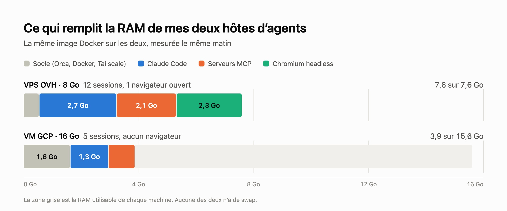

Mes agents de code tournent sur une VM : une par personne, [Orca](https://github.com/stablyai/orca) dessus, une session Claude Code par tâche, pilotée depuis le laptop ou le téléphone. Depuis [le passage sur un VPS OVH](/blog/mes-agents-de-code-sur-un-vps-ovh-avec-un-seul-script-de-demarrage), cette VM coûte 13,30 € par mois au lieu d'environ 126 $ sur GCP, avec la moitié de la RAM. Un matin, elle ramait au point que la frappe dans un terminal avait du retard, alors que l'hôte GCP, que j'ai gardé, allait très bien. Les deux font tourner la même image Docker, au digest près, la même version de Claude Code et les mêmes serveurs MCP : la différence était dans la machine, ou dans ce qui tournait dessus.

## La RAM, pas le CPU

`free` et les compteurs de pression du noyau ([PSI](https://docs.kernel.org/accounting/psi.html)) répondent en deux commandes :

```
$ free -h
               total        used        free      shared  buff/cache   available
Mem:           7.6Gi       7.5Gi       129Mi       147Mi       376Mi       111Mi
Swap:             0B          0B          0B
$ cat /proc/pressure/cpu /proc/pressure/memory /proc/pressure/io
some avg10=0.46 avg60=0.88 avg300=0.52 total=1785735711
full avg10=0.00 avg60=0.00 avg300=0.00 total=0
some avg10=36.89 avg60=20.97 avg300=6.72 total=7798218254
full avg10=34.61 avg60=19.61 avg300=6.25 total=7497328883
some avg10=92.79 avg60=69.09 avg300=24.00 total=18054407606
full avg10=87.61 avg60=64.47 avg300=22.24 total=16617282875
```

111 Mo disponibles sur 7,6 Go, et pas de swap. Les processus n'attendaient presque jamais le CPU (les deux premières lignes), mais sur les dix dernières secondes, tous étaient bloqués sur la mémoire 35 % du temps, et sur le disque 88 % du temps. Sans swap, le noyau n'a nulle part où mettre la mémoire d'un processus inactif. Ce qu'il libère à la place, ce sont les fichiers mappés en mémoire, le code des programmes en premier, et il les relit sur le disque dès qu'ils tournent à nouveau. `vmstat` montrait 64 à 69 % du temps CPU à attendre les entrées-sorties, pour 7 à 9 Mo/s lus. Pendant la nuit, le noyau avait déjà tué un Chromium pour faire de la place.

Le processeur n'y est pas pour grand-chose. Le VPS a 4 vCores que l'hyperviseur présente comme un Intel Haswell, la VM GCP 4 vCPU d'AMD EPYC Milan. Une boucle bash de 300 000 itérations prend 1,42 s sur le VPS et 1,25 s sur GCP, VPS en pleine saturation. Un agent passe l'essentiel de son temps à attendre la réponse du modèle : sur les deux hôtes, la pression CPU est proche de zéro.



## Ce que pèse une session

Le VPS avait 12 sessions Claude Code ouvertes, les cinq plus anciennes depuis environ trois jours. La VM GCP en avait 5. Additionner le RSS des processus pour savoir ce que coûte chacune compte trop : une page partagée entre plusieurs processus (une bibliothèque, le code d'un binaire lancé douze fois) est comptée une fois par processus. Le PSS répartit chaque page partagée entre les processus qui l'utilisent, donc les lignes s'additionnent pour donner le vrai total :

```bash
sudo sh -c 'for d in /proc/[0-9]*; do
  echo "$(cat $d/comm) $(awk "/^Pss:/ {print \$2}" $d/smaps_rollup)"
done' 2>/dev/null \
  | awk '{kb[$1] += $2; n[$1]++} END {for (c in kb) printf "%6.0f MB %3d %s\n", kb[c]/1024, n[c], c}' \
  | sort -rn | head -8
```

Sur la VM GCP, qui a de la marge :

```
  1291 MB   5 claude
   771 MB   1 dockerd
   501 MB   5 chrome-devtools
   357 MB   7 orca-ide
   283 MB  10 node
   115 MB  10 slack-mcp-serve
    97 MB   1 systemd-journal
    83 MB   1 tailscaled
```

Une session, c'est environ 260 Mo pour Claude Code lui-même, et 180 Mo pour ses serveurs MCP : une centaine pour `chrome-devtools-mcp`, à peu près 55 Mo de `node` (le serveur Notion, et le watchdog de télémétrie que `chrome-devtools-mcp` lance à côté), une vingtaine pour deux serveurs Slack, un par workspace. Environ 440 Mo en tout ici, 385 sur le VPS, dont 40 % de serveurs MCP, pour des sessions ouvertes depuis quelques heures à trois jours : la mémoire d'une session grossit avec sa conversation. Chaque session lance sa propre copie de chaque serveur de sa configuration : 12 sessions, ce sont 12 `chrome-devtools-mcp`, 12 serveurs Notion et 24 serveurs Slack, et `chrome-devtools-mcp` coûte ses 100 Mo même dans une session qui n'ouvre jamais de page.

Le reste, c'est le socle : le serveur Orca, Docker, Tailscale, journald. 0,6 Go sur le VPS, 1,6 Go sur la VM GCP, surtout parce que `dockerd` y prend dix fois plus.

## Le navigateur resté ouvert

`chrome-devtools-mcp` ne lance Chromium qu'au premier appel d'un outil navigateur. Le navigateur vit ensuite aussi longtemps que la session, avec tous les onglets qu'elle a ouverts. Sur le VPS, une session s'en était servie un jour et seize heures plus tôt : 24 processus Chromium, 2,3 Go. Fermer cette session a fait passer la mémoire disponible de 111 Mo à 2,6 Go. Sur GCP, aucune des cinq sessions n'avait touché au navigateur, et il n'y avait pas de Chromium du tout.

## Combien de sessions par VM

De ces mesures, une règle simple : environ 1 Go pour le socle, 0,5 Go par session pour laisser de la marge à celles qui grossissent avec une longue conversation, environ 2 Go par navigateur resté ouvert, et environ 4 Go par stack Docker Compose lancée (la règle de dimensionnement du repo de l'hôte). Sans navigateur ni stack :

| VM | RAM | par mois, HT | sessions | par session |
|---|---|---|---|---|
| VPS-2 OVH | 8 Go | 13,30 € | ~13 | ~1,00 € |
| VPS-3 OVH | 12 Go | 17,15 € | ~21 | ~0,80 € |
| VPS-4 OVH | 24 Go | 28,80 € | ~44 | ~0,65 € |
| GCP e2-standard-4 | 16 Go | ~126 $ | ~29 | ~4,30 $ |

Les prix OVH comprennent, comme dans [la mise en place décrite avant](/blog/mes-agents-de-code-sur-un-vps-ovh-avec-un-seul-script-de-demarrage), un disque additionnel de 100 Go pour les données (4,31 €) et le backup automatique (0,50 à 1 € selon le modèle). GCP, c'est la VM par défaut avec son disque régional ; la `n2d-standard-4` sur laquelle j'ai mesuré, même RAM, revient à environ 160 $.

Ce matin-là sur le VPS : 1 Go de socle, 12 sessions à 0,5 Go, un navigateur à 2 Go, soit 9 Go sur une machine qui en a 7,6. Le VPS-2 tient les sessions sur lesquelles je travaille vraiment en même temps, pas celles que je laisse ouvertes.

## Les leviers

- **Fermer une session quand sa tâche est finie.** Orca affiche la mémoire de chaque session et permet de la tuer de là. Une session fermée emporte ses serveurs MCP et son navigateur avec elle.
- **Ne charger `chrome-devtools-mcp` que là où il faut un navigateur**, dans le `.mcp.json` des projets concernés plutôt que dans la configuration globale : 100 Mo de moins par session partout ailleurs, et pas de navigateur lancé par hasard.
- **Ajouter du swap.** Aucun des deux hôtes n'en a. Des sessions inactives depuis des jours, c'est exactement ce qu'un swap sait mettre de côté, et une RAM pleine ralentit alors la machine progressivement au lieu de la bloquer.
- **Monter d'un modèle.** Le VPS-3, c'est 3,85 € de plus par mois, pour 4 Go de RAM et 2 vCores de plus.
