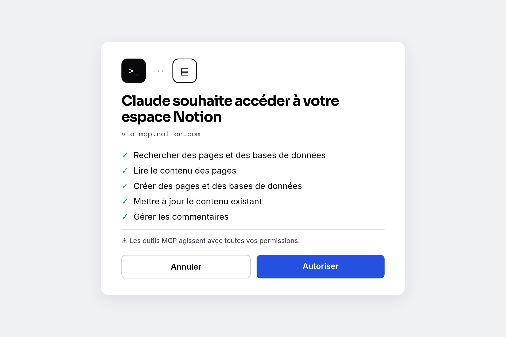

Le **Model Context Protocol (MCP)** permet aux assistants IA comme Claude d'interagir directement avec votre espace de travail Notion. Voici comment le configurer selon la documentation officielle.

## Qu'est-ce que le MCP Notion ?

Le MCP Notion est une intégration officielle qui permet aux outils IA de :

- **Rechercher** des pages et bases de données dans votre espace de travail
- **Lire** et **récupérer** le contenu des pages
- **Créer** de nouvelles pages et bases de données
- **Mettre à jour** le contenu existant
- **Déplacer** des pages entre différents emplacements
- **Gérer** les commentaires et utilisateurs

> Le serveur fournit **21 outils** pour les opérations de l'API Notion, avec des capacités d'édition Markdown optimisées pour la consommation de tokens.

## Outils IA supportés

- **Claude** (Desktop & [Claude.ai](http://claude.ai/))
- **Cursor** (éditeur de code assisté par IA)
- **ChatGPT Pro**
- Tout outil IA supportant le Model Context Protocol

---

## Serveur MCP hébergé (le plus simple)

Notion fournit un serveur hébergé avec installation OAuth. Connectez-vous via :

1. Le répertoire d'outils IA présentés dans Notion
2. Le répertoire de votre outil IA (cherchez "Notion")
3. Connexion manuelle avec l'URL publique

### Configuration

```json
{
  "mcpServers": {
    "notion": {
      "command": "npx",
      "args": ["-y", "mcp-remote", "https://mcp.notion.com/mcp"]
    }
  }
}
```



## Considérations de sécurité

⚠️ **Important** : Les outils MCP agissent avec toutes vos permissions Notion.

- Ils peuvent accéder à tout ce que vous pouvez accéder
- Notion limite les APIs exposées (par ex., impossible de supprimer des bases de données via MCP)
- Envisagez de configurer des capacités en lecture seule pour les espaces de travail sensibles
- Vérifiez les paramètres de capacités de l'intégration

---

## Exemples de commandes

Une fois connecté, vous pouvez demander à votre assistant IA :

- _"Recherche les mises à jour de projet dans Notion"_
- _"Lis les notes de réunion de la semaine dernière"_
- _"Crée une nouvelle tâche dans ma base de données Tâches"_
- _"Mets à jour le statut de la refonte de la page d'accueil"_

---

## Ressources officielles

- [Documentation MCP Notion](https://developers.notion.com/docs/mcp)
- [Guide de démarrage](https://developers.notion.com/docs/get-started-with-mcp)
- [Dépôt GitHub](https://github.com/makenotion/notion-mcp-server)

---

_Écrit avec Claude Code utilisant le MCP Notion_
