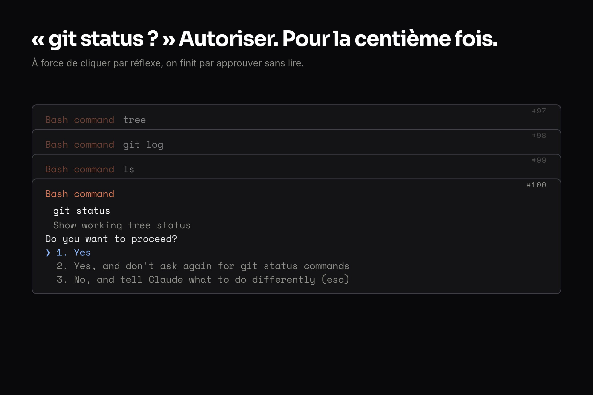

## « Autoriser Claude à exécuter git status ? » Pour la centième fois aujourd'hui.

J'adore Claude Code. C'est devenu mon compagnon de code au quotidien. Mais il y avait un truc qui me rendait dingue : les demandes de permission constantes pour des commandes totalement inoffensives.

`git status` ? Autoriser. `ls` ? Autoriser. `git log` ? Autoriser. `tree` ? Autoriser.

Je cliquais sur "Autoriser" tellement par réflexe que j'avais peur d'approuver un truc dangereux sans m'en rendre compte. C'est l'inverse de la sécurité.



## La hiérarchie des settings que je ne connaissais pas

Il s'avère que Claude Code a un système de configuration en couches que je n'avais pas vraiment exploré :

```javascript
~/.claude/settings.json          ← Défauts utilisateur (versionnable)
~/.claude/settings.local.json    ← Autorisations éphémères (NON versionné)
~/project/.claude/settings.json  ← Défauts projet
~/project/.claude/settings.local.json ← Éphémère projet
```

L'insight clé : `settings.json` est fait pour être **organisé et versionné**. `settings.local.json` est là où s'accumulent vos clics "Autoriser"—c'est éphémère par design.

Je laissais tout s'empiler dans `settings.local.json` à travers plusieurs projets, sans jamais promouvoir les bonnes permissions vers une vraie config.

## La solution : une allowlist de permissions versionnée

J'ai créé un repo `~/dev/claude` pour stocker ma configuration Claude, puis j'ai fait un symlink :

```bash
ln -sf ~/dev/claude/config/settings.json ~/.claude/settings.json
```

Maintenant mes settings racine sont versionnés. J'ai ajouté toutes les commandes read-only que j'utilise constamment :

```json
{
  "permissions": {
    "allow": [
      "Bash(git status:*)",
      "Bash(git log:*)",
      "Bash(git diff:*)",
      "Bash(git show:*)",
      "Bash(ls:*)",
      "Bash(tree:*)",
      "Bash(file:*)",
      "Bash(which:*)",
      "Bash(pwd)",
      
      "Bash(git add:*)",
      "Bash(git commit:*)",
      "Bash(git push:*)",
      
      "Bash(gh pr:*)",
      "Bash(gh issue:*)",
      
      "WebSearch"
    ]
  }
}
```

La paix. Plus de prompts pour les opérations de routine.

## Attends, et la sécurité ?

Ma première version avait des règles trop permissives :

```json
"Bash(npm:*)",
"Bash(npx:*)",
"Bash(node:*)",
"Bash(python:*)"
```

Puis j'y ai réfléchi. `npx:*` télécharge et exécute des packages arbitraires. `node -e "code"` exécute n'importe quoi. Ce sont des `eval()` pour la ligne de commande.

J'ai restreint aux sous-commandes safe :

```json
"Bash(npm install:*)",
"Bash(npm test:*)",
"Bash(npm run build:*)",
"Bash(npm run lint:*)",
"Bash(npm run dev:*)"
```

Si Claude a besoin d'autre chose, il demande. C'est le bon compromis.

## Le workflow de promotion

J'accumule toujours de nouvelles permissions dans `settings.local.json` en travaillant. Pour gérer ça, j'ai créé un skill custom appelé `/promote-permissions` qui :

1. Lit les permissions éphémères du projet courant
2. Compare avec mes settings versionnés
3. Me laisse approuver lesquelles promouvoir
4. Commit les changements et crée optionnellement une PR

Le skill vit dans `~/.claude/skills/promote-permissions/`[`SKILL.md`](http://skill.md/) (symlink depuis mon repo versionné), donc il est disponible partout.

## MCP au niveau utilisateur

J'ai aussi déplacé mes serveurs MCP au scope user pour qu'ils marchent sur tous les projets :

```bash
claude mcp add notion npx -y mcp-remote https://mcp.notion.com/mcp -s user
```

Le flag `-s user` le rend global. Plus besoin de ré-ajouter Notion MCP pour chaque projet.

## Le setup final

```javascript
~/dev/claude/
├── .claude/
│   └── skills/
│       └── promote-permissions/  ← Skill custom
├── config/
│   └── settings.json             ← Symlink depuis ~/.claude/
└── guides/
    └── settings-architecture.md  ← Documentation

~/.claude/
├── settings.json → ~/dev/claude/config/settings.json
├── settings.local.json  ← Éphémère (non versionné)
└── skills → ~/dev/claude/.claude/skills
```

Tout ce qui est important est versionné. L'éphémère reste éphémère. Je peux partager mon setup entre machines en clonant le repo.

La configuration complète est disponible sur GitHub : [nicolasrouanne/claude](https://github.com/nicolasrouanne/claude). Vous y trouverez le skill `/promote-permissions`, la config des permissions, et la documentation. N'hésitez pas à forker et adapter à vos besoins.

## Ce que j'ai appris

1. **Séparer le curated de l'accumulé** : `settings.json` vs `settings.local.json` existe pour une raison
2. **Être spécifique avec les commandes dangereuses** : `npm:*` c'est paresseux ; `npm install:*` c'est intentionnel
3. **Versionner sa config** : si ça vaut la peine de garder, ça vaut la peine de tracker
4. **Les skills peuvent gérer les skills** : un workflow de promotion évite le drift de config

Les prompts de permission n'ont pas disparu—ils se déclenchent toujours pour les commandes inhabituelles. Mais maintenant c'est du signal, pas du bruit.

---

_Cet article a été écrit avec Claude Code, en utilisant le setup même qu'il décrit. Méta ? Peut-être. Mais ça a marché._
