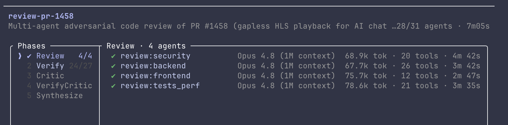
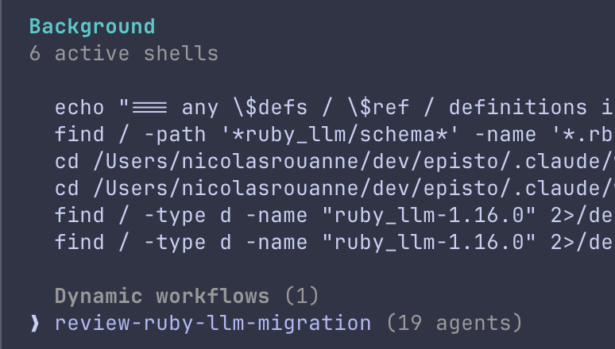
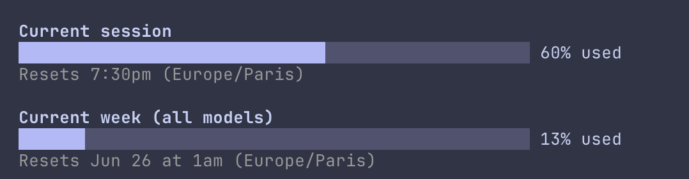
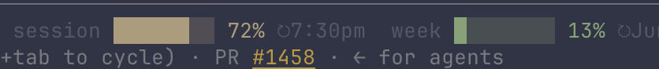
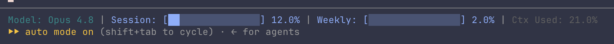

I ran two multi-agent code reviews back to back — Claude Code's "ultracode" mode — and watched a chunk of my weekly limit disappear without ever seeing it go. The first review fanned out 31 agents across one PR; the second, 19. Each agent chewed through 50–80k tokens. The output, honestly: unreadable. Lots of volume, very little I could use. And I had no real-time sense of what it was costing me until I went looking.

This is how I got that visibility back: first the `/usage` command, then a status line that keeps the number in front of me all day.

### 1. What burned the quota: multi-agent reviews

Claude Code can run a [code review](https://code.claude.com/docs/en/slash-commands) as a fan-out of independent agents instead of a single pass. On a PR about gapless HLS playback (#1458), the review ran five phases — Review, Verify, Critic, VerifyCritic, Synthesize — starting with four independent reviewers (security, backend, frontend, tests/perf), then adversarially verifying each finding. 31 agents, about seven minutes.



The second one, a `ruby_llm` migration (#1504), went wider: seven dimensions, each finding cross-examined by three skeptics. 19 agents.



Claude is upfront about the cost before you launch:

```text
Dynamic workflows can use a lot of tokens quickly by running
many subagents in parallel — which counts against your usage limit.
```

A lot of spend for not much — and worse, spend that is invisible while it's happening.

### 2. The on-demand view: `/usage`

Type `/usage` and you get the authoritative picture — two rolling windows:

```text
Current session      ███████░░░   60% used    Resets 7:30pm (Europe/Paris)
Current week (all)   █░░░░░░░░░   13% used    Resets Jun 26 at 1am (Europe/Paris)
```



"Current session" is a 5-hour window; "Current week" spans all models. These percentages come from Anthropic's side — they're the real number, not a local guess. After my two reviews, the session bar was the one that had moved. More in [Manage costs](https://code.claude.com/docs/en/costs).

But `/usage` is a manual, on-demand command: you have to stop, type it, read the bars, close it. Nobody does that every two minutes — least of all right before launching something heavy. So you find out you're running low the moment you think to check, which is usually too late: the 19-agent review has already started. What you actually want is the number in front of you all the time, without typing anything.

### 3. Why third-party tools can't show the real number

The go-to tool for this is [ccusage](https://ccusage.com/): a small open-source CLI (`npx ccusage`) that reads the JSONL log files Claude Code writes locally and reconstructs your consumption — cost per session, per day, per 5-hour window, even a live burn rate. It's perfect for answering "what is Claude Code costing me."

But it works off your local logs and a pricing table: it estimates **dollars**, it doesn't know your **subscription's real limit**. So it can't tell you the percentage you have left. That quota, server-side, is exposed in just two places: the `/usage` command, and a `rate_limits` block that Claude Code hands to your status line:

```json
"rate_limits": {
  "five_hour": { "used_percentage": 60, "resets_at": 1782322200 },
  "seven_day": { "used_percentage": 13, "resets_at": 1782428400 }
}
```

### 4. Always-on: a usage status line

Claude Code feeds your [status line](https://code.claude.com/docs/en/statusline) script a JSON payload on every update, and that payload now carries the `rate_limits` block above.

Where does that number come from? It lives server-side — which is exactly why ccusage can't see it — and rides back to Claude Code with the API response. The path:

```text
Anthropic's servers → API response (carries the rate limit)
   → Claude Code reads it
   → injects it into the status line's stdin JSON
   → your statusline.sh renders it
```

That's also why the block shows up only after the first exchange of the session, and only on Pro/Max plans: before any API call there's simply no number to pass yet. A small script turns it into a bar at the bottom of the terminal:

```text
Opus 4.8 (1M context)   session █████░░░ 60% ↻7:30pm   week █░░░░░░░ 13% ↻Jun 26 1am   ctx 6%
```



Wiring it up is two settings keys:

```json
"statusLine": {
  "type": "command",
  "command": "~/dev/claude/config/statusline.sh",
  "padding": 0
}
```

Now the same numbers `/usage` shows are in front of me all day — so the next time a 19-agent review is about to run, I can see how much room I actually have.

### Wait — this already existed (twice)

The hand-written `statusline.sh` was the first thing I reached for. Classic instinct: see a number I want, write the script. The problem is I'd reinvented the wheel — again, on two fronts.

First, the official status line docs already ship a copy-paste example (Bash, Python, Node) under "Rate limit usage" that parses the same `rate_limits` block. It renders plain text — `5h: 23% 7d: 41%` — bars aside, the parsing was already written for me.

Second, a community tool already draws the bars. [ccstatusline](https://github.com/sirmalloc/ccstatusline) ships "Session Usage" and "Weekly Usage" widgets that read the exact same block, in bar mode, with themes and reset timers out of the box. So I swapped my script for it:

```bash
npx ccstatusline@latest
```

Then I added the two usage widgets in bar mode and pointed it at my config. Same numbers, none of the maintenance.

One catch: ccstatusline's native reset widget only prints `06-26`. To get a human `Jun 26` for the week and a time-only `7:30pm` for the session, I dropped a one-line `date` call into its custom-command widget. So a sliver of script crept back. The wheel was never perfectly round.



The real number, in front of me all day — now via a tool that already did the work.

### What's still pending

- The bar refreshes on conversation activity (status lines update when messages change), not on an idle timer — sit still and it won't tick.
- Reset times are absolute, so they don't count down live; they flip to the next window when it rolls over.
- `ccusage` still earns its place for dollar-cost tracking; this status line is only about the subscription percentage.
- And the honest one: this only works because Claude exposes `rate_limits` to the status line at all. If that ever goes away, `/usage` is the fallback — there's no public API for the number.
