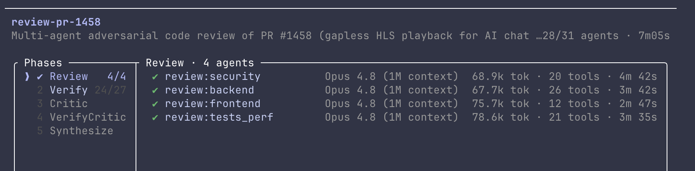
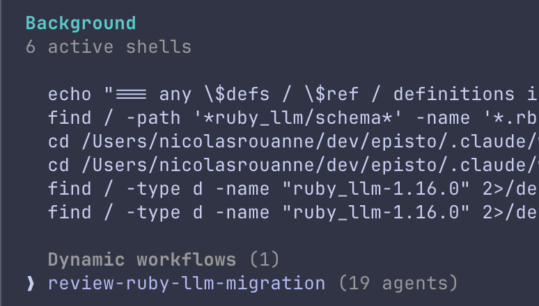
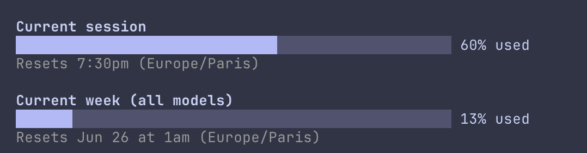
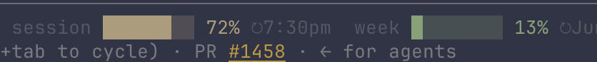
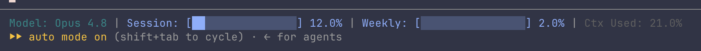

J'ai lancé deux reviews de code multi-agents à la suite — le mode « ultracode » de Claude Code — et j'ai regardé une partie de ma limite hebdo fondre sans jamais la voir partir. La première a déployé 31 agents sur une PR, la seconde 19, chacun avalant entre 50 et 80k tokens. Le résultat, honnêtement : illisible. Beaucoup de volume, peu d'utilisable. Et je n'avais aucune visibilité en temps réel sur ce que ça me coûtait, jusqu'à ce que j'aille regarder.

Voici comment j'ai récupéré cette visibilité : d'abord la commande `/usage`, puis une status line qui garde le chiffre sous les yeux toute la journée.

### 1. Ce qui a cramé le quota : les reviews multi-agents

Claude Code peut faire tourner une [review de code](https://code.claude.com/docs/en/slash-commands) comme un fan-out d'agents indépendants plutôt qu'en une seule passe. Sur une PR autour du playback HLS gapless (#1458), la review a déroulé cinq phases — Review, Verify, Critic, VerifyCritic, Synthesize — en commençant par quatre relecteurs indépendants (sécurité, backend, frontend, tests/perf), puis en vérifiant chaque finding de façon adverse. 31 agents, environ sept minutes.



La seconde, une migration `ruby_llm` (#1504), est allée plus large : sept dimensions, chaque finding contre-interrogé par trois sceptiques. 19 agents.



Claude est transparent sur le coût avant de lancer :

```text
Dynamic workflows can use a lot of tokens quickly by running
many subagents in parallel — which counts against your usage limit.
```

Beaucoup de dépense pour pas grand-chose — et surtout, une dépense invisible pendant qu'elle se produit.

### 2. La vue à la demande : `/usage`

Tape `/usage` et tu obtiens l'image qui fait foi — deux fenêtres glissantes :

```text
Current session      ███████░░░   60% used    Resets 7:30pm (Europe/Paris)
Current week (all)   █░░░░░░░░░   13% used    Resets Jun 26 at 1am (Europe/Paris)
```



« Current session » est une fenêtre de 5 heures, « Current week » couvre tous les modèles. Ces pourcentages viennent du côté d'Anthropic — c'est le vrai chiffre, pas une estimation locale. Après mes deux reviews, c'est la barre de session qui avait bougé. Plus de détails dans [Manage costs](https://code.claude.com/docs/en/costs).

Sauf que `/usage` est une commande manuelle, à la demande : il faut s'arrêter, la taper, lire les barres, refermer. Personne ne fait ça toutes les deux minutes — et surtout pas juste avant de lancer une action lourde. Du coup tu découvres que tu es à sec au moment où tu penses à vérifier, c'est-à-dire en général trop tard : la review à 19 agents est déjà partie. Ce qu'il faudrait, c'est avoir le chiffre en permanence sous les yeux, sans rien taper.

### 3. Pourquoi les outils tiers ne montrent pas le vrai chiffre

L'outil de référence pour ça, c'est [ccusage](https://ccusage.com/) : un petit CLI open-source (`npx ccusage`) qui lit les fichiers de logs JSONL que Claude Code écrit en local et reconstruit ta consommation — coût par session, par jour, par fenêtre de 5h, et même un burn rate en direct. C'est parfait pour répondre à « combien me coûte Claude Code ».

Mais il travaille à partir de tes logs locaux et d'une table de prix : il estime des **dollars**, il ne connaît pas la **limite réelle de ton abonnement**. Donc il ne peut pas te dire le pourcentage qu'il te reste. Ce quota-là, côté serveur, n'est exposé qu'à deux endroits : la commande `/usage`, et un bloc `rate_limits` que Claude Code passe à ta status line :

```json
"rate_limits": {
  "five_hour": { "used_percentage": 60, "resets_at": 1782322200 },
  "seven_day": { "used_percentage": 13, "resets_at": 1782428400 }
}
```

### 4. En permanence : une status line d'usage

Claude Code envoie à ton script de [status line](https://code.claude.com/docs/en/statusline) un payload JSON à chaque mise à jour, et ce payload porte désormais le bloc `rate_limits` ci-dessus.

D'où vient ce chiffre ? Il vit côté serveur — c'est exactement pour ça que ccusage ne peut pas le voir — et il revient à Claude Code avec la réponse de l'API. Le chemin :

```text
serveur Anthropic → réponse API (porte le rate limit)
   → Claude Code la lit
   → l'ajoute au JSON stdin de ta status line
   → ton statusline.sh l'affiche
```

C'est aussi pour ça que le bloc n'apparaît qu'après le premier échange de la session, et seulement sur les offres Pro/Max : avant le moindre appel API, il n'y a tout simplement pas encore de chiffre à passer. Un petit script le transforme en barre en bas du terminal :

```text
Opus 4.8 (1M context)   session █████░░░ 60% ↻7:30pm   week █░░░░░░░ 13% ↻Jun 26 1am   ctx 6%
```



Le câblage tient en deux clés de réglages :

```json
"statusLine": {
  "type": "command",
  "command": "~/dev/claude/config/statusline.sh",
  "padding": 0
}
```

Maintenant les mêmes chiffres que `/usage` sont sous mes yeux toute la journée — comme ça, la prochaine fois qu'une review à 19 agents s'apprête à tourner, je vois la marge qu'il me reste vraiment.

### Ça existait déjà (deux fois)

Premier réflexe en attaquant le sujet avec Claude : un `statusline.sh` écrit à la main. Je dis le chiffre que je veux afficher, Claude écrit le script qui le calcule. Sauf que ce script existait déjà — deux fois.

C'est le piège récurrent sur ce genre de tâche : Claude code la solution depuis zéro au lieu de regarder ce qui existe déjà. Et le temps perdu se voit mal, parce que le script qu'il produit marche — il faut réaliser après coup qu'on n'avait rien à écrire.

D'abord dans la doc officielle de la status line : un exemple copier-coller (Bash, Python, Node) sous « Rate limit usage », qui parse le même bloc `rate_limits`. Il rend du texte brut — `5h: 23% 7d: 41%` —, barres mises à part le parsing était déjà écrit.

Ensuite dans un outil communautaire qui dessine déjà les barres. [ccstatusline](https://github.com/sirmalloc/ccstatusline) embarque les widgets « Session Usage » et « Weekly Usage » : même bloc lu, mode barre, thèmes et timers de reset inclus. J'ai remplacé mon script par ça :

```bash
npx ccstatusline@latest
```

Deux widgets en mode barre, pointés sur ma config. Mêmes chiffres, plus rien à maintenir.

Reste un écart : le widget de reset natif de ccstatusline n'affiche que `06-26`. Pour un `Jun 26` lisible côté semaine et un `7:30pm` sans la date côté session, j'ai ajouté un `date` d'une ligne dans son widget custom-command. Un peu de script maison, mais ciblé sur ce que l'outil ne couvre pas.



### Ce qui reste

- La barre se rafraîchit sur l'activité de la conversation (les status lines se mettent à jour quand les messages changent), pas sur un timer en continu — si tu ne fais rien, elle ne bouge pas.
- Les heures de reset sont absolues, donc elles ne décomptent pas en direct ; elles basculent simplement vers la fenêtre suivante.
- `ccusage` garde son intérêt pour le suivi du coût en dollars ; cette status line ne parle que du pourcentage d'abonnement.
- Et la plus honnête : tout ça ne marche que parce que Claude expose `rate_limits` à la status line. Si ça disparaît un jour, `/usage` reste le filet de secours — il n'y a pas d'API publique pour ce chiffre.
