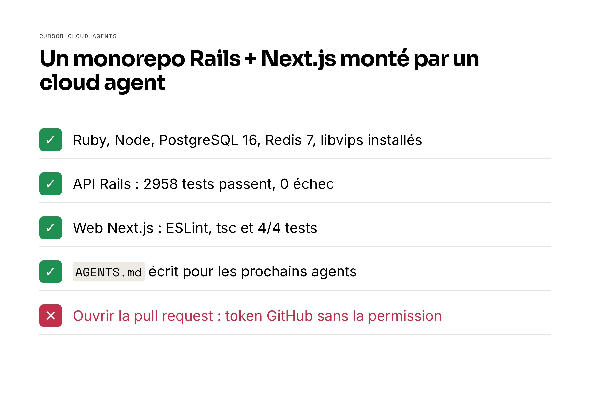

Je voulais voir si la nouvelle fonctionnalité Cloud Agents de Cursor pouvait configurer un vrai environnement de développement from scratch — pas un projet jouet, mais un monorepo complet Rails API + Next.js avec PostgreSQL, Redis, des credentials chiffrées et des données de seed. La réponse : oui, dans l'ensemble. Voici comment ça s'est passé.

## Les Cloud Agents de Cursor, c'est quoi ?

Cursor a lancé les Cloud Agents avec Computer Use le 24 février 2026. Chaque agent tourne dans sa propre VM isolée avec un environnement de développement complet. L'argument principal : les agents peuvent désormais tester le logiciel qu'ils construisent, générer des pull requests prêtes à merger, et joindre des artefacts comme des captures d'écran et des vidéos comme preuve.

La fonctionnalité est disponible depuis l'interface web Cursor, l'application desktop, le mobile, Slack, et même via les workflows GitHub.

## La tâche de configuration

J'ai pointé un cloud agent vers un monorepo avec deux services :

| Service | Stack | Port |
| --- | --- | --- |
| API | Rails 7 + Ruby 3.4.7 | 3000 |
| Web | Next.js + Node 24.x | 3001 |

L'agent devait installer Ruby (rbenv), Node (nvm), PostgreSQL 16, Redis 7, libvips, Yarn et Bundler — puis créer la base de données, lancer les migrations, seeder les données, et vérifier que le lint et les tests passent.

## Ce qui a fonctionné

L'agent a installé et configuré toutes les dépendances correctement dès la première exécution. Voici la matrice de vérification finale :

| Service | Lint | Tests | Exécution |
| --- | --- | --- | --- |
| **API** (Rails) | 710 fichiers, 0 offense | 2958 pass, 0 failures | OK |
| **Web** (Next.js) | ESLint + tsc pass | 4/4 pass | OK |

Il a réalisé un demo "hello world" : authentification via OAuth2 password grant, récupération des missions et freelances depuis l'API seedée, et navigation sur le dashboard web.

L'agent a aussi produit un fichier `AGENTS.md` documentant tout ce qu'il avait appris — ports des services, commandes de démarrage, configuration de la base, pièges — pour que les futurs cloud agents n'aient pas à tout redécouvrir.

## Ce qui n'a pas fonctionné

L'agent n'a pas pu créer de pull request. Le token GitHub fourni par Cursor Cloud n'avait pas les permissions de création de PR sur le repository, il a donc dû me donner le nom de branche et le corps de la PR pour que je la crée manuellement.

C'est un point de friction. Si la promesse est "des PRs prêtes à merger avec des artefacts", les permissions du token doivent couvrir la création de PR nativement.

## Les pièges découverts par l'agent

Quelques découvertes intéressantes pas évidentes à la lecture du code :

- `config.require_master_key = true` est activé aussi en **développement**, pas seulement en production. Sans `RAILS_MASTER_KEY`, l'API ne démarre pas du tout en dev.
- `development.rb` appelle `Rails.application.credentials.dig(:postmark, :api_token)` au boot, donc la clé doit être valide même si vous n'utilisez pas Postmark.
- L'environnement de test n'impose pas `require_master_key`, donc la plupart des tests passent sans — sauf les 212 qui nécessitent les credentials YouSign du fichier chiffré.
- Pas de table `oauth_applications`. Doorkeeper utilise `skip_client_authentication_for_password_grant`, donc pas besoin de client ID/secret pour les tokens.
- `libvips` est une dépendance système obligatoire — toute commande `rails` échoue sans, à cause d'ActiveStorage.

## Points clés à retenir

Les Cloud Agents de Cursor sont vraiment utiles pour les tâches de configuration d'environnement. L'approche VM isolée évite de perdre du temps à débugger sur sa propre machine. Le pattern `AGENTS.md` — où l'agent documente ce qu'il a appris — est particulièrement intéressant pour les équipes qui onboardent de nouveaux développeurs ou configurent des environnements CI.

Là où ça pèche : tout ce qui nécessite des permissions GitHub élevées ou des secrets non pré-configurés. Prévoyez de gérer la création de PR et l'injection de credentials sensibles vous-même.

Pour un monorepo avec une vraie complexité (credentials chiffrées, runtimes multiples, dépendances système), l'agent s'en est bien sorti. Je l'utiliserais à nouveau pour le prochain bootstrap d'environnement.
