[gog](https://github.com/openclaw/gogcli) (gogcli) is a CLI that talks to Gmail, Drive, Docs, Calendar and the rest of the Google Workspace API. I use it daily on my work account, and I wanted to plug in my personal Gmail to edit a shared document.

It looked like a one-line `gog auth add` and it turned out to be a small ball of yarn 🧵: a personal `@gmail.com` account can't reuse an organization's OAuth client. Here's the full path, from the concept down to the two `403` errors you'll definitely hit.

## The model: one OAuth client per context

`gog` stores one _refresh token_ per account, and each account is tied to an **OAuth client**. You can see it in the config:

```bash
gog auth credentials list
# CLIENT   PATH                                            DOMAINS
# default  …/credentials.json
# gybe     …/credentials-gybe.json

cat "~/Library/Application Support/gogcli/config.json"
# { "account_clients": { "work@your-domain.com": "gybe" } }
```

The `default` client was set to **"Internal"** — restricted to members of the Workspace organization. A personal account is rejected outright. The clean fix: give it **its own OAuth client**, inside a Google Cloud project you own.

→ OAuth docs: [https://developers.google.com/identity/protocols/oauth2](https://developers.google.com/identity/protocols/oauth2)

## 1. Create a Google Cloud project

Signed in with the personal account, create a dedicated project at [https://console.cloud.google.com/projectcreate](https://console.cloud.google.com/projectcreate).

```text
Project name : Google CLI
Organization : None
```

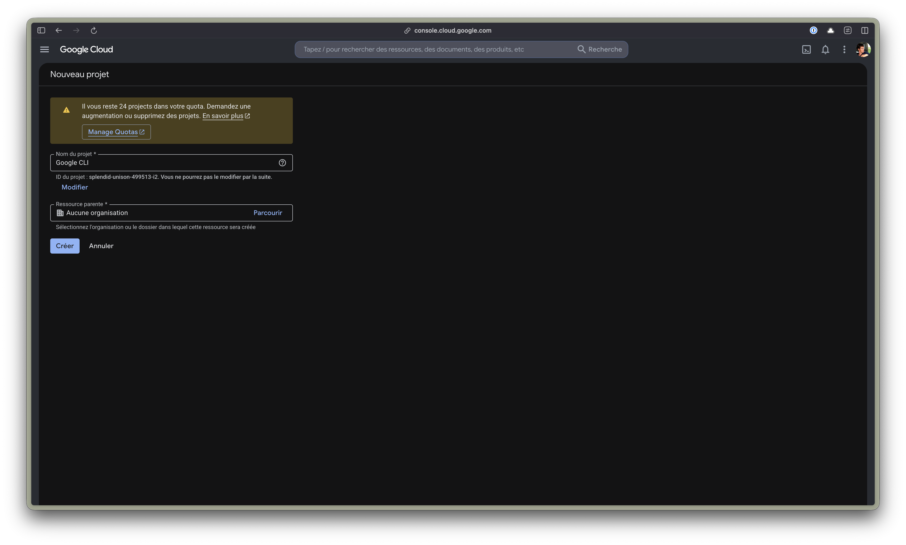

## 2. Enable the APIs gog needs

Enable the APIs matching the services you'll use — at minimum **Docs** and **Drive**:

- Google Docs API → [https://console.cloud.google.com/apis/library/docs.googleapis.com](https://console.cloud.google.com/apis/library/docs.googleapis.com)
- Google Drive API → [https://console.cloud.google.com/apis/library/drive.googleapis.com](https://console.cloud.google.com/apis/library/drive.googleapis.com)

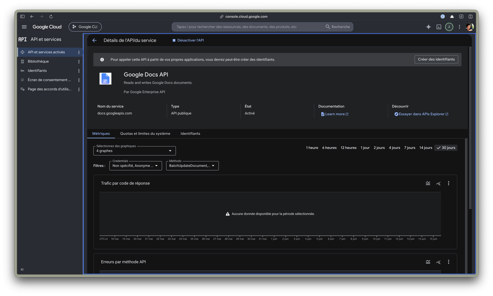

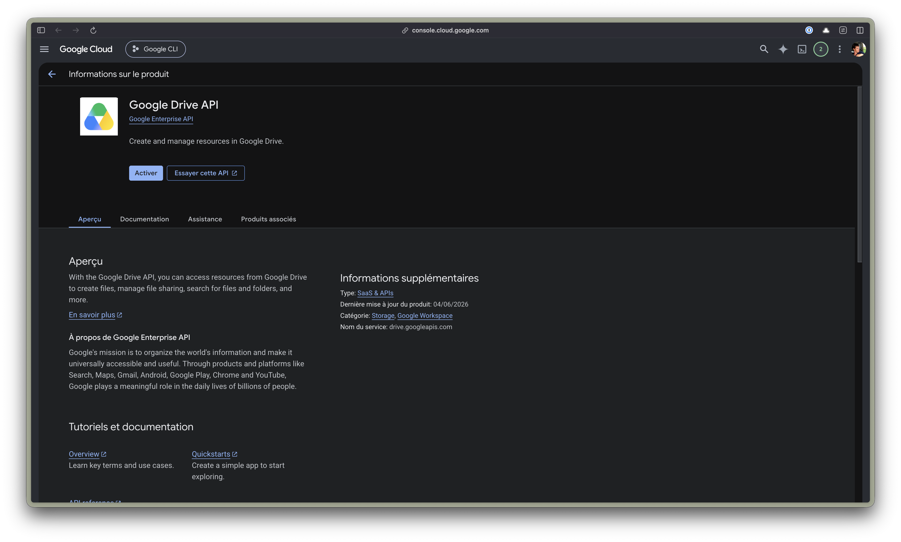

If you skip this, auth succeeds but the first call returns `403 accessNotConfigured: API has not been used in project … before or it is disabled`.

## 3. Configure the OAuth consent screen

Head to **Google Auth Platform** → [https://console.cloud.google.com/apis/credentials/consent](https://console.cloud.google.com/apis/credentials/consent). On the first visit the screen is empty — click **Get started**.

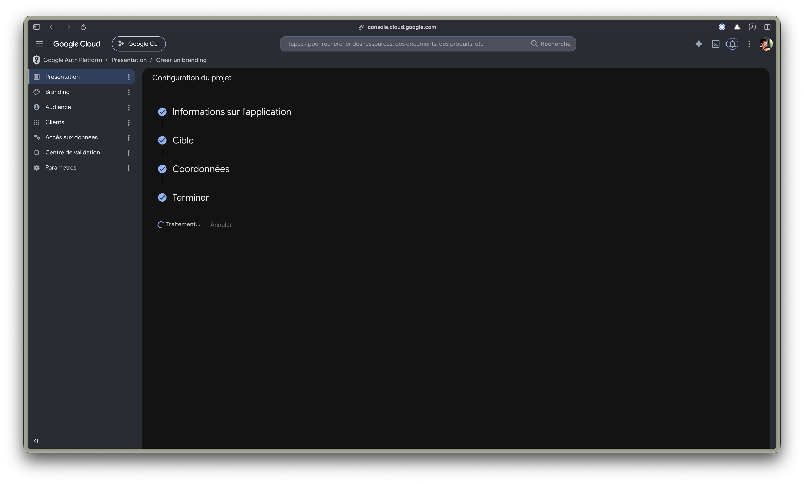

Fill in the minimum (app name, support email, developer contact) and pick user type **External**. This is the key point: "External" allows `@gmail.com` accounts, "Internal" doesn't.

→ Reference: [https://support.google.com/cloud/answer/10311615](https://support.google.com/cloud/answer/10311615)

## 4. Create the "Desktop app" OAuth client

Once the platform is configured, create the OAuth client. `gog` is a command-line app, so the type is **Desktop app**.

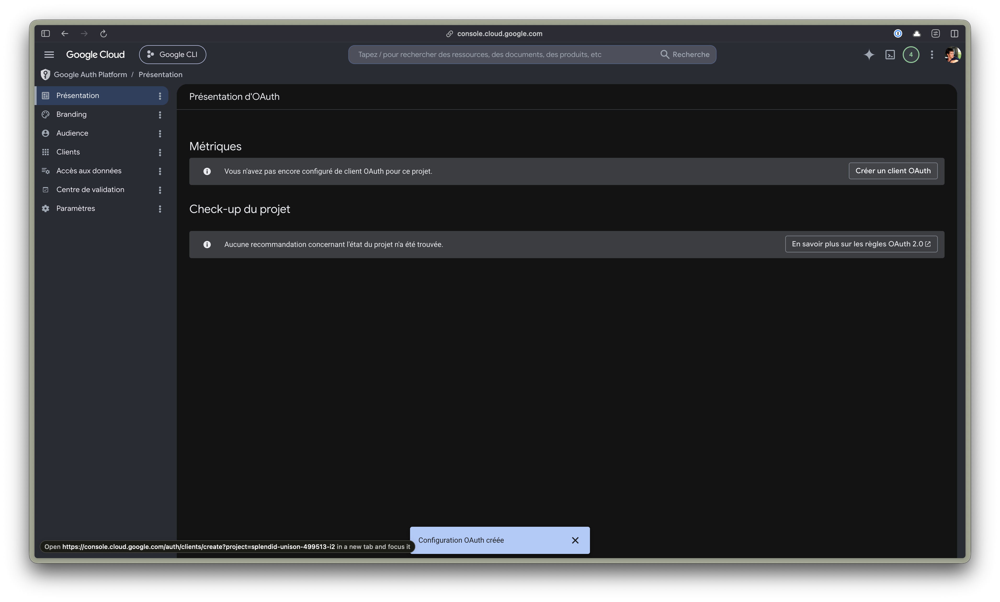

Download the `client_secret_….json` file at the end — that's what we'll hand to `gog`.

## 5. Add the account as a test user

As long as the app is in **Test** mode (and it can stay there for personal use), only declared _test users_ can authenticate. Go to the **Audience** tab → **Test users** → **Add users**, then add your personal address. It must show up in the list:

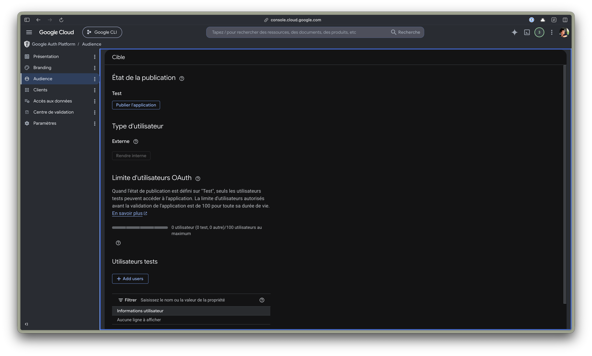

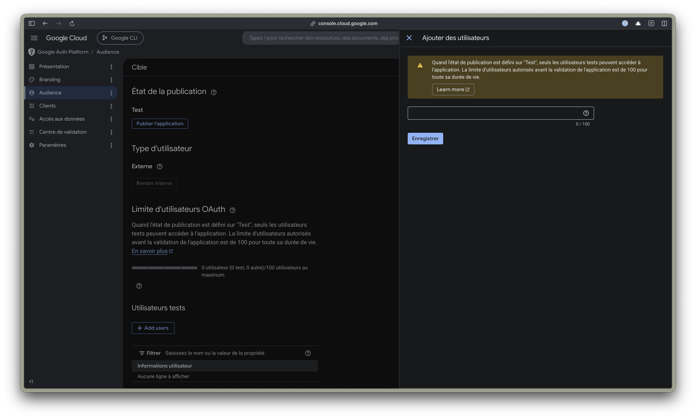

Forgetting this step gives the `access_denied` error described below.

## 6. Register the client in gog and authenticate

Two commands. The first registers a new client (named `perso` here), the second runs the OAuth flow for the account:

```bash
gog auth credentials set ~/Downloads/client_secret_*.json --client perso
gog auth add perso@gmail.com --client perso --services docs,drive
```

The browser opens with a **"Google hasn't verified this app"** warning — that's normal for a Test-mode app you own. **Advanced → Continue**.

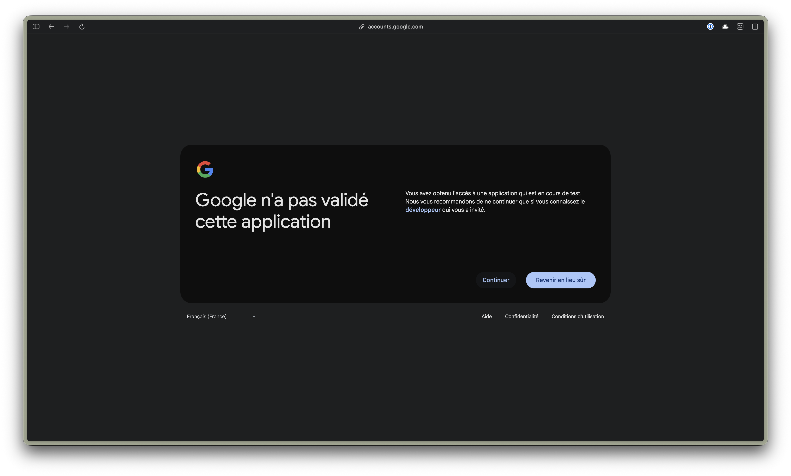

You finally land on the usual authorization screen:

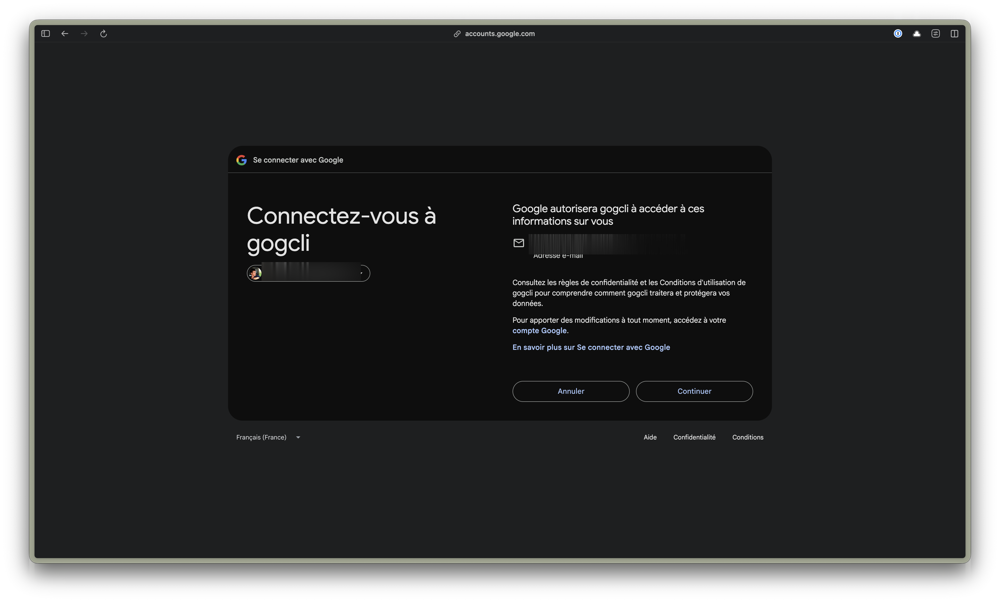

## 7. Verify

```bash
gog auth list
# perso@gmail.com         perso   docs,drive   …   oauth
# work@your-domain.com    gybe    …             …   oauth

# And a real call, targeting the right account + client:
gog docs cat <DOC_ID> -a perso@gmail.com --client perso
```

From there, target each command with `-a <email> --client <name>`.

## The two 403 errors worth knowing

**`Error 403: org_internal`** — _"gogcli can only be used within its organization"_. The OAuth client is in "Internal" mode. A personal account will never be able to use it: you need an "External" client (step 3) or a dedicated one.

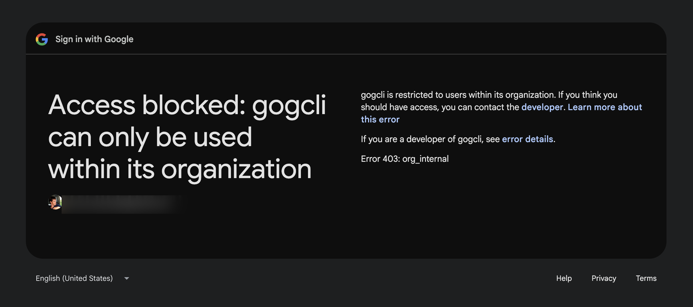

**`Error 403: access_denied`** — _"can only be accessed by developer-approved testers"_. The app is "External" but the account isn't in the test users. Add it (step 5); allow 1-2 minutes for propagation.

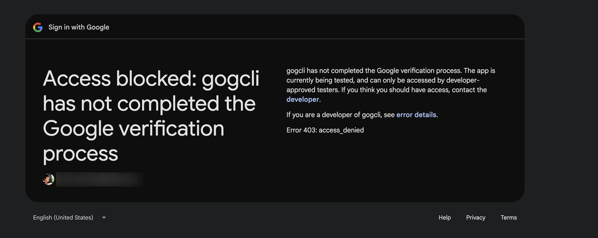

## What's still pending

- **The refresh token expires after 7 days** as long as the app stays in **"Test"** status. For regular use, publish the app to **Production** (the _Publish app_ button on the Audience tab) — the "unverified" warning remains for sensitive scopes, but the token stops expiring.
- One OAuth client per account adds a bit of config (`account_clients`). For a few accounts it's invisible; beyond that, an alias per account avoids retyping `--client` every time (`gog auth alias`).
- The scopes requested here (`docs,drive`) are the minimum for my case. Add `gmail`, `calendar`, etc. as needed — `gog auth services` lists them all.
