Dans mes workflows d’agents, j’utilise **gogcli** (`gog`), la CLI de [steipete](https://github.com/openclaw/gogcli), le créateur d’openclaw, qui parle à Gmail, Drive, Docs, Calendar et au reste de la Google Workspace API. C’est ce qui permet à mes agents d’aller fouiller dans mes documents et mes mails : retrouver toute la discussion et les échanges avec un client, trier ma boîte, éditer un Doc partagé, etc.

Si je préfère `gog` au MCP Google, c’est pour une raison simple : **il gère plusieurs comptes en parallèle**. Un perso, un pour Qraft, un pour Billi… chacun isolé, ciblable à la commande. Et au passage c’est redoutablement efficace, que ce soit en nombre de commandes, en recherche ou en tokens consommés.

Le seul compte qui me manquait encore, c’était mon perso `@gmail.com` : je voulais l’y brancher pour éditer un document partagé. Ce qui ressemblait à un simple `gog auth add` s’est révélé être une petite pelote de laine 🧵 : un compte perso ne peut pas réutiliser le client OAuth d’une organisation. Voici le chemin complet, du concept jusqu’aux deux erreurs `403` qu’on croise forcément.

## Le modèle : un client OAuth par contexte

`gog` stocke un _refresh token_ par compte, et chaque compte est rattaché à un **client OAuth**. On le voit dans la config :

```bash
gog auth credentials list
# CLIENT   PATH                                            DOMAINS
# default  …/credentials.json
# qraft    …/credentials-qraft.json

cat "~/Library/Application Support/gogcli/config.json"
# { "account_clients": { "pro@votre-domaine.com": "qraft" } }
```

Le client `default` était configuré en **« Interne »** — réservé aux membres de l'organisation Workspace. Un compte perso est rejeté d'office. La solution propre : lui créer **son propre client OAuth**, dans un projet Google Cloud dédié.

→ Doc OAuth : [https://developers.google.com/identity/protocols/oauth2](https://developers.google.com/identity/protocols/oauth2)

## 1. Créer un projet Google Cloud

Connecté avec le compte perso, on crée un projet dédié sur [https://console.cloud.google.com/projectcreate](https://console.cloud.google.com/projectcreate).

```text
Nom du projet : Google CLI
Organisation  : Aucune
```

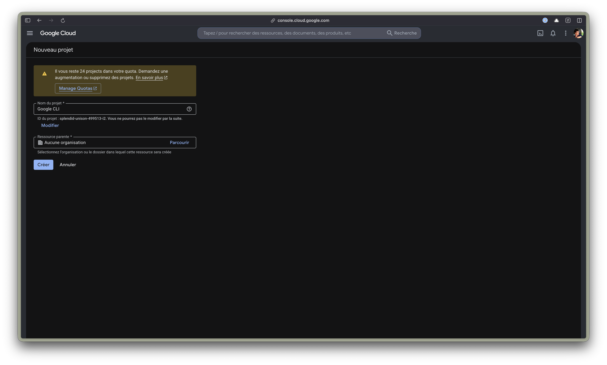

## 2. Activer les APIs dont gog a besoin

On active les APIs correspondant aux services qu'on utilisera — au minimum **Docs** et **Drive** :

- Google Docs API → [https://console.cloud.google.com/apis/library/docs.googleapis.com](https://console.cloud.google.com/apis/library/docs.googleapis.com)
- Google Drive API → [https://console.cloud.google.com/apis/library/drive.googleapis.com](https://console.cloud.google.com/apis/library/drive.googleapis.com)

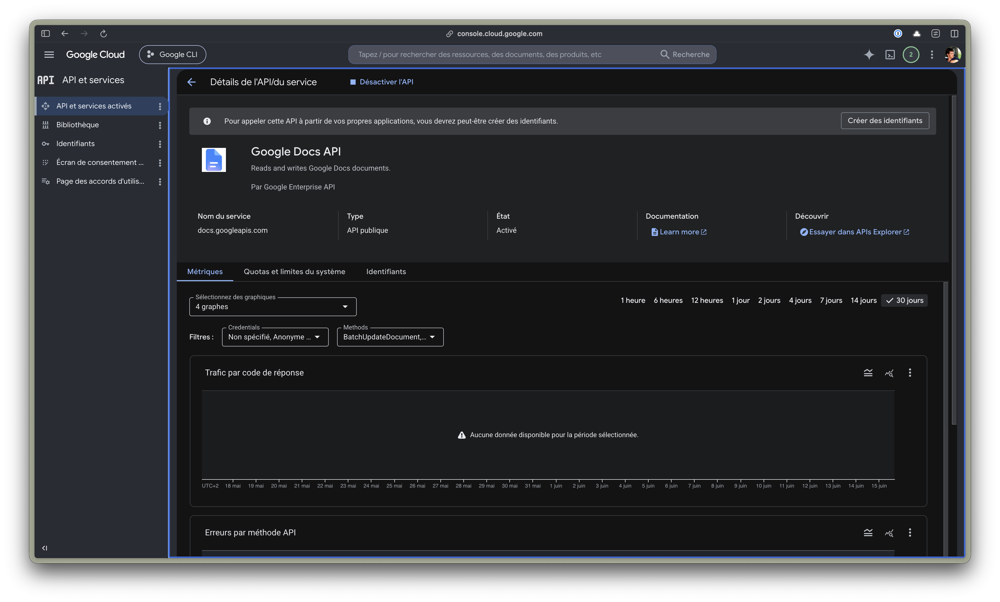

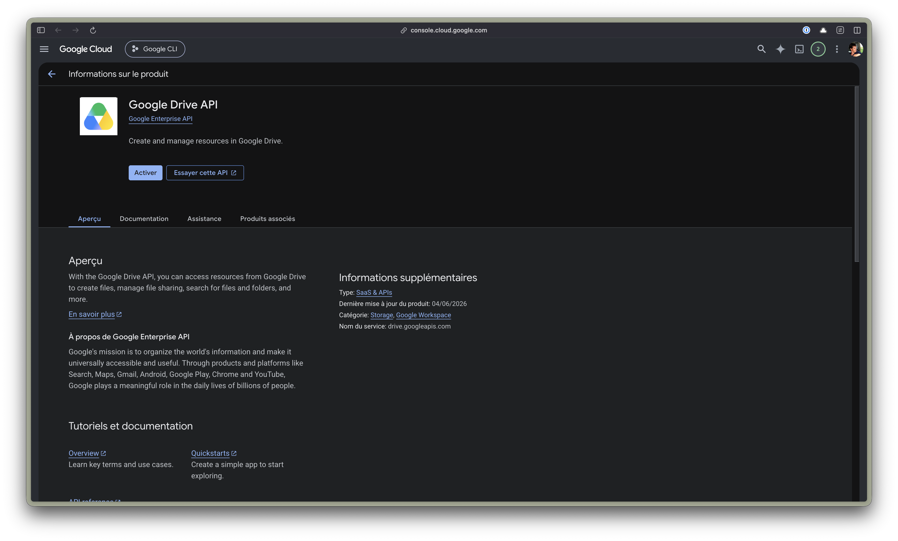

Si on saute cette étape, l'auth passe mais le premier appel renvoie `403 accessNotConfigured: API has not been used in project … before or it is disabled`.

## 3. Configurer l'écran de consentement OAuth

Direction **Google Auth Platform** → [https://console.cloud.google.com/apis/credentials/consent](https://console.cloud.google.com/apis/credentials/consent). Au premier passage, l'écran est vierge — on clique **Premiers pas**.

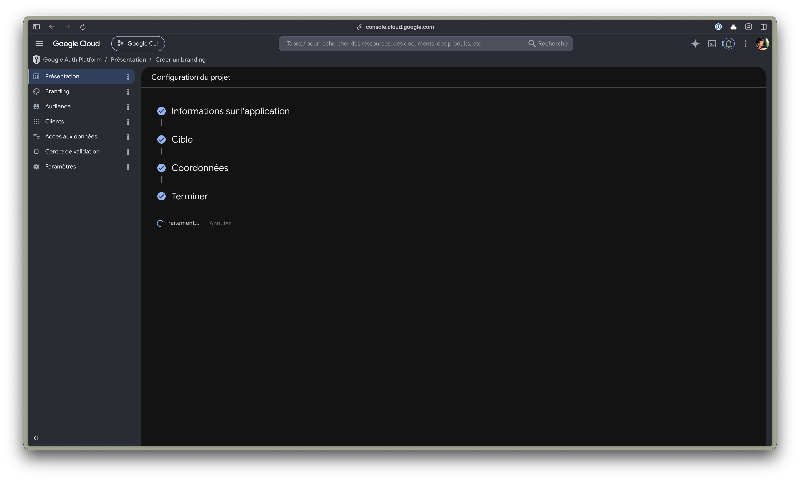

On renseigne le minimum (nom de l'app, e-mail de support, contact développeur) et on choisit le type d'utilisateur **Externe**. C'est le point clé : « Externe » autorise les comptes `@gmail.com`, « Interne » non.

→ Référence : [https://support.google.com/cloud/answer/10311615](https://support.google.com/cloud/answer/10311615)

## 4. Créer le client OAuth « Application de bureau »

Une fois la plateforme configurée, on crée le client OAuth. `gog` est une appli en ligne de commande, donc le type est **Application de bureau**.

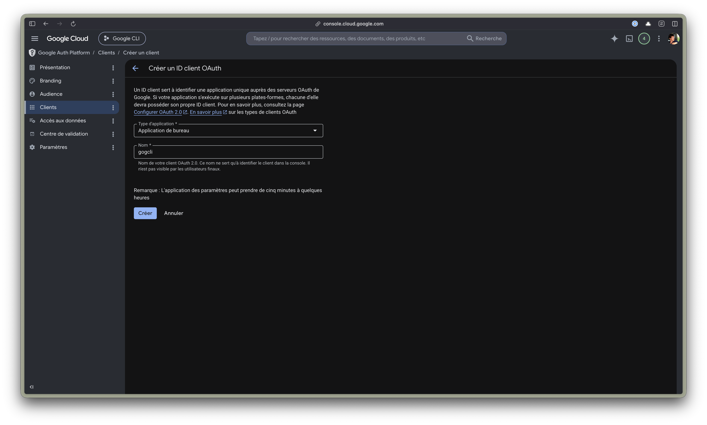

On télécharge le fichier `client_secret_….json` à la fin — c'est lui qu'on donnera à `gog`.

## 5. Ajouter le compte en utilisateur test

Tant que l'app est en mode **Test** (et elle peut y rester pour un usage perso), seuls les _utilisateurs tests_ déclarés peuvent s'authentifier. Onglet **Audience** → **Utilisateurs tests** → **Add users**, puis on ajoute son adresse perso. Elle doit apparaître dans la liste :

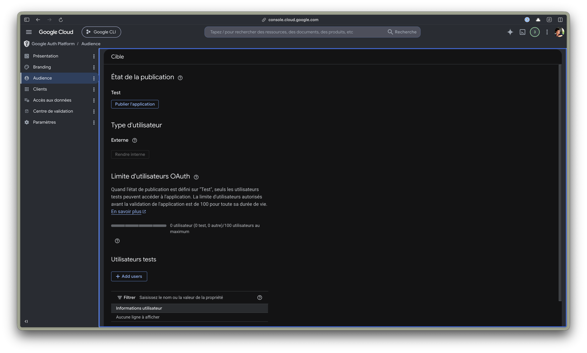

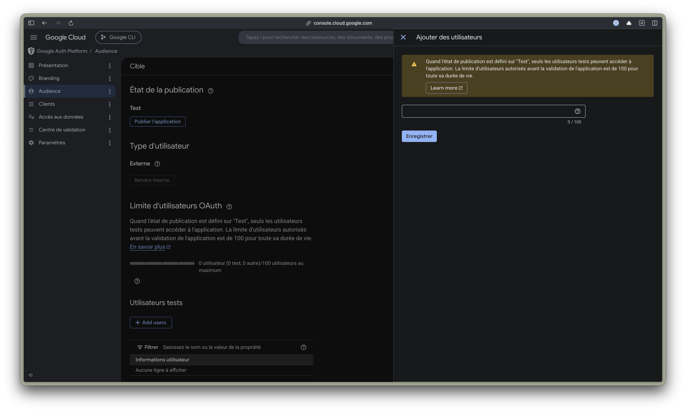

Oublier cette étape donne l'erreur `access_denied` détaillée plus bas.

## 6. Enregistrer le client dans gog et s'authentifier

Deux commandes. La première déclare un nouveau client (nommé ici `perso`), la seconde lance le flow OAuth pour le compte :

```bash
gog auth credentials set ~/Downloads/client_secret_*.json --client perso
gog auth add perso@gmail.com --client perso --services docs,drive
```

Le navigateur s'ouvre et affiche un avertissement **« Google n'a pas validé cette application »** — c'est normal pour une app en mode Test que l'on possède. **Paramètres avancés → Continuer**.

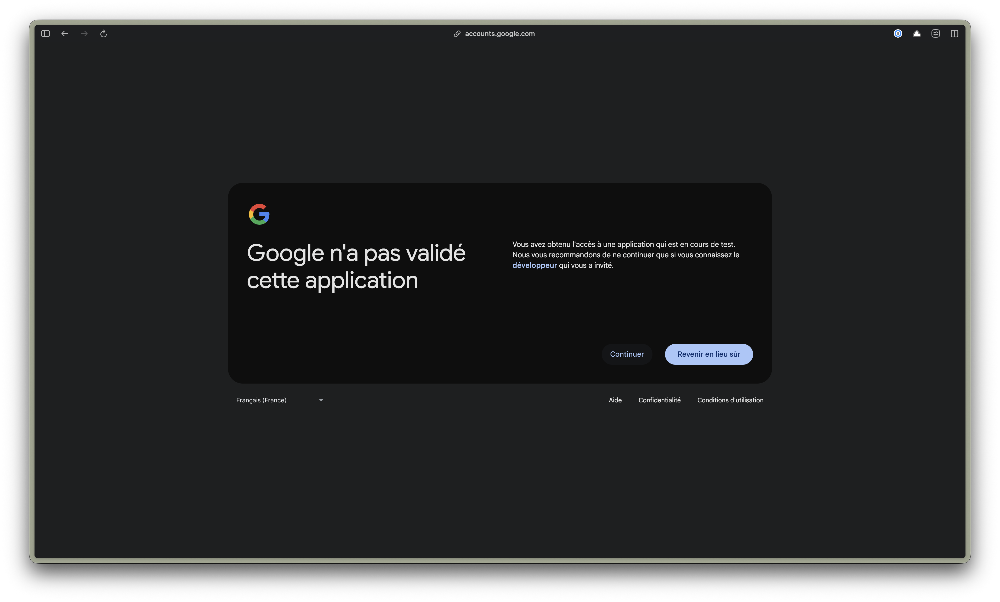

On arrive enfin sur l'écran d'autorisation habituel :

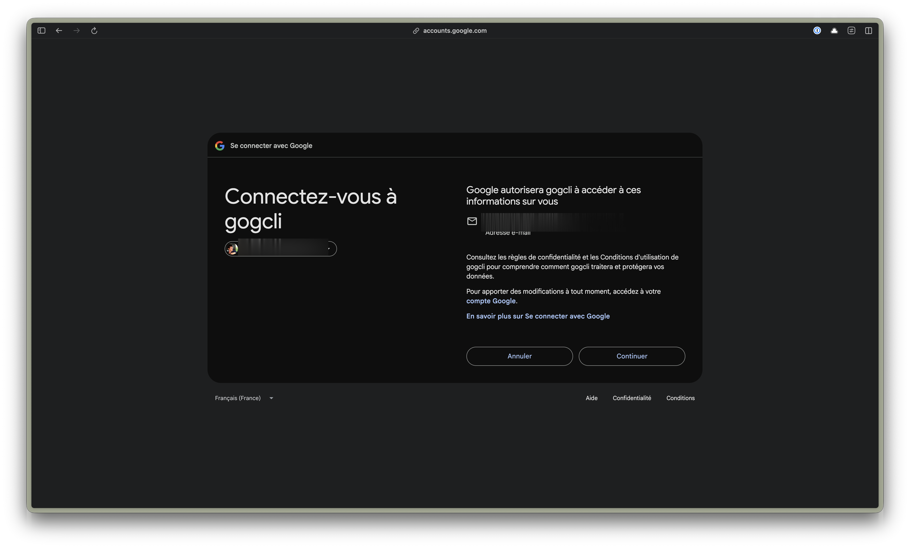

## 7. Vérifier

```bash
gog auth list
# perso@gmail.com         perso   docs,drive   …   oauth
# pro@votre-domaine.com   qraft   …             …   oauth

# Et un vrai appel, en ciblant le bon compte + client :
gog docs cat <DOC_ID> -a perso@gmail.com --client perso
```

À partir de là, chaque commande se cible avec `-a <email> --client <nom>`.

## Les deux erreurs 403 à connaître

**`Error 403: org_internal`** — _« gogcli can only be used within its organization »_. Le client OAuth est en mode « Interne ». Un compte perso ne pourra jamais l'utiliser : il faut un client « Externe » (étape 3) ou un client dédié.

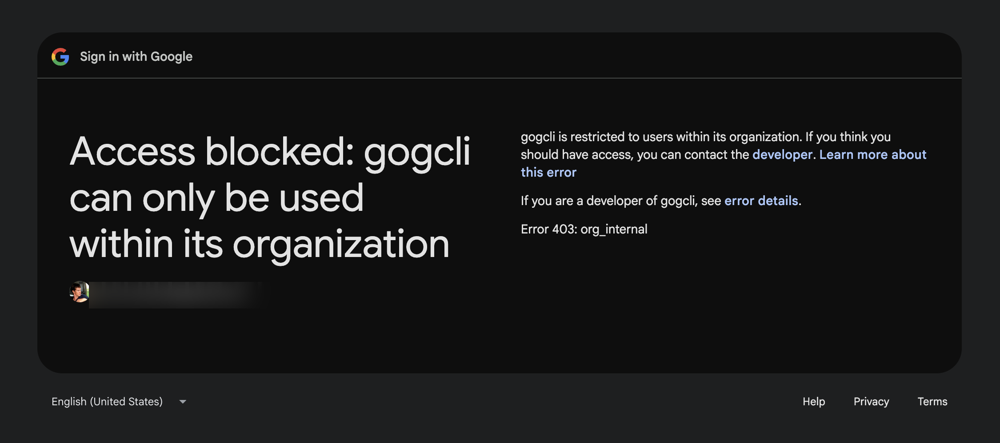

**`Error 403: access_denied`** — _« can only be accessed by developer-approved testers »_. L'app est bien « Externe » mais le compte n'est pas dans les utilisateurs tests. On l'ajoute (étape 5) ; compter 1-2 minutes de propagation.

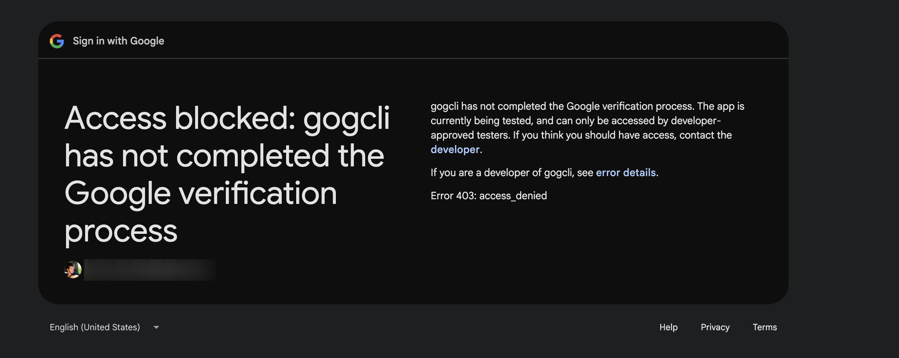

## Ce qui reste

- **Le refresh token expire au bout de 7 jours** tant que l'app reste en statut **« Test »**. Pour un usage régulier, on publie l'app en **Production** (bouton _Publier l'application_ sur l'onglet Audience) — l'avertissement « non validée » subsiste pour les scopes sensibles, mais le token ne se périme plus.
- Un client OAuth par compte alourdit un peu la config (`account_clients`). Pour quelques comptes c'est invisible ; au-delà, un alias par compte évite de retaper `--client` à chaque fois (`gog auth alias`).
- Les scopes demandés ici (`docs,drive`) sont le minimum pour mon cas. On ajoute `gmail`, `calendar`, etc. selon les besoins — `gog auth services` liste tout.
