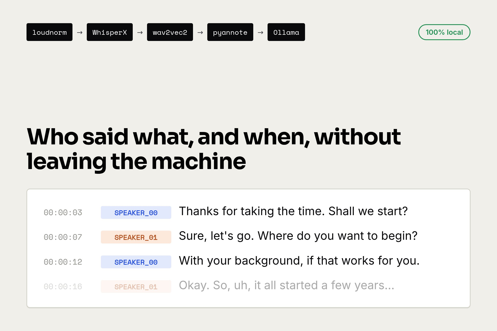

I needed to transcribe sensitive recordings — therapy sessions, interviews, conversations that had no business living on OpenAI or Google servers. So, cloud out. A year and a dozen pivots later, the pipeline boils down to five stages, all offline once the models are downloaded.

```text
ffmpeg loudnorm → WhisperX (large-v3, Silero VAD) → wav2vec2 align
  → pyannote diarise → Ollama mistral-nemo:12b correction
```

Repo: [github.com/nicolasrouanne/transcribe](https://github.com/nicolasrouanne/transcribe).



## 0. Why not MacWhisper

Before writing code, I looked at what already existed. [MacWhisper](https://goodsnooze.gumroad.com/l/macwhisper) is the most polished Mac app: a clean GUI around whisper.cpp, fully local, exports `.srt`/`.txt`. For transcribing the occasional meeting it's probably the best effort/result trade-off — and privacy is just as solid, since everything runs on your own machine.

What pushed me to DIY:

- **Automation.** I want to pipe the transcription into the next steps (correction LLM, post-processing) without an "open the app, load the file, copy the result" step in the middle. A script that outputs canonical JSON makes that work; a GUI, much less.
- **Decent diarisation.** Knowing who speaks when. Most consumer apps either don't do it, or do it poorly. For two-voice audio, that's what makes the transcript readable.
- **End-to-end control.** Tune the VAD thresholds, swap the diarisation model, plug in a local LLM, change the correction prompt. A closed app closes those choices too.

## 1. Preprocessing: bring the volume up

Whisper has an internal threshold below which an audio segment is discarded as "non-speech". On a recording that's too quiet, entire stretches of speech fall below that threshold and silently vanish from the transcript — no error message, just chunks missing.

On a session sitting at `mean_volume -35 dB`, I lost **14 minutes out of 60** that way.

The fix: EBU R128 normalisation ([loudnorm](https://ffmpeg.org/ffmpeg-filters.html#loudnorm)) before ASR, to bring everything above the thresholds.

```python
audio_filter = "loudnorm=I=-16:TP=-1.5:LRA=11"
cmd = ["ffmpeg", "-nostdin", "-i", str(path),
       "-af", audio_filter,
       "-f", "s16le", "-ac", "1", "-ar", "16000", "-"]
```

Target -16 LUFS (broadcast standard), true peak -1.5 dBTP.

## 2. ASR: audio → text

The heart of the pipeline. Everything else exists to make that text usable.

**v1, whisper.cpp + medium.** C++ binary, no Python, medium model to fit on CPU. Works well on clear English, mediocre on spoken French.

**First wall, hallucinations.** On silent passages, whisper locks into a self-reinforcing loop — `*door noise*` repeated on every segment, or sentences invented with full confidence. The model "sees" silence, doesn't know what to do with it, and improvises. Workaround: a speech detector upstream ([Silero VAD](https://github.com/snakers4/silero-vad)) that cuts the audio into "speech" / "silence" windows so whisper only processes the former.

**v2, \[WhisperX\](https://github.com/m-bain/whisperX).** Three reasons:

1. `large-v3` is significantly better than `medium` on French (very visible on proper nouns and spoken language)
2. Word-level alignment via wav2vec2 built in
3. pyannote diarisation available in the same lib

The VAD/no_speech thresholds are exposed. The defaults are too conservative on noisy audio; I push them down:

| Parameter | Default | My value | Effect |
| --- | --- | --- | --- |
| `no_speech_threshold` | 0.6 | **0.3** | Whisper discards fewer segments as "non-speech" |
| `vad_onset` (Silero) | 0.5 | **0.3** | The VAD picks up quieter voices |
| `hallucination_silence_threshold` | None | **2.0** | Cuts loops when silence slips through |

Too low and whisper starts transcribing background noise. Has to be tuned per recording.

## 3. Alignment: word-level timestamps

By default, whisper gives one timestamp per _sentence_. For clean subtitles, or to click a word and replay that exact moment, you want one timestamp per _word_. That's what forced alignment does: you know the text, you know the audio, you align them via a language-specific wav2vec2 model.

```python
align_model, metadata = whisperx.load_align_model(
    language_code=detected_lang, device=gpu_device
)
aligned = whisperx.align(result["segments"], align_model, metadata,
                         audio, gpu_device)
```

Accuracy down to ~20 ms. On Apple Silicon, the stage runs on MPS: 1-2 min → ~30s on 1h of audio.

## 4. Diarisation: who speaks when

Whisper gives you a flat sequence of sentences with no speaker information. For multi-voice audio, that's unusable. Diarisation analyses the raw audio (not the text) to detect voice changes and tag each segment with `[SPEAKER_00]` / `[SPEAKER_01]`.

```python
pipeline = DiarizationPipeline(
    model_name="pyannote/speaker-diarization-community-1",
    token=token, device=gpu_device,
)
segs = pipeline(audio, min_speakers=2, max_speakers=2)
result = assign_word_speakers(segs, result)
```

[\`pyannote/speaker-diarization-community-1\`](https://huggingface.co/pyannote/speaker-diarization-community-1) runs locally once downloaded.

This is the slowest stage: 30-40 min on 1h of audio on CPU, 12-15 min on MPS. The most worthwhile to port to GPU.

## 5. LLM correction: catching phonetic mistakes

`large-v3` gets things wrong: non-words in French, misspelled proper nouns, sentences that make no sense in isolation. At first I was editing by hand, untenable on 1h of audio. The fix: have a local LLM that knows French read through it and reconstruct what was probably said.

[Ollama](https://ollama.com/) runs open-source models locally, `mistral-nemo:12b` by default.

**Prompt v3, contextual correction.** v1/v2 corrected segment by segment, blind. v3 asks the model to use neighbouring lines:

- proper nouns: recover the spelling from other occurrences in context
- nonsense sentences: reconstruct what was probably said from the meaning of nearby lines
- words inconsistent with the topic: replace with the phonetically close word that fits

With guardrails: no paraphrasing when the sentence is clear, hesitations preserved (`euh`, repetitions), `[SPEAKER_XX]` label never touched.

**Three-dimensional cache.** The transcript is split into 40-segment chunks, each response cached under:

```text
cache/<safe>/correct/<model>/<prompt-version>/<content-hash>/chunk-NNN.txt
```

Switching model, bumping `PROMPT_VERSION`, or re-transcribing (new hash) invalidates the cache automatically. Without this structure, every iteration on the prompt meant re-running everything.

## 6. Cache: resuming after a crash

5 minutes to transcribe, 30 to diarise, 10 of LLM. Losing all of that on a Ctrl-C is unbearable — so the pipeline is staged, each stage caching its output.

```text
cache/<safe>/
├── meta.json       # audio fingerprint + params
├── transcribe.json
├── align.json
├── diarize.json
└── correct/<model>/<prompt-version>/<content-hash>/chunk-*.txt
```

The `fingerprint` (sha256 of `path + size + mtime`) lives in `meta.json`. If the audio changes under the same basename, the mismatch is detected and the script aborts. Re-running the command after a crash skips every stage already done.

## What's still pending

**ASR still on CPU.** [CTranslate2](https://github.com/OpenNMT/CTranslate2) (faster-whisper's backend, itself WhisperX's ASR backend) has no Metal support. On 1h of audio on M-series: ~5-10 min for transcription. The stage we can't yet port to GPU.

**PR #2: pivot to mlx-whisper.** [mlx-whisper](https://github.com/ml-explore/mlx-examples/tree/main/whisper) runs natively in Metal on Apple Silicon. Distilled `whisper-large-v3-turbo` model, ~3-4× faster than `large-v3` with marginal loss on clear dialogue. The PR replaces faster-whisper outright — the tool only runs locally on Mac, so the CPU fallback had no reason to stick around.

**No streaming, no UI.** Batch pipeline, two symlinked shell scripts. Enough for my use case.

**2-speaker diarisation hard-coded.** My cases (therapist/patient, interviewer/interviewee) are binary. For 3+ speakers, the params will need to be exposed in the CLI and probably leave a human to remap labels after the fact.

## All links

- Repo: [github.com/nicolasrouanne/transcribe](https://github.com/nicolasrouanne/transcribe)
- [MacWhisper](https://goodsnooze.gumroad.com/l/macwhisper) — the GUI Mac alternative
- [WhisperX](https://github.com/m-bain/whisperX) — transcription + alignment + diarisation
- [Silero VAD](https://github.com/snakers4/silero-vad) — voice activity detection
- [pyannote](https://github.com/pyannote/pyannote-audio) — speaker diarisation
- [Ollama](https://ollama.com/) — local LLM
- [mlx-whisper](https://github.com/ml-explore/mlx-examples/tree/main/whisper) — Metal-native ASR on Apple Silicon
- [ffmpeg loudnorm](https://ffmpeg.org/ffmpeg-filters.html#loudnorm) — EBU R128 normalisation
