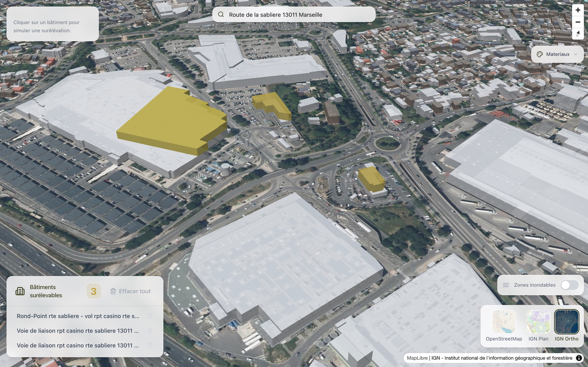
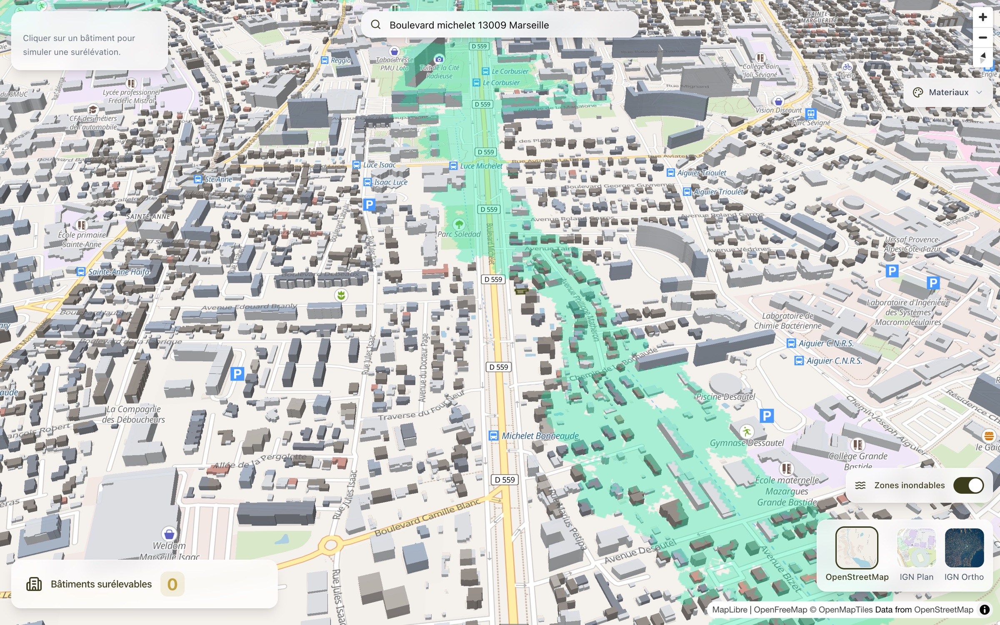
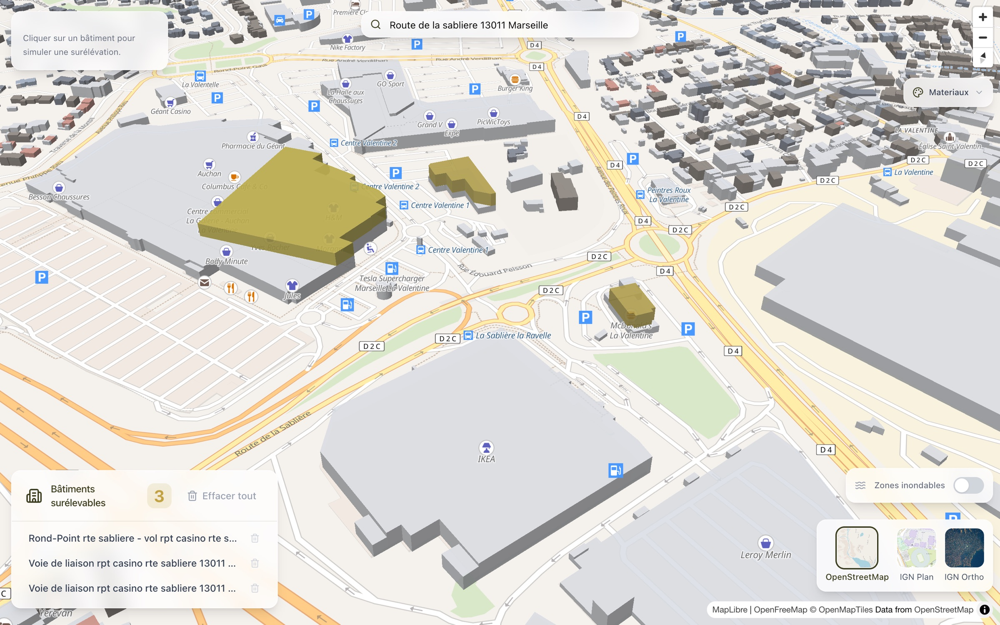

**Author:** Nicolas Rouanne

**Date:** February 12, 2026

---

I wanted to build a working prototype to explore how we could identify buildings suitable for urban hybridization (“surélévation”) in Marseille. The context: a client needed a GIS tool that could go beyond simple map visualization to actually help qualify which buildings could be elevated with additional floors on their rooftops. Instead of starting with a spec document, I decided to build something tangible using only open French government data.

The goal was clear: take IGN BD TOPO building data, render it in 3D, let users click on buildings to select them, and overlay environmental risk data like flood zones. All of this running in the browser, with no backend required for the prototype.



The prototype is live: [chutt.qraft.workers.dev](https://chutt.qraft.workers.dev/)

## The Stack: Next.js + MapLibre + French Government APIs

The prototype is a static Next.js app using MapLibre GL JS for mapping. No Mapbox, no proprietary tile service — everything comes from French government APIs:

- **Buildings**: IGN BD TOPO vector tiles give us 3D building geometry with metadata (height, wall material, usage)
- **Basemaps**: Three options — OpenFreeMap (bright), IGN Plan (vector), and IGN Ortho (satellite imagery)
- **Address search**: GeoPlatforme geocoding API, restricted to Marseille
- **Flood risk**: Georisques WMS service showing flood hazard zones



This was deliberate. The commercial project would eventually need to cross-reference multiple government datasets (cadastre, PLUi, SRU compliance), so proving we could work with these APIs in a prototype was important.

## How the 3D Visualization Works

The key feature is rendering buildings in 3D with color-coding based on wall material. BD TOPO includes a `materiaux_des_murs` field with CEREMA codes — we map the first digit to colors: stone (grey), brick (terracotta), concrete (slate), wood (brown).

")

When a user clicks a building, the prototype extracts the polygon geometry and creates an extrusion with a golden gradient, adding 10 meters to simulate what an elevated building would look like. This uses a ray-casting point-in-polygon algorithm projected to screen coordinates — necessary because MapLibre’s built-in click detection isn’t precise enough when the camera is tilted at 52°.

```typescript
// Ray-casting to find which polygon the user actually clicked
export function findClickedPolygonPrecise(
  point: maplibregl.Point,
  features: maplibregl.MapGeoJSONFeature[],
  map: maplibregl.Map
): maplibregl.MapGeoJSONFeature | null {
  for (const feature of features) {
    const geometry = feature.geometry;
    if (geometry.type === "Polygon") {
      for (const ring of geometry.coordinates) {
        const projectedRing = ring.map((coord) =>
          map.project(new maplibregl.LngLat(coord[0], coord[1]))
        );
        if (isPointInPolygon(point, projectedRing)) {
          return feature;
        }
      }
    }
  }
  return null;
}
```

Each selected building also gets its address resolved via reverse geocoding, with AbortController-based cancellation to prevent race conditions when users click rapidly.



## What Works Well

The prototype demonstrates several things convincingly:

- **3D building rendering at street level** looks impressive and gives an immediate sense of scale. Seeing buildings extruded with their real heights makes it visceral to understand which ones might be candidates for elevation.
- **French government data is good enough**. BD TOPO has building heights, wall materials, and geometry. Georisques provides flood zones. The GeoPlatforme geocoding API is fast and accurate for Marseille.
- **No backend needed for the exploration phase**. Everything runs as a static site, which means instant deployment and zero operational cost for a prototype.
- **Responsive design**. The glass-morphism UI with a drawer on mobile and inline panels on desktop makes it usable on any device.

## What’s Missing for a Real Product

This prototype is a visualization tool, not a business tool. To actually identify sites suitable for elevation, we’d need:

- **Cadastral data overlay**: The client needs CES (ground coverage coefficient) — buildings with more than 1000m² footprint on parcels larger than 2000m². This requires cross-referencing BD TOPO with cadastral boundaries.
- **Building usage filters**: Excluding residential buildings, schools, hospitals. BD TOPO has some usage data but it’s incomplete.
- **Roof type filtering**: Eliminating buildings with tile or slate roofs (not suitable for elevation).
- **Height constraints**: Only buildings ≤ 8m are candidates.
- **A real backend with PostGIS**: For spatial queries that combine all these filters, you need server-side processing. A static frontend can’t efficiently query “show me all commercial buildings under 8m with flat roofs on parcels > 2000m² that aren’t in flood zones.”

## Takeaways

Building this prototype took a few days and served its purpose: demonstrating that we can work with the French geospatial ecosystem (IGN, Georisques, GeoPlatforme) and produce something visually compelling. The 3D visualization with material-based coloring is genuinely useful for understanding the built environment at a glance.

The next step would be adding a PostGIS backend to combine multiple data sources and implement the actual business logic — the scoring and filtering that turns a map viewer into a site identification tool. The prototype proves the frontend is the easy part; the real work is in the spatial data pipeline.
