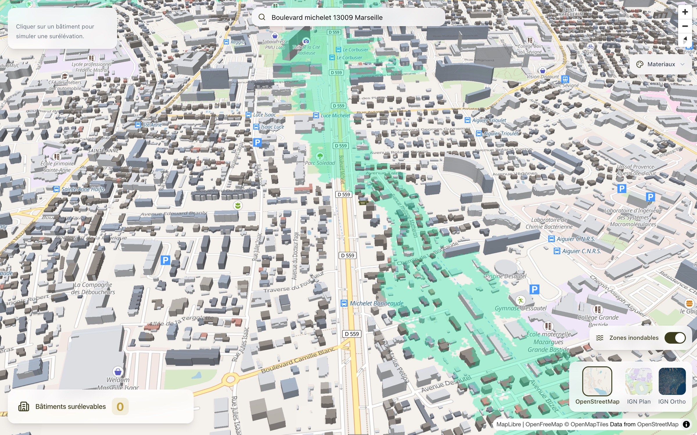
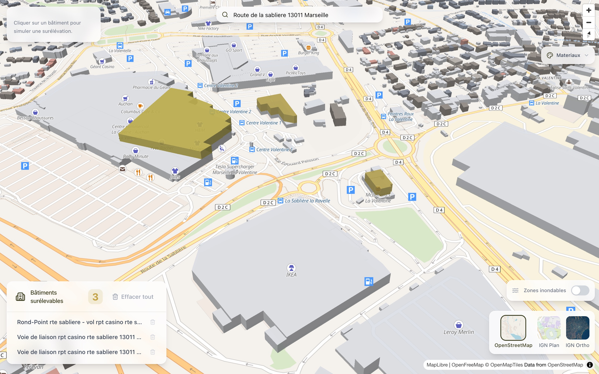

**Auteur :** Nicolas Rouanne

**Date :** 12 février 2026

---

Je voulais construire un prototype fonctionnel pour explorer comment identifier les bâtiments adaptés à l’hybridation urbaine (« surélévation ») à Marseille. Le contexte : un client avait besoin d’un outil SIG capable d’aller au-delà de la simple visualisation cartographique pour qualifier les bâtiments qui pourraient être surélevés, c’est-à-dire accueillir des étages supplémentaires sur leur toiture. Plutôt que de partir d’un document de spécifications, j’ai décidé de construire quelque chose de concret en utilisant uniquement des données ouvertes de l’État français.

L’objectif était clair : prendre les données bâtimentaires de l’IGN BD TOPO, les afficher en 3D, permettre aux utilisateurs de cliquer sur des bâtiments pour les sélectionner, et superposer des données de risques environnementaux comme les zones inondables. Le tout fonctionnant dans le navigateur, sans backend nécessaire pour le prototype.

 sur trois bâtiments de la zone commerciale de La Valentine, fond IGN Ortho")

Le prototype est en ligne : [chutt.qraft.workers.dev](https://chutt.qraft.workers.dev/)

## La stack : Next.js + MapLibre + API gouvernementales françaises

Le prototype est une application Next.js statique utilisant MapLibre GL JS pour la cartographie. Pas de Mapbox, pas de service de tuiles propriétaire — tout provient d’API gouvernementales françaises :

- **Bâtiments** : les tuiles vectorielles IGN BD TOPO fournissent la géométrie 3D des bâtiments avec leurs métadonnées (hauteur, matériau des murs, usage)
- **Fonds de carte** : trois options — OpenFreeMap (clair), IGN Plan (vectoriel) et IGN Ortho (imagerie satellite)
- **Recherche d’adresse** : API de géocodage GeoPlatforme, restreinte à Marseille
- **Risque inondation** : service WMS Georisques affichant les zones d’aléa inondation



Ce choix était délibéré. Le projet commercial devra à terme croiser plusieurs jeux de données gouvernementaux (cadastre, PLUi, conformité SRU), donc prouver que nous savons travailler avec ces API dès le prototype était important.

## Comment fonctionne la visualisation 3D

La fonctionnalité clé est le rendu 3D des bâtiments avec un code couleur basé sur le matériau des murs. La BD TOPO inclut un champ `materiaux_des_murs` avec des codes CEREMA — on associe le premier chiffre à une couleur : pierre (gris), brique (terre cuite), béton (ardoise), bois (marron).

")

Quand un utilisateur clique sur un bâtiment, le prototype extrait la géométrie du polygone et crée une extrusion avec un dégradé doré, ajoutant 10 mètres pour simuler à quoi ressemblerait un bâtiment surélevé. Cela utilise un algorithme de ray-casting point-dans-polygone projeté en coordonnées écran — nécessaire car la détection de clic native de MapLibre n’est pas assez précise quand la caméra est inclinée à 52°.

```typescript
// Ray-casting pour trouver le polygone réellement cliqué
export function findClickedPolygonPrecise(
  point: maplibregl.Point,
  features: maplibregl.MapGeoJSONFeature[],
  map: maplibregl.Map
): maplibregl.MapGeoJSONFeature | null {
  for (const feature of features) {
    const geometry = feature.geometry;
    if (geometry.type === "Polygon") {
      for (const ring of geometry.coordinates) {
        const projectedRing = ring.map((coord) =>
          map.project(new maplibregl.LngLat(coord[0], coord[1]))
        );
        if (isPointInPolygon(point, projectedRing)) {
          return feature;
        }
      }
    }
  }
  return null;
}
```

Chaque bâtiment sélectionné voit également son adresse résolue par géocodage inverse, avec annulation via AbortController pour éviter les conditions de concurrence quand les utilisateurs cliquent rapidement.



## Ce qui fonctionne bien

Le prototype démontre plusieurs choses de manière convaincante :

- **Le rendu 3D des bâtiments au niveau de la rue** est impressionnant et donne immédiatement un sens de l’échelle. Voir les bâtiments extrudés avec leur hauteur réelle rend viscéral la compréhension de ceux qui pourraient être candidats à la surélévation.
- **Les données gouvernementales françaises sont suffisantes**. La BD TOPO fournit les hauteurs, matériaux et géométries. Georisques fournit les zones inondables. L’API de géocodage GeoPlatforme est rapide et précise pour Marseille.
- **Pas de backend nécessaire pour la phase d’exploration**. Tout fonctionne en site statique, ce qui signifie un déploiement instantané et zéro coût opérationnel pour un prototype.
- **Design responsive**. L’interface glass-morphism avec un drawer sur mobile et des panneaux inline sur desktop le rend utilisable sur tout appareil.

## Ce qui manque pour un vrai produit

Ce prototype est un outil de visualisation, pas un outil métier. Pour réellement identifier les sites surélevables, il faudrait :

- **Superposition cadastrale** : le client a besoin du CES (coefficient d’emprise au sol) — des bâtiments de plus de 1000 m² d’emprise sur des parcelles de plus de 2000 m². Cela nécessite de croiser la BD TOPO avec les limites cadastrales.
- **Filtres par usage** : exclure les bâtiments résidentiels, les écoles, les hôpitaux. La BD TOPO a quelques données d’usage mais elles sont incomplètes.
- **Filtrage par type de toiture** : éliminer les bâtiments avec des toitures en tuiles ou ardoise (non adaptés à la surélévation).
- **Contraintes de hauteur** : seuls les bâtiments ≤ 8 m sont candidats.
- **Un vrai backend avec PostGIS** : pour des requêtes spatiales combinant tous ces filtres, il faut du traitement côté serveur. Un frontend statique ne peut pas efficacement requêter « tous les bâtiments commerciaux de moins de 8 m avec toit plat sur des parcelles > 2000 m² hors zones inondables ».

## Ce qu’il faut retenir

Construire ce prototype a pris quelques jours et a rempli son objectif : démontrer que nous savons travailler avec l’écosystème géospatial français (IGN, Georisques, GeoPlatforme) et produire quelque chose de visuellement convaincant. La visualisation 3D avec coloration par matériau est véritablement utile pour comprendre l’environnement bâti d’un coup d’œil.

La prochaine étape serait d’ajouter un backend PostGIS pour combiner plusieurs sources de données et implémenter la logique métier — le scoring et le filtrage qui transforment un visualiseur cartographique en outil d’identification de sites. Le prototype prouve que le frontend est la partie facile ; le vrai travail réside dans le pipeline de données spatiales.
