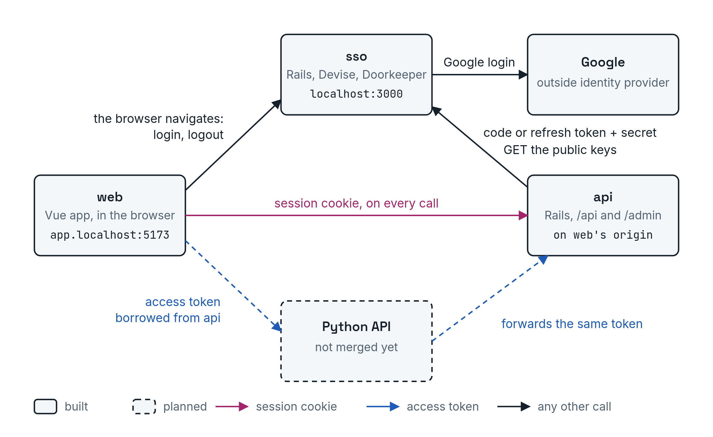
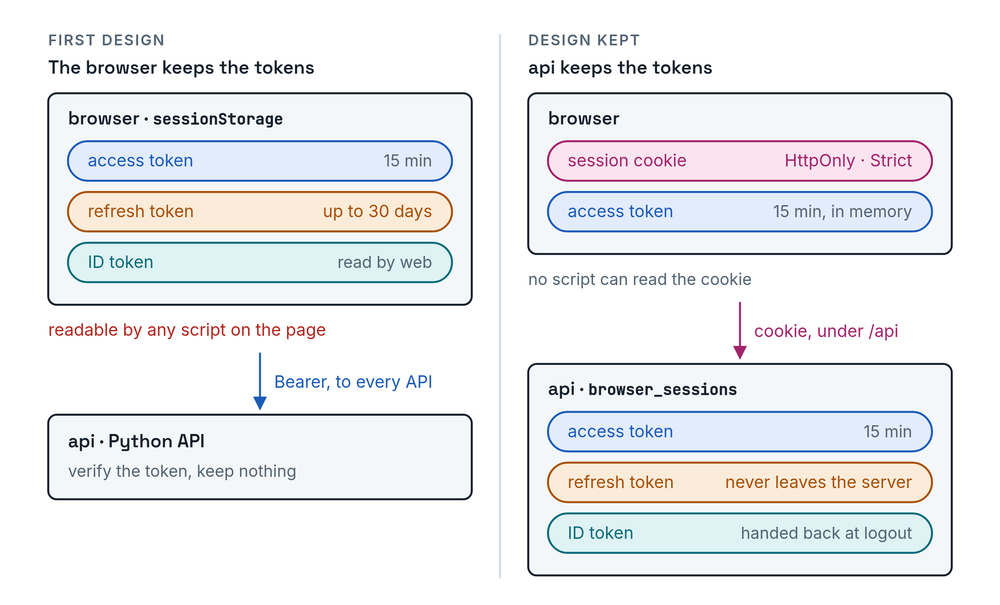
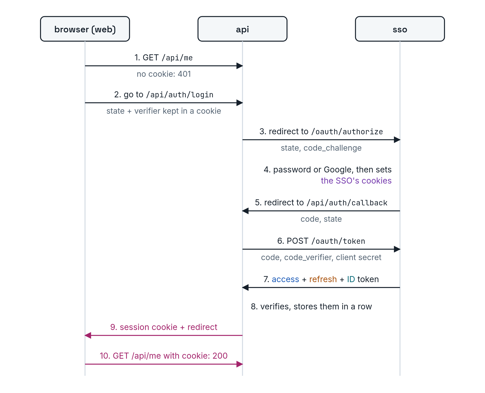
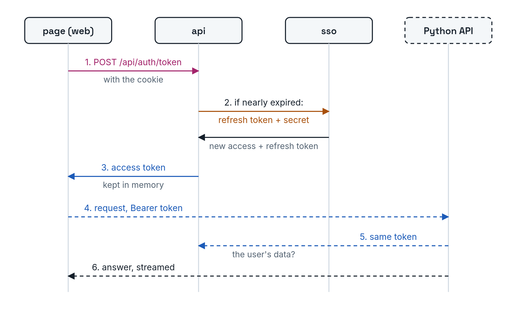

A login often starts simple and grows by layers: email and password, then a Google button, then a customer who wants to sign in with their company's SSO, then two-factor. And next to the Rails app there is often a second service, in Python, which also needs to know who is calling. We wanted to see what a clean version of that looks like when you build it yourself: a separate auth server in Rails, apps that trust only that server, and OAuth 2 and OpenID Connect doing the job they were designed for.

It's an exploration. Adrien Lupo wrote most of the code. Everything runs locally, nothing is deployed, and the Python service isn't merged yet. Each choice was written down with its reason as we went, and this article follows those notes.

## Four pieces that share nothing

One repository, one folder per service:

- `sso`, the auth server: Rails 8.1, [Devise](https://github.com/heartcombo/devise) for users and passwords, [Doorkeeper](https://github.com/doorkeeper-gem/doorkeeper) for OAuth 2, [doorkeeper-openid_connect](https://github.com/doorkeeper-gem/doorkeeper-openid_connect) for OpenID Connect. Google is a button on its login page.
- `api`, the app's backend: Rails 8.1 in API mode. It knows what a person may do, in its own database, and it also hosts the back-office.
- `web`, the front end in Vue. It stores no token.
- a Python API, the second service, which verifies the same tokens.

They share no database and no code, and talk only over HTTP. The SSO knows who the person is, the app knows what they may do, and each API checks a token by itself with the SSO's public key. The app trusts the SSO and nothing else: Google sits behind it, so adding another provider, or a customer's own, only changes the SSO.



The SSO is in Rails because that's what we write most, and a Rails team can maintain it. [Better Auth](https://www.better-auth.com/) (Node) was considered: less code, but a second stack.

## What the SSO hands out

The flow is OAuth 2's authorization code with [PKCE](https://www.rfc-editor.org/rfc/rfc7636). The client sends the browser to the SSO's `/oauth/authorize`, the person logs in there, the SSO sends the browser back with a one-time code, and the client exchanges that code for tokens at `/oauth/token`. PKCE ties the code to whoever started the login: the client sends the hash of a random secret with the first redirect, and the secret itself with the exchange.

The exchange returns three tokens, each with its own job:

- the **access token**, the one an API accepts. Here a JWT signed with RS256, valid 15 minutes, whose `aud` claim lists the two APIs;
- the **refresh token**, which gets a new access token without asking the person again. It's opaque, works once, and is replaced at each use;
- the **ID token**, OpenID Connect's addition, which tells the client who logged in. Its `aud` is that client's id.

The access token and the ID token are signed with the same key. What stops an API from accepting an ID token is `aud` alone, so an API's name must never be a client id.

In Doorkeeper most of this is configuration. Two lines matter more than they look: `force_pkce`, and the restriction to S256, because Doorkeeper accepts the weaker `plain` method by default.

```ruby
Doorkeeper.configure do
  grant_flows %w[authorization_code]
  force_pkce
  pkce_code_challenge_methods %w[S256]
  access_token_generator "::Doorkeeper::JWT"
  access_token_expires_in 15.minutes
  use_refresh_token
  default_scopes :openid
  enforce_configured_scopes
  skip_authorization { true }
end
```

`openid` is the only scope. With one client that gets everything, a scope per API limited nothing, so `aud` alone says which APIs accept a token. Scopes will come back the day a client must get less than everything. `skip_authorization` removes the consent screen, since every client is ours.

Two rules on refresh tokens aren't in Doorkeeper, and they are the reason for the SSO's only custom controller. A refresh token presented a second time means two parties hold it, and the SSO can't tell which one is the thief, so it revokes the whole chain (every refresh token descending from the same login) and both have to log in again. And a chain stops 30 days after the login, however often it was refreshed, so a stolen token that never gets caught still ends.

```ruby
class TokensController < Doorkeeper::TokensController
  before_action :revoke_refresh_chain_if_reused_or_too_old, only: :create

  private

  def revoke_refresh_chain_if_reused_or_too_old
    return unless params[:grant_type] == "refresh_token"

    token = Doorkeeper::AccessToken.by_refresh_token(params[:refresh_token].to_s)
    return unless token
    # Only the token's own client, proven by its secret, can set the rules off.
    return unless server.client&.id == token.application_id

    reused = token.revoked?
    max_lifetime = Rails.application.config.x.refresh_token_max_lifetime
    too_old = token.login_at.nil? || token.login_at < max_lifetime.ago
    return unless reused || too_old

    Doorkeeper::AccessToken.where(
      resource_owner_id: token.resource_owner_id, application_id: token.application_id,
      login_at: token.login_at, revoked_at: nil
    ).update_all(revoked_at: Time.current)
  end
end
```

The tokens are revoked here, then Doorkeeper refuses the request by itself with its usual `invalid_grant`. No Doorkeeper method is overridden. `login_at` is written by a Doorkeeper hook when the code is exchanged, and copied along the chain at each refresh. The check on `server.client` matters: without it, anyone holding an old refresh token could end someone's login without knowing the client's secret.

## Verifying a token without calling the SSO

An API never asks the SSO whether a token is valid. It fetches the SSO's public keys once, from the keys endpoint OpenID Connect publishes (`/oauth/discovery/keys`), keeps them in memory, and checks each signature itself. Each token names its key in a `kid` header. A token naming a key the API doesn't have makes it fetch again, at most once every 10 seconds, so the SSO can change its key without anyone touching the APIs. If the SSO can't be reached and no key is in memory, the answer is a 503, not a 401: the token may well be valid, and the client should retry rather than log in again.

With [ruby-jwt](https://github.com/jwt/ruby-jwt) it's one call:

```ruby
claims, = JWT.decode(
  token, nil, true,
  jwks: self, # the SSO's key set, fetched once and kept in memory
  algorithm: "RS256",
  iss: sso.issuer, verify_iss: true,
  aud: sso.audience, verify_aud: true,
  required_claims: %w[exp sub]
)
```

Each line closes a hole. `iss` and `aud` are only checked when asked for. `exp` is checked by default, but a token with no `exp` at all passes, hence `required_claims`. And the algorithm is ours to choose, never the token's: the classic attack is a token signed with HS256, using the public key, which everyone knows, as the secret.

The first valid token with an unknown `sub` creates the user's row in the app's database. The SSO and the app never talk about a user except through the token.

## The first design, and why we left it

In the first version the Vue app was an OAuth client like any other. It ran the authorization code flow itself with [oidc-client-ts](https://github.com/authts/oidc-client-ts), kept its tokens in the tab's `sessionStorage`, refresh token included, and sent the access token as a Bearer to every API. The argument was uniformity: one mechanism for every consumer, the browser today, a mobile app or a CLI tomorrow.

It worked. But a refresh token in the browser can be read by any script on the page, and a copy is worth up to 30 days of access. Rotation only catches the thief if the real app refreshes after them: close the tab, and the stolen chain goes unnoticed until its 30 days are over. The front end also carried token logic it had no business carrying. `oidc-client-ts` can send two refreshes with the same token, which the reuse rule takes for a theft, so every refresh had to go through one function, one at a time.

OWASP's [Session Management Cheat Sheet](https://cheatsheetseries.owasp.org/cheatsheets/Session_Management_Cheat_Sheet.html) and [OAuth 2.0 for Browser-Based Applications](https://www.rfc-editor.org/rfc/rfc10017) (RFC 10017) point the same way: keep the tokens on a server, and give the browser a cookie no script can read. That's the second design.



## The design we kept: api logs the browser in

`api` became the OAuth client of browsers. It's a confidential client, meaning it has a secret, which a page can't keep. It runs the authorization code flow server side, with its secret, and PKCE and `state` on top. No OpenID Connect library: a server-side code flow is one redirect and one POST, written with Ruby's standard library.



A few details make it hold.

- The login in progress waits in a cookie named after its `state`, valid 10 minutes, holding the PKCE verifier and the page to come back to. The callback accepts a `state` only if the browser sends the cookie of that name, which proves this browser started this login. One cookie per login, so two tabs logging in at the same time both complete.
- At the callback, `api` verifies the access token it just received exactly like any Bearer token, and finds or creates the user by `sub`. There is one verification path, not two.
- The session is a row of `browser_sessions` holding the SSO's three tokens. The cookie only holds the row's id: encrypted by Rails, `HttpOnly`, `SameSite=Strict`, path `/api`. Deleting the row ends the login from the server, and a login lasts 12 hours.
- `Strict` means the cookie is never sent on a request that starts from another site, and the return from the SSO is such a request. It still works because that return is recognised by the pending login's cookie, which is `Lax`, and the session cookie is set at that moment, not read.
- A request that isn't a GET and carries no token must name the web app's origin in its `Origin` header, which the browser writes itself and a page can't change. `SameSite` already covers most of it, but a site is wider than an origin: a sibling subdomain is the same site.

On the Vue side there's almost nothing left. The page asks `api` who's logged in, and the browser adds the cookie by itself:

```typescript
export async function loadUser() {
  const response = await fetch('/api/me')
  if (response.status === 401) {
    user.value = null
    return
  }
  if (!response.ok) throw new Error(`GET /api/me answered ${response.status}`)
  user.value = await response.json()
  sessionStorage.removeItem(LOGIN_STARTED_AT)
}
```

On a 401 the router sends the browser to `/api/auth/login`. If the SSO still knows the browser, through its session or its 30-day remember cookie, the redirects come straight back and the person only sees a spinner.

Other clients (another service, later a mobile app or a CLI) still send a Bearer token, verified the same way. So `api` has two ways in, and the browser is no longer just another consumer. That's the price of the cookie.

## A short-lived token for the second API

The Python API is called from the page, and it streams long answers. Relaying every call through `api` would hold a Rails thread per open stream, which 3 Puma threads can't sustain, and a reverse proxy in front of both was out of scope. RFC 10017 has a name for that compromise, the token-mediating backend. It ranks it below a backend that relays everything, and allows it when relaying isn't possible, which is the case here.

So the page asks `api` for a token (`POST /api/auth/token`) and gets the SSO's ordinary 15-minute access token, with the seconds it has left. It keeps it in a variable, never in the browser's storage, and asks again 30 seconds before it expires. It counts from `expires_in` rather than from an absolute time, because the browser's clock may not agree with the server's. The refresh token never leaves `api`.



Renewing is `api`'s job, and it has a trap. A refresh token works once and a second use revokes the chain, so two requests renewing at the same moment would log the person out. The renewal happens under a lock, and the row is read again inside it:

```ruby
def access_token!(sso_client)
  return [ access_token, access_token_expires_at ] if fresh?

  with_lock do
    update!(self.class.token_columns(sso_client.refresh(refresh_token))) unless fresh?
  end
  [ access_token, access_token_expires_at ]
rescue SsoClient::Refused
  destroy
  raise
end
```

The second request finds the token the first one stored. In Chrome, six requests sent at the same moment with an expired token all got the same new token, and the SSO's log shows a single refresh. Only a 400 `invalid_grant` ends the login. Any other failure of the SSO, a wrong client secret included, is a 503 and the session stays, otherwise a mistyped secret would log every user out, one after the other.

## The back-office

The admin panel ([Administrate](https://github.com/thoughtbot/administrate), plus Sidekiq's page) lives in `api` under `/admin`. HTML pages can't send a Bearer header, so it logs in at the SSO as a client of its own, `admin`, also confidential, through [omniauth_openid_connect](https://github.com/omniauth/omniauth_openid_connect), which checks the ID token's signature, `iss`, `aud` and `nonce`. After the login, `api` keeps the user's id in a Rails session cookie limited to `/admin`. The two logins share no cookie, and neither can end the other.

Being logged in isn't enough to get in. Only a user whose `admin` column is true in `api`'s database gets past `/admin`, and the column is read at every request, so a demotion counts from the next click. Roles belong to the app, not to the SSO or to the token.

## What local development taught us

Some traps only show up once the pieces actually run on different origins:

- Google refuses a redirect address on `sso.localhost`: it must end with a public top-level domain, and over plain http only `localhost` is accepted. So the SSO runs on `localhost:3000`.
- Cookies ignore ports. Opened on `localhost:3001`, the back-office would have received the SSO's cookies, and the SSO its. It runs on `app.localhost:3001`, another host, with a cookie limited to `/admin`.
- Behind Vite's proxy, `api` sees its own host, `localhost:3001`, and a redirect to a bare path sent the browser off the app. `api` now builds every address from the web app's configured origin.
- With an SSO session open, a login is a chain of redirects with nothing to stop it, so any failure that restarts it loops forever. A failed login ends on a page that starts nothing, and the front refuses to log in twice within 30 seconds.
- Devise only forgets a user it finds in the session at logout. After the browser was closed the session is empty, and the remember cookie survived every logout. The logout controllers now load the user from that cookie before signing out.

## The risks we accepted

The design doesn't remove every risk, and these are the ones we kept, knowingly:

- A script injected into the page can't read the cookie, but it can act as the user while the page is open, and it can read the short-lived token or ask for one, usable elsewhere for 15 minutes. In the first design a copied refresh token was worth 30 days. A strict content security policy and few third-party scripts remain the real defence.
- One token names both APIs, so a token leaked at one works at the other. A token per API needs resource indicators ([RFC 8707](https://www.rfc-editor.org/rfc/rfc8707)), which Doorkeeper only has in its 6.0 release candidate.
- Access tokens can't be recalled, since the APIs verify them offline. In a browser, a user disabled at the SSO keeps access to `api` until their 12-hour session ends.
- `api`'s database holds a refresh token per session. Without the client secret, which isn't in the database, it's worth nothing, and the columns aren't encrypted.
- The SSO remembers a browser for 30 days, with no checkbox to opt out on a shared computer: the person has to log out.

It all still runs locally, on SQLite and plain http, tried in Chrome only, with the Google login tested in OmniAuth's test mode and not against the real Google. There's no sign-up, password reset, company SSO or two-factor yet. And the Python API's part stops at the token: the service itself isn't merged.
