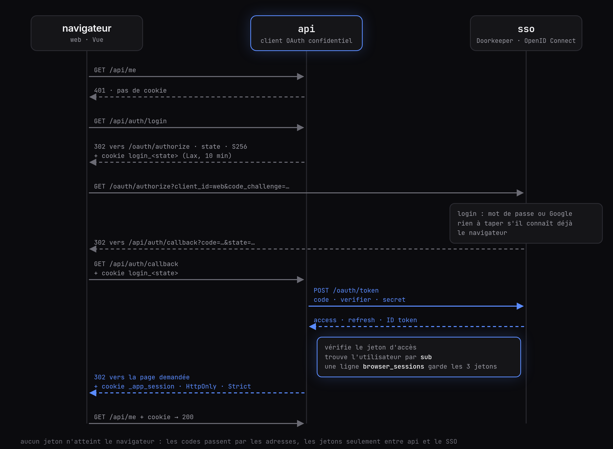

Un login commence souvent simple et grossit par couches : email et mot de passe, puis un bouton Google, puis un client qui veut se connecter avec le SSO de son entreprise, puis la double authentification. Et à côté de l'app Rails, il y a souvent un deuxième service, en Python, qui a lui aussi besoin de savoir qui l'appelle. On voulait voir à quoi ressemble une version propre de tout ça quand on la construit soi-même : un serveur d'authentification à part, en Rails, des apps qui ne font confiance qu'à lui, et OAuth 2 et OpenID Connect qui font le travail pour lequel ils ont été pensés.

C'est une exploration. Adrien Lupo a écrit l'essentiel du code. Tout tourne en local, rien n'est déployé, et le service Python n'est pas encore mergé. Chaque choix a été écrit avec sa raison au fil de l'eau, et cet article suit ces notes.

## Quatre pièces qui ne partagent rien

Un dépôt, un dossier par service :

- `sso`, le serveur d'authentification : Rails 8.1, [Devise](https://github.com/heartcombo/devise) pour les utilisateurs et les mots de passe, [Doorkeeper](https://github.com/doorkeeper-gem/doorkeeper) pour OAuth 2, [doorkeeper-openid_connect](https://github.com/doorkeeper-gem/doorkeeper-openid_connect) pour OpenID Connect. Google est un bouton sur sa page de login.
- `api`, le backend de l'app : Rails 8.1 en mode API. Il sait ce qu'une personne a le droit de faire, dans sa propre base, et il porte aussi le back-office.
- `web`, le front en Vue. Il ne stocke aucun jeton.
- une API Python, le deuxième service, qui vérifie les mêmes jetons.

Ils ne partagent ni base ni code, et ne se parlent qu'en HTTP. Le SSO sait qui est la personne, l'app sait ce qu'elle a le droit de faire, et chaque API vérifie un jeton seule, avec la clé publique du SSO. L'app ne fait confiance qu'au SSO : Google est derrière lui, donc ajouter un autre fournisseur, ou celui d'un client, ne change que le SSO.


Le SSO est en Rails parce que c'est ce qu'on écrit le plus, et qu'une équipe Rails peut le maintenir. [Better Auth](https://www.better-auth.com/) (Node) a été envisagé : moins de code, mais une deuxième stack.

## Ce que le SSO distribue

Le flux, c'est l'authorization code d'OAuth 2 avec [PKCE](https://www.rfc-editor.org/rfc/rfc7636). Le client envoie le navigateur sur `/oauth/authorize` du SSO, la personne s'y connecte, le SSO renvoie le navigateur avec un code à usage unique, et le client échange ce code contre des jetons sur `/oauth/token`. PKCE lie le code à celui qui a lancé le login : le client envoie le hash d'un secret aléatoire avec la première redirection, et le secret lui-même avec l'échange.

L'échange renvoie trois jetons, chacun avec son rôle :

- l'**access token**, celui qu'une API accepte. Ici un JWT signé en RS256, valable 15 minutes, dont le claim `aud` liste les deux API ;
- le **refresh token**, qui obtient un nouvel access token sans redemander quoi que ce soit à la personne. Il est opaque, ne sert qu'une fois, et il est remplacé à chaque usage ;
- l'**ID token**, l'ajout d'OpenID Connect, qui dit au client qui s'est connecté. Son `aud` est l'identifiant de ce client.

L'access token et l'ID token sont signés avec la même clé. Ce qui empêche une API d'accepter un ID token, c'est `aud` et rien d'autre, donc le nom d'une API ne doit jamais être un identifiant de client.

Dans Doorkeeper, l'essentiel est de la configuration. Deux lignes comptent plus qu'elles n'en ont l'air : `force_pkce`, et la restriction à S256, parce que Doorkeeper accepte par défaut la méthode `plain`, plus faible.

```ruby
Doorkeeper.configure do
  grant_flows %w[authorization_code]
  force_pkce
  pkce_code_challenge_methods %w[S256]
  access_token_generator "::Doorkeeper::JWT"
  access_token_expires_in 15.minutes
  use_refresh_token
  default_scopes :openid
  enforce_configured_scopes
  skip_authorization { true }
end
```

`openid` est le seul scope. Avec un seul client qui a droit à tout, un scope par API ne limitait rien, donc c'est `aud` seul qui dit quelles API acceptent un jeton. Les scopes reviendront le jour où un client devra avoir moins que tout. `skip_authorization` supprime l'écran de consentement, puisque tous les clients sont les nôtres.

Deux règles sur les refresh tokens ne sont pas dans Doorkeeper, et elles sont la raison du seul contrôleur maison du SSO. Un refresh token présenté une deuxième fois veut dire que deux personnes le détiennent, et le SSO ne peut pas savoir laquelle est le voleur : il révoque toute la chaîne (tous les refresh tokens issus du même login) et les deux doivent se reconnecter. Et une chaîne s'arrête 30 jours après le login, quel que soit le nombre de refresh, pour qu'un jeton volé qui n'est jamais repéré finisse quand même par expirer.

```ruby
class TokensController < Doorkeeper::TokensController
  before_action :revoke_refresh_chain_if_reused_or_too_old, only: :create

  private

  def revoke_refresh_chain_if_reused_or_too_old
    return unless params[:grant_type] == "refresh_token"

    token = Doorkeeper::AccessToken.by_refresh_token(params[:refresh_token].to_s)
    return unless token
    # Only the token's own client, proven by its secret, can set the rules off.
    return unless server.client&.id == token.application_id

    reused = token.revoked?
    max_lifetime = Rails.application.config.x.refresh_token_max_lifetime
    too_old = token.login_at.nil? || token.login_at < max_lifetime.ago
    return unless reused || too_old

    Doorkeeper::AccessToken.where(
      resource_owner_id: token.resource_owner_id, application_id: token.application_id,
      login_at: token.login_at, revoked_at: nil
    ).update_all(revoked_at: Time.current)
  end
end
```

Les jetons sont révoqués ici, puis Doorkeeper refuse la requête tout seul, avec son `invalid_grant` habituel. Aucune méthode de Doorkeeper n'est surchargée. `login_at` est écrit par un hook de Doorkeeper au moment de l'échange du code, et recopié le long de la chaîne à chaque refresh. Le test sur `server.client` compte : sans lui, n'importe qui détenant un vieux refresh token pourrait mettre fin au login de quelqu'un sans connaître le secret du client.

## Vérifier un jeton sans appeler le SSO

Une API ne demande jamais au SSO si un jeton est valide. Elle récupère une fois les clés publiques du SSO, sur l'endpoint qu'OpenID Connect publie (`/oauth/discovery/keys`), les garde en mémoire, et vérifie chaque signature elle-même. Chaque jeton nomme sa clé dans un en-tête `kid`. Un jeton qui nomme une clé que l'API n'a pas la pousse à redemander, au plus une fois toutes les 10 secondes, pour que le SSO puisse changer de clé sans qu'on touche aux API. Si le SSO est injoignable et qu'aucune clé n'est en mémoire, la réponse est un 503, pas un 401 : le jeton est peut-être bon, le client doit réessayer, pas se reconnecter.

Avec [ruby-jwt](https://github.com/jwt/ruby-jwt), c'est un seul appel :

```ruby
claims, = JWT.decode(
  token, nil, true,
  jwks: self, # the SSO's key set, fetched once and kept in memory
  algorithm: "RS256",
  iss: sso.issuer, verify_iss: true,
  aud: sso.audience, verify_aud: true,
  required_claims: %w[exp sub]
)
```

Chaque ligne bouche un trou. `iss` et `aud` ne sont vérifiés que si on le demande. `exp` est vérifié par défaut, mais un jeton sans `exp` du tout passe, d'où `required_claims`. Et l'algorithme, c'est nous qui le choisissons, jamais le jeton : l'attaque classique, c'est un jeton signé en HS256 avec la clé publique, que tout le monde connaît, comme secret.

Le premier jeton valide avec un `sub` inconnu crée la ligne de l'utilisateur dans la base de l'app. Le SSO et l'app ne parlent jamais d'un utilisateur autrement que par le jeton.

## Le premier design, et pourquoi on l'a quitté

Dans la première version, l'app Vue était un client OAuth comme un autre. Elle faisait elle-même le flux authorization code avec [oidc-client-ts](https://github.com/authts/oidc-client-ts), gardait ses jetons dans le `sessionStorage` de l'onglet, refresh token compris, et envoyait l'access token en Bearer à chaque API. L'argument, c'était l'uniformité : un seul mécanisme pour tous les consommateurs, le navigateur aujourd'hui, une app mobile ou une CLI demain.

Ça marchait. Mais un refresh token dans le navigateur est lisible par n'importe quel script de la page, et une copie vaut jusqu'à 30 jours d'accès. La rotation ne repère le voleur que si la vraie app fait un refresh après lui : si on ferme l'onglet, la chaîne volée passe inaperçue jusqu'au bout de ses 30 jours. Le front portait aussi une logique de jetons qui n'avait rien à faire là. `oidc-client-ts` peut envoyer deux refresh avec le même jeton, ce que la règle de réutilisation prend pour un vol, donc chaque refresh devait passer par une seule fonction, un à la fois.

La [Session Management Cheat Sheet](https://cheatsheetseries.owasp.org/cheatsheets/Session_Management_Cheat_Sheet.html) de l'OWASP et [OAuth 2.0 for Browser-Based Applications](https://www.rfc-editor.org/rfc/rfc10017) (RFC 10017) vont dans le même sens : garder les jetons sur un serveur, et donner au navigateur un cookie qu'aucun script ne peut lire. C'est le deuxième design.


## Le design retenu : api connecte le navigateur

`api` est devenu le client OAuth des navigateurs. C'est un client confidentiel, c'est-à-dire qu'il a un secret, ce qu'une page ne peut pas garder. Il fait le flux authorization code côté serveur, avec son secret, plus PKCE et `state` par-dessus. Pas de bibliothèque OpenID Connect : un flux code côté serveur, c'est une redirection et un POST, écrits avec la bibliothèque standard de Ruby.



Quelques détails font tenir l'ensemble.

- Le login en cours attend dans un cookie qui porte le nom de son `state`, valable 10 minutes, avec le verifier PKCE et la page où revenir. Le callback n'accepte un `state` que si le navigateur envoie le cookie de ce nom, ce qui prouve que c'est ce navigateur qui a lancé ce login. Un cookie par login, pour que deux onglets qui se connectent en même temps aboutissent tous les deux.
- Au callback, `api` vérifie l'access token qu'il vient de recevoir exactement comme n'importe quel Bearer, et trouve ou crée l'utilisateur par son `sub`. Il n'y a qu'un chemin de vérification, pas deux.
- La session est une ligne de `browser_sessions` qui garde les trois jetons du SSO. Le cookie ne contient que l'id de la ligne : chiffré par Rails, `HttpOnly`, `SameSite=Strict`, chemin `/api`. Supprimer la ligne met fin au login depuis le serveur, et un login dure 12 heures.
- `Strict` veut dire que le cookie n'est jamais envoyé sur une requête partie d'un autre site, et le retour du SSO est une de ces requêtes. Ça marche quand même parce que ce retour est reconnu par le cookie du login en cours, qui est `Lax`, et que le cookie de session est posé à ce moment-là, pas lu.
- Une requête qui n'est pas un GET et ne porte pas de jeton doit nommer l'origine de l'app dans son en-tête `Origin`, que le navigateur écrit lui-même et qu'une page ne peut pas changer. `SameSite` en couvre déjà l'essentiel, mais un site est plus large qu'une origine : un sous-domaine voisin est le même site.

Côté Vue, il ne reste presque rien. La page demande à `api` qui est connecté, et le navigateur ajoute le cookie tout seul :

```typescript
export async function loadUser() {
  const response = await fetch('/api/me')
  if (response.status === 401) {
    user.value = null
    return
  }
  if (!response.ok) throw new Error(`GET /api/me answered ${response.status}`)
  user.value = await response.json()
  sessionStorage.removeItem(LOGIN_STARTED_AT)
}
```

Sur un 401, le routeur envoie le navigateur sur `/api/auth/login`. Si le SSO connaît encore le navigateur, par sa session ou par son cookie « remember » de 30 jours, les redirections reviennent aussitôt et la personne ne voit qu'un spinner.

Les autres clients (un autre service, plus tard une app mobile ou une CLI) envoient toujours un Bearer, vérifié de la même façon. `api` a donc deux portes d'entrée, et le navigateur n'est plus un consommateur comme les autres. C'est le prix du cookie.

## Un jeton court pour la deuxième API

L'API Python est appelée depuis la page, et elle streame de longues réponses. Tout relayer par `api` immobiliserait un thread Rails par stream ouvert, ce que 3 threads Puma ne tiennent pas, et un reverse proxy devant les deux sortait du périmètre. La RFC 10017 a un nom pour ce compromis, le token-mediating backend. Elle le classe derrière un backend qui relaie tout, et l'autorise quand relayer n'est pas possible, ce qui est le cas ici.

La page demande donc un jeton à `api` (`POST /api/auth/token`) et reçoit l'access token ordinaire du SSO, de 15 minutes, avec le nombre de secondes qui lui restent. Elle le garde dans une variable, jamais dans le stockage du navigateur, et en redemande un 30 secondes avant l'expiration. Elle compte à partir de `expires_in` plutôt que d'une heure absolue, parce que l'horloge du navigateur n'est pas forcément d'accord avec celle du serveur. Le refresh token ne quitte jamais `api`.


Renouveler, c'est le travail d'`api`, et il y a un piège. Un refresh token ne sert qu'une fois et un deuxième usage révoque la chaîne, donc deux requêtes qui renouvellent au même moment déconnecteraient la personne. Le renouvellement se fait sous verrou, et la ligne est relue à l'intérieur :

```ruby
def access_token!(sso_client)
  return [ access_token, access_token_expires_at ] if fresh?

  with_lock do
    update!(self.class.token_columns(sso_client.refresh(refresh_token))) unless fresh?
  end
  [ access_token, access_token_expires_at ]
rescue SsoClient::Refused
  destroy
  raise
end
```

La deuxième requête trouve le jeton que la première a enregistré. Dans Chrome, six requêtes envoyées au même instant avec un jeton expiré ont toutes reçu le même nouveau jeton, et le log du SSO montre un seul refresh. Seul un 400 `invalid_grant` met fin au login. Toute autre erreur du SSO, y compris un mauvais secret client, donne un 503 et la session reste, sinon un secret mal recopié déconnecterait tous les utilisateurs, l'un après l'autre.

## Le back-office

Le back-office ([Administrate](https://github.com/thoughtbot/administrate), plus la page de Sidekiq) vit dans `api`, sous `/admin`. Des pages HTML ne peuvent pas envoyer d'en-tête Bearer, donc il se connecte au SSO comme un client à part entière, `admin`, confidentiel lui aussi, via [omniauth_openid_connect](https://github.com/omniauth/omniauth_openid_connect), qui vérifie la signature, l'`iss`, l'`aud` et le `nonce` de l'ID token. Après le login, `api` garde l'id de l'utilisateur dans un cookie de session Rails limité à `/admin`. Les deux logins ne partagent aucun cookie, et aucun ne peut mettre fin à l'autre.

Être connecté ne suffit pas pour entrer. Seul un utilisateur dont la colonne `admin` est vraie dans la base d'`api` passe `/admin`, et la colonne est relue à chaque requête, donc une rétrogradation compte dès le clic suivant. Les rôles appartiennent à l'app, pas au SSO ni au jeton.

## Ce que le développement local nous a appris

Certains pièges n'apparaissent qu'une fois les pièces vraiment lancées sur des origines différentes :

- Google refuse une adresse de retour sur `sso.localhost` : elle doit finir par un domaine de premier niveau public, et en http simple seul `localhost` est accepté. Le SSO tourne donc sur `localhost:3000`.
- Les cookies ignorent les ports. Ouvert sur `localhost:3001`, le back-office aurait reçu les cookies du SSO, et le SSO les siens. Il tourne sur `app.localhost:3001`, un autre hôte, avec un cookie limité à `/admin`.
- Derrière le proxy de Vite, `api` voit son propre hôte, `localhost:3001`, et une redirection vers un simple chemin envoyait le navigateur hors de l'app. `api` construit maintenant toutes ses adresses à partir de l'origine configurée de l'app.
- Avec une session SSO ouverte, un login est une suite de redirections que rien n'arrête, donc tout échec qui le relance boucle sans fin. Un login raté finit sur une page qui ne relance rien, et le front refuse de se reconnecter deux fois en moins de 30 secondes.
- Devise n'oublie un utilisateur au logout que s'il le trouve dans la session. Après une fermeture du navigateur, la session est vide, et le cookie « remember » survivait à tous les logouts. Les contrôleurs de logout chargent maintenant l'utilisateur depuis ce cookie avant de le déconnecter.

## Les risques qu'on a acceptés

Le design n'enlève pas tous les risques, et voici ceux qu'on a gardés, en connaissance de cause :

- Un script injecté dans la page ne peut pas lire le cookie, mais il peut agir au nom de l'utilisateur tant que la page est ouverte, et il peut lire le jeton court ou en demander un, utilisable ailleurs pendant 15 minutes. Dans le premier design, un refresh token copié valait 30 jours. Une content security policy stricte et peu de scripts tiers restent la vraie défense.
- Un même jeton nomme les deux API, donc un jeton qui fuit chez l'une marche chez l'autre. Un jeton par API demande les resource indicators ([RFC 8707](https://www.rfc-editor.org/rfc/rfc8707)), que Doorkeeper n'a que dans sa release candidate 6.0.
- Les access tokens ne se rappellent pas, puisque les API les vérifient hors ligne. Dans un navigateur, un utilisateur désactivé au SSO garde l'accès à `api` jusqu'à la fin de sa session de 12 heures.
- La base d'`api` garde un refresh token par session. Sans le secret du client, qui n'est pas dans la base, il ne vaut rien, et les colonnes ne sont pas chiffrées.
- Le SSO se souvient d'un navigateur pendant 30 jours, sans case à décocher sur un ordinateur partagé : il faut se déconnecter.

Tout tourne encore en local, sur SQLite et en http simple, essayé dans Chrome seulement, avec le login Google testé dans le mode test d'OmniAuth et pas contre le vrai Google. Il n'y a encore ni inscription, ni réinitialisation de mot de passe, ni SSO d'entreprise, ni double authentification. Et la partie de l'API Python s'arrête au jeton : le service lui-même n'est pas mergé.
