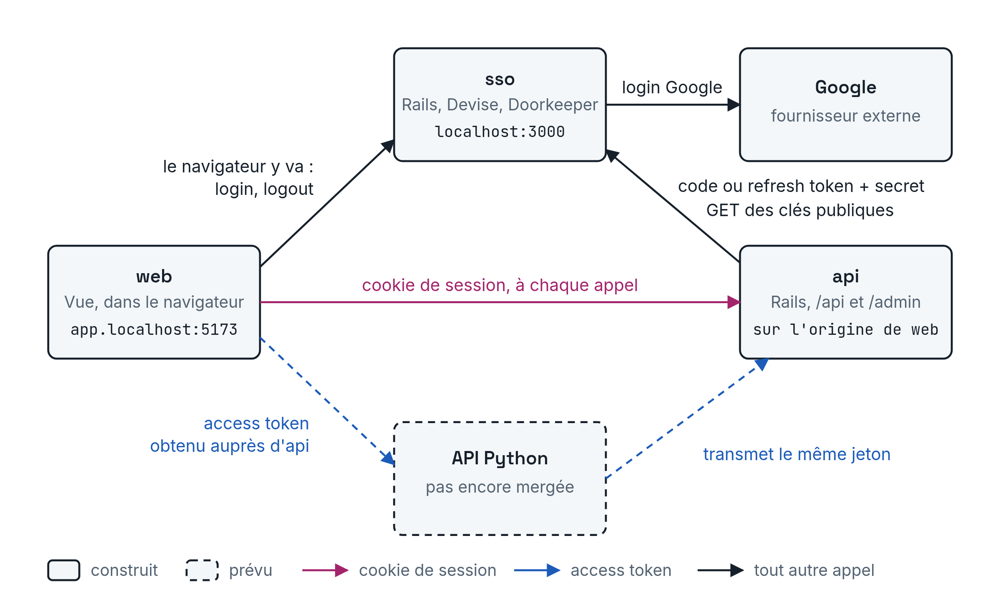
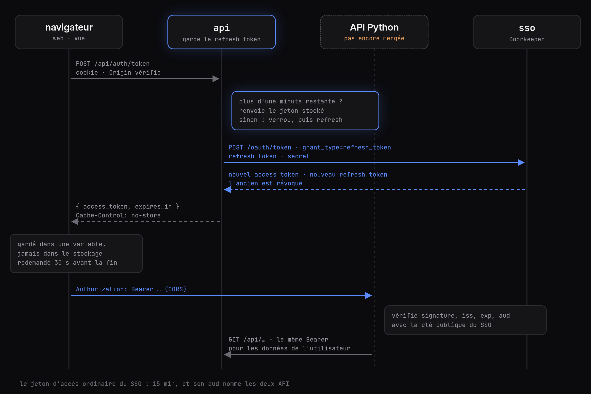
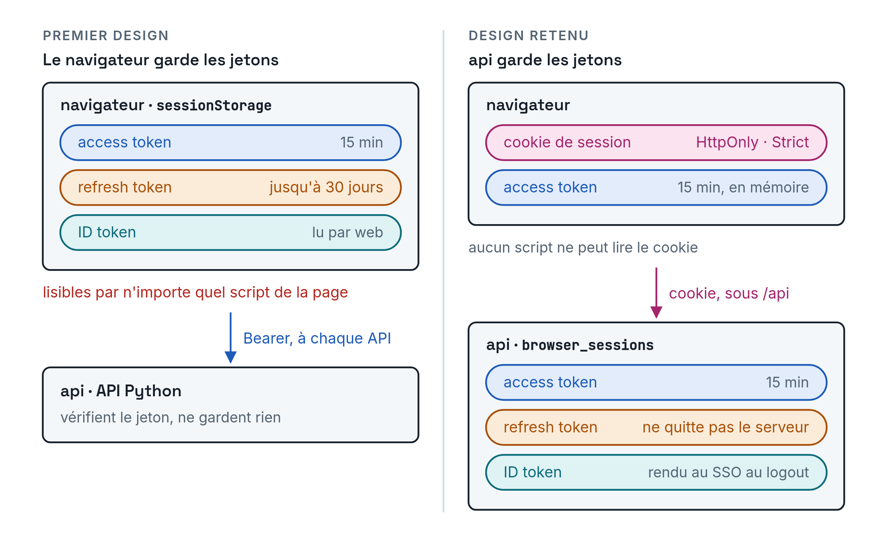

Un login commence souvent simple et grossit par couches : email et mot de passe, puis un bouton Google, puis un client qui veut se connecter avec le SSO de son entreprise, puis la double authentification. Et à côté de l'app Rails, il y a souvent un deuxième service, en Python, qui a lui aussi besoin de savoir qui l'appelle. On voulait voir à quoi ressemble une version propre de tout ça quand on la construit soi-même, en Rails, avec OAuth 2 et OpenID Connect au centre.

C'est une exploration, et Adrien Lupo a écrit l'essentiel du code. Tout tourne en local, rien n'est déployé, et l'API Python n'est pas encore mergée.

L'idée tient en quelques phrases. L'app ne voit jamais un mot de passe. Un serveur à part, le SSO, vérifie qui est la personne. Le backend de l'app lui pose la question une fois, au login, puis reconnaît le navigateur grâce à un cookie qu'aucun script ne peut lire. Les autres services présentent un jeton signé de courte durée, et la page peut en obtenir un, valable 15 minutes, pour appeler la deuxième API. La suite reprend ces phrases une par une.

## Les pièces

Un dépôt, un dossier par service :

- `sso`, le serveur d'authentification : Rails 8.1, [Devise](https://github.com/heartcombo/devise) pour les utilisateurs et les mots de passe, [Doorkeeper](https://github.com/doorkeeper-gem/doorkeeper) pour OAuth 2, [doorkeeper-openid_connect](https://github.com/doorkeeper-gem/doorkeeper-openid_connect) pour OpenID Connect. Google est un bouton sur sa page de login.
- `api`, le backend de l'app, en Rails 8.1. Il connecte les navigateurs, sait ce que chaque personne a le droit de faire et garde ses données.
- `web`, le front en Vue.
- l'API Python, le deuxième service.



Elles ne partagent aucune base et aucun code, et ne se parlent qu'en HTTP. Le navigateur n'envoie à `api` qu'un cookie. `api` appelle le SSO pour échanger un code de login contre des jetons, pour les renouveler, pour les révoquer au logout, et pour récupérer ses clés publiques. Personne ne demande au SSO si un jeton ou une session est encore valable.

| Rôle | Qui s'en charge |
| --- | --- |
| Savoir qui est la personne : email, mot de passe, compte Google | `sso`, dans sa base |
| Émettre les jetons, publier les clés publiques qui les vérifient | `sso`, avec Doorkeeper |
| Connecter un navigateur et s'en souvenir | `api`, avec une ligne de sa table `browser_sessions` |
| Décider ce qu'un utilisateur a le droit de faire, garder ses données | `api`, dans sa base |
| Vérifier qu'un jeton est authentique | chaque API, seule |

L'app ne fait confiance qu'au SSO. Google est derrière lui, donc ajouter un autre fournisseur, ou celui d'un client, ne change que le SSO. On l'a fait en Rails parce que c'est ce qu'on écrit le plus, et qu'une équipe Rails peut le maintenir. [Better Auth](https://www.better-auth.com/) (Node) a été envisagé : moins de code, mais une deuxième stack.

`api` sert aussi un back-office sous `/admin` ([Administrate](https://github.com/thoughtbot/administrate) et la page de Sidekiq). Il se connecte au même SSO, comme un deuxième client, et garde son propre cookie, limité à `/admin`. Les deux logins ne partagent aucun cookie, et fermer l'un ne ferme pas l'autre. Être connecté ne suffit pas pour entrer : il faut que la colonne `admin` de l'utilisateur soit vraie dans la base d'`api`. Les rôles appartiennent à l'app, pas au SSO.

## Cinq choses qu'on confond facilement

Un jeton, c'est une chaîne de caractères qui prouve quelque chose à celui qui la vérifie. Il y a ici cinq de ces preuves, et chacune prouve une chose différente à quelqu'un de différent. Elles gardent la même couleur dans tous les schémas.

| | Ce que ça prouve | Qui le garde, qui le lit | Durée |
| --- | --- | --- | --- |
| **Cookie de session de l'app** (rose) | Ce navigateur a un login en cours. Il ne contient que l'id d'une ligne de `browser_sessions`. | Le navigateur le garde et ne l'envoie que sous `/api`. `api` le lit. | 12 heures après le login |
| **Cookies du SSO** (violet) | Ce navigateur s'est déjà connecté au SSO. | Le navigateur ne les envoie qu'au SSO. | Jusqu'à la fermeture du navigateur, et 30 jours pour le cookie « remember » |
| **Access token** (bleu) | Le SSO garantit que celui qui le porte agit pour tel utilisateur, auprès de telles API. | `api` le garde. La page en reçoit une copie quand elle le demande. Les API le lisent. | 15 minutes |
| **Refresh token** (orange) | « On m'a donné les derniers jetons, donne-moi les suivants. » | `api` le garde, il n'arrive jamais dans le navigateur. Le SSO le lit. | Un seul usage, et jamais plus de 30 jours après le login |
| **ID token** (turquoise) | Le SSO dit que cette personne vient de se connecter. C'est l'ajout d'OpenID Connect. | `api` le garde et le rend au SSO au logout. Aucune API ne l'accepte. | 2 minutes |

L'access token est un jeton *porteur* (bearer) : une API accepte celui qui le présente, et vérifie seulement que le jeton est authentique. C'est pour ça qu'il dure peu. Le refresh token, lui, ne marche qu'accompagné du secret d'`api`, que le navigateur n'a pas.

L'access token est un JWT, un petit document JSON lisible par tout le monde, suivi d'une signature. Ses champs disent qui l'a signé (`iss`, le SSO), pour quel utilisateur (`sub`, son id au SSO, et son `email`), pour quelles API (`aud`, qui nomme les deux) et jusqu'à quand (`exp`). Il ne porte ni rôle ni scope : il n'y a qu'un client, c'est le nôtre, et `aud` dit déjà à quelles API le jeton est destiné.

## Le login, étape par étape

Le protocole, c'est OAuth 2, la façon standard pour une app d'envoyer l'utilisateur se connecter sur un serveur à part et de récupérer des jetons. Le flux s'appelle *authorization code* : le navigateur revient du SSO avec un code à usage unique, et `api` échange ce code contre des jetons, de serveur à serveur. Le mot de passe ne se tape que sur la page du SSO, ou sur celle de Google, et aucun jeton n'arrive dans le navigateur pendant le login. Dans le vocabulaire d'OAuth, c'est `api` qui est le *client*.


Chaque élément du schéma empêche une attaque précise.

| Élément | Ce que c'est | Ce que ça empêche |
| --- | --- | --- |
| `state` (étapes 2 à 5) | Une valeur aléatoire qu'`api` envoie à l'étape 3 et attend en retour à l'étape 5. Le login en cours attend 10 minutes dans un cookie qui porte son nom. | Qu'un autre site fasse terminer à votre navigateur un login qu'il n'a jamais commencé, dans le compte de l'attaquant. |
| Secret client (étape 6) | Envoyé par `api` au SSO, jamais par le navigateur. | Que quelqu'un qui a intercepté un code l'échange contre des jetons. |
| [PKCE](https://www.rfc-editor.org/rfc/rfc7636) (étapes 3 et 6) | `api` garde un `code_verifier` aléatoire et envoie son hash SHA-256, le `code_challenge`, à l'étape 3. À l'étape 6, le SSO hache le verifier et compare. Doorkeeper accepte par défaut une variante qui ne hache rien : la config ne garde que S256. | Qu'un code volé soit rejoué dans un autre navigateur. |
| Adresse de retour enregistrée (étape 5) | Le SSO n'envoie ses codes qu'à `/api/auth/callback`, et un code ne sert qu'une fois. | Qu'un lien piégé fasse livrer le code à un autre site. |
| `SameSite` (étapes 5 et 9) | Le cookie du login en cours est `Lax`, pour être envoyé au retour du SSO, qui arrive d'un autre site. Le cookie de session est `Strict`, jamais envoyé sur une requête partie d'un autre site. | Qu'un lien depuis un autre site arrive sur `api` avec la session. |

Chaque page a besoin d'un utilisateur, donc il n'y a pas de bouton « Se connecter ». Avant de dessiner une page, le routeur de `web` appelle `GET /api/me` et lance le login sur un 401. À l'étape 4, si le SSO connaît déjà le navigateur grâce à ses cookies, il ne montre rien et répond tout de suite avec un code : la personne ne voit qu'un spinner. C'est ce qui rend le single sign-on « single », et c'est pour ça que le logout doit aussi fermer la session du SSO.

Avec Google, le SSO refait le même aller-retour à l'étape 4, en tant que client de Google cette fois. `api` ne voit pas la différence : il reçoit toujours des jetons signés par le SSO, et ceux de Google ne quittent jamais le SSO. Un compte Google n'est relié à un compte existant que si Google dit que l'email est vérifié, et il est retrouvé ensuite par l'identifiant Google, jamais par l'email.

## Comment une API fait confiance à un jeton sans demander au SSO

Le SSO signe chaque access token avec une clé privée RSA (l'algorithme RS256). La clé publique correspondante permet de vérifier une signature, pas d'en fabriquer une. On peut donc la donner aux API sans qu'elles puissent forger de jetons.

Le SSO publie ses clés publiques sur `/oauth/discovery/keys`, chacune avec un identifiant, le `kid`, et chaque jeton nomme la clé qui l'a signé. `api` récupère la liste au premier jeton et la garde en mémoire. Il ne la redemande que si un jeton nomme une clé qu'il n'a pas, et au plus une fois toutes les 10 secondes. Le reste du temps, vérifier un jeton est un calcul fait dans `api`, sans appel réseau.

| Vérification | La question | Ce que ça arrête |
| --- | --- | --- |
| Signature, RS256 seulement | Signé par la clé du SSO que nomme le `kid`, et pas modifié depuis ? | Les jetons forgés ou retouchés, et ceux qui annoncent un algorithme plus faible |
| `iss` | Émis par notre SSO ? | Les jetons d'un autre serveur |
| `exp` | Encore dans ses 15 minutes ? | Les vieux jetons, y compris ceux qui ont fuité |
| `aud` | Mon nom est-il dans la liste ? | Les jetons destinés à une autre API, et les ID tokens, dont l'`aud` est l'id du client |

Avec [ruby-jwt](https://github.com/jwt/ruby-jwt), c'est un seul appel. Il y a trois pièges, et chaque ligne en ferme un : `iss` et `aud` ne sont vérifiés que si on le demande, un jeton sans `exp` du tout passe, et l'algorithme doit être fixé par l'API. S'il était lu dans le jeton, un jeton signé en HS256 avec la clé publique comme secret serait accepté, et cette clé, tout le monde la connaît.

```ruby
claims, = JWT.decode(
  token, nil, true,
  jwks: self, # the SSO's key set, fetched once and kept in memory
  algorithm: "RS256",
  iss: sso.issuer, verify_iss: true,
  aud: sso.audience, verify_aud: true,
  required_claims: %w[exp sub]
)
```

Un jeton refusé reçoit un 401. Si `api` n'a aucune clé et ne joint pas le SSO, il répond 503, parce que le jeton est peut-être bon et que le client doit réessayer, pas se reconnecter. Ensuite, `api` retrouve sa ligne d'utilisateur par le `sub`, ou la crée au premier jeton. Le SSO ne prévient jamais `api` d'un nouvel utilisateur.

## Appeler l'API Python depuis la page

L'API Python est sur une autre origine, donc le cookie ne lui parvient jamais. La page demande un access token à `api`, le garde en mémoire et l'envoie à l'API Python, qui demande ensuite à `api` les données de l'utilisateur avec le même jeton.



Le plus sûr serait de tout garder sur le serveur et de faire relayer par `api` les appels de la page vers l'API Python. Ça ne tient pas ici. L'API Python streame de longues réponses, et les relayer par Rails occuperait un thread serveur par stream ouvert, avec 3 threads configurés. Un reverse proxy devant les deux services pourrait relayer, mais il sortait du périmètre. [OAuth 2.0 for Browser-Based Applications](https://www.rfc-editor.org/rfc/rfc10017) (RFC 10017) appelle ce compromis un *token-mediating backend*, et l'accepte quand relayer n'est pas possible.

- **L'endpoint.** `POST /api/auth/token` répond `{ access_token, expires_in }`. Tant que le jeton stocké a plus d'une minute devant lui, `api` le rend tel quel, sans appeler le SSO.
- **Renouveler sous verrou.** Un refresh token ne sert qu'une fois, et le SSO prend un deuxième usage pour un vol (voir plus bas). Deux requêtes ne doivent donc jamais renouveler en même temps. `api` prend un verrou en base, relit la ligne, et ne renouvelle que si c'est encore nécessaire. La deuxième requête trouve le jeton que la première a enregistré. Dans Chrome, six requêtes envoyées au même instant ont reçu le même nouveau jeton, et le SSO n'a vu qu'un refresh.
- **Ce qui met fin à un login.** Seul un 400 `invalid_grant` du SSO, qui veut dire que le refresh token ne vaut plus rien. `api` supprime alors la ligne et répond 401, et l'utilisateur se reconnecte. Toute autre panne, un SSO lent ou en erreur, un secret client faux, donne un 503 et la session reste.
- **Côté page.** Une variable, jamais le stockage du navigateur. La page compte à partir de `expires_in` plutôt que d'une heure absolue, parce que son horloge n'est pas forcément d'accord avec celle du serveur.

```ruby
def access_token!(sso_client)
  return [ access_token, access_token_expires_at ] if fresh?

  with_lock do
    update!(self.class.token_columns(sso_client.refresh(refresh_token))) unless fresh?
  end
  [ access_token, access_token_expires_at ]
rescue SsoClient::Refused
  destroy
  raise
end
```

## Rester connecté, et se déconnecter

Un login dure 12 heures à partir du moment où il a été fait, quel que soit l'usage. `api` le vérifie lui-même, sur l'âge de la ligne. Après 12 heures, l'appel suivant reçoit un 401 et `web` relance le login. Si le SSO connaît encore le navigateur grâce à son cookie « remember » de 30 jours, ce ne sont que quelques redirections, sans formulaire.

Le navigateur ajoute les cookies tout seul, y compris sur une requête qu'une page d'un autre site lui fait envoyer. Trois choses protègent la session contre ça. Le cookie est `SameSite=Strict`. Une requête qui n'est pas un GET et ne porte pas de jeton doit nommer l'origine de l'app dans son en-tête `Origin`, sinon c'est un 403. Et aucun GET ne modifie quoi que ce soit.

Le logout est un formulaire qui poste sur `/api/auth/logout`, et il ferme trois choses.

| Ce qu'on ferme | Comment | Si on l'oublie |
| --- | --- | --- |
| La session de l'app | `api` supprime la ligne, et le cookie ne désigne plus rien. | L'app continue de répondre jusqu'à 12 heures. |
| Le refresh token | `api` demande au SSO de le révoquer. Si le SSO ne répond pas, le logout continue. | Un refresh token que plus personne ne détient reste valable jusqu'à 30 jours. |
| La session du SSO | `api` envoie le navigateur sur `/oauth/logout` du SSO avec l'ID token qu'il a gardé. Le SSO ferme sa session et son cookie « remember ». | La visite suivante reconnecte l'utilisateur directement, sans mot de passe. |

Un access token que la page a déjà reçu marche jusqu'à son expiration, 15 minutes au plus.

Chaque renouvellement rend un nouvel access token et un nouveau refresh token, et l'ancien refresh token cesse de marcher à ce moment-là. C'est la rotation. Le SSO y ajoute deux règles que Doorkeeper n'a pas. Si un refresh token déjà utilisé revient, deux parties le détiennent et le SSO ne peut pas savoir laquelle est le voleur, alors il révoque tous les refresh tokens de ce login et les deux doivent se reconnecter. Et aucun refresh token ne marche plus de 30 jours après son login, même renouvelé la veille. C'est le seul contrôleur maison du SSO, et il ne surcharge aucune méthode de Doorkeeper : il révoque la chaîne avant que Doorkeeper traite la requête, et Doorkeeper la refuse ensuite tout seul.

```ruby
class TokensController < Doorkeeper::TokensController
  before_action :revoke_refresh_chain_if_reused_or_too_old, only: :create

  private

  def revoke_refresh_chain_if_reused_or_too_old
    return unless params[:grant_type] == "refresh_token"

    token = Doorkeeper::AccessToken.by_refresh_token(params[:refresh_token].to_s)
    return unless token
    # Only the token's own client, proven by its secret, can set the rules off.
    return unless server.client&.id == token.application_id

    reused = token.revoked?
    max_lifetime = Rails.application.config.x.refresh_token_max_lifetime
    too_old = token.login_at.nil? || token.login_at < max_lifetime.ago
    return unless reused || too_old

    Doorkeeper::AccessToken.where(
      resource_owner_id: token.resource_owner_id, application_id: token.application_id,
      login_at: token.login_at, revoked_at: nil
    ).update_all(revoked_at: Time.current)
  end
end
```

## Pourquoi pas les jetons dans le navigateur

C'était notre premier design. L'app Vue était un client OAuth comme un autre. Elle faisait le login elle-même avec [oidc-client-ts](https://github.com/authts/oidc-client-ts), gardait ses jetons dans le `sessionStorage` de l'onglet, refresh token compris, et envoyait l'access token en Bearer à chaque API. L'argument, c'était l'uniformité : un seul mécanisme pour le navigateur aujourd'hui, une app mobile ou une CLI demain.



Ça marchait, mais n'importe quel script de la page peut lire le `sessionStorage`, et un refresh token copié vaut jusqu'à 30 jours d'accès. La rotation ne repère le voleur que si la vraie app fait un refresh après lui, donc si on ferme l'onglet, la chaîne volée passe inaperçue jusqu'au bout. La [Session Management Cheat Sheet](https://cheatsheetseries.owasp.org/cheatsheets/Session_Management_Cheat_Sheet.html) de l'OWASP et la RFC 10017 vont dans le même sens : garder les jetons sur un serveur, et ne donner au navigateur qu'un cookie qu'aucun script ne lit.

Le prix, c'est qu'`api` a maintenant deux portes d'entrée, le cookie pour les navigateurs et le Bearer pour les autres clients. Le navigateur n'est plus un client comme les autres.

## Les pièges du développement local

Certains problèmes n'apparaissent qu'une fois les pièces lancées sur des origines différentes.

- Google refuse une adresse de retour sur `sso.localhost`, parce qu'elle doit finir par un domaine public, et en http simple il n'accepte que `localhost`. Le SSO tourne donc sur `localhost:3000`.
- Les cookies ignorent les ports. Ouvert sur `localhost:3001`, le back-office aurait reçu les cookies du SSO, et le SSO les siens. Il tourne sur `app.localhost:3001`, un autre hôte.
- Derrière le proxy de Vite, `api` voit son propre hôte, `localhost:3001`, et une redirection vers un simple chemin envoyait le navigateur hors de l'app. `api` construit maintenant ses adresses à partir de l'origine configurée de l'app.
- Avec une session SSO ouverte, un login est une suite de redirections que rien n'arrête, donc tout échec qui le relance boucle sans fin. Un login raté finit sur une page qui ne relance rien, et le front refuse de se reconnecter deux fois en moins de 30 secondes.
- Devise n'oublie un utilisateur au logout que s'il le trouve dans la session. Après une fermeture du navigateur, la session est vide, et le cookie « remember » survivait à tous les logouts. Les contrôleurs de logout chargent maintenant l'utilisateur depuis ce cookie avant de le déconnecter.

## Les risques acceptés

- **Un script dans la page peut lire un access token.** Il ne peut lire ni le cookie ni le refresh token, mais il peut demander un access token à `api`, et ce jeton marche 15 minutes aux deux API. Dans le premier design, c'était 30 jours. Aucune content security policy n'est encore en place.
- **La révocation est lente.** Un utilisateur désactivé au SSO garde l'accès depuis un navigateur jusqu'à 12 heures, et avec un jeton jusqu'à 15 minutes.
- **Un jeton vaut pour les deux API.** Une fuite chez l'une marche chez l'autre. Un jeton par API demande les resource indicators ([RFC 8707](https://www.rfc-editor.org/rfc/rfc8707)), que Doorkeeper n'a que dans sa version 6.0, encore en release candidate.
- **Pas de « déconnecter partout ».** Un logout ferme un login, pas les autres.
- **Le navigateur est mémorisé.** Quiconque utilise le même navigateur dans les 30 jours est connecté sans mot de passe, et il n'y a pas de case à décocher sur un ordinateur partagé.
- **Les jetons sont dans la base d'`api`**, stockés tels quels. Le refresh token ne vaut rien sans le secret client, qui n'est pas dans la base.

Tout tourne encore en local, sur SQLite et en http simple, essayé dans Chrome seulement, avec le login Google testé dans le mode test d'OmniAuth et pas contre le vrai Google. Il n'y a encore ni inscription, ni réinitialisation de mot de passe, ni SSO d'entreprise, ni double authentification. Et l'API Python n'est pas mergée : le design est prouvé jusqu'au jeton qu'on lui enverra.
