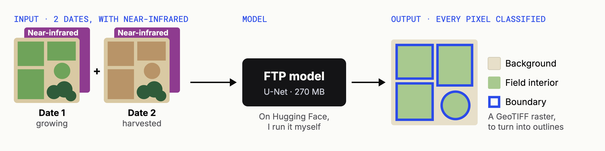
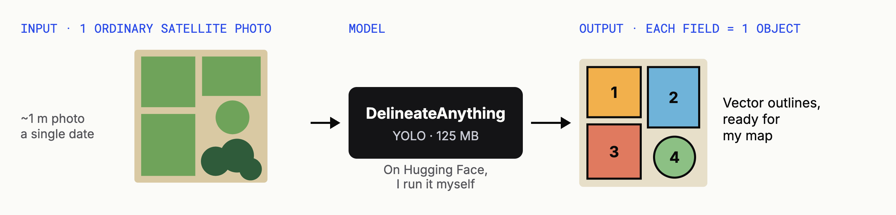
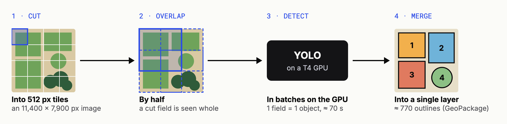
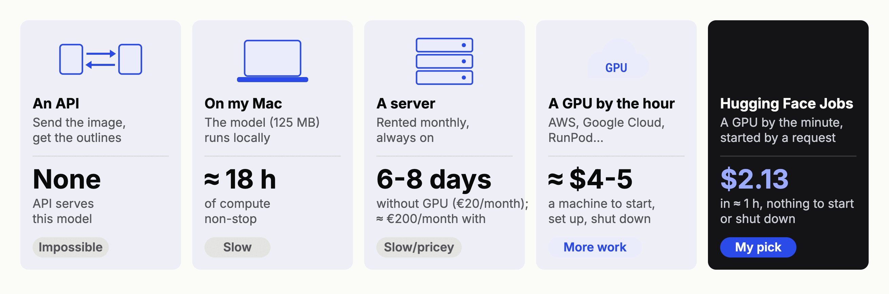
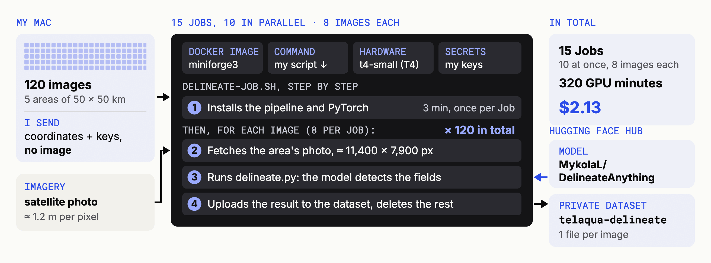
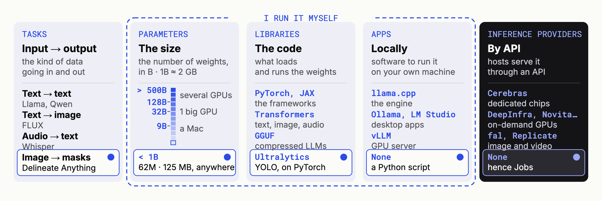

For Telaqua, we are building a prospecting map: every farm field spotted from the satellite, across five 50 × 50 km areas in Senegal and Côte d'Ivoire. Drawing those outlines by hand is out of the question, so we needed a model. This Tuesday I presented internally how we got there, and what I learned about Hugging Face along the way. Here is the written version.

, with only the Fields layer shown.")

---

## Three options before running anything

### Fields of The World: a ready-made database

[Fields of The World](https://fieldsofthe.world/) publishes precomputed field outlines for the whole planet: about 1.6 billion fields a year, for 2024 and 2025 (3.17 billion in total). They are predicted from Sentinel-2 imagery at 10 m, by a team that includes Microsoft AI for Good and Taylor Geospatial. The data is licensed CC-BY-4.0 and served as PMTiles vector tiles.

On paper, it's ideal: load the tiles on the basemap and you're done. In practice, around N'Douci in Côte d'Ivoire, with the confidence threshold at 69%, large blobs cover forest and plantations without separating the plots. Raise the threshold and many real fields disappear. And the right threshold changes from one area to the next.

, 2025 predictions, confidence threshold at 69%.")

At 10 m, one pixel is 100 m²: too coarse for the plots in the region.

### Fields of the Planet: the right model, the wrong licence

The same team publishes [Fields of the Planet](https://huggingface.co/fieldsoftheworld/ftp-b7), a model you run yourself: a 270 MB U-Net (EfficientNet-B7 encoder). It takes two 3 m PlanetScope images of the same area, with near-infrared, one from the planting window and one from the harvest. Each output pixel is classified as background, field interior or boundary.



Three problems:

- **The imagery**: it needs the same kind as in training, PlanetScope, which is commercial and paid.
- **The dates**: "planting" and "harvest" change with the crop, the country, the region. For a product at country scale, that's hard to keep up.
- **The licence**: CC-BY-NC-4.0, no commercial use. For a client product like this one, that rules it out.

### Delineate Anything: an ordinary photo is enough

[Delineate Anything](https://huggingface.co/MykolaL/DelineateAnything) is an instance segmentation model: a YOLO11 (the model family that detects cars and pedestrians in a photo) retrained to find fields. Each detected field is a separate object, with its own outline.



Why it works for us:

- **The imagery**: an ordinary colour (RGB) photo, a single date, at a resolution between 0.25 and 10 m. We use it on a satellite photo at about 1 m.
- **The whole world**: it was trained on [FBIS-73M](https://huggingface.co/datasets/MykolaL/FBIS-73M) (MIT licence), 1.48 million images and 74 million hand-drawn fields across 61 countries. For comparison, the Fields of The World dataset covers 24 countries, 17 of them in Europe.
- **The licence**: AGPL-3.0. Commercial use is allowed, with the AGPL's obligations: if you modify the code and serve it to users over a network, you owe them the source. We run the authors' pipeline unchanged, as a batch.
- **The size**: about 62 million parameters and a 125 MB weights file. It runs anywhere, even on a laptop.

---

## The authors' pipeline, run as is

The [Delineate Anything GitHub repository](https://github.com/Lavreniuk/Delineate-Anything) ships a script, `delineate.py`, that does all the work on a large image:

1. **Cut** the image into 512 px tiles, the size the model works on.
2. **Overlap** the tiles by half (`tile_step: 0.5`), so a field cut at the edge of one tile is seen whole in the next.
3. **Detect** the fields in batches on the GPU, in FP16.
4. **Merge** the pieces into a single vector layer, a GeoPackage, which I convert to GeoJSON for the map.



I don't touch it: the script is fetched at a pinned commit and installed the way its README says. It's the most reliable part of the project, no reason to rewrite it.

```bash
conda create -y -q -n da -c conda-forge python=3.11 gdal > /dev/null
source /opt/conda/etc/profile.d/conda.sh && conda activate da
git init -q /da && cd /da
git fetch -q --depth 1 "$DA_REPO" "$DA_COMMIT" && git checkout -q FETCH_HEAD
pip install -q torch==2.6.0 torchvision==0.21.0 -r requirements.txt
```

That leaves a scale problem: one image covers about 13 × 9 km. My five 50 × 50 km areas need 120 of them, 24 per area.

---

## Where to run 120 images?

I compared five options, measured or estimated from our measurements:



- **An API**: no inference provider serves this model on Hugging Face. Not possible.
- **My Mac** (MacBook Pro M1 Pro): the pipeline picks Apple's GPU on its own and runs about twice as slow as a T4. That's roughly 18 hours of non-stop compute.
- **A monthly server**: without a GPU (an 8-vCore VPS at €20 a month before VAT), 6 to 8 days. With a GPU, around €200 a month.
- **A GPU by the hour** (AWS, Google Cloud, RunPod…): about $4-5, but a machine to start, set up and shut down.
- **Hugging Face Jobs**: a GPU by the minute, started by a request. That's what I picked.

---

## Hugging Face Jobs: a GPU by the minute

A Hugging Face [Job](https://huggingface.co/docs/hub/jobs) is a Docker image, a command, a machine type (the *flavor*) and secrets. Hugging Face starts the container, bills by the minute, then shuts it down. No subscription needed: a balance of prepaid credits is enough.



My settings, as they are in the code:

```ts
export const FLAVOR = 't4-small';
export const IMAGE = 'condaforge/miniforge3:26.9.4-0';
export const TIMEOUT_MINUTES = 120;
export const BOXES_PER_JOB = 8;
export const PRICE_PER_HOUR = 0.4;
export const CAP_DOLLARS = 10;
```

I start the Jobs from a TypeScript script through the HTTP API. The equivalent with the [`hf` CLI](https://huggingface.co/docs/huggingface_hub/guides/cli):

```bash
hf jobs run --flavor t4-small --secrets HF_TOKEN \
  condaforge/miniforge3:26.9.4-0 bash -c "$(cat delineate-job.sh)"
```

A few choices that matter:

- **The hardware**: `t4-small`, one 16 GB NVIDIA T4 GPU, 4 vCPU and 15 GB of RAM, at $0.40 an hour.
- **8 images per Job**: setup (conda, pip) takes about 3 minutes. Grouping 8 images per Job means paying it once for 8.
- **No image leaves my Mac**: I only send coordinates and keys. Each Job fetches its photos, runs `delineate.py`, uploads one file per image to a private dataset on the Hub and deletes everything else. If a Job dies, only the current image is lost.
- **A spending cap**: the script starts no Job that could take the run past $10, and before starting it checks that the flavor's price hasn't changed:

```bash
curl -s https://huggingface.co/api/jobs/hardware \
  | jq '.[] | select(.name == "t4-small") | {unitCostUSD, unitLabel}'
# { "unitCostUSD": 0.006667, "unitLabel": "minute" }   → $0.40 an hour
```

The result across the five areas: 120 images, 15 Jobs (10 at once), 320 billed minutes, **$2.13**, and 92,098 outlines.

> [!TIP]
> To try the model on a single image without installing anything, the authors point to a [demo on a Hugging Face Space](https://huggingface.co/spaces/hugging-apps/delineate-anything-v2): drop an image, see the fields.

---

## The Hub, beyond our case

While preparing the talk, I took the time to tour the platform. Figures as of 17 November 2026.

### Models: 3,244,718

The [huggingface.co/models](https://huggingface.co/models) page reads best through its filters. Five of them show well how you pick a model, and where Delineate Anything sits in each:



- **Tasks**: what the model takes and returns. Here, `image-segmentation`. The [huggingface.co/tasks](https://huggingface.co/tasks) page lists 47.
- **Parameters**: the size, in twelve buckets from "under 1B" to "over 500B". In 16 bits a parameter weighs 2 bytes, so 1B ≈ 2 GB of memory. Delineate Anything is far from a billion.
- **Libraries**: the code that loads the weights. Here, `ultralytics`, on top of PyTorch.
- **Apps**: software to run it at home (llama.cpp, Ollama, LM Studio, vLLM…). They mostly target LLMs; none runs this model.
- **Inference Providers**: hosts that serve the model through an API, billed via the Hugging Face account. None serves Delineate Anything, hence Jobs.

Every model on the Hub is *open weight*: you can download its weights. That doesn't make it *open source*: the licence says what you're allowed to do with it, as we saw with Fields of the Planet. Closed models (GPT, Claude, Gemini) aren't there, though OpenAI does publish open-weight models there too, the `gpt-oss` family.

### Datasets: 1,134,666

A dataset is a table of examples: an input and, often, the expected answer. It serves four purposes, all present in this project:

- **Train**: FBIS-73M was used to train Delineate Anything.
- **Fine-tune**: specialise an existing model with your own labelled examples.
- **Evaluate**: Fields of The World is also a benchmark to score field delineation models. The official dataset is on Source Cooperative, with [a copy on the Hub](https://huggingface.co/datasets/Voxel51/fields-of-the-world) by Voxel51.
- **Store**: our results live in a private dataset, visible only to us and authorised tokens. Each upload from a Job is a commit.

Like a model, each dataset has its licence, to read before using it, and `load_dataset()` loads it in one line.

### Spaces: 1,531,251

A Space is a web app hosted by Hugging Face, backed by a git repository. Most often it's a model demo, like the Delineate Anything one. A few points I checked in the docs:

- **Three SDKs**: Gradio, Docker or static HTML. A Gradio app also exposes an API you can call from code.
- **Hardware**: CPU Basic is free (2 vCPU, 16 GB). GPUs are rented by the hour, for instance $0.40 for a T4 small.
- **ZeroGPU**: a shared GPU, lent for the duration of a call to a function decorated with `@spaces.GPU`. The quota is 5 minutes a day on a free account and 40 minutes on PRO.
- **Creating a Gradio or Docker Space requires a paid plan** (PRO at $9 a month), except for up to two Gradio Spaces on ZeroGPU on a verified free account. Static Spaces stay free.
- **"Duplicate this Space"** makes a copy under your account, private by default. On free hardware, an unused Space goes to sleep after 48 hours.

---

## What's still pending

- **The imagery licence**: using the satellite photo for this processing has to be settled in writing with its provider before scaling to a whole country.
- **A filter used outside its range**: the pipeline removes giant polygons, but that filter is meant for 2.5 to 10 m imagery, and ours is about 1.2 m. On some images it removes a polygon of more than 100 km² that looks like the image background. I left it on, and each image records what it removed.
- **Blocks with no outline**: in one area of Côte d'Ivoire, plantation blocks clearly visible on the photo have no outline. My guess: the model merged them into the image background, and the filter above removed it. I can't check, since removed polygons aren't saved.
- **Old photos**: in some areas the photo dates from 2018. A field planted since doesn't show up.
- **Image edges**: a field wider than the 500 m margin between two images can be cut in two.
- **Scaling to a country**: Senegal is about 1,900 images. Extrapolating from this run, that's around 84 GPU hours, about $34, and 8 hours of wall-clock time with 10 Jobs in parallel. Not launched yet 😅
