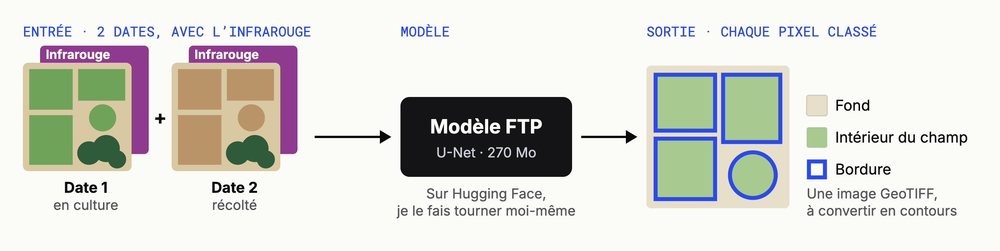
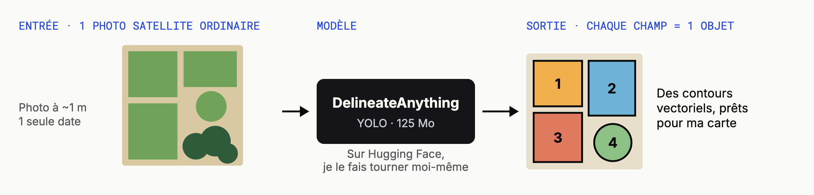
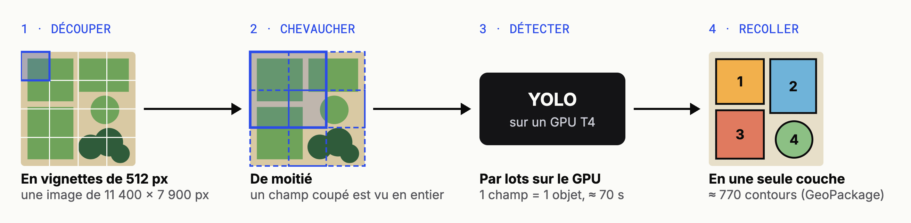
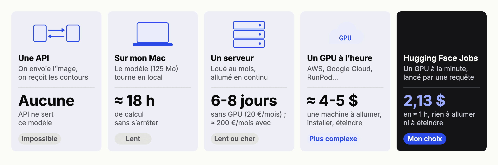
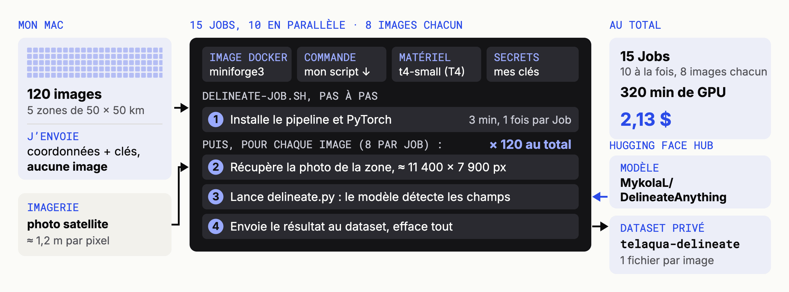
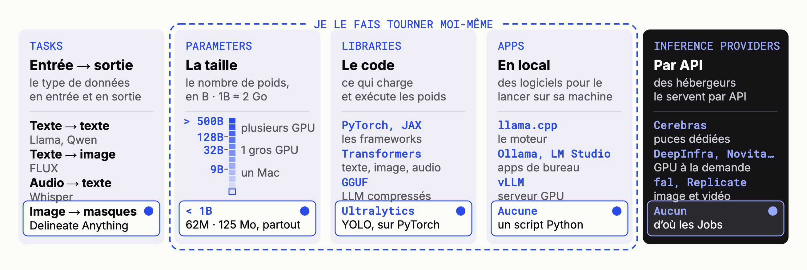

Pour Telaqua, on construit une carte de prospection : chaque champ agricole repéré depuis le satellite, sur cinq zones de 50 × 50 km au Sénégal et en Côte d'Ivoire. Dessiner ces contours à la main est impossible, il fallait un modèle. Ce mardi, j'ai présenté en interne comment on y est arrivés, et ce que j'ai découvert de Hugging Face en chemin. Voici la version écrite.

, avec seulement la couche Champs affichée.")

---

## Trois pistes avant de lancer quoi que ce soit

### Fields of The World : une base toute prête

[Fields of The World](https://fieldsofthe.world/) publie des contours de champs déjà calculés pour toute la planète : environ 1,6 milliard de champs par an, pour 2024 et 2025 (3,17 milliards en tout). Ils sont prédits sur des images Sentinel-2 à 10 m, par une équipe qui réunit notamment Microsoft AI for Good et Taylor Geospatial. Les données sont sous licence CC-BY-4.0 et distribuées en tuiles vectorielles PMTiles.

Sur le papier, c'est idéal : on charge les tuiles sur le fond de carte et c'est fini. En pratique, autour de N'Douci, en Côte d'Ivoire, avec un seuil de confiance à 69 %, de grands aplats couvrent la forêt et les plantations sans séparer les parcelles. En montant le seuil, beaucoup de vrais champs disparaissent. Et le bon seuil change d'une zone à l'autre.

, prédictions 2025, seuil de confiance à 69 %.")

Une image à 10 m, c'est un pixel de 100 m² : pour les parcelles de la région, c'est trop grossier.

### Fields of the Planet : le bon modèle, la mauvaise licence

La même équipe publie [Fields of the Planet](https://huggingface.co/fieldsoftheworld/ftp-b7), un modèle qu'on fait tourner soi-même : un U-Net (encodeur EfficientNet-B7) de 270 Mo. Il prend deux images PlanetScope à 3 m de la même zone, avec le proche infrarouge, l'une en période de semis et l'autre à la récolte. En sortie, chaque pixel est classé en fond, intérieur de champ ou bordure.



Trois soucis :

- **Les images** : il faut les mêmes qu'à l'entraînement, de l'imagerie PlanetScope, qui est commerciale et payante.
- **Les dates** : « semis » et « récolte » changent selon la culture, le pays, la région. Pour un produit à l'échelle d'un pays, c'est difficile à tenir.
- **La licence** : CC-BY-NC-4.0, pas d'usage commercial. Pour un produit client comme celui-ci, c'est éliminatoire.

### Delineate Anything : une simple photo suffit

[Delineate Anything](https://huggingface.co/MykolaL/DelineateAnything) est un modèle de segmentation d'instances : un YOLO11 (la famille de modèles qui détecte voitures et piétons sur une photo) réentraîné à repérer des champs. Chaque champ détecté est un objet séparé, avec son propre contour.



Ce qui le rend utilisable chez nous :

- **Les images** : une photo couleur ordinaire (RVB), à une seule date, d'une résolution entre 0,25 et 10 m. On l'utilise sur une photo satellite à environ 1 m.
- **Le monde entier** : il a été entraîné sur [FBIS-73M](https://huggingface.co/datasets/MykolaL/FBIS-73M) (licence MIT), 1,48 million d'images et 74 millions de champs dessinés dans 61 pays. Pour comparer, le jeu Fields of The World couvre 24 pays, dont 17 européens.
- **La licence** : AGPL-3.0. L'usage commercial est permis, avec les obligations de l'AGPL : si on modifie le code et qu'on le sert à des utilisateurs par le réseau, on leur doit les sources. Nous, on lance le pipeline des auteurs tel quel, en batch.
- **La taille** : environ 62 millions de paramètres et un fichier de poids de 125 Mo. Ça tourne partout, même sur un portable.

---

## Le pipeline des auteurs, lancé tel quel

Le [dépôt GitHub de Delineate Anything](https://github.com/Lavreniuk/Delineate-Anything) fournit un script, `delineate.py`, qui fait tout le travail sur une grande image :

1. **Découper** l'image en vignettes de 512 px, la taille sur laquelle le modèle travaille.
2. **Faire chevaucher** les vignettes de moitié (`tile_step: 0.5`), pour qu'un champ coupé au bord d'une vignette soit vu en entier dans la voisine.
3. **Détecter** les champs par lots sur le GPU, en FP16.
4. **Recoller** les morceaux en une seule couche vectorielle, un GeoPackage, que je convertis en GeoJSON pour la carte.



Je n'y touche pas : le script est récupéré à un commit fixé et installé comme le README l'indique. C'est la partie la plus sûre du projet, autant ne pas la réécrire.

```bash
conda create -y -q -n da -c conda-forge python=3.11 gdal > /dev/null
source /opt/conda/etc/profile.d/conda.sh && conda activate da
git init -q /da && cd /da
git fetch -q --depth 1 "$DA_REPO" "$DA_COMMIT" && git checkout -q FETCH_HEAD
pip install -q torch==2.6.0 torchvision==0.21.0 -r requirements.txt
```

Reste un problème d'échelle : une image couvre environ 13 × 9 km. Pour mes cinq zones de 50 × 50 km, il en faut 120, soit 24 par zone.

---

## Où faire tourner 120 images ?

J'ai comparé cinq options, mesurées ou estimées à partir de nos mesures :



- **Une API** : aucun fournisseur d'inférence ne sert ce modèle sur Hugging Face. Impossible.
- **Mon Mac** (MacBook Pro M1 Pro) : le pipeline utilise le GPU d'Apple tout seul, environ deux fois plus lentement qu'un T4. Comptez à peu près 18 h de calcul sans pause.
- **Un serveur au mois** : sans GPU (un VPS 8 vCores à 20 € HT par mois), 6 à 8 jours. Avec un GPU, autour de 200 € par mois.
- **Un GPU à l'heure** (AWS, Google Cloud, RunPod…) : environ 4 à 5 $, mais une machine à allumer, installer et éteindre.
- **Hugging Face Jobs** : un GPU à la minute, lancé par une requête. C'est ce que j'ai retenu.

---

## Hugging Face Jobs : un GPU à la minute

Un [Job](https://huggingface.co/docs/hub/jobs) Hugging Face, c'est une image Docker, une commande, un type de machine (le *flavor*) et des secrets. Hugging Face lance le conteneur, facture à la minute, puis l'éteint. Pas besoin d'abonnement : un solde de crédits prépayés suffit.



Mes réglages, tels qu'ils sont dans le code :

```ts
export const FLAVOR = 't4-small';
export const IMAGE = 'condaforge/miniforge3:26.9.4-0';
export const TIMEOUT_MINUTES = 120;
export const BOXES_PER_JOB = 8;
export const PRICE_PER_HOUR = 0.4;
export const CAP_DOLLARS = 10;
```

Je lance les Jobs depuis un script TypeScript via l'API HTTP. L'équivalent avec la [CLI `hf`](https://huggingface.co/docs/huggingface_hub/guides/cli) :

```bash
hf jobs run --flavor t4-small --secrets HF_TOKEN \
  condaforge/miniforge3:26.9.4-0 bash -c "$(cat delineate-job.sh)"
```

Quelques choix qui comptent :

- **Le matériel** : `t4-small`, un GPU NVIDIA T4 de 16 Go, 4 vCPU et 15 Go de RAM, à 0,40 $ de l'heure.
- **8 images par Job** : l'installation (conda, pip) prend environ 3 minutes. En groupant 8 images par Job, on ne la paie qu'une fois pour 8.
- **Aucune image ne part de mon Mac** : je n'envoie que les coordonnées et les clés. Chaque Job récupère ses photos, lance `delineate.py`, puis dépose un fichier par image dans un dataset privé sur le Hub et efface tout. Si un Job meurt, on ne perd que l'image en cours.
- **Un plafond de dépense** : le script ne lance aucun Job qui pourrait faire dépasser 10 $ au run, et il vérifie avant de démarrer que le prix du flavor n'a pas changé :

```bash
curl -s https://huggingface.co/api/jobs/hardware \
  | jq '.[] | select(.name == "t4-small") | {unitCostUSD, unitLabel}'
# { "unitCostUSD": 0.006667, "unitLabel": "minute" }   → 0,40 $ de l'heure
```

Le résultat sur les cinq zones : 120 images, 15 Jobs (10 à la fois), 320 minutes facturées, **2,13 $**, et 92 098 contours.

> [!TIP]
> Pour essayer le modèle sur une seule image sans rien installer, les auteurs pointent vers une [démo sur un Space Hugging Face](https://huggingface.co/spaces/hugging-apps/delineate-anything-v2) : on dépose une image, on voit les champs.

---

## Le Hub, au-delà de notre cas

En préparant la présentation, j'ai pris le temps de faire le tour de la plateforme. Chiffres relevés le 17 novembre 2026.

### Les modèles : 3 244 718

La page [huggingface.co/models](https://huggingface.co/models) se lit par ses filtres. Cinq d'entre eux racontent bien comment on choisit un modèle, et où Delineate Anything se place dans chacun :



- **Tasks** : ce que le modèle prend et rend. Ici, `image-segmentation`. La page [huggingface.co/tasks](https://huggingface.co/tasks) en recense 47.
- **Parameters** : la taille, en douze tranches de « moins de 1B » à « plus de 500B ». En 16 bits, un paramètre pèse 2 octets, donc 1B ≈ 2 Go de mémoire. Delineate Anything est loin du milliard.
- **Libraries** : le code qui charge les poids. Ici, `ultralytics`, au-dessus de PyTorch.
- **Apps** : les logiciels pour le lancer chez soi (llama.cpp, Ollama, LM Studio, vLLM…). Ils visent surtout les LLM, aucun ne lance ce modèle.
- **Inference Providers** : des hébergeurs qui servent le modèle par API, facturés via le compte Hugging Face. Aucun ne sert Delineate Anything, d'où les Jobs.

Tous les modèles du Hub sont *open weight* : on peut télécharger leurs poids. Ça ne veut pas dire *open source* : c'est la licence qui dit ce qu'on a le droit d'en faire, comme on l'a vu avec Fields of the Planet. Les modèles fermés (GPT, Claude, Gemini) n'y sont pas, même si OpenAI y publie aussi des modèles open weight, les `gpt-oss`.

### Les datasets : 1 134 666

Un dataset, c'est un tableau d'exemples : une entrée et, souvent, la réponse attendue. Il sert à quatre choses, toutes présentes dans ce projet :

- **Entraîner** : FBIS-73M a servi à entraîner Delineate Anything.
- **Affiner** : spécialiser un modèle existant avec ses propres exemples étiquetés.
- **Évaluer** : Fields of The World est aussi un banc d'essai pour noter les modèles de délimitation. Le jeu officiel est sur Source Cooperative, avec [une copie sur le Hub](https://huggingface.co/datasets/Voxel51/fields-of-the-world) par Voxel51.
- **Stocker** : nos résultats vivent dans un dataset privé, visible seulement par nous et les jetons autorisés. Chaque envoi d'un Job est un commit.

Comme un modèle, chaque dataset a sa licence, à lire avant de s'en servir, et `load_dataset()` le charge en une ligne.

### Les Spaces : 1 531 251

Un Space, c'est une app web hébergée par Hugging Face, adossée à un dépôt git. Le plus souvent, c'est la démo d'un modèle, comme celle de Delineate Anything. Quelques points que j'ai vérifiés dans la doc :

- **Trois SDK** : Gradio, Docker ou HTML statique. Une app Gradio expose aussi une API, qu'on peut appeler depuis du code.
- **Le matériel** : CPU Basic gratuit (2 vCPU, 16 Go). Les GPU se louent à l'heure, par exemple 0,40 $ pour un T4 small.
- **ZeroGPU** : un GPU partagé, prêté le temps d'un appel à une fonction décorée par `@spaces.GPU`. Le quota est de 5 minutes par jour en compte gratuit et de 40 minutes en PRO.
- **Créer un Space Gradio ou Docker demande un plan payant** (PRO à 9 $ par mois), sauf jusqu'à deux Spaces Gradio sur ZeroGPU pour un compte gratuit vérifié. Les Spaces statiques restent gratuits.
- **« Duplicate this Space »** en fait une copie sous son compte, privée par défaut. Sur le matériel gratuit, un Space inutilisé s'endort au bout de 48 heures.

---

## Ce qui reste

- **La licence de l'imagerie** : l'usage de la photo satellite pour ce traitement est à régler par écrit avec son fournisseur avant de passer à l'échelle d'un pays.
- **Un filtre utilisé hors de sa plage** : le pipeline retire les polygones géants, mais ce filtre est prévu pour des images de 2,5 à 10 m, et les nôtres sont à environ 1,2 m. Sur certaines images, il retire un polygone de plus de 100 km² qui ressemble au fond de l'image. Je l'ai laissé actif, et chaque image enregistre ce qu'il a retiré.
- **Des blocs non dessinés** : sur une zone de Côte d'Ivoire, des blocs de plantation bien visibles sur la photo n'ont pas de contour. Mon hypothèse : le modèle les a fondus dans le fond de l'image, et le filtre ci-dessus les a retirés. Je ne peux pas le vérifier, puisque les polygones retirés ne sont pas sauvegardés.
- **Des photos anciennes** : sur certaines zones, la photo date de 2018. Un champ planté depuis n'apparaît pas.
- **Les bords d'image** : un champ plus large que la marge de 500 m entre deux images peut être coupé en deux.
- **Le passage à un pays** : le Sénégal, c'est environ 1 900 images. En extrapolant ce run, cela donne autour de 84 heures de GPU, environ 34 $, et 8 heures de calcul avec 10 Jobs en parallèle. Ce n'est pas encore lancé 😅
