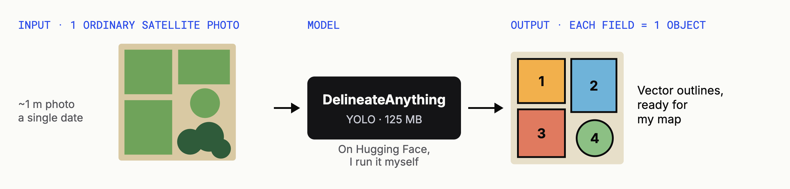
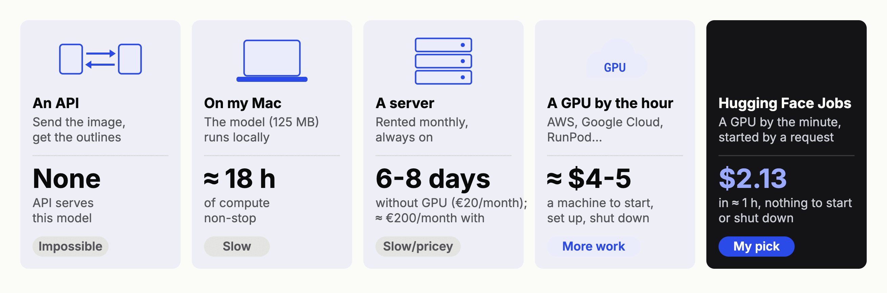
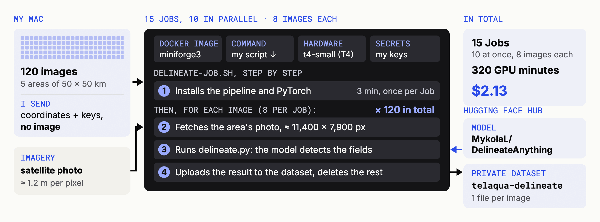
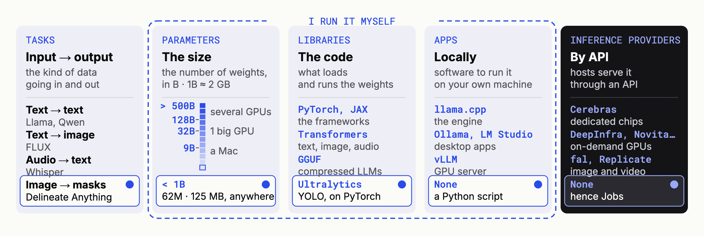
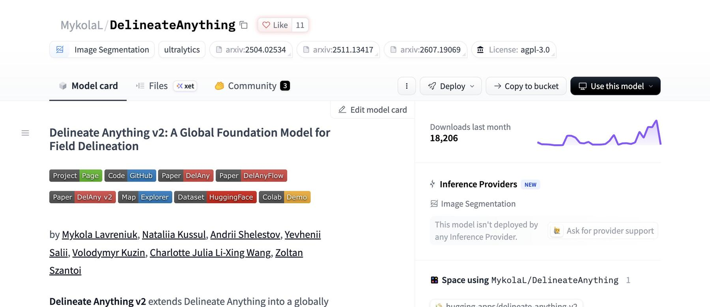
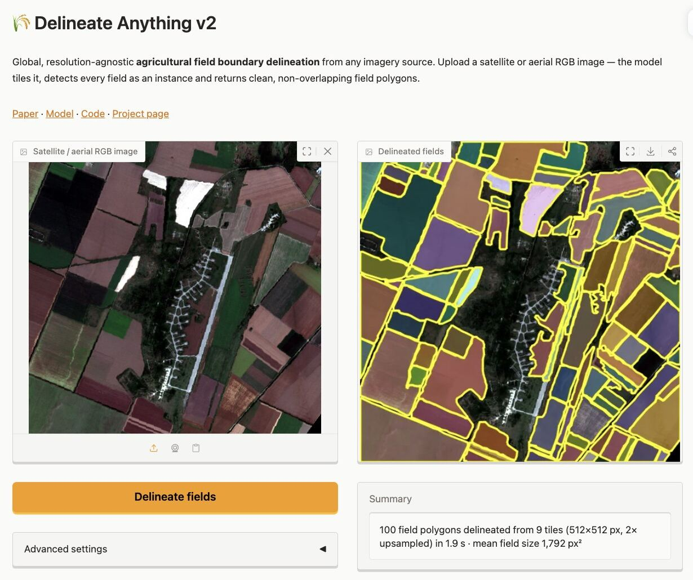

For a client that sells irrigation equipment in Senegal and Côte d'Ivoire, we built [a prospecting map](/en/blog/a-map-to-help-sales-reps-find-irrigated-fields). We had to draw every field on it, across 5 areas of 50 × 50 km. The model we picked runs on a MacBook, but it would have needed about 18 hours. We ran it on Hugging Face instead, and got the 92,098 outlines for **$2.13**.

## 1. The model and its pipeline

[Delineate Anything](https://huggingface.co/MykolaL/DelineateAnything) is **a YOLO11 model retrained to delineate fields**. YOLO, short for *You Only Look Once*, is a family of vision models that finds every object in an image in a single pass, which makes them fast. Delineate Anything uses the largest variant of [YOLO11](https://docs.ultralytics.com/models/yolo11/), YOLO11x-seg, which also traces the exact outline of each object. **Each detected field becomes a separate object**, with its own outline.

It takes a single colour satellite photo. It weighs 125 MB, for about 62 million parameters.

The [Delineate Anything GitHub repository](https://github.com/Lavreniuk/Delineate-Anything) ships a script, `delineate.py`, that processes a large image in four steps. It cuts it into 512 px tiles, overlaps them by half so a field cut at the edge of one tile is seen whole in the next, detects the fields in batches on the GPU, then merges everything into a single vector layer. It outputs a GeoPackage, which I convert to GeoJSON for the map.

**I don't touch this script's code.** I fetch it at a pinned commit and install it the way the README says. I only change two settings in its configuration: the land cover mask, for which I use [ESA WorldCover](https://esa-worldcover.org/), and the minimum field area. That is also what lets us use it for a client. The model is licensed AGPL-3.0, which **allows commercial use** and only requires publishing modified code served to users over a network.

One image covers about 13 × 9 km, so my 5 areas need 120 of them, 24 per area. **The model runs on a laptop**, and at first we thought that would do.

## 2. Where to run 120 images

I compared five options, from measurements or estimates based on our measurements.

No inference provider serves this model through an API on Hugging Face, so that option is out. On my MacBook Pro M1 Pro, the pipeline uses Apple's GPU, about half as fast as a T4. It would take roughly 18 hours of non-stop compute. A VPS without a GPU at €20 a month before VAT would take 6 to 8 days, and a server with a GPU costs around €200 a month. A GPU rented by the hour from AWS, Google Cloud or RunPod would come to $4 or $5, but you have to start the machine, set it up, then shut it down. I picked **Hugging Face Jobs, which rents a GPU by the minute** and starts with a single request.

## 3. Hugging Face Jobs

A [Job](https://huggingface.co/docs/hub/jobs) is a Docker image, a command, a machine type (the *flavor*) and secrets. Hugging Face **starts the container, bills by the minute and stops it at the end**. No subscription needed, a balance of prepaid credits is enough.

I start the Jobs from a script, through Hugging Face's HTTP API; the [`hf` CLI](https://huggingface.co/docs/huggingface_hub/guides/cli) does the same in one command. Each Job stops after 2 hours at most.

The `t4-small` flavor is one 16 GB NVIDIA T4 GPU, 4 vCPU and 15 GB of RAM, for $0.40 an hour. Setting up the pipeline (conda, pip) takes about 3 minutes: grouping 8 images per Job means paying for it once per 8. **My Mac sends no image**, only coordinates and keys. Each Job fetches its photos, runs `delineate.py`, uploads one file per image to a private dataset on the Hub, then deletes its files. If a Job crashes, **only the current image is lost**.

I also set a cap: the script **starts no Job that could take the total past $10**, and it first checks with Hugging Face's API that the flavor's price hasn't changed.

Across the 5 areas, that came to 120 images, 15 Jobs with 10 in parallel and **92,098 outlines**. The Jobs ran for 320 minutes in total, at $0.40 an hour, so **$2.13**.

To try the model on one image without installing anything, the authors' README points to a [demo on a Hugging Face Space](https://huggingface.co/spaces/hugging-apps/delineate-anything-v2).

## 4. Hugging Face

Hugging Face is the platform where open AI models, datasets and demos are shared. It's where we found Delineate Anything and where we ran it. The figures below are from 17 November 2026.

### 3,244,718 models

The [models page](https://huggingface.co/models) is browsed through filters. The diagram shows five of them, with where Delineate Anything sits in each.

Tasks says what the model takes and returns, here `image-segmentation`. Parameters gives its size: in 16 bits a parameter weighs 2 bytes, so 1B is about 2 GB of memory. Libraries names the code that loads the weights, here `ultralytics`, on top of PyTorch. Apps lists software to run it on your own machine, such as Ollama or LM Studio, mostly built for LLMs. Inference Providers lists the hosts that serve it through an API. **None serves Delineate Anything, hence Jobs.**

Every model on the Hub is *open weight*: its weights can be downloaded. **Its licence sets what you're allowed to do with it**, and some forbid commercial use. Closed models such as GPT, Claude or Gemini aren't there, though OpenAI publishes open models there, the `gpt-oss` family.

### 1,134,666 datasets

A dataset is **a table of examples**: an input, and often the expected answer. Three of its uses show up in this project. [FBIS-73M](https://huggingface.co/datasets/MykolaL/FBIS-73M) was used to train Delineate Anything. Fields of The World serves as a benchmark to score field delineation models, and Voxel51 put [a copy on the Hub](https://huggingface.co/datasets/Voxel51/fields-of-the-world). Finally, our results are stored in a private dataset, where each upload from a Job is a commit. You can also use one to fine-tune an existing model with your own examples.

### 1,531,251 Spaces

A Space is **a web app hosted by Hugging Face**, most often a model demo, like the one for Delineate Anything. You build it with Gradio, Docker or static HTML, and a Gradio app also exposes an API. Basic CPU hardware is free, GPUs are rented by the hour ($0.40 for a T4 small), and ZeroGPU lends a shared GPU for the duration of a call, with a daily quota of a few minutes. Creating a Gradio or Docker Space usually requires the PRO plan, at $9 a month. The "Duplicate this Space" button creates a private copy under your account.

