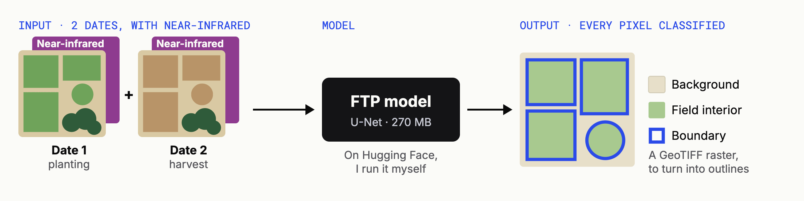
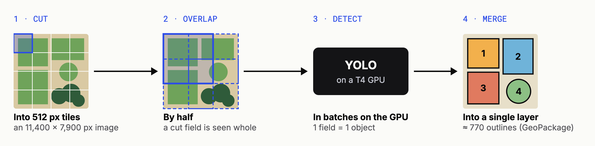

Telaqua, one of our clients, sells irrigation equipment. Its sales team looks for large irrigated farms that aren't customers yet. We are building them a prospecting map that shows every farm field seen from the satellite, for now across five 50 × 50 km areas around its customers' sites, in Senegal and Côte d'Ivoire.

I presented this work to the team on Tuesday in three parts, which I follow here: the client's need and the options we explored, the implementation, then a tour of Hugging Face, the platform where we found the model and ran it.

, with only the Fields layer shown.")

## 1. The client's need and what we explored

To draw the fields on the map, we need their outlines. Field boundary databases already exist, but on our areas they were too imprecise. We looked at three options before picking one.

### Fields of The World, a precomputed database

[Fields of The World](https://fieldsofthe.world/) publishes precomputed field boundaries for the whole planet: about 1.6 billion fields a year, for 2024 and 2025. They are predicted from Sentinel-2 imagery at 10 m, by a team that includes Microsoft AI for Good and Taylor Geospatial. The data is licensed CC-BY-4.0, served as PMTiles vector tiles you can load straight onto a map.

It was the first thing I tried. Around N'Douci in Côte d'Ivoire, with the confidence threshold at 69%, there are a lot of false positives: large blobs cover forest and plantations without separating the plots. Raise the threshold and you lose many real fields. And the right setting changes from one area to the next.

, 2025 predictions, confidence threshold at 69%.")

### Fields of the Planet, a model that is costly to run at scale

The same team publishes [Fields of the Planet](https://huggingface.co/fieldsoftheworld/ftp-b7), a model you run yourself: a 270 MB U-Net. It takes two 3 m PlanetScope images of the same area, with near-infrared, one at planting and one at harvest. It then classifies each pixel as background, field interior or boundary.

It falls short on three counts. First, cost: it needs the same imagery as in training, which is paid Planet imagery. Then scale: planting and harvest dates change with the crop, the country and the region, so covering a country would mean picking them area by area. Finally the licence, CC-BY-NC-4.0, which forbids commercial use, and so a client product like this one.

### Delineate Anything, an ordinary photo is enough

[Delineate Anything](https://huggingface.co/MykolaL/DelineateAnything) is a YOLO11 model retrained to delineate fields. YOLO, short for *You Only Look Once*, is a family of vision models that finds every object in an image in a single pass, which makes them fast. [YOLO11](https://docs.ultralytics.com/models/yolo11/) is the version Ultralytics released in September 2024. It detects objects and can also trace their exact outline, which is called instance segmentation. Delineate Anything uses its largest variant, YOLO11x-seg, trained to recognise fields instead of cars or pedestrians. Each detected field becomes a separate object, with its own outline.

It needs an ordinary colour photo, from a single date, at a resolution between 0.25 and 10 m. We use it on a satellite photo at about 1 m. It was trained on [FBIS-73M](https://huggingface.co/datasets/MykolaL/FBIS-73M) (MIT licence): 1.48 million images and 74 million annotated fields across 61 countries, where the Fields of The World dataset covers 24, 17 of them in Europe.

It is licensed AGPL-3.0, which allows commercial use. The obligation applies to modified code served to users over a network, whose source must then be published; we run the authors' pipeline without changing its code, as a batch. And it's small, about 62 million parameters for 125 MB of weights: it even runs on a laptop.

## 2. The implementation

### The authors' pipeline

The [Delineate Anything GitHub repository](https://github.com/Lavreniuk/Delineate-Anything) ships a script, `delineate.py`, that processes a large image in four steps. It cuts it into 512 px tiles, overlaps them by half so a field cut at the edge of one tile is seen whole in the next, detects the fields in batches on the GPU, then merges everything into a single vector layer. It outputs a GeoPackage, which I convert to GeoJSON for the map.

I don't touch this script's code. I fetch it at a pinned commit and install it the way the README says. I only change two settings in its configuration: the land cover mask, for which I use [ESA WorldCover](https://esa-worldcover.org/), and the minimum field area.

One image covers about 13 × 9 km, so my five areas need 120 of them, 24 per area.

### Where to run 120 images

I compared five options, from measurements or estimates based on our measurements.

No inference provider serves this model through an API on Hugging Face, so that option is out. On my MacBook Pro M1 Pro, the pipeline uses Apple's GPU and runs about half as fast as on a T4: roughly 18 hours of non-stop compute. A VPS without a GPU at €20 a month before VAT would take 6 to 8 days, and a server with a GPU costs around €200 a month. A GPU rented by the hour from AWS, Google Cloud or RunPod would come to $4 or $5, but you have to start the machine, set it up, then shut it down. I picked Hugging Face Jobs, which rents a GPU by the minute and starts with a single request.

### Hugging Face Jobs

A [Job](https://huggingface.co/docs/hub/jobs) is a Docker image, a command, a machine type (the *flavor*) and secrets. Hugging Face starts the container, bills by the minute and stops it at the end. No subscription needed, a balance of prepaid credits is enough.

I start the Jobs from a script, through Hugging Face's HTTP API; the [`hf` CLI](https://huggingface.co/docs/huggingface_hub/guides/cli) does the same in one command. Each Job stops after 2 hours at most.

The `t4-small` flavor is one 16 GB NVIDIA T4 GPU, 4 vCPU and 15 GB of RAM, for $0.40 an hour. Setting up the pipeline (conda, pip) takes about 3 minutes: grouping 8 images per Job means paying for it once per 8. My Mac sends no image, only coordinates and keys. Each Job fetches its photos, runs `delineate.py`, uploads one file per image to a private dataset on the Hub, then deletes its files. If a Job crashes, only the current image is lost.

I also set a cap: the script starts no Job that could take the total past $10, and it first checks with Hugging Face's API that the flavor's price hasn't changed.

Across the five areas, that came to 120 images, 15 Jobs with 10 in parallel, 320 billed minutes, $2.13 and 92,098 outlines.

To try the model on one image without installing anything, the authors' README points to a [demo on a Hugging Face Space](https://huggingface.co/spaces/hugging-apps/delineate-anything-v2).

## 3. Hugging Face

Hugging Face is the platform where open AI models, datasets and demos are shared. It's where we found Delineate Anything and where we ran it. While preparing the talk I toured it; figures are from 17 November 2026.

### 3,244,718 models

The [models page](https://huggingface.co/models) is browsed through filters. Five of them sum up well how you choose a model, and the diagram shows where Delineate Anything sits in each.

Tasks says what the model takes and returns, here `image-segmentation` ([huggingface.co/tasks](https://huggingface.co/tasks) lists 47). Parameters gives its size, in twelve buckets from under 1B to over 500B: in 16 bits a parameter weighs 2 bytes, so 1B is about 2 GB of memory. Libraries names the code that loads the weights, here `ultralytics`, on top of PyTorch. Apps lists software to run it on your own machine, such as llama.cpp, Ollama, LM Studio or vLLM, mostly built for LLMs. Inference Providers lists the hosts that serve it through an API, billed via the Hugging Face account. None serves Delineate Anything, hence Jobs.

Every model on the Hub is *open weight*: its weights can be downloaded. That doesn't make it *open source*, the licence sets what you're allowed to do with it, as we saw with Fields of the Planet. Closed models such as GPT, Claude or Gemini aren't there, though OpenAI also publishes open models there, the `gpt-oss` family.

### 1,134,666 datasets

A dataset is a table of examples: an input, and often the expected answer. It's used for four things, three of which show up in this project. FBIS-73M was used to train Delineate Anything. You can also fine-tune an existing model with your own labelled examples. Fields of The World serves as a benchmark to score field delineation models; the official dataset is on Source Cooperative, and Voxel51 put [a copy on the Hub](https://huggingface.co/datasets/Voxel51/fields-of-the-world). Finally, our results are stored in a private dataset, visible only to us and authorised tokens, where each upload from a Job is a commit. As with models, each dataset has its licence, and `load_dataset()` loads it in one line.

### 1,531,251 Spaces

A Space is a web app hosted by Hugging Face and backed by a git repository, most often a model demo. You build it with Gradio, Docker or static HTML, and a Gradio app also exposes an API you can call from code. CPU Basic hardware (2 vCPU, 16 GB) is free, and GPUs are rented by the hour, $0.40 for a T4 small. There is also ZeroGPU, a shared GPU lent for the duration of a call to a function decorated with `@spaces.GPU`, with a quota of 5 minutes a day on a free account and 40 minutes on PRO.

Creating a Gradio or Docker Space requires a paid plan (PRO at $9 a month), except for two Gradio Spaces on ZeroGPU with a verified free account. Static Spaces stay free. The "Duplicate this Space" button creates a private copy under your account, and on free hardware an unused Space goes to sleep after 48 hours.

## What's still pending

- Using the satellite photo for this processing still has to be settled in writing with its provider before covering a whole country.
- The pipeline removes giant polygons with a filter meant for 2.5 to 10 m imagery, while ours is about 1.2 m. On some images it removes a polygon of more than 100 km² that looks like the image background. I left it on, and each image keeps a record of what it removed.
- In one area of Côte d'Ivoire, plantation blocks clearly visible on the photo have no outline. I think the model merged them into the image background and the filter then removed it, but I can't check: removed polygons aren't saved.
- In some areas the photo dates from 2018, so a field planted since doesn't show up.
- A field wider than the 500 m margin between two images can be cut in two.
- The whole of Senegal is about 1,900 images. Extrapolating from this run, it would take about 84 GPU hours, $34 and 8 hours end to end with 10 Jobs in parallel. We haven't run it yet.
