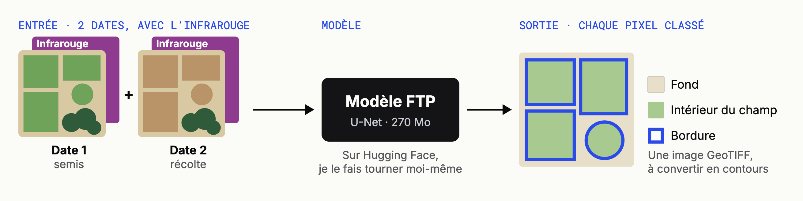
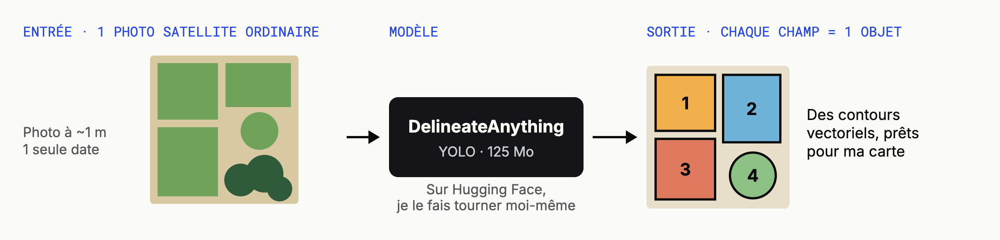
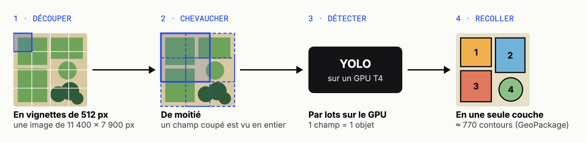
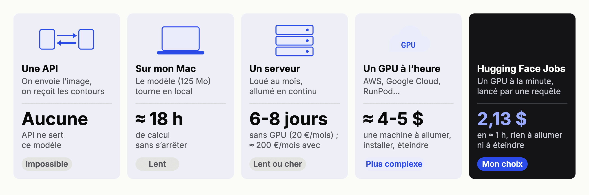
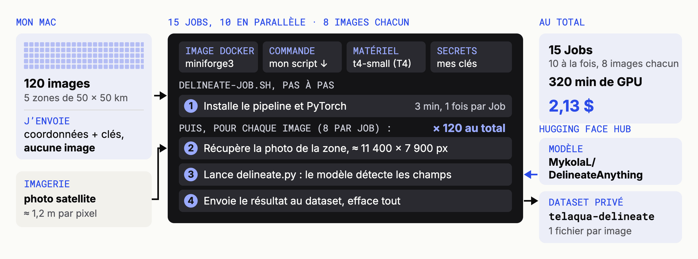
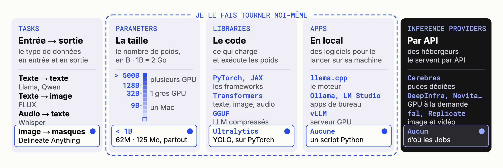

Telaqua, un de nos clients, vend du matériel d'irrigation. Ses commerciaux cherchent les grandes exploitations irriguées qui ne sont pas encore clientes. On leur construit une carte de prospection qui montre chaque champ agricole vu du satellite, pour l'instant sur cinq zones de 50 × 50 km autour de sites de ses clients, au Sénégal et en Côte d'Ivoire.

J'ai présenté ce travail mardi à l'équipe, en trois temps que je reprends ici : le besoin du client et les pistes qu'on a explorées, l'implémentation, puis un tour de Hugging Face, la plateforme où on a trouvé le modèle et où on l'a fait tourner.

, avec seulement la couche Champs affichée.")

## 1. Le besoin client et nos explorations

Pour dessiner les champs sur la carte, il nous faut leurs contours. Des bases de contours de champs existent déjà, mais sur nos zones elles étaient trop imprécises. On a regardé trois pistes avant d'en retenir une.

### Fields of The World, une base déjà calculée

[Fields of The World](https://fieldsofthe.world/) publie les contours de champs de toute la planète, déjà calculés : environ 1,6 milliard de champs par an, pour 2024 et 2025. Ils sont prédits sur des images Sentinel-2 à 10 m, par une équipe dont font partie Microsoft AI for Good et Taylor Geospatial. Les données sont sous licence CC-BY-4.0, en tuiles vectorielles PMTiles qu'on charge directement sur une carte.

C'est la première chose que j'ai essayée. Autour de N'Douci, en Côte d'Ivoire, avec un seuil de confiance à 69 %, il y a beaucoup de faux positifs : de grands aplats recouvrent la forêt et les plantations sans séparer les parcelles. Si on monte le seuil, on perd beaucoup de vrais champs. Et le bon réglage change d'une zone à l'autre.

, prédictions 2025, seuil de confiance à 69 %.")

### Fields of the Planet, un modèle cher à faire tourner à l'échelle

La même équipe publie [Fields of the Planet](https://huggingface.co/fieldsoftheworld/ftp-b7), un modèle qu'on fait tourner soi-même : un U-Net de 270 Mo. Il prend deux images PlanetScope à 3 m de la même zone, avec le proche infrarouge, une au semis et une à la récolte. Il classe ensuite chaque pixel en fond, intérieur de champ ou bordure.



Il bloque sur trois points. D'abord le coût : il faut les mêmes images qu'à l'entraînement, et c'est de l'imagerie Planet, payante. Ensuite le passage à l'échelle : les dates de semis et de récolte changent selon la culture, le pays et la région, il faudrait donc les choisir zone par zone pour couvrir un pays. Enfin la licence, CC-BY-NC-4.0, qui interdit l'usage commercial, donc un produit client comme celui-ci.

### Delineate Anything, une simple photo suffit

[Delineate Anything](https://huggingface.co/MykolaL/DelineateAnything) est un modèle YOLO11 réentraîné pour délimiter des champs. YOLO, pour *You Only Look Once*, est une famille de modèles de vision qui repère tous les objets d'une image en une seule passe, d'où leur rapidité. [YOLO11](https://docs.ultralytics.com/models/yolo11/) en est la version publiée par Ultralytics en septembre 2024. Elle sait détecter des objets, mais aussi tracer leur contour exact, ce qu'on appelle la segmentation d'instances. Delineate Anything en reprend la plus grosse variante, YOLO11x-seg, entraînée à reconnaître des champs plutôt que des voitures ou des piétons. Chaque champ détecté devient un objet à part, avec son propre contour.



Il lui faut une photo couleur ordinaire, à une seule date, avec une résolution entre 0,25 et 10 m. On l'utilise sur une photo satellite à environ 1 m. Il a été entraîné sur [FBIS-73M](https://huggingface.co/datasets/MykolaL/FBIS-73M) (licence MIT) : 1,48 million d'images et 74 millions de champs annotés dans 61 pays, là où le jeu de Fields of The World en couvre 24, dont 17 européens.

Il est sous licence AGPL-3.0, qui autorise l'usage commercial. La contrainte porte sur le code modifié servi à des utilisateurs par le réseau, qui doit alors être publié ; nous lançons le pipeline des auteurs sans en modifier le code, en batch. Et il est petit, environ 62 millions de paramètres pour 125 Mo de poids : il tourne même sur un portable.

## 2. L'implémentation

### Le pipeline des auteurs

Le [dépôt GitHub de Delineate Anything](https://github.com/Lavreniuk/Delineate-Anything) fournit un script, `delineate.py`, qui traite une grande image en quatre étapes. Il la découpe en vignettes de 512 px, les fait se chevaucher de moitié pour qu'un champ coupé au bord d'une vignette soit vu en entier dans la voisine, détecte les champs par lots sur le GPU, puis recolle le tout en une seule couche vectorielle. Il produit un GeoPackage, que je convertis en GeoJSON pour la carte.



Je ne touche pas au code de ce script. Je le récupère à un commit fixé et je l'installe comme l'indique le README. Je change seulement deux réglages de sa configuration : le masque d'occupation du sol, pour lequel j'utilise [ESA WorldCover](https://esa-worldcover.org/), et la surface minimale d'un champ.

Une image couvre environ 13 × 9 km, il en faut donc 120 pour mes cinq zones, 24 par zone.

### Où faire tourner 120 images

J'ai comparé cinq options, à partir de mesures ou d'estimations tirées de nos mesures.



Aucun fournisseur d'inférence ne sert ce modèle par API sur Hugging Face, donc cette option est exclue. Sur mon MacBook Pro M1 Pro, le pipeline utilise le GPU d'Apple et tourne environ deux fois moins vite que sur un T4 : il faudrait à peu près 18 heures de calcul sans interruption. Un VPS sans GPU à 20 € HT par mois mettrait 6 à 8 jours, et un serveur avec GPU coûte autour de 200 € par mois. Un GPU loué à l'heure chez AWS, Google Cloud ou RunPod reviendrait à 4 ou 5 $, mais il faut allumer la machine, l'installer, puis l'éteindre. J'ai choisi Hugging Face Jobs, qui loue un GPU à la minute et se lance par une simple requête.

### Hugging Face Jobs

Un [Job](https://huggingface.co/docs/hub/jobs), c'est une image Docker, une commande, un type de machine (le *flavor*) et des secrets. Hugging Face démarre le conteneur, facture à la minute et l'arrête à la fin. Pas besoin d'abonnement, un solde de crédits prépayés suffit.



Mes réglages, dans le code :

```ts
export const FLAVOR = 't4-small';
export const IMAGE = 'condaforge/miniforge3:26.9.4-0';
export const TIMEOUT_MINUTES = 120;
export const BOXES_PER_JOB = 8;
export const PRICE_PER_HOUR = 0.4;
export const CAP_DOLLARS = 10;
```

Je lance les Jobs depuis un script TypeScript, via l'API HTTP. Avec la [CLI `hf`](https://huggingface.co/docs/huggingface_hub/guides/cli), ça donnerait :

```bash
hf jobs run --flavor t4-small --secrets HF_TOKEN \
  condaforge/miniforge3:26.9.4-0 bash -c "$(cat delineate-job.sh)"
```

Le flavor `t4-small`, c'est un GPU NVIDIA T4 de 16 Go, 4 vCPU et 15 Go de RAM, pour 0,40 $ de l'heure. L'installation du pipeline (conda, pip) prend environ 3 minutes : en groupant 8 images par Job, je ne la paie qu'une fois pour 8. Mon Mac n'envoie aucune image, seulement des coordonnées et des clés. Chaque Job récupère ses photos, lance `delineate.py`, dépose un fichier par image dans un dataset privé du Hub, puis efface ses fichiers. Si un Job plante, seule l'image en cours est perdue.

J'ai aussi mis un plafond : le script ne lance aucun Job qui pourrait faire dépasser 10 $ au total, et il vérifie d'abord que le prix du flavor n'a pas changé.

```bash
curl -s https://huggingface.co/api/jobs/hardware \
  | jq '.[] | select(.name == "t4-small") | {unitCostUSD, unitLabel}'
# { "unitCostUSD": 0.006667, "unitLabel": "minute" }   → 0,40 $ de l'heure
```

Sur les cinq zones, ça a donné 120 images, 15 Jobs dont 10 en parallèle, 320 minutes facturées, 2,13 $ et 92 098 contours.

Pour essayer le modèle sur une image sans rien installer, le README des auteurs renvoie vers une [démo sur un Space Hugging Face](https://huggingface.co/spaces/hugging-apps/delineate-anything-v2).

## 3. Hugging Face

Hugging Face est la plateforme où se partagent les modèles, les datasets et les démos d'IA ouverts. C'est là qu'on a trouvé Delineate Anything et qu'on l'a fait tourner. En préparant la présentation, j'en ai fait le tour ; les chiffres datent du 17 novembre 2026.

### 3 244 718 modèles

La [page des modèles](https://huggingface.co/models) se parcourt avec des filtres. Cinq d'entre eux résument bien comment on choisit un modèle, et le schéma montre où Delineate Anything se place dans chacun.



Tasks dit ce que le modèle prend et rend, ici `image-segmentation` ([huggingface.co/tasks](https://huggingface.co/tasks) en liste 47). Parameters donne sa taille, en douze tranches de moins de 1B à plus de 500B : en 16 bits, un paramètre pèse 2 octets, donc 1B représente environ 2 Go de mémoire. Libraries indique le code qui charge les poids, ici `ultralytics`, au-dessus de PyTorch. Apps liste les logiciels pour le lancer sur sa machine, comme llama.cpp, Ollama, LM Studio ou vLLM, surtout pensés pour les LLM. Inference Providers recense les hébergeurs qui le servent par API, facturés via le compte Hugging Face. Aucun ne sert Delineate Anything, d'où les Jobs.

Tous les modèles du Hub sont *open weight* : leurs poids se téléchargent. Ça ne veut pas dire qu'ils sont *open source*, c'est la licence qui fixe ce qu'on a le droit d'en faire, comme on l'a vu avec Fields of the Planet. Les modèles fermés comme GPT, Claude ou Gemini n'y sont pas, même si OpenAI y publie aussi des modèles ouverts, les `gpt-oss`.

### 1 134 666 datasets

Un dataset est un tableau d'exemples : une entrée, et souvent la réponse attendue. On s'en sert pour quatre choses, dont trois apparaissent dans ce projet. FBIS-73M a servi à entraîner Delineate Anything. On peut aussi affiner un modèle existant avec ses propres exemples étiquetés. Fields of The World sert de banc d'essai pour noter les modèles de délimitation ; le jeu officiel est sur Source Cooperative, et Voxel51 en a mis [une copie sur le Hub](https://huggingface.co/datasets/Voxel51/fields-of-the-world). Enfin, nos résultats sont stockés dans un dataset privé, visible seulement par nous et par les jetons autorisés, où chaque envoi d'un Job est un commit. Comme pour les modèles, chaque dataset a sa licence, et `load_dataset()` le charge en une ligne.

### 1 531 251 Spaces

Un Space est une app web hébergée par Hugging Face et adossée à un dépôt git, le plus souvent la démo d'un modèle. On le construit avec Gradio, Docker ou en HTML statique, et une app Gradio expose aussi une API qu'on peut appeler depuis du code. Le matériel CPU Basic (2 vCPU, 16 Go) est gratuit, et les GPU se louent à l'heure, 0,40 $ pour un T4 small. Il existe aussi ZeroGPU, un GPU partagé prêté le temps d'un appel à une fonction décorée par `@spaces.GPU`, avec un quota de 5 minutes par jour en compte gratuit et de 40 minutes en PRO.

Pour créer un Space Gradio ou Docker, il faut un plan payant (PRO à 9 $ par mois), sauf pour deux Spaces Gradio sur ZeroGPU avec un compte gratuit vérifié. Les Spaces statiques restent gratuits. Le bouton « Duplicate this Space » crée une copie privée sous son compte, et sur le matériel gratuit un Space inutilisé se met en veille au bout de 48 heures.

## Ce qui reste

- L'usage de la photo satellite pour ce traitement reste à régler par écrit avec son fournisseur avant de couvrir un pays entier.
- Le pipeline retire les polygones géants avec un filtre prévu pour des images de 2,5 à 10 m, alors que les nôtres sont à environ 1,2 m. Sur certaines images, il enlève un polygone de plus de 100 km² qui ressemble au fond de l'image. Je l'ai laissé actif, et chaque image garde la trace de ce qu'il a retiré.
- Sur une zone de Côte d'Ivoire, des blocs de plantation bien visibles sur la photo n'ont pas de contour. Je pense que le modèle les a fondus dans le fond de l'image et que le filtre les a ensuite retirés, mais je ne peux pas le vérifier : les polygones retirés ne sont pas sauvegardés.
- Sur certaines zones, la photo date de 2018, donc un champ planté depuis n'apparaît pas.
- Un champ plus large que la marge de 500 m entre deux images peut être coupé en deux.
- Le Sénégal entier, c'est environ 1 900 images. En extrapolant ce run, il faudrait environ 84 heures de GPU, 34 $ et 8 heures de bout en bout avec 10 Jobs en parallèle. On ne l'a pas encore lancé.
