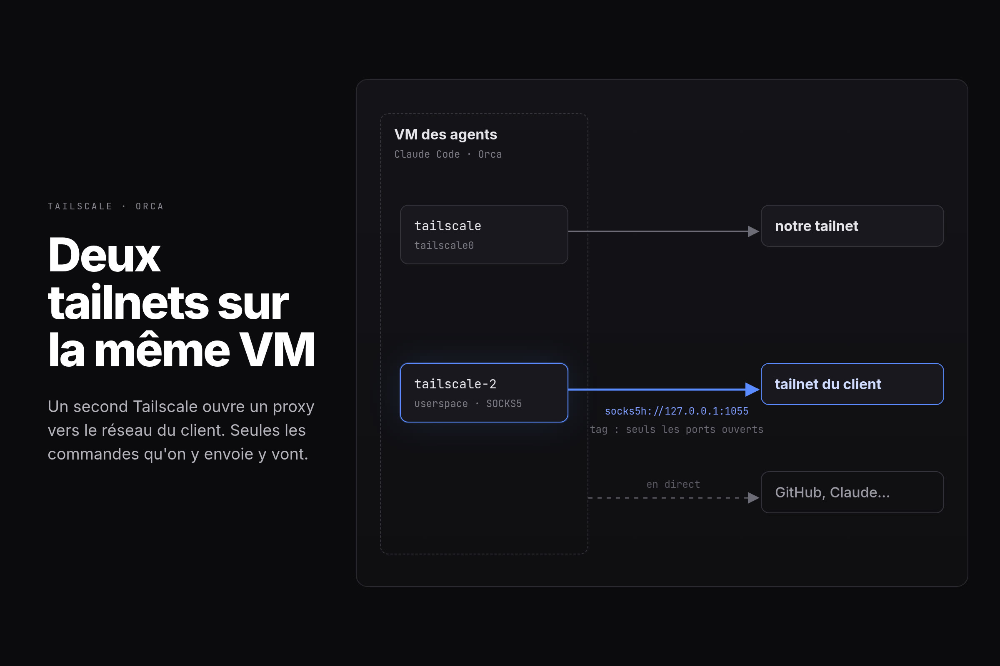

Nos agents de code tournent sur une VM par dev, connectée à notre réseau [Tailscale](https://tailscale.com/). Un de nos clients a ses machines sur son propre réseau Tailscale, et nos agents doivent les atteindre. Problème : une machine ne peut être que sur un seul réseau Tailscale à la fois.

La solution tient en un conteneur de plus sur la VM : un second Tailscale, connecté au réseau du client, qui ne crée pas d'interface réseau mais ouvre un proxy sur la machine.



```yaml
tailscale-2:
  image: tailscale/tailscale
  network_mode: host
  environment:
    TS_AUTHKEY: ${TS2_AUTHKEY}
    TS_USERSPACE: "true"
    TS_SOCKS5_SERVER: 127.0.0.1:1055
```

Ensuite, seules les commandes qu'on fait passer par le proxy vont chez le client. Le reste (GitHub, Claude…) sort normalement :

```sh
curl -x socks5h://127.0.0.1:1055 http://machine-du-client:8080
```

Côté client, la clé de connexion porte un tag. La VM n'est pas un membre de leur réseau : elle n'atteint que les machines et les ports qu'ils ont ouverts à ce tag. C'est eux qui décident ce que nos agents peuvent toucher.

Le compose complet est dans [qrafttech/orca-host](https://github.com/qrafttech/orca-host#a-second-tailnet).
