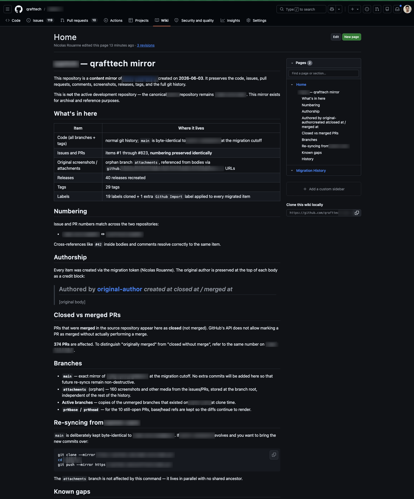

**Before:** a repository hosted in an organization we don't control — 823 issues and pull requests, ~2,300 comments, 160 screenshots, 40 releases.

**After:** a complete mirror in our own organization, numbering preserved identically — #42 over there is #42 over here.

`git clone --mirror` gets you the code in five minutes. The rest of this post is everything git doesn't see.

Why go through all this trouble for tickets? Because the code is only half a project. The other half — why a feature works the way it does, which alternatives were considered and rejected, what a bug looked like and how it was tracked down — lives in the issues and PRs. Every discussion carries its dates, its authors, its arbitrations: you can see who worked on what, when, and who took which decision. That's the project's memory. A repository without it is a codebase without its why.

## 1. What --mirror doesn't carry

```bash
git clone --mirror https://github.com/source-org/app.git
cd app.git
git push --mirror https://github.com/our-org/app.git
```

This copies every branch, tag and commit, byte-identical. And nothing else: issues, pull requests, comments, review threads, labels, releases and the screenshots embedded in discussions all live in GitHub's database, not in git. At the cutoff that meant 349 issues (119 still open), 474 PRs, ~2,300 comments, 19 labels, 40 releases and 160 distinct images.

We had one hard requirement: keep the numbering identical, so that every cross-reference like "see #42" written over the years keeps resolving to the right item.

## 2. An open-source tool, plus four patches

We built on [github-migration](https://github.com/NicholasBoll/github-migration), a Node.js tool that recreates issues and PRs through the GitHub REST API, in order, preserving numbers. It does the heavy lifting — it also predates a few things, so we patched it:

- `refs/heads/master` as the fallback base for empty PRs — the tool predates `main` as GitHub's default branch.
- It only matched markdown images ``. GitHub's modern editor produces HTML `` tags, so half the screenshots were invisible to it. We also had to add auth headers to fetch images from a private repo.
- Its HTTP layer (`request-promise`) has no socket timeout: one transient network error and a multi-hour run crashes. We replaced it with a 30 s timeout, 4 retries with backoff, and per-item checkpointing so a crash resumes where it stopped.
- 2 PRs pointed at base branches that no longer existed in the source history. GitHub refuses to create a PR without a valid base, so they became placeholder issues — keeping the numbering aligned.

```javascript
// the tool predates GitHub's HTML editor output
const MD_IMAGE   = /!\[[^\]]*\]\(([^)]+)\)/g;
const HTML_IMAGE = /]+src="([^"]+)"/g;
```

## 3. Screenshots: an orphan branch as image host

The original image URLs were the trap. Bodies referenced `private-user-images.githubusercontent.com/…?jwt=…` URLs whose tokens had already expired — the screenshots were dead links before we even started. Each image does have a stable permalink at `github.com/user-attachments/assets/<uuid>`, so we downloaded all 160 of them with an authenticated token and committed them to an orphan branch:

```bash
git checkout --orphan attachments
git rm -rf .
cp ~/migration/images/* .
git add -A && git commit -m "screenshots referenced from issues and PRs"
git push origin attachments
```

An orphan branch rather than a commit on `main`, for two reasons: `main` stays byte-identical to the source (a future `git push --mirror` re-sync still applies cleanly), and whoever clones the code doesn't pull 55 MB of screenshots.

Then the gotcha: our first rewrite pointed bodies at `raw.githubusercontent.com` URLs — which render as 404 in the browser on a private repo, because that host wants an `Authorization` header that browsers never attach to embedded `` requests. The form that works is `github.com/<org>/<repo>/raw/refs/heads/attachments/<uuid>.png`, which goes through github.com's session-cookie auth. A second pass rewrote the 112 items already posted with the wrong form.

## 4. Secondary rate limits, or the art of waiting

GitHub enforces a [secondary rate limit](https://docs.github.com/en/rest/using-the-rest-api/rate-limits-for-the-rest-api#about-secondary-rate-limits) on content creation, separate from the documented requests-per-hour quota — and it's opaque: no header tells you the threshold in advance. We hit it twice:

```text
issues + PRs   3,000/h  → blocked at item #670  → resumed ~6 min later at 1,500/h
comments       1,500/h  → intermittent blocks   → finished at 600/h in several passes
```

Total wall-clock time, overnight pauses and cool-offs included: about a week. Actual processing time: on the order of 6 hours. Patience is part of the tooling.

## 5. Documenting without breaking the mirror

Last question: where do you document all of this? Not in the repository itself. A commit on `main` would break the byte-identical mirror; an issue or a PR would consume the next number (#824) and break the one-to-one mapping with the source.

So the documentation lives in the repository's GitHub wiki. The wiki is its own separate git repository (`<repo>.wiki.git`): writing there touches neither the history nor the numbering, and a future `git push --mirror` re-sync still applies cleanly. The knowledge travels with the repo, without leaving a single fingerprint on what it documents.



## 6. What didn't survive

- **Merged PRs show as closed.** The API cannot mark a PR as merged without actually merging it — 374 PRs are affected. Each migrated body opens with a credit block (original author, created / closed / merged dates), so the information is still there, just not in the PR state.
- **261 inline review comments are gone for good.** They were anchored to commit SHAs that had been force-pushed and garbage-collected on the source side, and GitHub requires a valid SHA to anchor an inline comment.
- **Of the ~2,300 comments counted at the source, 1,210 were recreated.**

Those review comments remain readable only on the source repository — which is exactly the dependency this mirror was meant to remove. We decided we could live with that.
