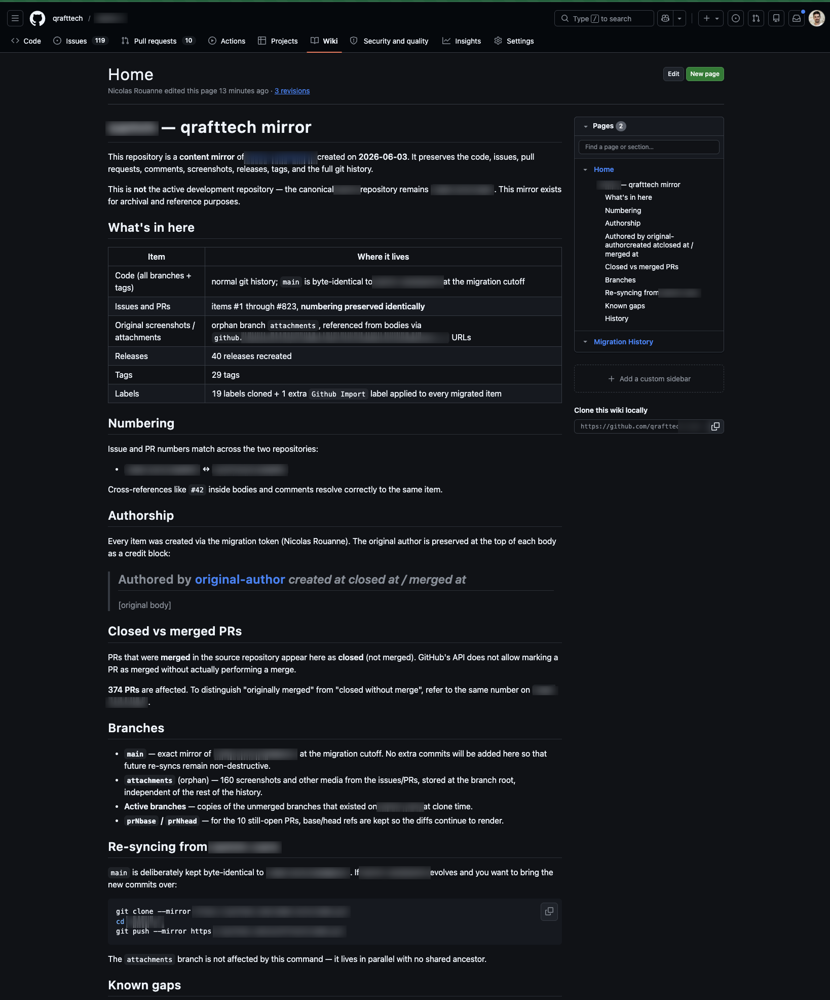

**Avant :** un repo hébergé sur une organisation qu'on ne contrôle pas — 823 issues et pull requests, ~2 300 commentaires, 160 screenshots, 40 releases.

**Après :** un mirror complet sur notre propre organisation, numérotation préservée à l'identique — la #42 là-bas est la #42 chez nous.

`git clone --mirror` ramène le code en cinq minutes. La suite de ce post, c'est tout ce que git ne voit pas.

Pourquoi se donner tout ce mal pour des tickets ? Parce que le code n'est que la moitié d'un projet. L'autre moitié — pourquoi une feature marche comme ça, quelles alternatives ont été écartées, à quoi ressemblait un bug et comment il a été traqué — vit dans les issues et les PRs. Chaque discussion porte ses dates, ses auteurs, ses arbitrages : on voit qui a travaillé sur quoi, quand, et qui a pris quelle décision. C'est la mémoire du projet. Un repo sans elle, c'est une codebase sans son pourquoi.

## 1. Ce que --mirror n'emporte pas

```bash
git clone --mirror https://github.com/source-org/app.git
cd app.git
git push --mirror https://github.com/our-org/app.git
```

Cette commande copie chaque branche, tag et commit, à l'octet près. Et rien d'autre : issues, pull requests, commentaires, review threads, labels, releases et les screenshots embarqués dans les discussions vivent dans la base de données de GitHub, pas dans git. Au moment de la copie, ça représentait 349 issues (dont 119 ouvertes), 474 PRs, ~2 300 commentaires, 19 labels, 40 releases et 160 images distinctes.

On avait une exigence dure : préserver la numérotation à l'identique, pour que toutes les références croisées du type « voir #42 » écrites au fil des années continuent de pointer au bon endroit.

## 2. Un outil open source, plus quatre patches

On est partis de [github-migration](https://github.com/NicholasBoll/github-migration), un outil Node.js qui recrée issues et PRs via l'API REST de GitHub, dans l'ordre, en préservant les numéros. Il fait le gros du travail — mais il date un peu, du coup il a fallu le patcher :

- `refs/heads/master` comme base de repli pour les PRs vides — l'outil est antérieur à `main` comme branche par défaut de GitHub.
- Il ne matchait que les images markdown ``. L'éditeur moderne de GitHub produit des balises HTML `` : la moitié des screenshots lui étaient invisibles. Il a aussi fallu ajouter les headers d'auth pour télécharger les images d'un repo privé.
- Sa couche HTTP (`request-promise`) n'a pas de timeout socket : une erreur réseau transitoire et un run de plusieurs heures s'écroule. On l'a remplacée par un timeout de 30 s, 4 retries avec backoff, et un checkpointing par item pour reprendre là où ça s'est arrêté.
- 2 PRs pointaient vers des branches de base qui n'existaient plus dans l'historique source. GitHub refuse de créer une PR sans base valide : elles sont devenues des issues placeholder, pour garder la numérotation alignée.

```javascript
// l'outil est antérieur à l'éditeur HTML de GitHub
const MD_IMAGE   = /!\[[^\]]*\]\(([^)]+)\)/g;
const HTML_IMAGE = /]+src="([^"]+)"/g;
```

## 3. Screenshots : une branche orpheline comme hébergeur d'images

Le piège, c'était les URLs d'origine. Les bodies référençaient des URLs `private-user-images.githubusercontent.com/…?jwt=…` dont les tokens avaient déjà expiré — les screenshots étaient des liens morts avant même qu'on commence. Chaque image a heureusement un permalien stable en `github.com/user-attachments/assets/<uuid>` : on a téléchargé les 160 avec un token authentifié, puis on les a commitées sur une branche orpheline :

```bash
git checkout --orphan attachments
git rm -rf .
cp ~/migration/images/* .
git add -A && git commit -m "screenshots des issues et PRs"
git push origin attachments
```

Une branche orpheline plutôt qu'un commit sur `main`, pour deux raisons : `main` reste identique à la source à l'octet près (un futur `git push --mirror` de re-sync s'applique sans conflit), et celui qui clone le code ne se traîne pas 55 Mo de screenshots.

Puis le gotcha : notre première réécriture pointait vers des URLs `raw.githubusercontent.com` — qui renvoient 404 dans le navigateur sur un repo privé, parce que ce host attend un header `Authorization` que les navigateurs n'ajoutent jamais aux requêtes `` embarquées. La forme qui marche, c'est `github.com/<org>/<repo>/raw/refs/heads/attachments/<uuid>.png`, qui passe par l'auth en cookie de session de github.com. Une deuxième passe a réécrit les 112 items déjà postés avec la mauvaise forme.

## 4. Secondary rate limits, ou l'art d'attendre

GitHub applique une [secondary rate limit](https://docs.github.com/en/rest/using-the-rest-api/rate-limits-for-the-rest-api#about-secondary-rate-limits) sur la création de contenu, distincte du quota documenté de requêtes par heure — et opaque : aucun header n'annonce le seuil à l'avance. On l'a rencontrée deux fois :

```text
issues + PRs    3 000/h  → bloqué à l'item #670     → reprise ~6 min plus tard à 1 500/h
commentaires    1 500/h  → blocages intermittents   → terminé à 600/h en plusieurs passes
```

Durée totale, pauses nocturnes et cool-offs compris : environ une semaine. Temps de traitement effectif : de l'ordre de 6 heures. La patience fait partie de l'outillage.

## 5. Documenter sans casser le mirror

Dernière question : où documenter tout ça ? Pas dans le repo lui-même. Un commit sur `main` casserait le mirror identique à l'octet près ; une issue ou une PR consommerait le numéro suivant (la #824) et casserait la correspondance un-pour-un avec la source.

La documentation vit donc dans le wiki GitHub du repo. Le wiki est un repo git séparé (`<repo>.wiki.git`) : y écrire ne touche ni à l'historique, ni à la numérotation, et un futur `git push --mirror` de re-sync s'applique toujours sans conflit. Le knowledge voyage avec le repo, sans laisser la moindre empreinte sur ce qu'il documente.



## 6. Ce qui n'a pas survécu

- **Les PRs mergées apparaissent comme closed.** L'API ne permet pas de marquer une PR comme mergée sans la merger réellement — 374 PRs sont concernées. Chaque body migré s'ouvre sur un bloc de crédit (auteur d'origine, dates de création / fermeture / merge), donc l'information est là, juste pas dans l'état de la PR.
- **261 commentaires de review inline sont perdus pour de bon.** Ils étaient ancrés à des SHAs de commits force-pushés puis garbage-collectés côté source, et GitHub exige un SHA valide pour ancrer un commentaire inline.
- **Sur les ~2 300 commentaires comptés à la source, 1 210 ont été recréés.**

Ces commentaires de review ne restent lisibles que sur le repo source — exactement la dépendance que ce mirror devait faire disparaître. On a décidé qu'on pouvait vivre avec.
