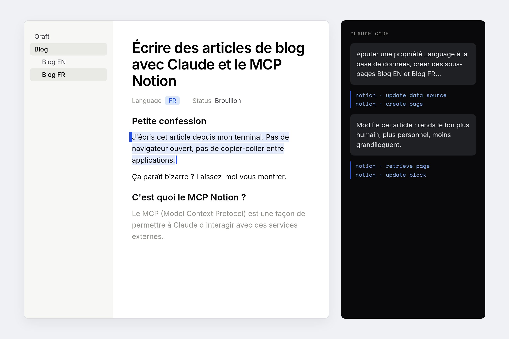

## Petite confession

J'écris cet article depuis mon terminal. Pas de navigateur ouvert, pas de copier-coller entre applications. Juste moi, Claude Code, et un espace Notion avec lequel je peux discuter directement.

Ça paraît bizarre ? Laissez-moi vous montrer.

## C'est quoi le MCP Notion ?

Le MCP (Model Context Protocol) est une façon de permettre à Claude d'interagir avec des services externes. Avec le MCP Notion, Claude peut lire, créer et modifier des pages dans votre workspace—simplement en lui demandant en langage naturel.

Imaginez que vous donnez un trousseau de clés Notion à Claude.

## Exemples concrets d'aujourd'hui

Le truc, c'est que ce blog que vous lisez ? On vient de le restructurer entièrement avec ce workflow. Voici les prompts que j'ai réellement utilisés :

### Mettre en place un blog multilingue

```javascript
Implémente le plan suivant : restructurer le blog pour supporter 
des versions française et anglaise de chaque article. Ajouter une 
propriété Language à la base de données, créer des sous-pages 
Blog EN et Blog FR, et traduire les 3 articles existants en français.
```

C'est tout. Un seul prompt. Claude a compris la structure, créé les pages, traduit les articles, et tout lié ensemble.

### Faire des modifications rapides

Quand j'ai voulu améliorer cet article :

```javascript
Modifie cet article : rends le ton plus humain, plus personnel, 
moins grandiloquent. Ajoute des exemples de prompts de cette 
conversation.
```

### Corriger les erreurs

Tout ne se passe pas toujours parfaitement. À un moment, la mise à jour d'une page a accidentellement archivé du contenu. Mais le corriger était aussi simple que :

```javascript
La base de données a été archivée. Peux-tu la recréer avec 
la même structure et les mêmes articles ?
```



## Pourquoi j'aime vraiment ça

**C'est rapide.** Écrire de la documentation finit toujours en bas de ma liste de tâches. Maintenant je peux rédiger et publier quelque chose en le temps de décrire ce que je veux.

**Ça reste dans mon flow.** Je suis déjà dans le terminal pour coder. Ne pas avoir à basculer vers un navigateur, me connecter à Notion, gérer le formatage... ça enlève juste assez de friction pour que je le fasse vraiment.

**C'est itératif.** Pas content d'une tournure ? Dis-le. Claude corrige. Pas besoin de ré-expliquer tout le contexte.

## L'ironie évidente

Oui, c'est un article sur l'utilisation de l'IA pour écrire des articles, écrit par l'IA. Méta, je sais.

Mais c'est justement ça le point—les outils sont devenus assez bons pour qu'on puisse se concentrer sur _ce qu'on_ veut dire, pas sur _comment_ le mettre sur la page. Claude gère la mécanique ; vous gardez le contrôle du contenu.

---

_Écrit avec Claude Code + MCP Notion. Les prompts ci-dessus viennent de cette session._
