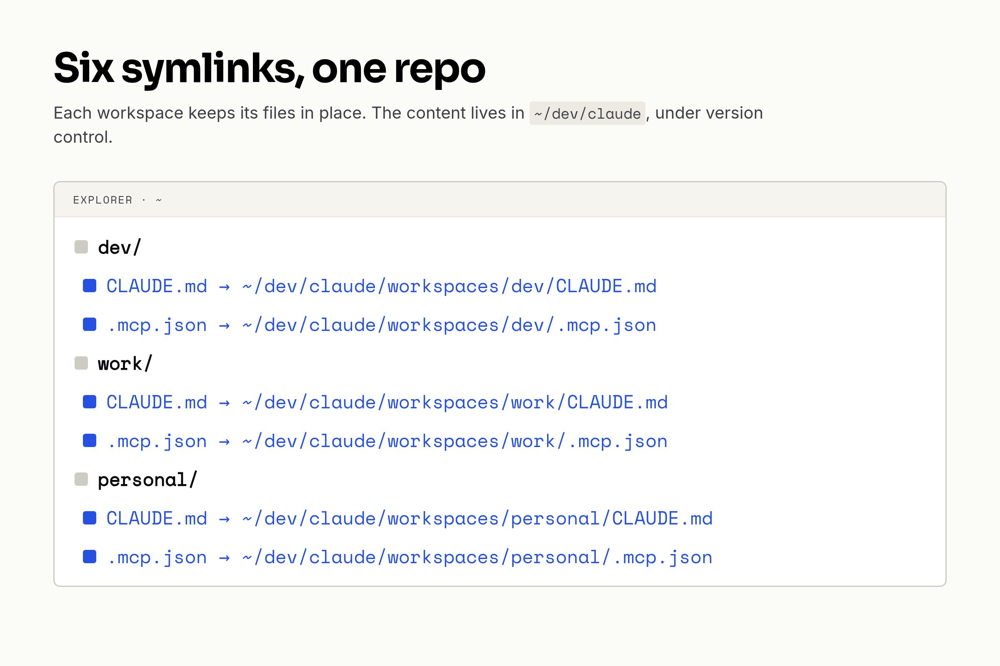

I use Claude Code across three separate directories — `~/dev/` for development, `~/work/` for non-dev tasks (time tracking, content editing), and `~/personal/` for personal admin. Each workspace has its own `CLAUDE.md` (context instructions) and `.mcp.json` (MCP server config). I wanted all of these versioned in a single repo so I could track changes, review diffs, and not lose configs when switching machines.

## The setup

I already had a `~/dev/claude/` repo where I version my global Claude Code settings, skills, and guides. The global `~/.claude/CLAUDE.md` was already symlinked into this repo. I wanted to extend this pattern to workspace-level configs.

The new structure:

```javascript
~/dev/claude/
├── workspaces/
│   ├── dev/
│   │   ├── CLAUDE.md
│   │   └── .mcp.json
│   ├── work/
│   │   ├── CLAUDE.md
│   │   └── .mcp.json
│   └── personal/
│       ├── CLAUDE.md
│       └── .mcp.json
├── CLAUDE.md          # global instructions
├── config/
│   └── settings.json
└── ...
```

Each original file (`~/dev/CLAUDE.md`, `~/work/.mcp.json`, etc.) becomes a symlink pointing into the repo.



## Handling secrets in .mcp.json

The `.mcp.json` files configure MCP servers — in my case, Notion. Each one originally contained a raw API token. I didn't want to commit those.

Claude Code supports `${VAR}` syntax in `.mcp.json` env values, so the fix was straightforward. Instead of:

```json
{
  "mcpServers": {
    "notion": {
      "env": {
        "NOTION_TOKEN": "ntn_abc123..."
      }
    }
  }
}
```

I now have:

```json
{
  "mcpServers": {
    "notion": {
      "env": {
        "NOTION_TOKEN": "${NOTION_TOKEN_WORK}"
      }
    }
  }
}
```

The actual tokens live in `~/.zshrc` as exported environment variables. Two tokens, two workspaces: `NOTION_TOKEN_WORK` for dev and work (same Notion workspace), `NOTION_TOKEN_PERSONAL` for personal.

## Creating the symlinks

The migration was mechanical:

```bash
# Copy content into the repo
cp ~/dev/CLAUDE.md ~/dev/claude/workspaces/dev/CLAUDE.md
# ... same for all 6 files

# Replace originals with symlinks
rm ~/dev/CLAUDE.md
ln -s ~/dev/claude/workspaces/dev/CLAUDE.md ~/dev/CLAUDE.md
# ... same for all 6 files
```

Claude Code follows symlinks transparently — it reads the file content regardless of whether it's a regular file or a symlink. No configuration changes needed.

## What works

- **Version control**: Every change to workspace instructions or MCP config goes through a PR. I can see what changed and why.
- **No secrets in git**: The `${VAR}` pattern keeps tokens out of the repo entirely.
- **Single source of truth**: One repo holds all Claude Code configuration — global settings, skills, and now workspace configs.
- **Machine portability**: Clone the repo, set up the symlinks and env vars, and all workspaces are configured.

## What to watch out for

- **Symlink awareness**: Some tools don't follow symlinks. Claude Code does, but if you use other tools that read `.mcp.json`, test them.
- **Shell profile dependency**: The env vars must be loaded before Claude Code starts. If you use a non-login shell or a different profile file, make sure your exports are in the right place.
- **Per-machine tokens**: If you use different Notion tokens per machine, you'll need to set the env vars differently on each one. The repo stays the same, only the shell profile differs.

## Takeaway

If you're using Claude Code across multiple directories, symlinks into a config repo are a clean way to version everything without committing secrets. The `${VAR}` syntax in `.mcp.json` makes it easy to keep tokens in your shell profile where they belong.
