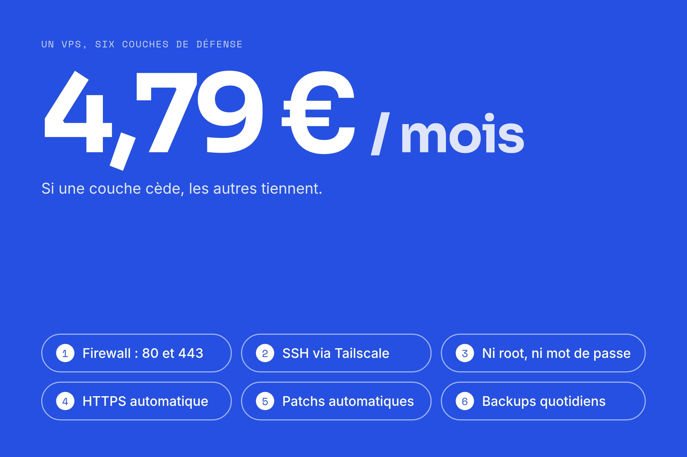

J'ai développé un petit site pour une association sportive, et j'ai décidé de l'héberger moi-même sur un VPS. Ouvrir un VPS, ça fait un peu peur au début : une IP publique, et des bots qui tapent à la porte toute la journée. Voici comment je l'ai sécurisé, sans être sysadmin. Le fil rouge : la défense en profondeur.

## Pourquoi un VPS

Le site est simple : quelques pages, un portail admin avec login, du CRUD pour les actus et les événements, des PDF à télécharger. J'ai pris du Next.js + Postgres + Prisma, par familiarité.

Une fois cette stack choisie, l'hébergement managé devient cher ou pénible :

| Option | Coût/mois | Frein |
| --- | --- | --- |
| Vercel + Neon | ~37 € | Vercel Pro obligatoire pour une organisation |
| Scalingo | ~25-30 € | Overkill pour un site associatif |
| Cloudflare Workers | quasi gratuit | Pas de Postgres managé, des adapters à mettre en place |

Cloudflare était le moins cher, mais son runtime n'est pas Node.js : il faut un adapter edge-compatible pour Prisma, et `@opennextjs/cloudflare` pour Next.js. C'est plus simple depuis la [Adapter API de Next.js 16.2](https://nextjs.org/blog/nextjs-across-platforms#the-adapter-api), mais ça reste du travail.

Le VPS, c'est 3,99 €/mois (plus 0,80 € de backup). Surtout, le même `docker compose` tourne en local et en prod, avec les mêmes volumes : pas d'adapter, pas de plateforme qui m'enferme. Et c'est un bon terrain d'apprentissage : Linux, réseau, DNS, TLS.

La contrepartie, c'est que la sécurité, c'est moi qui m'en occupe.

## Le principe : plusieurs couches

La défense en profondeur, c'est de ne pas miser sur une seule protection mais sur plusieurs. Si l'une cède, les autres tiennent. J'en ai six. Je détaille ensuite les deux moins évidentes.

> [!TIP]
> Aucune couche ne suffit toute seule. C'est l'empilement qui protège : un attaquant doit toutes les passer.

1. Surface réseau minimale : un firewall qui ne laisse entrer que 80 et 443.
2. Pas de SSH public : l'admin passe par un tunnel privé (Tailscale).
3. Pas de root, pas de mot de passe : un user dédié, connexion par clé.
4. Chiffrement : HTTPS automatique côté public (Caddy + Let's Encrypt).
5. Patchs automatiques : les correctifs de sécurité s'appliquent seuls.
6. Backups : des sauvegardes quotidiennes chez Hetzner.



---

## Fermer le port SSH

Pour administrer un serveur, on s'y connecte en SSH, qui écoute sur le port 22. Un port ouvert, c'est une porte, et tout ce qui est ouvert peut être attaqué. Les bots scannent les IP publiques et tapent sur le port 22 avec des mots de passe au hasard, en boucle.

On peut durcir cette porte. Ou on peut la supprimer, et c'est ce que permet [Tailscale](https://tailscale.com/kb/1245/set-up-servers).

Tailscale monte un réseau privé chiffré entre mes machines (un VPN WireGuard, le tailnet). Le VPS et mon Mac se voient comme sur le même réseau local, où qu'ils soient. Sur le serveur, deux commandes :

```bash
curl -fsSL https://tailscale.com/install.sh | sh
tailscale up --ssh --hostname=mon-vps --auth-key=tskey-auth-xxxxx
```

`--ssh` : Tailscale gère l'auth SSH via l'identité du tailnet. `--hostname` : je tape `ssh deploy@mon-vps` au lieu d'une IP.

Ce qui change, c'est le sens de la connexion. Un serveur classique écoute sur un port et attend qu'on vienne. Avec Tailscale, c'est le VPS qui se connecte vers le tailnet, en sortie, comme un navigateur va sur un site. Plus besoin d'ouvrir un port pour l'admin.

```text
Serveur classique :  Internet  ---tape sur--->  [port 22 ouvert]  serveur
Avec Tailscale :     serveur  ---sort vers--->  tailnet privé chiffré
```

Du coup, un attaquant qui scanne mon IP ne voit aucun SSH. Pas de porte, rien à forcer.

## Pas de root, pas de mot de passe

Sur Linux, `root` peut tout faire, sans garde-fou. Travailler en root en permanence est risqué : une faute de frappe peut casser le système, et une session root volée donne tout à l'attaquant. On applique donc le moindre privilège : un user normal au quotidien, et on monte en droits seulement quand il faut.

```bash
adduser --disabled-password deploy    # user dédié, sans mot de passe (clé SSH seulement)
usermod -aG sudo deploy               # peut passer admin via sudo, à la demande

# Dans /etc/ssh/sshd_config :
PasswordAuthentication no             # plus de brute-force par mot de passe
PermitRootLogin no                    # connexion root directe interdite
```

`--disabled-password` veut dire qu'il n'y a pas de mot de passe à deviner : on entre seulement avec une clé SSH, dont la partie privée ne quitte jamais mon Mac. Et couper l'auth par mot de passe rend le brute-force inutile.

> [!WARNING]
> Par défaut, un VPS neuf accepte la connexion root par mot de passe : c'est exactement ce que les bots attaquent. C'est la première chose à corriger sur une machine neuve.

---

## HTTPS automatique : Caddy + Let's Encrypt

Côté public, je place [Caddy](https://caddyserver.com/docs/automatic-https) devant l'app. Il fait deux choses.

D'abord, le reverse proxy. Caddy écoute sur 80/443, déchiffre le HTTPS, puis passe la requête à l'app Next.js sur son port interne `:3000`.

```text
Visiteur --443 HTTPS--> Caddy --3000 interne--> app Next.js
```

L'app n'est jamais exposée directement à Internet : aucun port publié vers l'hôte, le firewall bloque le reste. Elle ne parle qu'à Caddy, dans le réseau Docker.

Ensuite, le HTTPS. Caddy obtient et renouvelle tout seul le certificat TLS via Let's Encrypt, une autorité gratuite et automatisée. Le certificat chiffre le trafic et prouve que le serveur est bien le bon domaine (le cadenas). Ma config tient en quelques lignes : je déclare le domaine, Caddy fait le reste.

```javascript
{$SITE_ADDRESS} {
  encode gzip

  header {
    Strict-Transport-Security "max-age=31536000; includeSubDomains; preload"
    X-Content-Type-Options nosniff
    X-Frame-Options DENY
    Referrer-Policy strict-origin-when-cross-origin
    -Server
  }

  reverse_proxy app:3000
}
```

Le bloc `header` n'est pas là pour décorer : la [doc Caddy](https://caddyserver.com/docs/caddyfile/directives/header) recommande ces en-têtes. `Strict-Transport-Security` force le HTTPS, `X-Content-Type-Options nosniff` empêche le navigateur de deviner les types de fichiers, `X-Frame-Options DENY` bloque le clickjacking.

## Patchs automatiques et backups

L'image Debian de Hetzner date d'un instant T, et depuis, des failles ont été corrigées. On rattrape tout d'un coup, puis on automatise.

```bash
apt update && apt full-upgrade -y     # rattrape tous les correctifs connus
apt install -y unattended-upgrades    # applique les patchs de sécu chaque jour, seul
dpkg-reconfigure -plow unattended-upgrades
```

> [!TIP]
> La plupart des patchs sont actifs tout de suite. Seuls le kernel et quelques libs (`glibc`, `openssl`) demandent un reboot, que Debian signale dans `/var/run/reboot-required`. Je reboote à la main de temps en temps, pour vérifier que le site remonte bien après.

Côté réseau, Tailscale m'a permis de fermer le port 22, et le firewall Hetzner l'applique côté plateforme. Je n'autorise en entrée que le strict nécessaire, et je supprime la règle port 22 que Hetzner met par défaut.

| Port | Usage |
| --- | --- |
| 80 (TCP) | HTTP (redirection + validation du cert Let's Encrypt) |
| 443 (TCP) | HTTPS (le site) |
| ICMP | ping (debug, optionnel) |

Enfin, j'ai coché l'option backups de Hetzner (+20 %, ~0,80 €/mois) : des sauvegardes quotidiennes pour restaurer en cas de pépin.

---

## L'ordre compte : la clé jetable

Ces couches ne se posent pas dans n'importe quel ordre. Il y a un problème de poule et d'œuf : pour fermer le port 22, il faut déjà avoir Tailscale, mais pour installer Tailscale, il faut déjà pouvoir entrer sur la machine.

La solution, c'est une clé SSH jetable. À la création du VPS, j'ajoute une clé publique temporaire (sinon Hetzner envoie le mot de passe root par email, ce qu'on veut éviter). Elle me sert à entrer une seule fois, pour durcir la machine et installer Tailscale. Une fois que `ssh deploy@mon-vps` marche via le tailnet, je supprime la clé jetable chez Hetzner et je ferme le port 22. C'est un échafaudage : on l'enlève une fois le reste en place.

On vérifie ensuite depuis l'extérieur (hors tailnet) que tout est bien fermé :

```bash
nc -zvw3 <IP_VPS> 22      # TIMEOUT  -> SSH invisible
nc -zvw3 <IP_VPS> 5432    # TIMEOUT  -> Postgres invisible
curl -I https://mon-asso.fr   # 200 -> web OK
ssh deploy@mon-vps 'echo ok'  # OK -> admin via Tailscale
```

## Ce qu'il faut retenir

- La sécurité, c'est un empilement, pas un mur. Six couches, il faut toutes les passer.
- Fermer le port SSH plutôt que le durcir : Tailscale inverse le sens de la connexion, et un attaquant ne voit plus aucune porte.
- L'ordre des étapes compte. La clé jetable est un échafaudage qu'on retire une fois Tailscale en place.
- Tout ça coûte moins de 5 €/mois. Le vrai coût, c'est l'apprentissage de départ, mais il sert dès le projet suivant.
