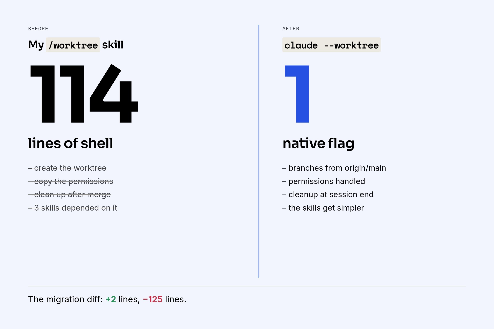

I spent a few weeks building a custom `/worktree` skill for Claude Code. It managed git worktrees for feature branches: creating them, copying permissions, cleaning up after merges, pruning stale branches. It was 114 lines of carefully crafted shell logic, and three other skills depended on it. Today I deleted it all and replaced it with a single flag: `claude --worktree`.

This is a story about building custom tooling on a fast-moving platform, and whether the investment is worth it.

## What I Had Built

The `/worktree` skill did several things:

- **Created worktrees** in sibling directories with a consistent naming convention (`myapp-feat-login`)
- **Copied permissions** — specifically `.claude/settings.local.json` — so the new worktree wouldn't start with a blank permission slate and trigger a cascade of approval prompts
- **Cleaned up** after work was done: removing the worktree, deleting merged branches, pruning remote tracking refs
- **Served as a dependency** for `/pr`, `/merge`, and `/review-apply`, which all delegated their worktree operations to it

The permission copying alone justified the skill's existence. Without it, every new worktree was a fresh Claude Code session that knew nothing about which tools you'd already approved. You'd spend the first five minutes just clicking "Allow" over and over.

## What Claude Code Shipped

Then Anthropic added `--worktree` as a native flag. When you run `claude --worktree`, it:

- Creates an isolated worktree automatically
- Branches from `origin/main`
- Handles permissions natively (no manual copying needed)
- Cleans up on session exit

Four bullet points that made my 114 lines obsolete.

## The Migration

Ripping out the custom logic took four PRs in quick succession:

1. **Remove the** **`/worktree`** **skill entirely** and inline the minimal branch-pruning logic into `/merge`
2. **Simplify** **`/pr`** — instead of creating worktrees and copying files, just rename the current branch (`git branch -m`), since `--worktree` already starts you on an isolated branch from `origin/main`
3. **Simplify** **`/review-apply`** — remove worktree creation/cleanup, just check out the PR branch directly
4. **Remove the last incompatible steps** — the rebase-before-push in `/pr` (unnecessary since worktrees already branch from latest main) and the local branch pruning in `/merge` (GitHub auto-deletes merged remote branches anyway)

The diff tells the story: **+2 lines, -125 lines**. The skills got simpler, more reliable, and lost an entire class of edge cases around worktree state management.

## Is It Worth Building Custom Tools?

This is the question I keep coming back to. I think the honest answer is: **yes, but it hurts**.

Here's why it's worth it:

- **You solve your problem today.** When I built `/worktree`, there was no native alternative. I needed isolated branches for PR workflows, and I needed permissions to carry over. The skill worked. It shipped code.
- **You learn the platform deeply.** Building the skill forced me to understand how Claude Code handles permissions, how skills chain together, how worktrees interact with the session model. That knowledge didn't evaporate when the skill became obsolete — it made the migration trivial.
- **You influence the platform.** The problems you solve with custom tools are signals. Permission portability across worktrees, cleanup on exit — these are the exact pain points that the native implementation addressed. Early adopters who build workarounds are, in a way, writing the spec for what the platform should do next.

Here's why it hurts:

- **Maintenance is real.** Every Claude Code update could break your custom skills. The interaction between skills, permissions, and git state creates subtle edge cases that take time to debug.
- **You will throw work away.** Not "might" — will. If you're building tools on a platform that ships weekly, some of your work has a shelf life measured in weeks.
- **The native version is always better.** It has access to internals you don't. It handles edge cases you never thought of. It doesn't need permission hacks.

## What I'd Tell Someone Starting Out

Build the tool. Seriously. But build it knowing it's temporary.

Keep your custom skills small and focused. Don't build a framework — build a script. The less you invest in abstraction, the less it hurts when you delete it.

Version everything. I keep all my Claude Code configs in a git repo. When I deleted the worktree skill, I could see exactly what it did, trace the dependencies, and verify nothing was left dangling. Without that, the migration would have been archaeology.

And when the platform catches up — and it will — delete your code with gratitude, not regret. The 114 lines I wrote weren't wasted. They were a bridge that let me work effectively until something better came along.

That's the deal with custom tooling on a fast-moving platform. It's a necessary pain. You pay the cost of building and maintaining things that will be obsoleted, because the alternative is waiting — and waiting means not shipping.
