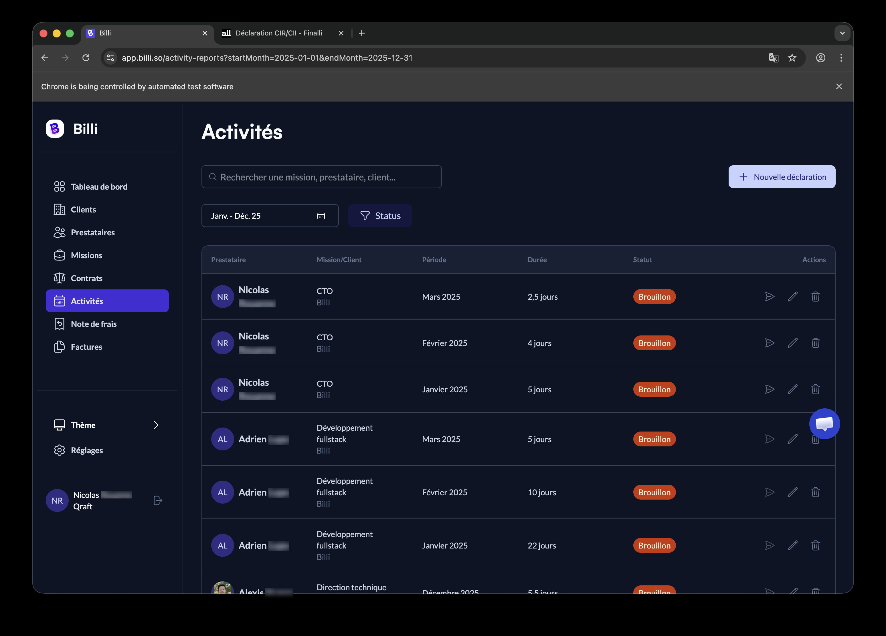
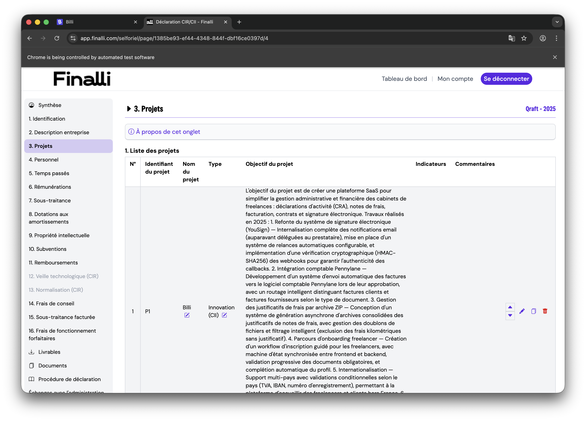

Filing the French CII (Crédit d'Impôt Innovation) is a yearly chore. The dossier needs personnel data, time tracking, payroll figures, and a project description detailed enough that a tax inspector won't bounce it.

This year I tried to fill the whole thing in one Claude session. The job split cleanly into three phases: gathering data from scattered sources, putting it into the form, and notifying the right people.

## 1. Gathering information across sources

Inputs live in at least four places, and Claude reached into each one without me copy-pasting anything.

### Git → features and time

For the project description ("what's innovative this year?"), I spawned a subagent to scan the year's commits filtered by author, group them by feature theme, and produce concrete innovation axes — YouSign refactor, Pennylane integration, expense ZIP, onboarding, internationalization, PDF reliability. The subagent did the reading; I just had to validate the framing.

For time tracking, our internal CRA in Billi was sparse, so Claude counted distinct commit days per author as a floor:

```bash
git -C ~/dev/billi/billi log \
  --after="2024-12-31" --before="2026-01-01" \
  --author="Adrien Lupo" \
  --format="%ad" --date=format:"%Y-%m-%d" | sort -u | wc -l
```

Then I distributed actual workdays across months by hand.

### Billi API → activity reports

We dogfood Billi for our own activity reports. Claude pulled the existing entries through the API after grabbing an OAuth token, then cross-checked them against the git data to spot gaps.



### Payslip PDFs → admin info

Payslips drop into Downloads as PDFs. Claude reads them directly, extracts the brut annuel cumul and monthly employer charges, and computes annual approximations. For the eligible/non-eligible split, I used the same ratio as last year's declaration since the URSSAF annual statement isn't out yet — flagged for the accountant to verify.

### Last year's declaration → Finalli itself

Half the dossier is "do the same as last year, with this year's numbers." Before filling anything, Claude opened the validated previous declaration in another tab and extracted the structure, the personnel format, the wording.

## 2. Filling Finalli with chrome-devtools

This was the part that was actually impressive to watch.

The Finalli form is a multi-page selforiel with autosave. The chrome-devtools MCP gives Claude take_snapshot (accessibility-tree element IDs) and fill / click to interact. None of the action buttons have stable labels — the column shows up/down/eye/edit/duplicate/delete icons in a row, with no aria-labels.

What was bluffing was watching Claude figure out the UI on its own. First click on what it thought was the edit button, see a row got duplicated instead, learn that "fourth icon = duplicate, third = edit", correct course, recover the state. By the third table it had internalized the pattern and stopped misclicking.

What it actually looks like in the conversation — each line below is a tool call that Claude makes, and the runtime shows them inline as the work progresses:

```text
chrome-devtools - new_page (url: "https://app.finalli.com/login")
chrome-devtools - take_snapshot
chrome-devtools - fill (uid: "1_7", value: "nicolas@qraft.tech")
chrome-devtools - fill (uid: "1_8", value: "***")
chrome-devtools - click (uid: "1_13")        # Se connecter

chrome-devtools - navigate_page (url: ".../selforiel/page/.../4")
chrome-devtools - take_snapshot
chrome-devtools - click (uid: "25_61")        # Edit P1 (after first try landed on duplicate)
chrome-devtools - fill (uid: "27_70", value: "L'objectif du projet est...")
chrome-devtools - click (uid: "27_77")        # Valider
```

The interesting trace is in the misclicks: a click on what Claude thought was "edit" produced a duplicated row, the next snapshot showed the new row, Claude inferred the correct icon position, and the work continued. No human in the loop except me reading along.

The brittleness is real — sorting columns shifts the IDs, opening a row reorders the snapshot — but the recovery loop holds up. Knowing which mistakes are reversible (a duplicated row, a wrong cell) is what makes the autonomy usable.



## 3. The wrap-up email

Once the dossier was filled, the final step was telling the people involved (the Finalli consultant, the accountants, my co-founder) that it was done.

Claude searched my sent folder for the prior CII thread, identified the right CC list, matched the tone from previous emails I'd sent (tutoiement, "Hello", direct), and replied in-thread. The honest line "I vibe-filled this with Claude, please double-check" went in unprompted — the right framing for output that ends up in front of a tax inspector.

### The actual email

Here's what landed in their inbox (in French, since that's the working language with the firm):

> Hello Guillaume,\
> \
> Le selforiel CII 2025 est rempli de notre côté :\
> \- Projet P1 Billi avec la description des travaux 2025\
> \- Personnel : Adrien L. + Mehdi M.\
> \- Temps passés : 73 jours (49j Adrien + 24j Mehdi)\
> \- Rémunérations saisies avec les bruts annuels\
> \- CV uploadés\
> \
> Par contre j'ai rempli ça assez vite avec l'aide de Claude, donc je te laisse bien vérifier que tout est cohérent et qu'il n'y a pas de boulettes :)\
> \
> Il nous manque les relevés individuels de cotisations patronales 2025 (avec le détail éligible/non éligible CII) — Alex, Flor, vous pouvez nous préparer ça ?\
> \
> À dispo si tu as besoin d'ajustements.\
> \
> Nicolas

## When this is worth doing

For a yearly admin task with last-year reference data, a structured form, and inputs scattered across SaaS tools, Claude as orchestrator beats doing it manually. The API surface (1Password CLI, git, PDF reads, Gmail CLI, chrome-devtools) is enough to cut a half-day of paperwork down to about 90 minutes — and the parts I learned to trust most were the ones where Claude had to figure something out on its own.
