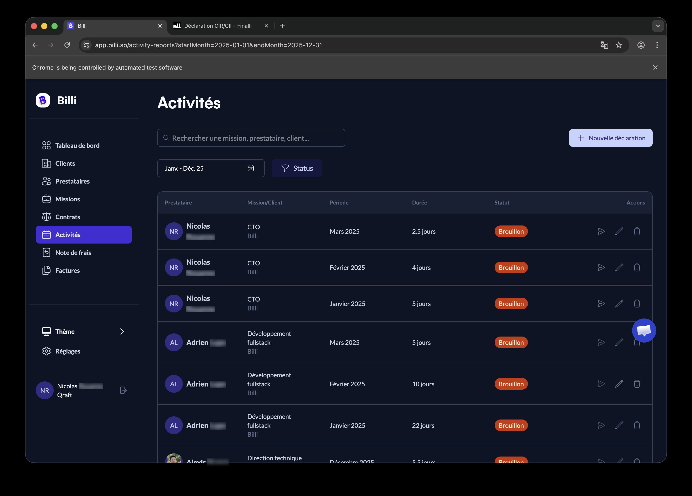
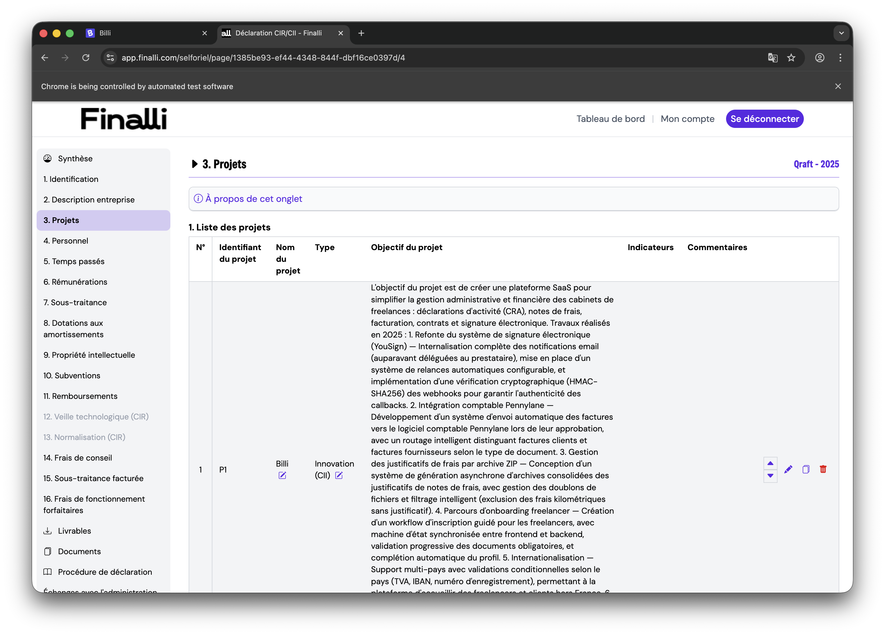

Remplir le dossier CII (Crédit d'Impôt Innovation) est une corvée annuelle. Le dossier exige des données de personnel, du suivi de temps, des chiffres de paie, et une description du projet suffisamment détaillée pour qu'un inspecteur des impôts ne la rejette pas.

Cette année j'ai essayé de tout remplir en une seule session avec Claude. Le boulot s'est séparé proprement en trois phases : aller chercher l'info dans les différentes sources, la saisir dans le formulaire, et notifier les bonnes personnes.

## 1. Aller chercher l'info dans plusieurs sources

Les inputs vivent dans au moins quatre endroits, et Claude est allé piocher dans chacun sans que j'aie à copier-coller quoi que ce soit.

### Git → features et temps passé

Pour la description du projet ("qu'est-ce qui est innovant cette année ?"), j'ai lancé un sous-agent qui a scanné les commits de l'année par auteur, les a regroupés par thème de feature, et a sorti des axes d'innovation concrets — refonte YouSign, intégration Pennylane, ZIP des notes de frais, onboarding, internationalisation, fiabilité PDF. Le sous-agent a fait la lecture ; je n'avais qu'à valider le cadrage.

Pour le suivi du temps, nos CRA dans Billi étaient parcellaires. Claude a donc compté les jours uniques de commit par auteur comme plancher :

```bash
git -C ~/dev/billi/billi log \
  --after="2024-12-31" --before="2026-01-01" \
  --author="Adrien Lupo" \
  --format="%ad" --date=format:"%Y-%m-%d" | sort -u | wc -l
```

Ensuite j'ai réparti les jours travaillés réels par mois à la main.

### API Billi → comptes-rendus d'activité

On dogfoode Billi pour nos propres CRA. Claude est allé chercher les saisies existantes via l'API après avoir attrapé un token OAuth, puis les a recoupées avec les données git pour repérer les trous.



### PDF de paie → infos administratives

Les bulletins de paie atterrissent dans Downloads en PDF. Claude lit le PDF directement, extrait le cumul brut annuel et les charges patronales mensuelles, et calcule des approximations annuelles. Pour le split éligible/non éligible, j'ai utilisé le même ratio que la déclaration de l'an dernier puisque le relevé URSSAF annuel n'est pas encore sorti — flagué pour le comptable.

### Déclaration de l'an dernier → Finalli lui-même

La moitié du dossier c'est "refais comme l'an dernier, avec les chiffres de cette année". Avant de remplir quoi que ce soit, Claude a ouvert la déclaration validée de l'an dernier dans un autre onglet et en a extrait la structure, le format du personnel, la formulation.

## 2. La saisie dans Finalli avec chrome-devtools

C'est la partie qui était vraiment bluffante à regarder.

Le formulaire Finalli est un selforiel multi-pages avec sauvegarde automatique. Le MCP chrome-devtools donne à Claude take_snapshot (IDs de l'arbre d'accessibilité) et fill / click pour interagir. Aucun des boutons d'action n'a de label stable — la colonne affiche des icônes haut/bas/œil/éditer/dupliquer/supprimer en ligne, sans aria-labels.

Ce qui était bluffant, c'était de voir Claude apprendre l'UI tout seul. Premier clic sur ce qu'il pensait être l'éditeur, voir qu'une ligne a été dupliquée à la place, comprendre que "4ème icône = duplicata, 3ème = édition", corriger, récupérer l'état. Au bout du troisième tableau, il avait intériorisé le pattern et arrêté de se tromper.

À quoi ça ressemble vraiment dans la conversation — chaque ligne ci-dessous est un appel d'outil que Claude fait, et le runtime les affiche en ligne au fil de l'avancement :

```text
chrome-devtools - new_page (url: "https://app.finalli.com/login")
chrome-devtools - take_snapshot
chrome-devtools - fill (uid: "1_7", value: "nicolas@qraft.tech")
chrome-devtools - fill (uid: "1_8", value: "***")
chrome-devtools - click (uid: "1_13")        # Se connecter

chrome-devtools - navigate_page (url: ".../selforiel/page/.../4")
chrome-devtools - take_snapshot
chrome-devtools - click (uid: "25_61")        # Éditer P1 (après un premier essai qui a dupliqué la ligne)
chrome-devtools - fill (uid: "27_70", value: "L'objectif du projet est...")
chrome-devtools - click (uid: "27_77")        # Valider
```

Le passage intéressant est dans les ratages : un clic sur ce que Claude pensait être "éditer" a produit une ligne dupliquée, le snapshot suivant a montré la nouvelle ligne, Claude en a déduit la bonne position de l'icône, et le travail a continué. Personne dans la boucle à part moi qui regardais défiler.

La fragilité est réelle — trier une colonne décale les IDs, ouvrir une ligne réordonne le snapshot — mais la boucle de récupération tient. Savoir quelles erreurs sont réversibles (une ligne dupliquée, une mauvaise cellule), c'est ce qui rend l'autonomie utilisable.



## 3. Le mail récapitulatif

Une fois le dossier rempli, la dernière étape était de prévenir les bonnes personnes (le consultant Finalli, les comptables, mon associé) que c'était fait.

Claude a cherché dans mes envoyés le thread CII précédent, identifié la bonne liste de copies, calé le ton sur les mails que j'avais déjà envoyés (tutoiement, "Hello", direct), et répondu dans le thread. La phrase honnête "j'ai vibe-rempli avec Claude, merci de bien vérifier" est passée sans que je le demande — c'est le bon cadrage pour quelque chose qui finit devant un inspecteur des impôts.

### Le mail tel quel

Voici ce qui a atterri dans leur boîte :

> Hello Guillaume,\
> \
> Le selforiel CII 2025 est rempli de notre côté :\
> \- Projet P1 Billi avec la description des travaux 2025\
> \- Personnel : Adrien L. + Mehdi M.\
> \- Temps passés : 73 jours (49j Adrien + 24j Mehdi)\
> \- Rémunérations saisies avec les bruts annuels\
> \- CV uploadés\
> \
> Par contre j'ai rempli ça assez vite avec l'aide de Claude, donc je te laisse bien vérifier que tout est cohérent et qu'il n'y a pas de boulettes :)\
> \
> Il nous manque les relevés individuels de cotisations patronales 2025 (avec le détail éligible/non éligible CII) — Alex, Flor, vous pouvez nous préparer ça ?\
> \
> À dispo si tu as besoin d'ajustements.\
> \
> Nicolas

## Quand ça vaut le coup

Pour une tâche admin annuelle avec une référence de l'an dernier, un formulaire structuré, et des inputs éparpillés entre des outils SaaS, Claude comme orchestrateur bat le travail manuel. La surface d'API (CLI 1Password, git, lecture PDF, CLI Gmail, chrome-devtools) suffit à réduire une demi-journée de paperasse à environ 90 minutes — et les parties que j'ai appris à faire le plus confiance sont celles où Claude devait comprendre quelque chose tout seul.
