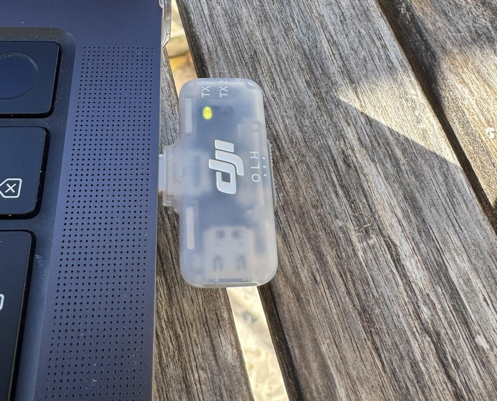

On the evening of November 25, I sent this message to Poulpito, the [meta-agent that runs my other coding agents](/en/blog/a-meta-agent-to-run-my-coding-agents). It's in French, and it's the raw transcription:

> J'ai fini parce que c'était en cours sur Hot Greenfield, est-ce que tu peux supprimer le Word Tricourt et en recrée un pour supprimer tous les commentaires comme j'avais fait dans une paire, tu reprends l'esprit de cette paire pour savoir quel commentaire il faut supprimer ou pas et un deuxième Wrice ça Khadi bien les deux ensemble pour pour mettre tous les schémas d'architecture que je t'ai déjà partagé qui sont notamment dans l'article de blog sur le Red faire un propre mettre le voilà et après on va faire un troisième tri pour déployer tout ça sur quelque part, je sais pas moi, j'imagine Claude Flöhr mais je pas très facile, j'en sais rien ça c'est moins c'est moins prioritaire

I didn't type it, I said it. "Hot Greenfield" is auth-greenfield, the repo of our SSO exploration. "Word Tricourt" is a worktree, "une paire" is a PR (say "PR" in French and you get close), and "Claude Flöhr" is Cloudflare. Poulpito still got all of it: it deleted the old worktree, started one agent to strip the comments from the code in the spirit of that PR, a second one to redo the docs with the diagrams from [the SSO article](/en/blog/building-a-clean-sso-server-in-rails), and noted the deployment, "maybe on Cloudflare", for later.

That's roughly how I work now: I barely type, I talk to my agents all day.

## Why voice

What I tell my agents is rarely code. It's an intent (delete this worktree, make a new one), context (like in that PR), an order of priority (the deployment can wait), and a lot of feedback on the tone of what they write. I say all of that much faster than I type it, and I can say it while walking, away from the keyboard.

## The setup

The mic is a DJI Mic Mini 2. The transmitter goes under my shirt, against the collar:

A magnet on the other side of the fabric holds it in place. From the outside, all you see is a small black square:

The receiver plugs straight into the MacBook's USB-C port, and the Mac sees it as a microphone:

For the dictation, I first tried [Wispr Flow](https://wisprflow.ai). It works really well, tricky words like "PR" or "merge" included, especially when I speak franglais. But it's far too expensive, and I didn't want to pay for yet another tool.

So I use [Granola](https://www.granola.ai). Its main job is recording my meetings, but it also has a dictation agent that does roughly what Wispr Flow does: I press a key, it records and transcribes right away. The text lands in the chat field in Orca, the app my agents run in.

## Longer messages, less tidy

With a meta-agent, I only talk to one agent, and voice fits that well: I don't have to pick the right project's tab, I tell Poulpito everything and it splits the work. My messages got longer and richer. The one above holds three tasks, their order, a PR to use as a model, the article where the diagrams are, and a doubt about hosting. I would never have typed all that in one go.

They are also less structured: no list, sentences that change course halfway, a few "voilà". The agent puts things back in order, and its answer is my proofreading. Here is the one I got that evening:

> C'est lancé dans auth-greenfield :
>
> - **L'ancien worktree est supprimé.** Il était propre et tout était déjà dans main.
> - **Agent 1, les commentaires** : il reprend les règles de ta PR 1 (tout retirer sauf les shebangs, `schema.rb` et ce dont un outil a besoin). […]
> - **Agent 2, la doc et les schémas** : un README propre et une `architecture.md` à jour. Il remplace les vieux schémas par ceux de l'article SSO […]
>
> **Le déploiement**, peut-être sur Cloudflare, est noté sur la tâche auth-greenfield. On le lance quand les deux PR seront mergées.

"Started in auth-greenfield: the old worktree is deleted, agent 1 handles the comments with the rules of PR 1, agent 2 the docs and diagrams, and the deployment, maybe on Cloudflare, waits until both PRs are merged." If a line isn't what I meant, I see it right away.

## Proper nouns

What the transcription misses most is proper nouns, and those are exactly the ones that matter: the names of my projects. Two more, the next morning:

- "est-ce que tu peux review Épistole ? On reprend les deux reviews de perles" ("can you review Épistole? Let's pick up the two reviews of pearls"): Episto, one of our clients, and its two PRs under review;
- "la Canard Racing Engineering" ("Duck Racing Engineering"): Jacanda Racing, my sailing project.

Each time, Poulpito guessed right, because it knows my projects and the rest of the sentence helps. "Review" and "perles" next to a word that sounds like Episto leave little doubt.

These misses aren't the whole story, though. My last long dictation, about Wispr Flow and Granola as it happens, came through without a single error, every word right. It all depends on the recording: it works really well even with noise around, thanks to the mic's active noise cancellation, but the better it hears me, the better it works.

## When it guesses wrong

The real risk isn't a mangled name. It's that when I talk, I think out loud, and thinking out loud sounds a lot like an instruction. On the morning of the 26th, we were discussing a small internal page to track when our articles go out. I had told it "let's talk about it first", it had offered two ways to host it, and I answered "GitHub Actions and Cloudflare". To me, that was an answer in the discussion. To Poulpito, it was the go: twelve seconds later, the repo existed on GitHub, under a name I hadn't chosen yet. I stopped it, and the repo was renamed two minutes later.

Poulpito wrote the rule down in its memory, with the reason:

> When Nicolas thinks out loud ("la question, c'est...", "on en parle"), he is discussing, not instructing: I answer and wait for his go before creating anything. That day I created a GitHub repo while he was still choosing its name.

## What would help

For proper nouns, the dictation would need a vocabulary to work from. My list is short, it's the names of my projects and the words of my days: Episto, auth-greenfield, Jacanda, worktree, PR, merge, Cloudflare.

For the rest, it's up to the agent to say when it isn't sure. Poulpito already does it when it writes down an instruction I dictated: it adds "in my reading", so I know it's its interpretation and reread it. What I want is the same thing before acting: when it hesitates over what I said, one line saying "here's what I understood, shall I go?" rather than a new repo.
