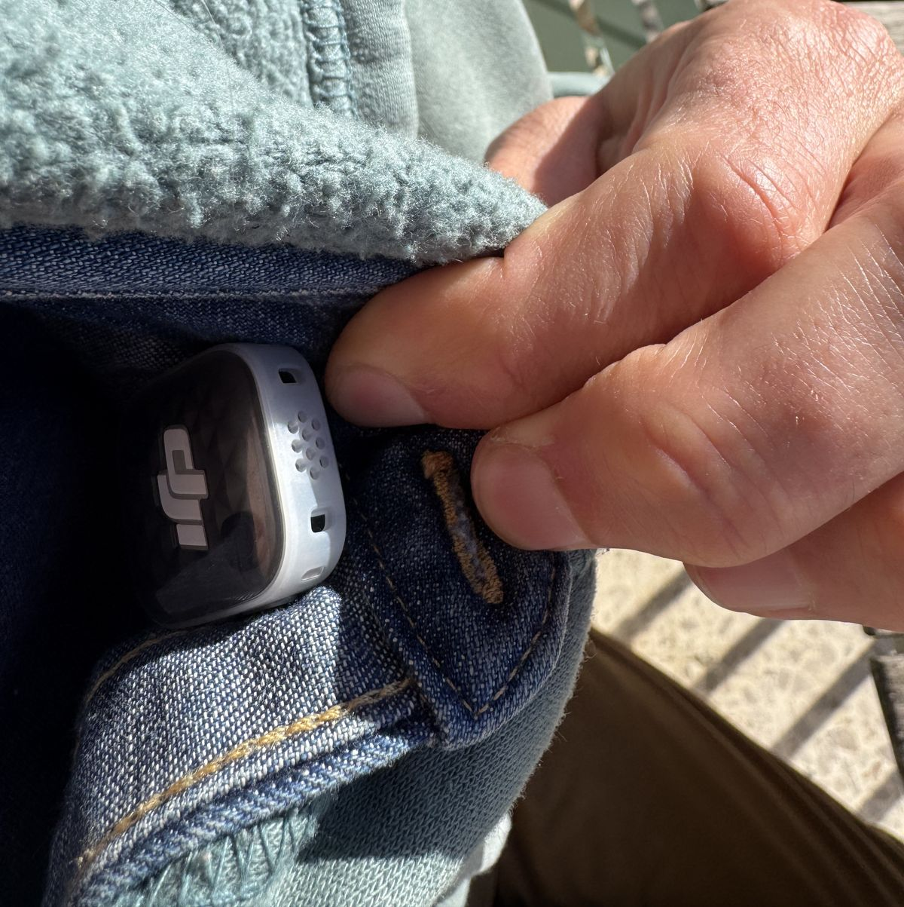
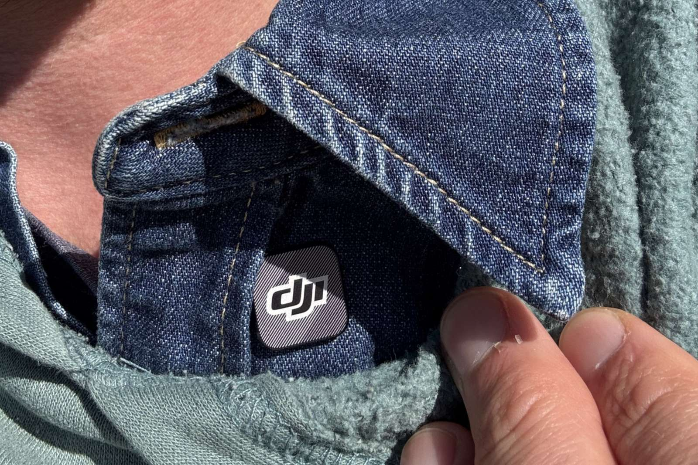
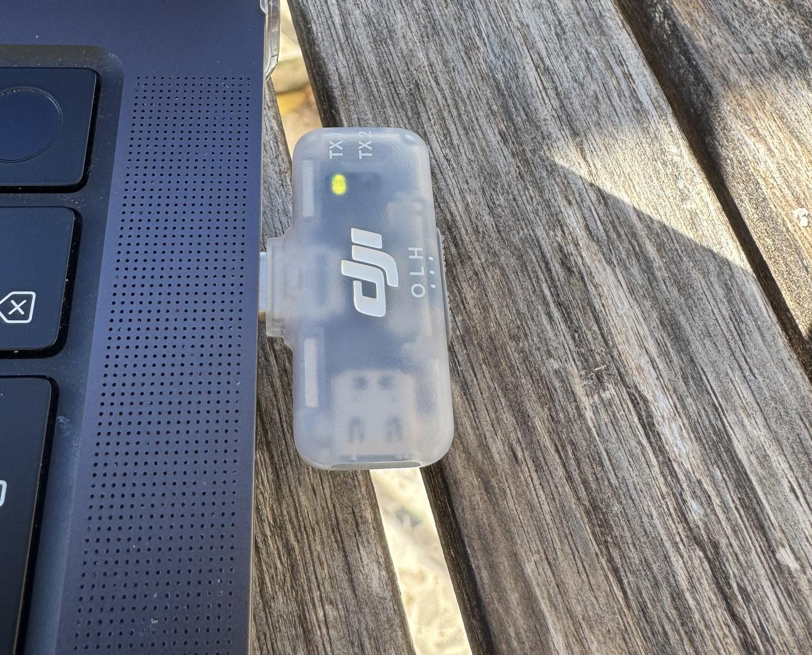

Je ne tape presque plus. Toute la journée, je parle à mes agents de code, avec un petit micro sans fil sur le col, et ça a changé ma façon de travailler avec eux.

Voilà un message que j'ai envoyé le 25 novembre au soir à Poulpito, le [méta-agent qui pilote mes autres agents](/blog/un-meta-agent-pour-piloter-mes-agents-de-code). C'est la transcription brute, mots déformés compris (j'y reviens plus bas) :

> J'ai fini parce que c'était en cours sur Hot Greenfield, est-ce que tu peux supprimer le Word Tricourt et en recrée un pour supprimer tous les commentaires comme j'avais fait dans une paire, tu reprends l'esprit de cette paire pour savoir quel commentaire il faut supprimer ou pas et un deuxième Wrice ça Khadi bien les deux ensemble pour pour mettre tous les schémas d'architecture que je t'ai déjà partagé qui sont notamment dans l'article de blog sur le Red faire un propre mettre le voilà et après on va faire un troisième tri pour déployer tout ça sur quelque part, je sais pas moi, j'imagine Claude Flöhr mais je pas très facile, j'en sais rien ça c'est moins c'est moins prioritaire

## Je pense en parlant

Ce message, je ne l'aurais jamais tapé. Il y a trois tâches, leur ordre, une PR à prendre comme modèle, l'article où trouver les schémas, et une hésitation sur l'hébergement (« je sais pas moi, j'imagine Claude Flöhr »). À l'oral, je parle vraiment comme si je réfléchissais à voix haute : je dis ce que je veux, pourquoi, ce que j'ai déjà fait ailleurs, ce dont je ne suis pas sûr. C'est exactement le contexte dont un agent a besoin.

Ça me libère aussi la tête. Je n'ai plus à mettre en forme ce que je pense avant de l'envoyer : je parle plus naturellement, et je réfléchis pendant que je parle. Je relis d'ailleurs rarement ce que j'envoie. C'est la réponse de l'agent qui me sert de relecture. Ce soir-là, Poulpito avait tout compris :

> C'est lancé dans auth-greenfield :
>
> - **L'ancien worktree est supprimé.** Il était propre et tout était déjà dans main.
> - **Agent 1, les commentaires** : il reprend les règles de ta PR 1 […]
> - **Agent 2, la doc et les schémas** : un README propre et une `architecture.md` à jour. Il remplace les vieux schémas par ceux de l'article SSO […]
>
> **Le déploiement**, peut-être sur Cloudflare, est noté sur la tâche auth-greenfield. On le lance quand les deux PR seront mergées.

Si une ligne ne correspond pas à ce que je voulais dire, je le vois tout de suite. Et surtout, ça va beaucoup plus vite qu'au clavier.

Ça s'emboîte bien avec un méta-agent. Je ne parle qu'à un seul agent : pas d'onglet à choisir, je dis tout à Poulpito, et c'est lui qui répartit le travail entre les autres.

Un effet de bord, au bureau : mes collègues essaient de me faire une prompt injection, en criant dans mon micro plus fort que moi. Pour l'instant, ça n'a pas marché.

## Le micro et la dictée

Le micro, c'est un DJI Mic Mini 2. L'émetteur se met sous la chemise :

Un mini aimant, de l'autre côté du tissu, le tient en place. De l'extérieur, on ne voit qu'un petit carré noir :

Le récepteur se branche directement sur le port USB-C du MacBook, et le Mac le voit comme un micro :

Pour la dictée, j'ai d'abord testé [Wispr Flow](https://wisprflow.ai). Il marche vraiment bien, y compris sur les mots piégeux comme « PR » ou « merge », surtout quand je parle franglais. Mais il est bien trop cher, et je ne voulais pas payer un outil de plus. J'utilise donc [Granola](https://www.granola.ai) : son métier principal, c'est d'enregistrer mes réunions, mais il a aussi un agent de dictée qui fait à peu près la même chose. J'appuie sur une touche, il enregistre et transcrit tout de suite, et le texte arrive dans le chat d'Orca, l'app dans laquelle tournent mes agents.

## Quand ça rate

La transcription déforme surtout les noms propres. Dans le message du début, « Hot Greenfield », c'est auth-greenfield, le repo de notre exploration sur le SSO, « Word Tricourt » un worktree, « une paire » une PR, et « Claude Flöhr » Cloudflare. Le lendemain, j'ai eu « Épistole » pour Episto, un de nos clients, et « Canard Racing » pour Jacanda Racing, mon projet de voile. Poulpito a deviné juste à chaque fois, parce qu'il connaît mes projets et que le reste de la phrase l'aide. Et avec un enregistrement propre, presque tout passe : ma dernière longue dictée est arrivée sans une erreur. Ça marche très bien même avec du bruit autour, grâce à la réduction de bruit active du micro, mais mieux il m'entend, mieux ça marche.

Le seul vrai raté vient justement de ma façon de penser à voix haute : une réflexion ressemble beaucoup à une consigne. Un matin, je lui avais dit « on en parle d'abord » à propos d'une petite page interne, puis j'ai répondu « GitHub Actions et Cloudflare » à sa question sur l'hébergement. Douze secondes plus tard, le repo existait sur GitHub, avec un nom que je n'avais pas encore choisi. Depuis, il a une règle dans sa mémoire : quand je réfléchis à voix haute, il répond, et il attend mon go avant de créer quoi que ce soit.
