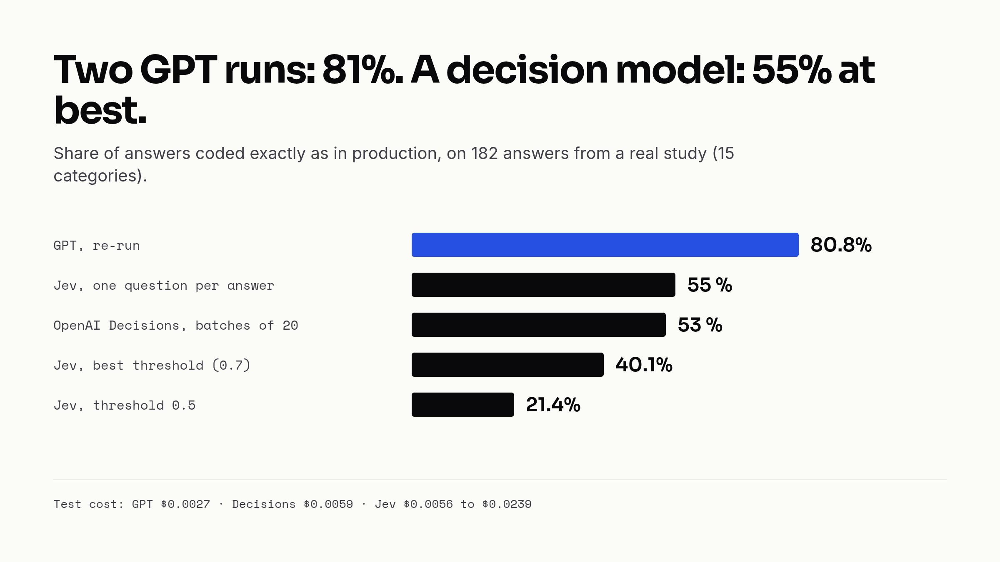
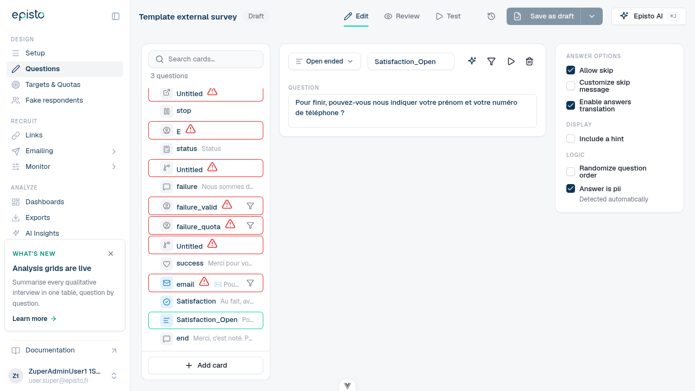

In September, TypeSafe AI released [Jev](https://docs.typesafe.ai), a model that doesn't write text. You give it some context and a list of typed questions, and it answers all of them in one pass with calibrated probabilities. It claims 70 to 500 ms per call, $0.042 per million input tokens, and free output.

In our app, which runs market research studies, we ask GPT many times a day to sort respondents' open answers into categories. On paper, that's exactly what a decision model is for. So we plugged Jev into it, measured, then ran the same test on the [Decisions API](https://developers.openai.com/api/docs/guides/decisions) that OpenAI released a few weeks later. We kept neither for that job. One of them is in production for something else, though.



## A model that decides instead of writing

A decision model takes a `state` (text or JSON) and questions of three kinds: a choice among up to 255 options, a score on a scale, or a yes/no question that returns the probability of "yes". Each question gets its typed answer and its probabilities, never a sentence.

The difference with an LLM matters for what comes next: the model evaluates each question on its own, in parallel. That's what makes it fast. It's also what will hurt us.

## The use case: coding open answers

A study asks "What did you take away from this ad?" and gets a few hundred free-text answers. We code them into 10 to 15 categories, often several per answer, plus a sentiment. Today GPT (gpt-6-luna) gets a batch of answers with the list of categories, and sends back the codes.

To plug Jev in, we turned each category into a question. For a multiple-choice coding, that's one yes/no question per category, plus one sentiment question per category:

```json
{
  "model": "jev-latest",
  "state": { "research_focus": "Banking app dislikes", "answer": "Slow, ugly, expensive" },
  "questions": {
    "category_2": { "type": "noul", "instructions": "Does what the respondent said in `answer` match the category \"Slowness\"?" },
    "sentiment_2": { "type": "choice", "instructions": "What is the respondent's sentiment about \"Slowness\"?",
                     "criteria": { "positive": "…", "neutral": "…", "negative": "…" } }
  }
}
```

A category was kept above 50% probability. And since Jev only takes one `state` per request, each answer is its own call.

## First test: 120 made-up answers

We wrote 120 answers about a banking app, with 8 well-separated categories and the expected answer for each.

| 120 answers · 8 categories | Perfectly coded | Time | Cost |
| --- | --- | --- | --- |
| GPT, multiple choice | 100% | 16.0 s | $0.0012 |
| Jev, multiple choice | 65.8% | 3.6 s | $0.0035 |
| Jev, threshold 0.8 + question as context | 90.0% | ≈ 3.5 s | $0.0035 |
| GPT, single choice | 97.5% | 12.3 s | $0.0012 |
| Jev, single choice | 95.0% | 3.2 s | $0.0025 |

Jev is four times faster, and with two tweaks it gets to 90%. Encouraging, except that the set is easy, and the expected answers were written by Claude, a model of the same family as GPT. So, a second test.

## Second test: a real production coding

With the internal GDPR go-ahead, we took 192 answers from a real study (an ad post-test), emails and phone numbers masked in the SQL query itself, with its 15 categories and the sentiment. There are no human labels, so we compare everything with the GPT coding done in production. To get a baseline, we ran GPT a second time: **two GPT runs only agree on 81% of the answers**. That's the ceiling.

| 192 answers · 15 categories + sentiment | Same codes as prod GPT | F1 | Time | Cost |
| --- | --- | --- | --- | --- |
| GPT, re-run | 80.8% | 90.5% | 34.4 s | $0.0027 |
| Jev, threshold 0.5 | 21.4% | 64.9% | 6.2 s | $0.0239 |
| Jev, best threshold (0.7) | 40.1% | 71.9% | ≈ 6 s | $0.0239 |

At best 40% against 81%, nine times the cost, five times the speed.

## Why it doesn't work

We read 22 disagreements by hand, and GPT was right in most of them. Two problems explain almost all of them.

**Each category is judged alone.** A yes/no question about "Other answers" can't know the other categories didn't match: catch-all categories only make sense compared with the rest. Jev missed "Other answers" 11 times. It also added categories: "no idea" got "No idea", but also "Unclear ad".

**No threshold works.** The right categories score between 0.5 and 0.7, just like the wrong ones. Raising the threshold removes as many right codes as wrong ones.

## Why it costs more

The price per token is lower than GPT's. The number of tokens is not.

GPT reads the 15 categories once per batch and writes only the codes: about 54 tokens per answer, output included. Jev asks 30 questions per answer, each one carries its instructions, and every request adds 250 to 300 tokens of overhead: about 3,000 tokens per answer. **Cost grows with answers × categories.** The richer the coding frame, the more Jev costs.

We tried three levers before giving up:

| Lever | Tokens / answer | Cost | Same codes as prod GPT |
| --- | --- | --- | --- |
| One `choice` question + one sentiment per answer | 737 | $0.0056 | 55% |
| Lighter yes/no questions | 691 | $0.0053 | 34% at best |
| Jev when confident, GPT otherwise (51% sent to GPT) | n/a | $0.0070 | 75% |

None beats GPT on both cost and reliability. And for the record, coding all of our open answers with GPT costs around $6 per quarter. Cost was never the real argument.

## OpenAI Decisions: same idea, same ceiling

OpenAI announced its own version at DevDay on September 29: `POST /v1/decisions`, on gpt-6-luna, $0.10 per million input tokens, free output. Two differences matter to us: up to 400 questions per request, so we can batch answers, and it's OpenAI, which already processes this data. No new vendor to get approved.

| 182 distinct answers · 15 categories | Same codes as prod GPT | Main category right | Tokens / answer | Cost | Time |
| --- | --- | --- | --- | --- | --- |
| GPT, re-run | 80.8% | n/a | ≈ 54 | $0.0027 | 34.4 s |
| Jev, one `choice` per answer | 55% | 88% | 737 | $0.0056 | 4.0 s |
| Decisions, one `choice`, batches of 20 | 53% | 86% | 326 | $0.0059 | 1.5 s |
| Decisions, 15 predicates, batches of 20 | 52% | n/a | 2,352 | $0.0428 | 2.4 s |

Same ceiling as Jev: the problem is the principle, not the vendor. The main category is usually right, but secondary ones are rarely assigned (19 multi-category answers against 67 for GPT). And on "idk" or "I don't know", the API sent back a refusal with no answer at all.

We also wanted to know if we were paying for speed. We counted the tokens actually sent and compared them with what the API billed: **about 150 tokens per question, whatever its size**.

| A batch of 20 answers | Tokens sent | Tokens billed |
| --- | --- | --- |
| 40 questions (one choice + one sentiment per answer) | 3,822 | 6,556 |
| 300 questions (15 yes/no per answer) | 8,062 | 47,036 |

Same unit price as GPT: we pay for the number of questions. Indirectly, yes, that's the price of the speed: each question is an independent evaluation.

## Where it works: one yes/no question

Our survey editor has an "Answer is pii" option on open questions. It excludes the answers from every AI feature and triggers a reminder to delete them once fieldwork is over. Over six months, one open question out of 1,559 had it ticked. About thirty others asked for a first name, a phone number or an email.

A single yes/no question, short text, no respondent data: that's exactly what a decision model is good at. On 181 production questions (11 of them PII):

| Approach | Precision | Recall | Average time |
| --- | --- | --- | --- |
| Keywords | 13.6% | 100% | instant |
| OpenAI Decisions | 100% | 100% | 0.31 s |
| GPT | 100% | 100% | 2.17 s |

Keywords mix up "your name" with "brands you know, even just by name". Both models make no mistake, and Decisions is sharply decided: 0.99 to 1.0 on the PII questions, 0.05 at most on the others. We picked Decisions, seven times faster for a negligible cost.

The prompt lives in an agent, like our other AI features, on a new base class next to the ones for the Responses API:

```ruby
class Ai::Agents::PiiQuestionDetection < Ai::Agents::Decision
  QUESTION = 'pii'

  def initialize(question:, survey: nil, user: nil)
    super(feature_token: :pii_detection, survey:, user:)
    @question = question
  end

  private

  def input = "Open-ended survey question: #{@question}"

  def questions
    [{ type: 'predicate', name: QUESTION, instructions: }]
  end
end
```

The base's `call` goes through the same wrapper as every other LLM call, so each detection shows up in Langfuse with its cost and its user (the wrapper is described in [our article on LLM observability](https://qraft.tech/en/blog/llm-observability-what-langfuse-sees-and-what-it-doesn-t)).

The rules took longer than the model. A code review found two traps before merging: an old card could flip to PII on an unrelated save, in the middle of fieldwork, and a client going through our MCP server couldn't undo a detection. Now:

- the option is ticked above 0.8, with a "Detected automatically" label;
- detection only runs when the question is created or its text changes;
- any change of the checkbox by a person becomes a manual choice, never overwritten;
- an API error never blocks the save: the card goes `pending` and detection is retried on the next save.



In its first five days in production: 44 calls, no failure, about 250 tokens per call, a tenth of a cent in total.

## What we take away

A decision model is not a cheaper LLM. It's excellent at one well-posed yes/no question, and poor as soon as several linked options must be compared, which is exactly what coding open answers is.

What's left:

- Fix the thirty or so PII questions already in production, and plug the detection into the other survey generators.
- Try Decisions on single-choice codings, where its main category is right 86% of the time.
- Work on GPT itself: re-run a coding, and one answer in five changes codes 😅
